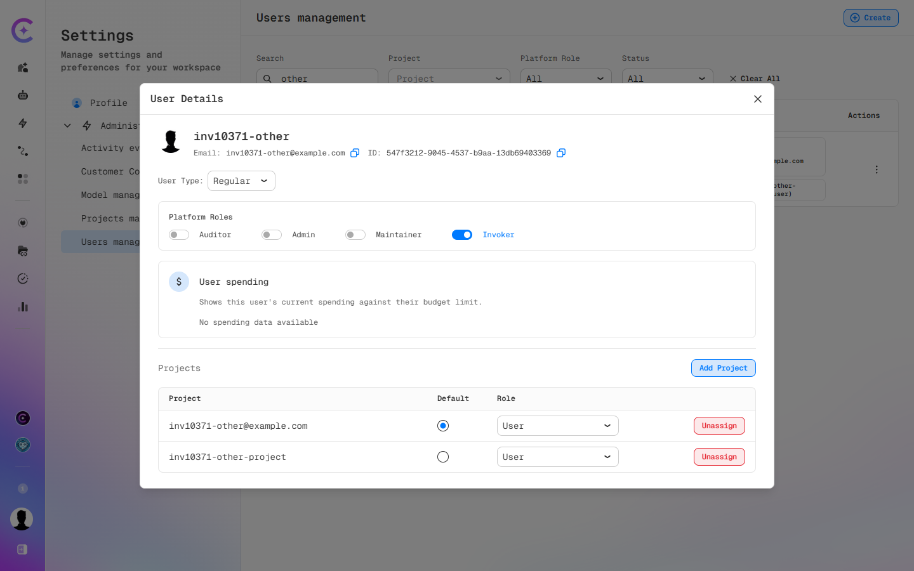

The **Invoker** role limits a user to running shared assistants and workflows and to managing their own conversations and personal integrations. For what the role looks like to the user, see the [Invoker Role](../../../user-guide/project-user-management/invoker-role.md) user guide.

## Prerequisites

- **Platform-managed mode** (`ENABLE_USER_MANAGEMENT=true`) or local authentication (`IDP_PROVIDER=local`). The role is not supported in IDP-claims mode, see [IDP-claims Mode](#idp-claims-mode).
- `ACTIVITY_EVENTS_ENABLED=true` if you need the [audit trail](#audit-events). With the flag off the Invoker still works, but nothing is recorded.

## Assigning the Role

Platform Maintainers and Admins assign the role from **Settings → Administration → Users management**.

1. Open the **User Details** panel of the user.
2. In the **Platform Roles** block, toggle **Invoker** on.
3. Save.



- A **Maintainer** sees the Auditor, Admin, Maintainer, and Invoker toggles.
- An **Admin who is not a Maintainer** sees only the Invoker toggle. The toggles of an Admin or Maintainer user are disabled for them with the note _"Only a Maintainer can change the roles of an Admin or Maintainer."_

The users list has an **Invoker** column, and **Invoker** is an option of the **Platform Role** filter. Filtering by it leaves only the Invoker users.

### Mutually exclusive roles

Invoker cannot be combined with **Admin**, **Maintainer**, **Auditor**, or **Project Admin**.

- In the interface, switching one of them on for an Invoker (or Invoker on for one of them) swaps the roles: the previous one is switched off.
- The API refuses a request that sets both flags with **422 `Invalid role combination`**.

### Users who own triggers or schedulers

The assignment is refused with **422 `Invoker role unavailable`** while the user owns active triggers (for example webhooks) or schedulers, because an Invoker cannot manage them. The interface shows a message about active schedulers or webhooks and leaves the toggle off. Disable or delete the user's triggers and schedulers first.

## Denied Requests

An Invoker's API calls are checked against an allow-list. Anything not on it is refused with **HTTP 401 `Access denied`** (not 403). This covers, among others: projects, datasources (`/v1/index`), skills, schedulers, analytics, admin routes, project integrations, workflow creation, prebuilt workflows, and LLM model lists. Changing or deleting an assistant answers 401 as well.

Some refusals use another code:

| Request                                                                            | Answer                           |
| ---------------------------------------------------------------------------------- | -------------------------------- |
| Chat request that sets `llm_model` or `system_prompt`, or an assistant create body | 422 `Invalid request body`       |
| Conversation update that changes the model or image-generation settings            | 403 `Access denied`              |
| Cloning a non-Marketplace or foreign assistant                                     | 403                              |
| Creating an integration of a type the Invoker does not need                        | 422 `Credential type not needed` |

Requests to another user's conversations, executions, files, and integrations are refused as well. Every refusal is recorded as an `invoker.restriction.blocked` event when auditing is on.

### Tool output visibility

An Invoker may see tool error text and tool outputs in the thoughts of a response, as any user of a shared assistant does. Assistant owners can set `hide_tool_outputs` on their assistant to hide them.

## Credentials

An Invoker's tools use only:

1. the Invoker's own **USER** integrations, and
2. the credential that the assistant author **pinned** on the toolkit or tool settings.

Every other credential that the normal lookup would find (the project default, a project search result, another user's integration, the publisher's unpinned credential) is dropped before it is decrypted. Users who are not Invokers are not affected by this rule.

:::warning Pin a project credential for Invokers
A credential pinned to the **author's personal USER integration** resolves only for the author. For an Invoker it does not resolve. If you want Invokers to run your assistant, pin a **PROJECT** integration on its toolkits.
:::

An assistant without a pinned project credential works for an Invoker only after the Invoker creates their own integration; until then the assistant details page shows the **Integration needed** banner.

Related platform behavior: a user who is not an Invoker can no longer bind or use another user's USER integration or an integration of a project they are not a member of. Such a request is refused with **403 `Integration is not accessible`**.

## Audit Events

Invoker actions are written to the activity events table under the `invoker` domain, readable on the **Activity events** page (**Settings → Administration**) and through `GET /v1/admin/activity-events`. Requires `ACTIVITY_EVENTS_ENABLED=true`.

| Event type                                  | Recorded when                                                |
| ------------------------------------------- | ------------------------------------------------------------ |
| `invoker.chat.turn`                         | The Invoker sends a chat message                             |
| `invoker.workflow.execution`                | The Invoker starts a workflow execution                      |
| `invoker.assistant.cloned`                  | The Invoker clones a Marketplace assistant                   |
| `invoker.integration.created`               | A personal integration is created                            |
| `invoker.integration.updated`               | A personal integration is edited                             |
| `invoker.integration.deleted`               | A personal integration is deleted                            |
| `invoker.restriction.blocked`               | A request is refused by an Invoker restriction               |
| `invoker.mapping.bound`                     | An integration is bound to an assistant                      |
| `invoker.credential.tested`                 | An integration test succeeds (a failed test records nothing) |
| `invoker.file.uploaded`                     | A file is uploaded                                           |
| `invoker.file.rejected`                     | A file of another user is used in a chat or workflow run     |
| `invoker.execution.aborted`                 | A workflow execution is aborted                              |
| `invoker.execution.resumed`                 | An interrupted execution is resumed                          |
| `invoker.execution.output_updated`          | A step output is edited                                      |
| `invoker.execution.output_change_requested` | Changes to a step output are requested                       |
| `invoker.execution.deleted`                 | A workflow execution is deleted                              |
| `invoker.conversation.deleted`              | A conversation is deleted                                    |
| `invoker.feedback.submitted`                | Feedback is given on a response                              |
| `invoker.feedback.deleted`                  | Feedback is removed                                          |
| `invoker.oauth.initiated`                   | An OAuth sign-in for an integration is started               |

:::warning
With `ACTIVITY_EVENTS_ENABLED=false` the Invoker role keeps working and its restrictions still apply, but **no audit rows are written**. Enable the flag before relying on the audit trail.
:::

## IDP-claims Mode

The Invoker role is **not supported** when `IDP_PROVIDER` is not `local` and `ENABLE_USER_MANAGEMENT=false` (roles come from the identity provider token claims).

- The role cannot be assigned: user management is not available in this mode.
- A stored `is_invoker` flag is **ignored**: authentication builds the user from token claims without reading the users table, so the user is not restricted.
- At startup the backend checks for stored Invoker rows. If any exist it logs an **ERROR** and continues to start:

  ```text
  Invoker role is unsupported in IDP-claims mode: users rows with is_invoker=true exist but have no request-time effect. Clear them or switch mode (IDP_PROVIDER=local or ENABLE_USER_MANAGEMENT=true).
  ```

If you see this error, either clear the flag for those users, or set `IDP_PROVIDER=local` or `ENABLE_USER_MANAGEMENT=true`.

:::note Database migration
The role adds a `users.is_invoker` column (default `false`). The migration is additive; downgrading drops the column and loses the flags.
:::
