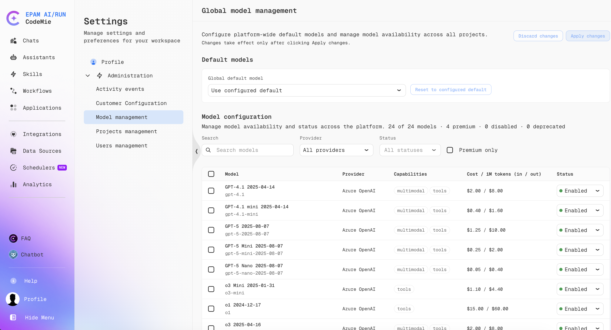
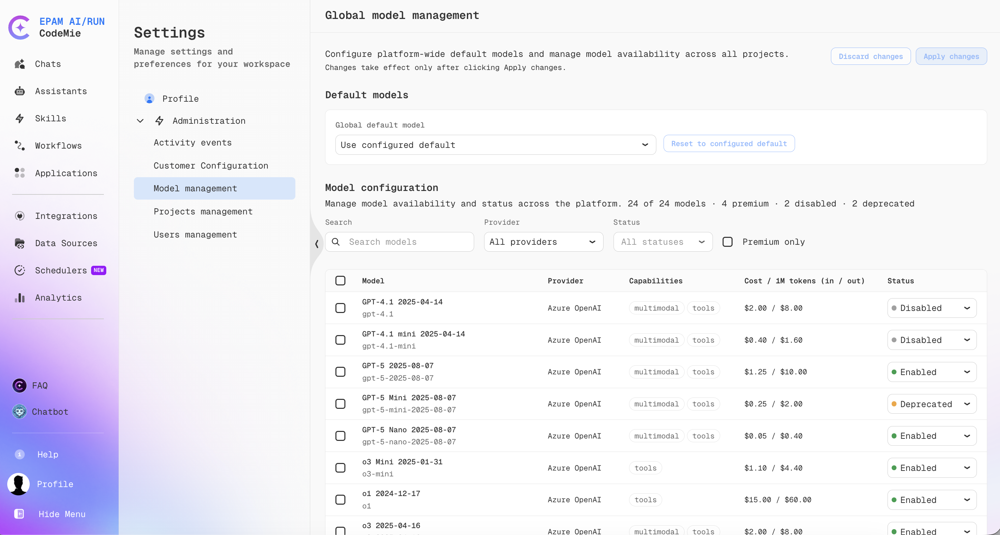
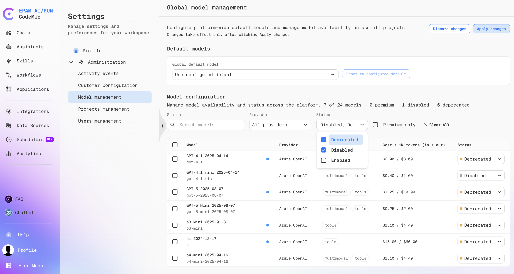
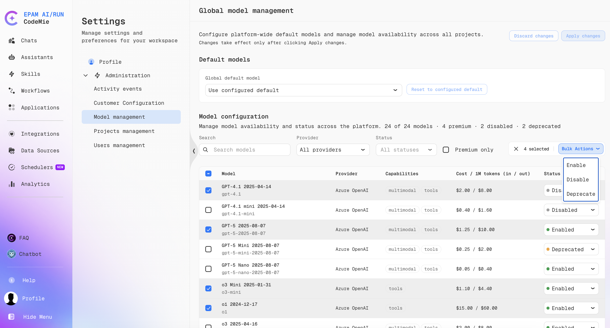
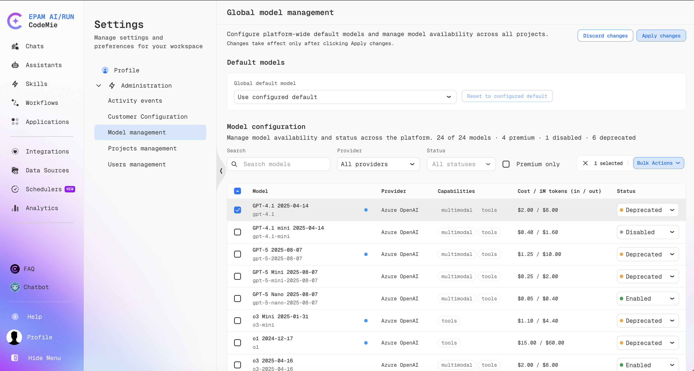
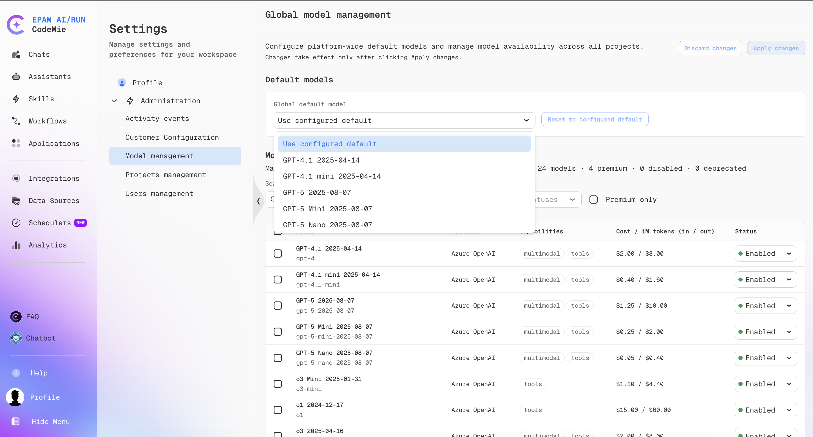

# Global Model Management

The **Global model management** page lets platform administrators control which AI models are available across the entire platform, set their status (enabled, deprecated, or disabled), and choose the global default chat model. Changes are staged in the UI and take effect only after clicking **Apply changes**.

The model catalog is read from whatever LLM integration is configured for the deployment — LiteLLM Proxy or a native provider. Administrators see all models regardless of their personal project membership.

## Accessing Global Model Management

1. Click the **Profile** icon in the bottom-left corner and select **Settings**.
2. In the left sidebar, navigate to **Administration → Model management**.

The page requires the global `admin` role. It is not visible to users with the maintainer, auditor, or project admin role.



## Model Catalog

The table on the page lists every chat and embedding model available on the platform.

| Column               | Description                                                                                            |
| -------------------- | ------------------------------------------------------------------------------------------------------ |
| **Model**            | Display label and internal base name. An **Unsaved Changes** badge appears on rows with pending edits. |
| **Provider**         | The cloud or proxy provider (e.g., Azure OpenAI, AWS Bedrock, Google Vertex AI).                       |
| **Capabilities**     | Capability chips for multimodal input, tool use, and image generation (chat models only).              |
| **Cost / 1M tokens** | Input and output cost in USD per million tokens, where declared in the model configuration.            |
| **Status**           | Current model status. See [Model statuses](#model-statuses) below.                                     |

Rows with a faint amber background are **premium models**. Their cost is highlighted in amber in the **Cost** column.

Synthetic switchyard routers have a computed, read-only status. Their status reflects the underlying models they route across and cannot be changed directly.

## Model Statuses

Each model carries one of three statuses. Status changes are stored in the platform database as overrides on top of the deployment configuration, so they survive restarts and proxy reloads.

| Status         | Effect on new work                                                                | Effect on existing work                                                                                       |
| -------------- | --------------------------------------------------------------------------------- | ------------------------------------------------------------------------------------------------------------- |
| **Enabled**    | Available for selection in assistants, workflows, and chat.                       | Continues to work normally.                                                                                   |
| **Deprecated** | Cannot be selected for new assistants, new workflows, or as a new global default. | Existing assistants and workflows continue to use the model and can still run.                                |
| **Disabled**   | Cannot be used. Any new request specifying this model is rejected.                | Existing work is redirected to an available replacement model. If no replacement is available, requests fail. |

:::warning
Disabling a model that is actively used in production assistants or workflows will redirect those requests to an available replacement. Verify that a suitable replacement exists and that dependent assistants and workflows will continue to function before disabling.

Deprecating a model first is the recommended path: it blocks new selections while letting existing work continue unaffected, giving time to migrate.
:::



## Filtering the Catalog

Use the filter controls above the table to narrow down the model list:

- **Search**: matches against the model label and base name (case-insensitive).
- **Provider**: filters to a single provider from those present in the catalog.
- **Status**: multi-select filter; leaves all statuses visible when nothing is selected.
- **Premium only**: hides non-premium models.

The status summary line below the section heading reflects the filtered count. Filtering away a row that is currently selected also removes it from the selection automatically.



## Changing Model Status

### Single Model

1. Locate the model in the table.
2. Use the status selector in the **Status** column to choose **Enabled**, **Deprecated**, or **Disabled**.
3. The row shows an **Unsaved Changes** badge.
4. Click **Apply changes** to persist all pending edits.

### Bulk Update

1. Use the checkboxes to select one or more models. The header checkbox selects all visible and editable models. Switchyard routers cannot be selected.
2. The **Bulk actions** control appears above the table.
3. Choose the target status from the **Bulk actions** menu.
4. Click **Apply changes** to persist.



## Applying and Discarding Changes

All pending edits — both status changes and global default changes — are saved together.

- **Apply changes**: Saves all pending edits to the platform. The button is disabled when there are no changes or when no enabled model exists for the global default to resolve to.
- **Discard changes**: Reverts all pending edits to the last saved state.

If the page is left with unsaved changes and navigation is attempted, a confirmation prompt appears.



## Global Default Model

The **Default models** section controls which model is used when an assistant or workflow has no explicit model selection (for example, when the configured model is unavailable or when a new assistant is created without a model preference).

### Options

| Option                     | Behavior                                                                                                                                          |
| -------------------------- | ------------------------------------------------------------------------------------------------------------------------------------------------- |
| **Use configured default** | Defers to the deployment-level default from the LiteLLM configuration or native LLM config. This is the initial state for every fresh deployment. |
| **A specific model**       | Uses the selected model as the platform-wide default, overriding whatever the deployment configuration declares.                                  |

Only enabled chat models that are not switchyard routers appear in the default model selector. Deprecated models are excluded.



### Setting the Default

1. In the **Default models** section, open the selector.
2. Choose **Use configured default** to defer to the deployment configuration, or select a specific model.
3. The selector shows an **Unsaved Changes** badge when the selection differs from the last saved state.
4. Click **Apply changes**.

If the saved default model is later disabled or becomes unavailable, the platform falls back to the next available enabled model automatically. The **Default models** section shows an informational notice when this fallback is active.

### Clearing the Override

Selecting **Use configured default** from the dropdown and then clicking **Apply changes** removes the admin override and returns to the deployment-level default.

## Model Retirement (API)

When a deprecated model needs to be fully removed from the platform, the retirement API replaces all references to it across assistants, assistant configurations, and workflows with a nominated replacement.

Retirement is available via the platform API only; there is no UI for it in the current release. All affected records keep their original update timestamps.

```
POST /v1/admin/llm/retire
```

| Field                    | Type    | Description                                                                     |
| ------------------------ | ------- | ------------------------------------------------------------------------------- |
| `deprecated_model`       | string  | Base name of the model to retire.                                               |
| `replacement_model`      | string  | Base name of the model that replaces it.                                        |
| `check_models_existence` | boolean | When `true`, validates that both models exist in the catalog before proceeding. |

For bulk retirement of multiple model pairs in a single call:

```
POST /v1/admin/llm/retire/bulk
```

The bulk endpoint processes each pair independently. A failure on one pair does not affect the others; per-item results are returned in the response.

## Reloading the Model Catalog

When new models are added to or removed from the LiteLLM Proxy configuration without restarting the CodeMie API pod, the catalog can be refreshed:

```
GET /v1/admin/reload
```

This clears the in-memory model cache and re-fetches the model list from the proxy. The catalog on the Global model management page reflects the refreshed list after the next page load.

## Related Configuration

- [AI Models Integration](./ai-models-integration/index.md) — configure model providers and routing at the deployment level.
- [LiteLLM Model Configuration](../extensions/litellm-proxy/model-configuration.md) — add and configure models in the LiteLLM Proxy `config.yaml`.
- [Customer Feature Configuration](./customer-feature-configuration.md) — the `features:projectModelOverride` flag enables a per-project model allow-list and default model selector on project detail pages.
