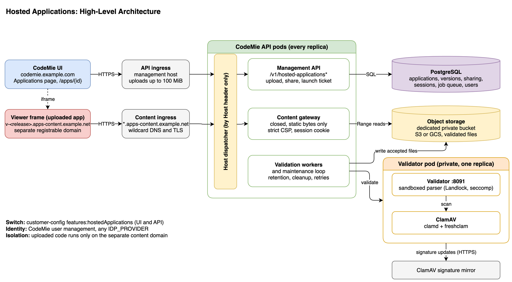

# Custom Applications (Hosted Applications)

Hosted applications let CodeMie users upload a small static web page (one HTML file or a ZIP of a prebuilt static build), share it, and open it inside CodeMie on the **Applications** page. The feature is intended for **presentations**: slides, reports, and demos.

CodeMie only stores and serves static files. The one exception is the automatic preview: after a version passes validation, the validator takes one picture of its start page in a sandboxed browser, and the application card uses it as a cover (see [Automatic preview](#automatic-preview)). Uploaded pages run in the viewer's browser on a separate content domain, so they cannot access CodeMie cookies, tokens, or data. They also cannot make network requests, submit forms, open dialogs, or load external resources. They can switch to full screen and open pop-up windows, which keep the same sandbox.

:::info Off by default
While the feature is off, the Applications page shows only Platform apps and no hosted background work runs.
:::

## Architecture



| Component      | Role                                                                                                                                                       |
| -------------- | ---------------------------------------------------------------------------------------------------------------------------------------------------------- |
| CodeMie API    | Management API, content gateway, and validation workers. One process serves both hosts by `Host` header.                                                   |
| Content domain | A separate registrable domain. Each version is served from `v-<version ID>.<content domain>`, and its viewer frame from `w-<version ID>.<content domain>`. |
| Validator      | A private deployment that checks every upload in a sandboxed parser and takes the automatic preview in a sandboxed Chromium renderer. Exactly one replica. |
| ClamAV         | A separate private deployment that scans uploads for malware on behalf of the validator.                                                                   |
| Object storage | A dedicated private S3 or GCS bucket for the validated files.                                                                                              |
| PostgreSQL     | Applications, versions, sharing, sessions, and the job queue.                                                                                              |

## Prerequisites

| Area            | Requirement                                                                                                                                                                  |
| --------------- | ---------------------------------------------------------------------------------------------------------------------------------------------------------------------------- |
| Content domain  | A separate registrable domain, for example `apps-content.example.net` when CodeMie runs on `example.com`. Never a subdomain of CodeMie or the identity provider.             |
| DNS and TLS     | Wildcard DNS `*.<content domain>` to the ingress and a wildcard certificate.                                                                                                 |
| Identity        | `ENABLE_USER_MANAGEMENT=true`. Any installed `IDP_PROVIDER` works.                                                                                                           |
| Storage         | A dedicated private bucket, with `FILES_STORAGE_TYPE` set to `aws` (S3) or `gcp` (GCS). Azure is not supported yet.                                                          |
| Validator nodes | Linux amd64 nodes with Landlock ABI 3 or later (normally Linux 6.2 or later). On GKE, a dedicated Ubuntu node pool (not Autopilot). See [Validator nodes](#validator-nodes). |

## Configuration

### Feature switch and API settings

- **Feature switch.** Enable the `features:hostedApplications` component in the customer configuration. It controls the UI and the API together. See [Customer Feature Configuration](./customer-feature-configuration.md#advanced-features).
- **API settings.** The `HOSTED_APPS_*` variables are listed in the [API Configuration Reference](./api-configuration.md#hosted-applications).

If the feature is enabled but the deployment cannot run it safely, it stays off and the API logs `Hosted applications are enabled but unavailable: <reason>`. The reason names the failing setting.

### UI

The CodeMie UI needs no configuration of its own. It reads `features:hostedApplications` from `GET /v1/config` and gets the content address from the API when a user opens an application. Two things to check:

- `FRONTEND_URL` on the API must match the address users open in the browser.
- If your edge adds a `Content-Security-Policy` to the UI host, its `frame-src` must allow `https://*.<content domain>`.

### Validator and ClamAV

The validator and ClamAV are deployed by the CodeMie Helm chart, as two separate deployments. Both are off by default. Enable them with the `features.tools.hosted-apps` block of the chart values, using the validator image supplied with the release:

```yaml
features:
  tools:
    hosted-apps:
      enabled: true
      validator:
        image:
          repository: <registry>/codemie-hosted-validator
      ingress:
        host: "*.<content domain>"
```

| Value                                                                               | Description                                                                                                   |
| ----------------------------------------------------------------------------------- | ------------------------------------------------------------------------------------------------------------- |
| `enabled`                                                                           | Renders the validator, ClamAV, and content Ingress. Default `false`.                                          |
| `validator.image.repository`                                                        | Validator image. The tag defaults to the API image tag.                                                       |
| `ingress.host`                                                                      | Required. Wildcard host of the content Ingress, for example `*.apps-content.example.net`.                     |
| `ingress.enabled`, `ingress.ingressClassName`, `ingress.tls`, `ingress.annotations` | Optional. Content Ingress is enabled by default with class `nginx`. Put the wildcard certificate under `tls`. |
| `namespace.name`, `namespace.create`                                                | Namespace of the validator and ClamAV (default `codemie-hosted-apps`), and whether the chart creates it.      |
| `clamdConfig.existingConfigMap`                                                     | Optional. Use your own ConfigMap (key `clamd.conf`) instead of the one the chart creates.                     |

The validator Service is `codemie-hosted-apps-validator` and runs in the `namespace.name` namespace, which is separate from the API by default. Set `HOSTED_APPS_VALIDATOR_URL` to the full service name, `http://codemie-hosted-apps-validator.<namespace>.svc:8091`, and create the `codemie-hosted-applications` Secret in the validator namespace as well, with the key `validator-key` (the API reads `HOSTED_APPS_VALIDATOR_KEY` from the same value). The chart sets the validator and ClamAV environment variables itself.

:::caution Exactly one replica
Validation results live in the validator instance that produced them. Do not scale the validator above one replica. While it restarts, uploads wait and viewing is not affected.
:::

### Validator nodes

The validator parses uploads in a kernel sandbox (Landlock and seccomp) and exits at startup if the node cannot enforce it. On such a node the pod crash-loops with `Parser isolation is not enforced on this node`.

Run the validator on Linux amd64 nodes with Landlock ABI 3 or later (normally kernel 6.2 or later). On GKE, the default Container-Optimized OS image is built without Landlock, so place the validator on a dedicated Ubuntu node pool with the `validator.nodeSelector` and `validator.tolerations` chart values. The API and ClamAV can stay on the default nodes. GKE Autopilot nodes always run Container-Optimized OS, where Landlock is disabled, so the validator cannot run on Autopilot; use a GKE Standard node pool.

### Automatic preview

When an application has no uploaded cover and no cover image in its files, its card shows a picture of the start page. The validator takes this picture once for each version that passes validation. It needs no extra pod, Service, or image: the renderer is a child process of the validator, and the validator image contains a pinned Chromium version.

How the renderer works:

- It opens the start page at 1280 × 800 px with no network access. Every request is answered from the files of the version, and all other requests fail.
- It takes one JPEG (at most 1 MiB and 2048 px per side) when the page is quiet, or at 15 seconds. At 20 seconds it stops the browser and there is no picture.
- It runs under the same kernel sandbox as the parser (Landlock and seccomp), with an empty environment and without access to the validator secrets.
- It never changes the validation result. If there is no picture, the card uses the application initials.
- Pages that use WebGL give a blank picture, because the renderer has no GPU. A picture with one color only is not used.

Requirements and settings:

| Item           | Value                                                                                                                                                                                              |
| -------------- | -------------------------------------------------------------------------------------------------------------------------------------------------------------------------------------------------- |
| Memory         | The default validator memory limit is `3Gi` (it was `2Gi`). If `features.tools.hosted-apps.validator.resources` is overridden, raise the limit to at least `3Gi`.                                  |
| Switch         | `VALIDATOR_PREVIEW_CAPTURE` on the validator, `true` (default) or `false`. Any other value stops the validator at start.                                                                           |
| Node kernel    | Landlock ABI 3 or later, as for the parser. Linux 6.12 or later (Landlock ABI 6) also stops the renderer from sending signals to the validator. On ABI 3 to 5 this extra protection is not active. |
| Chromium patch | Rebuild the validator image at least every 4 weeks, and at once after a Chromium security release. The image label `org.codemie.chromium-version` shows the pinned version.                        |

The chart does not set `VALIDATOR_PREVIEW_CAPTURE`. To set it, add it to `features.tools.hosted-apps.validator.env`. Helm replaces lists, so repeat the default entries of that list:

```yaml
features:
  tools:
    hosted-apps:
      validator:
        env:
          - name: VALIDATOR_BIND_HOST
            value: '0.0.0.0'
          - name: VALIDATOR_SERVICE_KEY
            valueFrom:
              secretKeyRef:
                name: codemie-hosted-applications
                key: validator-key
          - name: CLAMD_HOST
            value: codemie-hosted-apps-clamd
          - name: CLAMD_PORT
            value: '3310'
          - name: CLAMD_CONFIGURATION
            value: /etc/clamav/clamd.conf
          - name: VALIDATOR_PREVIEW_CAPTURE
            value: 'false'
```

At start, the validator logs `Preview capture on (chromium=<version>)`, or `Preview capture off (reason=<reason>)` when the switch is `false`, the secrets cannot be hidden, or the renderer self-test fails. When capture is off, validation continues and cards fall back to the other cover sources. `GET /health` on the validator (protected by the service key) also reports `"capture": "on"` or `"off"`.

## Ingress

- **Content hosts.** The chart creates the content Ingress `codemie-hosted-apps-content` when `features.tools.hosted-apps.enabled` and `ingress.enabled` are true. It must route `*.<content domain>`, and only that, to the CodeMie API Service. Keep `Host` unchanged. Do not add authentication, rewrites, caching, or a CDN in front of it, and do not log request bodies, cookies, or `Authorization` headers.
- **Management host.** Uploads carry up to 100 MiB: set the request body limit to at least `110m` and read and send timeouts to at least `900` seconds. The default chart sets `proxy-read-timeout: "600"`, so raise it and add `proxy-send-timeout`.

## Storage

- Use a dedicated private bucket for each deployment. Versioning off, public access blocked.
- S3 needs `s3:GetObject`, `s3:PutObject`, `s3:DeleteObject`, `s3:ListBucket`, `s3:ListBucketMultipartUploads`, `s3:AbortMultipartUpload`, and `s3:ListMultipartUploadParts`. Add a lifecycle rule that aborts incomplete multipart uploads after 1 day.
- GCS needs `roles/storage.objectUser` on the bucket. Add a lifecycle rule that deletes objects under `.staging/` and `.fences/` after 1 day.
- Never delete the `.hosted/storage-id` object. Back up the database and the bucket together.

## Rollout

1. Create the DNS record, wildcard certificate, bucket, and Secret. On GKE, also create the validator node pool.
2. Raise the management ingress limits.
3. Enable `features.tools.hosted-apps` in the chart values and add the API settings.
4. Enable `features:hostedApplications` in the customer configuration.
5. Check that the API log has no `Hosted applications are enabled but unavailable` warning, that the validator and ClamAV deployments are ready, that the validator log has `Preview capture on`, and that `GET /v1/config` reports the feature as enabled.
6. Upload a test page without a cover, check that its card shows a picture of the page, open it, share it with a second user, and sign out.

### Upgrade to a release with the automatic preview

The API and the validator must come from the same release. An older API cannot read a version that has an automatic preview, so a mixed deployment makes the content of such versions unavailable for a short time.

1. Make sure the validator image is built from the same commit as the API image and pushed with the same tag.
2. Deploy the new release with `VALIDATOR_PREVIEW_CAPTURE=false`.
3. When all API pods run the new release, set `VALIDATOR_PREVIEW_CAPTURE=true` and restart the validator.

:::warning Rollback
After versions are accepted with an automatic preview, a rollback to an older release makes the content and the cover of those versions unreadable. No automated repair exists. Before a rollback, read the rollback notes in the repository runbook `hosted-applications/README.md`. To stop new pictures at once, set `VALIDATOR_PREVIEW_CAPTURE=false` and restart the validator.
:::

## Operations

To take an application down immediately, a platform administrator can suspend it from the application's page (**Suspend**) or through the API. A suspended application disappears for everyone except its owner, project administrators, and platform administrators, and it cannot be activated, published, or shared. Existing shares are kept and apply again after the application is reinstated.

```bash
curl -X POST "$CODEMIE_API/v1/admin/hosted-applications/<application id>/security/suspend" \
  -H "Authorization: Bearer $ADMIN_TOKEN" -H "Content-Type: application/json" \
  -H "Idempotency-Key: $(uuidgen)" -d '{"reason": "Phishing report"}'
```

Use `reinstate` instead of `suspend` to clear a suspension. Reinstating needs an `If-Match` header with the current application ETag, and the administrator who reinstates cannot be the application's creator. The body can name another accepted `version_id` to make active, with `delete_previous` to remove the previous version. To stop all hosted content, turn the feature off and restart the API.

## More Information

The repository file `hosted-applications/README.md` is the full operations runbook. It covers secret rotation, backup and restore, metrics, identity details, and residual risks. For end users, see [Hosted Applications](../../../user-guide/applications/hosted-applications.md).
