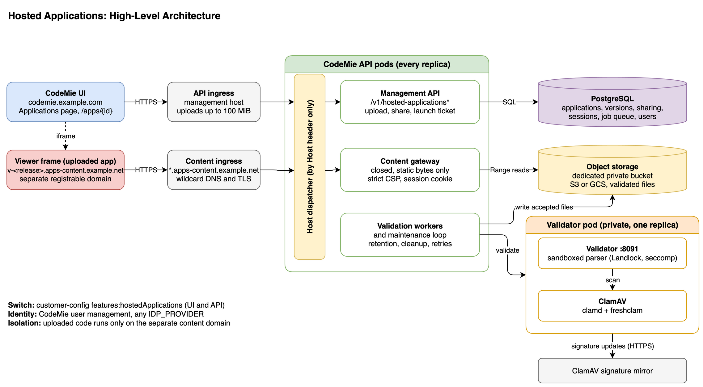

# Custom Applications (Hosted Applications)

Hosted applications let CodeMie users upload a small static web page (one HTML file or a ZIP of a prebuilt static build), share it, and open it inside CodeMie on the **Applications** page. The feature is intended for **presentations**: slides, reports, and demos.

CodeMie only stores and serves static files. Uploaded pages run in the viewer's browser on a separate content domain, so they cannot access CodeMie cookies, tokens, or data. They also cannot make network requests, submit forms, open dialogs or popups, or load external resources.

:::info Off by default
While the feature is off, the Applications page shows only Platform apps and no hosted background work runs.
:::

## Architecture



| Component      | Role                                                                                                     |
| -------------- | -------------------------------------------------------------------------------------------------------- |
| CodeMie API    | Management API, content gateway, and validation workers. One process serves both hosts by `Host` header. |
| Content domain | A separate registrable domain. Each version is served from `v-<release>.<content domain>`.               |
| Validator      | A private deployment that checks every upload in a sandboxed parser. Exactly one replica.                |
| ClamAV         | A separate private deployment that scans uploads for malware on behalf of the validator.                 |
| Object storage | A dedicated private S3 or GCS bucket for the validated files.                                            |
| PostgreSQL     | Applications, versions, sharing, sessions, and the job queue.                                            |

## Prerequisites

| Area           | Requirement                                                                                                                                                      |
| -------------- | ---------------------------------------------------------------------------------------------------------------------------------------------------------------- |
| Content domain | A separate registrable domain, for example `apps-content.example.net` when CodeMie runs on `example.com`. Never a subdomain of CodeMie or the identity provider. |
| DNS and TLS    | Wildcard DNS `*.<content domain>` to the ingress and a wildcard certificate.                                                                                     |
| Identity       | `ENABLE_USER_MANAGEMENT=true`. Any `IDP_PROVIDER` works.                                                                                                         |
| Storage        | A dedicated private bucket, with `FILES_STORAGE_TYPE` set to `aws` (S3) or `gcp` (GCS). Azure is not supported yet.                                              |
| Validator node | Linux amd64 with Landlock ABI 3 or later (normally kernel 6.2+). The validator refuses to start without it.                                                      |
| Database       | Alembic revisions `16001d9b0c1d` and `5c7e1a93b0d4`, applied by the normal migration step.                                                                       |
| Images         | The validator image is built from the same commit as the API image.                                                                                              |

## Configuration

### Feature switch

Enable the `features:hostedApplications` component in `customer-config.yaml`. It controls the UI and the API together.

```yaml
components:
  - id: "features:hostedApplications"
    settings:
      enabled: true
      name: "Custom Applications"
      description: "Upload, share and open custom static web applications on the Applications page"
```

`FEATURE_HOSTED_APPLICATIONS=true|false` overrides `enabled`, but only when the component exists in the file. The flag is read at startup, so restart the API after changing it. See [Customer Feature Configuration](./customer-feature-configuration.md).

If the flag is on but the deployment cannot run the feature safely, the feature stays off and the API logs:

```text
Hosted applications are enabled but unavailable: <reason>
```

The reason names the failing setting, for example a missing content domain, a content domain that shares a registrable domain with `FRONTEND_URL` or the identity provider, a secret shorter than 32 characters, a missing bucket, or `FILES_STORAGE_TYPE=azure`.

### API settings

Set the `HOSTED_APPS_*` variables on the CodeMie API through the `extraEnv` of the `codemie-api` chart, and take secrets from a Kubernetes Secret or your secret manager. All parameters, defaults, and descriptions are in the [API Configuration Reference](./api-configuration.md#hosted-applications). The required ones are `HOSTED_APPS_CONTENT_DOMAIN`, `HOSTED_APPS_CREDENTIAL_SECRET`, `HOSTED_APPS_VALIDATOR_KEY`, `HOSTED_APPS_STORAGE_BUCKET`, and `FILES_STORAGE_TYPE` (`aws` or `gcp`).

The feature also reuses `FRONTEND_URL` (the only origin allowed to embed content) and `JWT_ISSUER` (the organization ID). Do not change `JWT_ISSUER` after users create applications, because applications are stored under it.

```yaml
extraEnv:
  - name: FEATURE_HOSTED_APPLICATIONS
    value: "true"
  - name: HOSTED_APPS_CONTENT_DOMAIN
    value: "apps-content.example.net"
  - name: FILES_STORAGE_TYPE
    value: "aws" # or "gcp"
  - name: HOSTED_APPS_STORAGE_BUCKET
    value: "codemie-hosted-apps"
  - name: HOSTED_APPS_VALIDATOR_URL
    value: "http://codemie-hosted-validator:8091"
  - name: HOSTED_APPS_CREDENTIAL_SECRET
    valueFrom:
      secretKeyRef:
        name: codemie-hosted-applications
        key: credential-secret
  - name: HOSTED_APPS_VALIDATOR_KEY
    valueFrom:
      secretKeyRef:
        name: codemie-hosted-applications
        key: validator-key
```

```bash
kubectl -n codemie create secret generic codemie-hosted-applications \
  --from-literal=credential-secret="$(openssl rand -base64 48)" \
  --from-literal=validator-key="$(openssl rand -base64 48)"
```

### UI

The CodeMie UI needs no configuration of its own. It reads `features:hostedApplications` from `GET /v1/config` and gets the content address from the API when a user opens an application. Two things to check:

- `FRONTEND_URL` on the API must match the address users open in the browser.
- If your edge adds a `Content-Security-Policy` to the UI host, its `frame-src` must allow `https://*.<content domain>`.

### Validator and ClamAV

Deploy the validator and ClamAV as two separate deployments, using the files in the `hosted-applications/` directory of the CodeMie repository (`Dockerfile.validator`, `Dockerfile.scanner`, `clamd.conf`). Neither has access to platform secrets, and only the API can reach the validator.

| Variable                   | Description                                                             |
| -------------------------- | ----------------------------------------------------------------------- |
| `VALIDATOR_SERVICE_KEY`    | Same value as `HOSTED_APPS_VALIDATOR_KEY`.                              |
| `VALIDATOR_BIND_HOST`      | Set to `0.0.0.0` so the Service can reach the validator.                |
| `CLAMD_HOST`, `CLAMD_PORT` | Address of the ClamAV Service.                                          |
| `CLAMD_CONFIGURATION`      | Path of the mounted `clamd.conf`. The validator checks its scan limits. |

:::caution Exactly one replica
Validation results live in the validator instance that produced them. Do not scale the validator above one replica. While it restarts, uploads wait and viewing is not affected.
:::

## Ingress

- **Content hosts.** Route `*.<content domain>`, and only that, to the CodeMie API Service. Keep `Host` unchanged. Do not add authentication, rewrites, caching, or a CDN in front of it, and do not log request bodies, cookies, or `Authorization` headers.
- **Management host.** Uploads carry up to 100 MiB: set the request body limit to at least `110m` and read and send timeouts to at least `900` seconds. The default chart sets `proxy-read-timeout: "600"`, so raise it and add `proxy-send-timeout`.

## Storage

- Use a dedicated private bucket for each deployment. Versioning off, public access blocked.
- S3 needs `s3:GetObject`, `s3:PutObject`, `s3:DeleteObject`, `s3:ListBucket`, `s3:ListBucketMultipartUploads`, `s3:AbortMultipartUpload`, and `s3:ListMultipartUploadParts`. Add a lifecycle rule that aborts incomplete multipart uploads after 1 day.
- GCS needs `roles/storage.objectUser` on the bucket. Add a lifecycle rule that deletes objects under `.staging/` and `.fences/` after 1 day.
- Never delete the `.hosted/storage-id` object. Back up the database and the bucket together.

## Rollout

1. Apply the database migration.
2. Create the DNS record, wildcard certificate, bucket, Secret, `codemie-hosted-clamd` ConfigMap, and the validator and ClamAV deployments.
3. Raise the management ingress limits.
4. Add the API settings and enable `features:hostedApplications`.
5. Check that the API log has no `Hosted applications are enabled but unavailable` warning, that the validator and ClamAV deployments are ready, and that `GET /v1/config` reports the feature as enabled.
6. Upload a test page, open it, share it with a second user, and sign out.

## Operations

To take an application down immediately, a platform administrator can suspend it. This unpublishes it, removes all shares, and ends open sessions:

```bash
curl -X POST "$CODEMIE_API/v1/admin/hosted-applications/<application id>/security/suspend" \
  -H "Authorization: Bearer $ADMIN_TOKEN" -H "Content-Type: application/json" \
  -H "Idempotency-Key: $(uuidgen)" -d '{"reason": "Phishing report"}'
```

Use `reinstate` instead of `suspend` to clear a suspension. To stop all hosted content, turn the feature off and restart the API.

## Troubleshooting

| Symptom                       | Check                                                                                     |
| ----------------------------- | ----------------------------------------------------------------------------------------- |
| Only Platform apps are listed | The API log for `Hosted applications are enabled but unavailable` and `GET /v1/config`.   |
| Uploads stay queued           | The validator and ClamAV deployments are ready, and the validator node supports Landlock. |
| Large uploads fail            | Ingress body size and timeouts.                                                           |
| Viewer frame is empty         | CSP on the UI host, or third-party cookies blocked. Use **Open in new tab**.              |
| `403 ACCOUNT_NOT_SUPPORTED`   | Service or external accounts, or no usable sign-in token.                                 |
| Validation always unavailable | API and validator images built from different commits, or a different `clamd.conf`.       |

## More Information

The repository file `hosted-applications/README.md` is the full operations runbook. It covers secret rotation, backup and restore, metrics, identity details, and residual risks. For end users, see [Hosted Applications](../../../user-guide/applications/hosted-applications.md).
