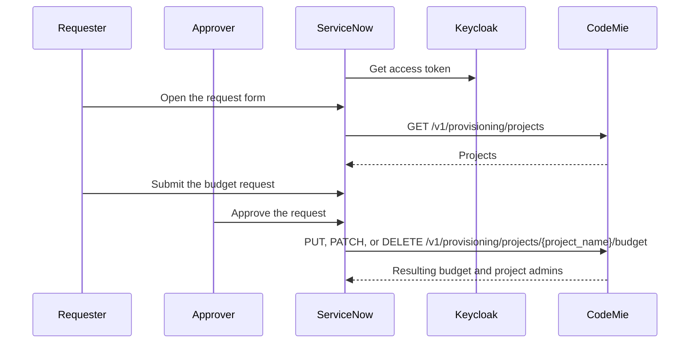

import EnterpriseFeature from '@site/src/components/EnterpriseFeature';

# ServiceNow Budget Integration

<EnterpriseFeature />

The ServiceNow budget integration lets CodeMie project budgets be requested through a request form in ServiceNow. A requester asks to set, adjust, or cancel the monthly budget of a project, a Delivery or Project Manager approves the request, and ServiceNow sends it to the CodeMie provisioning API, where it is applied automatically.

For each approved request, CodeMie:

- applies the budget per spend category: Platform, CLI, and Premium Models
- creates the project if it does not exist yet, and links it to a cost center when the request names one
- makes the requester and approvers project admins

ServiceNow is registered in CodeMie as a [provisioning client](./provisioning-clients.md). The provisioning API is not specific to ServiceNow: any registered provisioning client can call the endpoints described on this page.

:::note
This integration is not the same as the [ServiceNow tool](../../../user-guide/tools_integrations/tools/servicenow.md), which lets assistants work with ServiceNow data.
:::

## How It Works

A budget request is handled in ServiceNow first and reaches CodeMie only after it is approved. When the requester opens the request form, ServiceNow loads the requester's existing CodeMie projects. Once the request is approved, ServiceNow sends it to CodeMie, which applies it and returns the resulting budget.



## Set Up in CodeMie

### Prerequisites

- [Project budget management](./project-budget-management.md) is configured, including LiteLLM Proxy.
- Platform-managed user management is enabled (`ENABLE_USER_MANAGEMENT=true`). See [Platform-managed mode configuration](../access-control/platform-managed-mode-configuration.md).
- Cost centers are enabled (`features:costCenters`) if requests link projects to cost centers. See [Chargeback and Cost Centers](../../../user-guide/budget-management/chargeback-cost-centers.md).
- Administrator access to Keycloak.

### 1. Create a Keycloak Client

ServiceNow connects to CodeMie through the service account of this client. The service account needs no roles or project memberships in CodeMie.

1. Create a **confidential** client for ServiceNow with **Service accounts roles** enabled (client credentials grant). The steps are the same as in [Creating Client Secret Credentials](../../../user-guide/api/client-secret-access.md).
2. Copy the protocol mappers from an existing client used for CodeMie API access, so the token includes the same user claims.
3. Get the CodeMie user ID of the client's service account. See [Find the Account's User ID](./provisioning-clients.md#find-the-accounts-user-id).

### 2. Register ServiceNow as a Provisioning Client

ServiceNow looks up projects, creates projects, links cost centers, and adds admins, so it needs all three permissions. Add an entry to `provisioning-clients-config.yaml`, enable the provisioning API, and restart the workloads as described in [Provisioning Clients Configuration](./provisioning-clients.md#deploy-with-the-helm-chart):

```yaml
provisioning_clients:
  - name: support-portal
    user_id: '<service-account-user-id>'
    permissions:
      - provisioning:read-projects
      - provisioning:manage-projects
      - provisioning:manage-budgets
```

:::danger
Register the service account before handing its credentials over to ServiceNow. Until it is registered, the account can call the whole CodeMie API.
:::

### 3. Verify the Setup

Request a token for the new client and list the projects of any existing CodeMie user. A `200` response with the user's projects confirms the setup. A `404` means the provisioning API is not enabled, and a `403` means the service account is not registered or lacks the `provisioning:read-projects` permission. See [Verify the Setup](./provisioning-clients.md#verify-the-setup) for details.

```bash
TOKEN=$(curl -s -X POST "https://<keycloak-host>/realms/<realm>/protocol/openid-connect/token" \
  -d grant_type=client_credentials \
  -d client_id=<client-id> \
  -d client_secret=<client-secret> | jq -r .access_token)

curl -H "Authorization: Bearer $TOKEN" \
  "https://<codemie-host>/code-assistant-api/v1/provisioning/projects?member_email=<user-email>"
```

## Connect ServiceNow

At this point, CodeMie is ready to accept requests from ServiceNow. The ServiceNow side needs three values from the setup above:

- **Token URL**: `https://<keycloak-host>/realms/<realm>/protocol/openid-connect/token`
- **Client ID and client secret** of the Keycloak client
- **CodeMie API base URL**, for example `https://codemie.example.com/code-assistant-api`

### Authentication

Before calling CodeMie, ServiceNow gets an access token from the token URL using the client ID and secret (OAuth 2.0 client credentials). The token is then sent in the `Authorization: Bearer <access-token>` header of every request.

### Request Mapping

Each approved request becomes one call to the provisioning API:

| ServiceNow Request              | Provisioning API                                         |
| ------------------------------- | -------------------------------------------------------- |
| Set a budget                    | `PUT /v1/provisioning/projects/{project_name}/budget`    |
| Adjust a budget                 | `PATCH /v1/provisioning/projects/{project_name}/budget`  |
| Cancel a budget                 | `DELETE /v1/provisioning/projects/{project_name}/budget` |
| Request number                  | `X-Change-Reference` header                              |
| CodeMie project name            | `project_name` path parameter                            |
| EPAM project code (cost center) | `project.cost_center` in the request body                |
| Requester and approver emails   | `project.admin_emails` in the request body               |
| Monthly amounts per category    | `amounts` in the request body                            |

## Provisioning API Endpoints

All endpoints are under `/v1/provisioning`, relative to the CodeMie API base URL, and are callable only by registered provisioning clients that hold the listed permission.

| Endpoint                                                                             | Permission                                                                                             | Description                                                                                                       |
| ------------------------------------------------------------------------------------ | ------------------------------------------------------------------------------------------------------ | ----------------------------------------------------------------------------------------------------------------- |
| [List Projects for People](#list-projects-for-people) (`GET /projects`)              | `provisioning:read-projects`                                                                           | Returns the CodeMie projects that the given people belong to. Used to offer existing projects in the request form |
| [Set a Budget](#set-adjust-and-cancel) (`PUT /projects/{project_name}/budget`)       | `provisioning:manage-budgets`, see [Project, Cost Center, and Admins](#project-cost-center-and-admins) | Replaces the budget of a project                                                                                  |
| [Adjust a Budget](#set-adjust-and-cancel) (`PATCH /projects/{project_name}/budget`)  | `provisioning:manage-budgets`, see [Project, Cost Center, and Admins](#project-cost-center-and-admins) | Changes only the budget categories sent                                                                           |
| [Cancel a Budget](#set-adjust-and-cancel) (`DELETE /projects/{project_name}/budget`) | `provisioning:manage-budgets`                                                                          | Removes the budget of a project                                                                                   |

### List Projects for People

**GET** `/v1/provisioning/projects`

Returns the shared projects that any of the given people belong to, deduplicated and sorted by project name. Personal projects are not included. Emails without an active CodeMie user and service account emails are skipped; if no email matches, the response is an empty list.

| Query Parameter  | Required | Description                                                                                     |
| ---------------- | -------- | ----------------------------------------------------------------------------------------------- |
| **member_email** | Yes      | Email of a person whose projects to list. Repeat the parameter for each email. Case-insensitive |

```http
GET /v1/provisioning/projects?member_email=requester@example.com&member_email=approver@example.com
Authorization: Bearer <access-token>
```

```json
[{ "project_name": "epm-xmpl", "display_name": "Example Project" }]
```

`display_name` is `null` when the project has none.

### Budget Requests

The set, adjust, and cancel requests share one URL: `/v1/provisioning/projects/{project_name}/budget`.

#### Headers and Path Parameter

| Name                   | Required      | Description                                                                                                                                                                                                                                         |
| ---------------------- | ------------- | --------------------------------------------------------------------------------------------------------------------------------------------------------------------------------------------------------------------------------------------------- |
| **Authorization**      | Yes           | `Bearer <access-token>`                                                                                                                                                                                                                             |
| **X-Change-Reference** | Yes           | The caller's reference for the change, such as the ServiceNow request number. 1–64 characters. It is logged and names a new budget: `<client name> <change reference>`                                                                              |
| **Content-Type**       | PUT and PATCH | `application/json`                                                                                                                                                                                                                                  |
| **project_name**       | Yes           | CodeMie project name, used exactly as sent; 3–100 characters. An existing project is matched regardless of case, and the response names it as stored. A project the call creates needs a name matching `^[a-z0-9][a-z0-9_-]*$` that is not reserved |

#### Request Body

`PUT` and `PATCH` take the same body. `DELETE` has no body. Unknown fields are rejected with `422`.

| Field                    | Type      | Required | Description                                                                                                                                                                                                       |
| ------------------------ | --------- | -------- | ----------------------------------------------------------------------------------------------------------------------------------------------------------------------------------------------------------------- |
| **amounts**              | Object    | Yes      | Monthly budget in USD per category: `platform`, `cli`, `premium_models`. At least one category; amounts cannot be negative                                                                                        |
| **project**              | Object    | No       | Project settings applied together with the budget                                                                                                                                                                 |
| **project.cost_center**  | String    | No       | Cost center to link the project to while it has no active one. Created if it does not exist. Ignored when the project is already linked to an active cost center; otherwise it must match `^[a-z0-9]+-[a-z0-9]+$` |
| **project.admin_emails** | String\[] | No       | People to make project admins. See [Project, Cost Center, and Admins](#project-cost-center-and-admins). Case-insensitive; an email repeated in any case counts once                                               |

#### Set, Adjust, and Cancel

`PUT` and `PATCH` create the project and the budget if they do not exist. The Platform amount must remain above `0`. A new budget resets every 30 days, and an existing budget keeps its period. Each new or changed category gets a soft limit of 80% of its amount; a category whose amount does not change keeps its soft limit.

| Method   | Result                                                                                                            | Example, with a current budget of Platform `500` and CLI `100` | Success Status                                        |
| -------- | ----------------------------------------------------------------------------------------------------------------- | -------------------------------------------------------------- | ----------------------------------------------------- |
| `PUT`    | Replaces the budget with the requested amounts. Categories not included are removed. `platform` must be above `0` | `{"platform": 600}` results in Platform `600`, CLI removed     | `201` when the budget is created, `200` when replaced |
| `PATCH`  | Changes only the categories included. A category sent as `0` is removed, others stay as is                        | `{"cli": 200}` results in Platform `500`, CLI `200`            | `200`                                                 |
| `DELETE` | Removes the project budget. The project and its cost center are kept. A project without a budget is not an error  | The budget is removed                                          | `204`                                                 |

#### Project, Cost Center, and Admins

- **The project exists**: it is used as is. A cost center from the `project` block is linked only while the project has no active cost center; a link to an active cost center never changes.
- **The project does not exist**: `PUT` and `PATCH` create it, and `DELETE` returns `404`.
- **The project is personal**: the request is rejected with `403`, because budgets cannot be managed for personal projects.
- **The project is deleted**: the request is rejected with `409`.
- **Admins**: the people in `admin_emails` become project admins, and admins are never removed by later requests. People without an active CodeMie user are returned in `admins_not_assigned`, and the request still succeeds. They can be added later by sending the same request again once they have signed in to CodeMie.

`provisioning:manage-budgets` is required for every budget request. A `PUT` or `PATCH` that creates the project, or whose `project` block names a `cost_center` or `admin_emails`, also requires `provisioning:manage-projects`.

#### Retries

Every check runs before anything is written, so a `4xx` response means nothing was changed. A `500` or `502` response, or no response at all, means the request may be partly applied: send the same request again. A repeated request converges on the same result, but it may answer `200` instead of `201` and report `created_project: false`.

#### Examples

The examples cover each method and the most common outcomes. The same request can be sent with `curl`, using the `$TOKEN` variable from [Verify the Setup](#3-verify-the-setup):

```bash
curl -X PATCH "https://<codemie-host>/code-assistant-api/v1/provisioning/projects/epm-xmpl/budget" \
  -H "Authorization: Bearer $TOKEN" \
  -H "X-Change-Reference: RITM0012346" \
  -H "Content-Type: application/json" \
  -d '{ "amounts": { "cli": 200 } }'
```

##### Create a Project and Set Its Budget

The project `epm-xmpl` and the cost center `abc-xmpl` do not exist yet. The request creates both, applies the budget, and makes the listed people project admins. The requester has not signed in to CodeMie yet, so the requester is returned in `admins_not_assigned`. The response status is `201`.

```http
PUT /v1/provisioning/projects/epm-xmpl/budget
Content-Type: application/json
Authorization: Bearer <access-token>
X-Change-Reference: RITM0012345

{
  "amounts": { "platform": 500, "cli": 100, "premium_models": 50 },
  "project": {
    "cost_center": "abc-xmpl",
    "admin_emails": ["requester@example.com", "approver@example.com"]
  }
}
```

```json
{
  "project_name": "epm-xmpl",
  "cost_center": "abc-xmpl",
  "created_project": true,
  "created_cost_center": true,
  "created_budget": true,
  "budget": {
    "total_amount": 650.0,
    "budget_duration": "30d",
    "categories": [
      { "category": "platform", "max_budget": 500.0, "soft_budget": 400.0, "budget_reset_at": "2026-11-18T00:00:00Z" },
      { "category": "cli", "max_budget": 100.0, "soft_budget": 80.0, "budget_reset_at": "2026-11-18T00:00:00Z" },
      { "category": "premium_models", "max_budget": 50.0, "soft_budget": 40.0, "budget_reset_at": "2026-11-18T00:00:00Z" }
    ]
  },
  "admins_assigned": ["approver@example.com"],
  "admins_not_assigned": ["requester@example.com"]
}
```

##### Adjust a Category

With a current budget of Platform `500`, CLI `100`, and Premium Models `50`, `PATCH` changes only the CLI amount. The other categories keep their amounts and soft limits. The response status is `200`.

```http
PATCH /v1/provisioning/projects/epm-xmpl/budget
Content-Type: application/json
Authorization: Bearer <access-token>
X-Change-Reference: RITM0012346

{
  "amounts": { "cli": 200 }
}
```

```json
{
  "project_name": "epm-xmpl",
  "cost_center": "abc-xmpl",
  "created_project": false,
  "created_cost_center": false,
  "created_budget": false,
  "budget": {
    "total_amount": 750.0,
    "budget_duration": "30d",
    "categories": [
      { "category": "platform", "max_budget": 500.0, "soft_budget": 400.0, "budget_reset_at": "2026-11-18T00:00:00Z" },
      { "category": "cli", "max_budget": 200.0, "soft_budget": 160.0, "budget_reset_at": "2026-11-18T00:00:00Z" },
      { "category": "premium_models", "max_budget": 50.0, "soft_budget": 40.0, "budget_reset_at": "2026-11-18T00:00:00Z" }
    ]
  },
  "admins_assigned": [],
  "admins_not_assigned": []
}
```

##### Remove a Category

Sending a category as `0` in a `PATCH` removes it and leaves the other categories unchanged. The Platform category cannot be removed this way: a `PATCH` that leaves Platform at `0` returns `400`.

```http
PATCH /v1/provisioning/projects/epm-xmpl/budget
Content-Type: application/json
Authorization: Bearer <access-token>
X-Change-Reference: RITM0012352

{
  "amounts": { "premium_models": 0 }
}
```

```json
{
  "project_name": "epm-xmpl",
  "cost_center": "abc-xmpl",
  "created_project": false,
  "created_cost_center": false,
  "created_budget": false,
  "budget": {
    "total_amount": 700.0,
    "budget_duration": "30d",
    "categories": [
      { "category": "platform", "max_budget": 500.0, "soft_budget": 400.0, "budget_reset_at": "2026-11-18T00:00:00Z" },
      { "category": "cli", "max_budget": 200.0, "soft_budget": 160.0, "budget_reset_at": "2026-11-18T00:00:00Z" }
    ]
  },
  "admins_assigned": [],
  "admins_not_assigned": []
}
```

##### Cancel a Budget

`DELETE` removes the budget of an existing project. The project itself and its cost center are kept. If the project has no budget, the request still succeeds and changes nothing. The response status is `204`, with no body.

```http
DELETE /v1/provisioning/projects/epm-xmpl/budget
Authorization: Bearer <access-token>
X-Change-Reference: RITM0012347
```

#### Response Fields

`PUT` and `PATCH` return the following fields:

| Field                   | Description                                                                                                                      |
| ----------------------- | -------------------------------------------------------------------------------------------------------------------------------- |
| **project_name**        | Project the request was applied to, as stored                                                                                    |
| **cost_center**         | Cost center the project is linked to after the request, or `null`                                                                |
| **created_project**     | Whether the request created the project                                                                                          |
| **created_cost_center** | Whether the request created the cost center                                                                                      |
| **created_budget**      | Whether the request created the budget                                                                                           |
| **budget**              | Budget after the request: `total_amount`, `budget_duration`, and per-category `max_budget`, `soft_budget`, and `budget_reset_at` |
| **admins_assigned**     | Requested people who are project admins after the request, including existing admins                                             |
| **admins_not_assigned** | Requested people who could not be made admins because they have no active CodeMie user                                           |

### Error Responses

Errors use the standard CodeMie error response: `message` explains what went wrong, and `help` suggests how to fix it. For example, a request for a personal project returns `403`:

```json
{
  "error": {
    "message": "Budgets cannot be managed for personal projects",
    "details": null,
    "help": "Use a shared project."
  }
}
```

Other common failures, with the cause of each:

- **`400`**: a `PATCH` that leaves the Platform amount at `0`, for example `{"platform": 0}`. Nothing is changed. A `PUT` without a Platform amount above `0` returns `422` instead.

  ```json
  { "error": { "message": "Platform budget must be greater than 0", "details": null, "help": null } }
  ```

- **`403`**: the client lacks a required permission, for example a `PUT` that creates a project without `provisioning:manage-projects`.

  ```json
  {
    "error": {
      "message": "Access denied",
      "details": "This provisioning client does not hold the permission provisioning:manage-projects.",
      "help": "If you believe you should have access, please contact your system administrator."
    }
  }
  ```

- **`404`**: `DELETE` sent for a project that does not exist.

  ```json
  {
    "error": {
      "message": "Project 'epm-unknown' does not exist",
      "details": null,
      "help": "Check the CodeMie project name; there is no budget to cancel."
    }
  }
  ```

- **`409`**: the project name belongs to a deleted project.

  ```json
  {
    "error": {
      "message": "Project 'epm-xmpl' has been deleted",
      "details": null,
      "help": "Restore the project or use a different CodeMie project name."
    }
  }
  ```

| Status Code | Description                                                                                                                                                                               |
| ----------- | ----------------------------------------------------------------------------------------------------------------------------------------------------------------------------------------- |
| **400**     | The amounts do not make a valid budget, the name of the project to create is invalid, or the cost center name is invalid                                                                  |
| **401**     | Missing or invalid access token                                                                                                                                                           |
| **403**     | The caller is not a registered provisioning client, lacks a required permission, the project is personal, or cost centers are disabled and the request would create or link a cost center |
| **404**     | The provisioning API is not enabled, or `DELETE` was sent for a project that does not exist                                                                                               |
| **409**     | The project or the named cost center is deleted                                                                                                                                           |
| **422**     | Invalid project name, `X-Change-Reference` header, or body, for example an unknown field or category, a negative amount, or missing `amounts`                                             |
| **500**     | The request was partly applied. Send the same request again                                                                                                                               |
| **502**     | The budget sync to LiteLLM failed, and the request was partly applied. Send the same request again                                                                                        |

For errors caused by the client registration, see [Troubleshooting](./provisioning-clients.md#troubleshooting).
