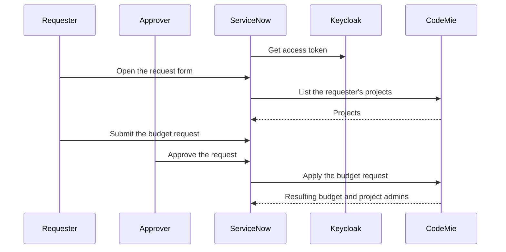

import EnterpriseFeature from '@site/src/components/EnterpriseFeature';

# ServiceNow Budget Integration

<EnterpriseFeature />

The ServiceNow budget integration lets CodeMie project budgets be requested through a request form in ServiceNow. A requester asks to set, adjust, or cancel the monthly budget of a project, a Delivery or Project Manager approves the request, and ServiceNow sends it to CodeMie, where it is applied automatically.

For each approved request, CodeMie:

- applies the budget per spend category: Platform, CLI, and Premium Models
- creates the project, and its cost center, if they do not exist yet
- makes the requester and approvers project admins

:::note
This integration is not the same as the [ServiceNow tool](../../../user-guide/tools_integrations/tools/servicenow.md), which lets assistants work with ServiceNow data.
:::

## How It Works

A budget request is handled in ServiceNow first and reaches CodeMie only after it is approved. When the requester opens the request form, ServiceNow loads the requester's existing CodeMie projects. Once the request is approved, ServiceNow sends it to CodeMie, which applies it and returns the resulting budget.



## Set Up in CodeMie

### Prerequisites

- [Project budget management](./project-budget-management.md) is configured, including LiteLLM Proxy.
- Platform-managed user management is enabled (`ENABLE_USER_MANAGEMENT=true`). See [Platform-managed mode configuration](../access-control/platform-managed-mode-configuration.md).
- Administrator access to Keycloak.

### 1. Create a Keycloak Client

ServiceNow connects to CodeMie through the service account of this client, which can call only the integration endpoints. The service account needs no roles or project memberships in CodeMie.

1. Create a **confidential** client for ServiceNow with **Service accounts roles** enabled (client credentials grant). The steps are the same as in [Creating Client Secret Credentials](../../../user-guide/api/client-secret-access.md).
2. Copy the protocol mappers from an existing client used for CodeMie API access, so the token includes the same user claims.
3. Open the service account user of the new client and copy its **ID**.

### 2. Enable the Integration

| Variable                         | Default | Description                                                    |
| -------------------------------- | ------- | -------------------------------------------------------------- |
| `SERVICENOW_INTEGRATION_ENABLED` | `false` | Enables the ServiceNow integration endpoints                   |
| `SERVICENOW_SERVICE_ACCOUNT_ID`  | empty   | ID of the Keycloak service account copied in the previous step |

Add both variables to the `extraEnv` list of the `codemie-api` Helm chart, then redeploy `codemie-api`:

```yaml
extraEnv:
  - name: SERVICENOW_INTEGRATION_ENABLED
    value: 'true'
  - name: SERVICENOW_SERVICE_ACCOUNT_ID
    value: '<keycloak-service-account-id>'
```

### 3. Verify the Setup

Request a token for the new client and list the projects of any existing CodeMie user. A `200` response with the user's projects confirms the setup. A `404` means the integration is not enabled, and a `403` means the service account ID does not match the client.

```bash
TOKEN=$(curl -s -X POST "https://<keycloak-host>/realms/<realm>/protocol/openid-connect/token" \
  -d grant_type=client_credentials \
  -d client_id=<client-id> \
  -d client_secret=<client-secret> | jq -r .access_token)

curl -H "Authorization: Bearer $TOKEN" \
  "https://<codemie-host>/code-assistant-api/v1/integrations/servicenow/projects?emails=<user-email>"
```

## Connect ServiceNow

At this point, CodeMie is ready to accept requests from ServiceNow. The ServiceNow side needs three values from the setup above:

- **Token URL**: `https://<keycloak-host>/realms/<realm>/protocol/openid-connect/token`
- **Client ID and client secret** of the Keycloak client
- **CodeMie API base URL**, for example `https://codemie.example.com/code-assistant-api`

### Authentication

Before calling CodeMie, ServiceNow gets an access token from the token URL using the client ID and secret (OAuth 2.0 client credentials). The token is then sent in the `Authorization: Bearer <access-token>` header of every request.

### Endpoints

Both endpoints are under `/v1/integrations/servicenow`, relative to the CodeMie API base URL.

| Endpoint                                                              | Description                                                                                                       |
| --------------------------------------------------------------------- | ----------------------------------------------------------------------------------------------------------------- |
| [List Projects for Users](#list-projects-for-users) (`GET /projects`) | Returns the CodeMie projects that the given people belong to. Used to offer existing projects in the request form |
| [Apply a Budget Request](#apply-a-budget-request) (`POST /budgets`)   | Sets, adjusts, or cancels the budget of a project. Called once the request is approved                            |

### List Projects for Users

**GET** `/v1/integrations/servicenow/projects`

Returns the shared projects that any of the given people belong to. Personal projects are not included, and emails without a CodeMie account are skipped.

| Query parameter | Required | Description                                                                                            |
| --------------- | -------- | ------------------------------------------------------------------------------------------------------ |
| **emails**      | Yes      | Requester and approver emails. Repeat the parameter for each email. Letter case and spaces are ignored |

```http
GET /v1/integrations/servicenow/projects?emails=requester@example.com&emails=approver@example.com
Authorization: Bearer <access-token>
```

```json
[{ "project_name": "epm-xmpl", "display_name": "Example Project" }]
```

### Apply a Budget Request

**POST** `/v1/integrations/servicenow/budgets`

Applies an approved request to the budget of a project. A request that fails changes nothing, and sending the same request again always gives the same result, so a request can be retried safely after a timeout or network error.

#### Request Body

Project names, project codes, and emails are not case-sensitive: they are converted to lowercase and surrounding spaces are removed. Duplicate emails are ignored.

| Field                    | Type      | Required           | Description                                                                                            |
| ------------------------ | --------- | ------------------ | ------------------------------------------------------------------------------------------------------ |
| **action**               | String    | Yes                | `set`, `adjust`, or `cancel`. See [Actions](#actions)                                                  |
| **request_id**           | String    | Yes                | ServiceNow request number, used for traceability                                                       |
| **epam_project_code**    | String    | Yes                | EPAM project code. Also used as the CodeMie project name when `codemie_project_name` is omitted        |
| **codemie_project_name** | String    | No                 | CodeMie project to manage                                                                              |
| **admin_emails**         | String\[] | No                 | Requester and approver emails to make project admins. See [Project Admins](#project-admins)            |
| **amounts**              | Object    | `set` and `adjust` | Monthly budget in USD per category: `platform`, `cli`, `premium_models`. `set` must include `platform` |

#### Actions

`set` and `adjust` create the budget if the project has none. The Platform amount must remain above `0`. A new budget resets every 30 days, and each new or changed category gets a soft limit of 80% of its amount.

| Action   | Result                                                                                     | Example, with a current budget of Platform `500` and CLI `100` |
| -------- | ------------------------------------------------------------------------------------------ | -------------------------------------------------------------- |
| `set`    | Replaces the budget with the requested amounts. Categories not included are removed        | `{"platform": 600}` results in Platform `600`, CLI removed     |
| `adjust` | Changes only the categories included. A category sent as `0` is removed, others stay as is | `{"cli": 200}` results in Platform `500`, CLI `200`            |
| `cancel` | Removes the project budget. `amounts` and `admin_emails` are ignored                       | The budget is removed                                          |

#### Project and Cost Center

- **The project exists**: it is used as is, and its cost center is not changed.
- **The project does not exist**: `set` and `adjust` create it, and `cancel` returns `404`. When the EPAM project code differs from the CodeMie project name, the new project is linked to a cost center named after the EPAM project code, which is created if needed. This requires cost centers to be enabled (see [Chargeback and Cost Centers](../../../user-guide/budget-management/chargeback-cost-centers.md)).
- **The project is personal**: the request is rejected, because personal projects cannot be managed through the integration.

#### Project Admins

For `set` and `adjust`, the people listed in `admin_emails` become project admins, and admins are never removed by later requests. People without a CodeMie account are returned in `admins_pending` and the request still succeeds. They can be added later by sending the same request again once they have signed in to CodeMie.

#### Example

```http
POST /v1/integrations/servicenow/budgets
Content-Type: application/json
Authorization: Bearer <access-token>

{
  "action": "set",
  "request_id": "RITM0012345",
  "epam_project_code": "abc-xmpl",
  "codemie_project_name": "epm-xmpl",
  "admin_emails": ["requester@example.com", "approver@example.com"],
  "amounts": { "platform": 500, "cli": 100, "premium_models": 50 }
}
```

```json
{
  "project_name": "epm-xmpl",
  "cost_center": "abc-xmpl",
  "created_project": true,
  "created_cost_center": true,
  "budget": {
    "total_amount": 650.0,
    "budget_duration": "30d",
    "categories": [
      { "category": "platform", "max_budget": 500.0, "soft_budget": 400.0, "budget_reset_at": "2026-11-18T00:00:00Z" },
      { "category": "cli", "max_budget": 100.0, "soft_budget": 80.0, "budget_reset_at": "2026-11-18T00:00:00Z" },
      { "category": "premium_models", "max_budget": 50.0, "soft_budget": 40.0, "budget_reset_at": "2026-11-18T00:00:00Z" }
    ]
  },
  "admins_assigned": ["approver@example.com"],
  "admins_pending": ["requester@example.com"]
}
```

#### Response Fields

| Field                   | Description                                                                  |
| ----------------------- | ---------------------------------------------------------------------------- |
| **project_name**        | Project the request was applied to                                           |
| **cost_center**         | Cost center the project is linked to, or `null`                              |
| **created_project**     | Whether the request created the project                                      |
| **created_cost_center** | Whether the request created the cost center                                  |
| **budget**              | Budget after the request, or `null` after `cancel`                           |
| **admins_assigned**     | People who are project admins after the request                              |
| **admins_pending**      | People who could not be made admins because they have no CodeMie account yet |

### Error Responses

Errors use the standard CodeMie error response: `message` explains what went wrong, and `help` suggests how to fix it. For example, a request for a personal project returns `403`:

```json
{
  "error": {
    "message": "Budgets cannot be managed for personal projects",
    "details": null,
    "help": "Use a shared project."
  }
}
```

| Status Code | Description                                                                                             |
| ----------- | ------------------------------------------------------------------------------------------------------- |
| **400**     | The project or cost center name is invalid, or an `adjust` would leave the Platform amount at `0`       |
| **401**     | Missing or invalid access token                                                                         |
| **403**     | The caller is not the ServiceNow service account, the project is personal, or cost centers are disabled |
| **404**     | The integration is not enabled, or `cancel` was sent for a project that does not exist                  |
| **409**     | The name belongs to a deleted project or cost center                                                    |
| **422**     | Invalid request, for example an unknown category, a negative amount, or missing `amounts`               |
