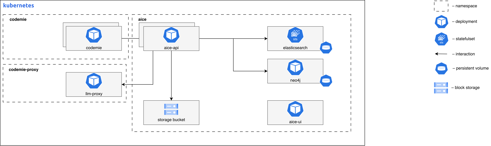

import EnterpriseFeature from '@site/src/components/EnterpriseFeature';

# AI Code Explorer (AICE)

<EnterpriseFeature />

AI Code Explorer (AICE) is an intelligent code analysis and exploration platform that provides advanced code understanding capabilities through graph-based knowledge representation and AI-powered insights.

## AICE System Requirements

The diagram below depicts the AICE Platform deployed on Kubernetes infrastructure within a cloud environment.



### AICE Container Resource Requirements

| Component Name       | Replicas | Memory | CPU (cores) |
| -------------------- | -------- | ------ | ----------- |
| code-exploration-ui  | 1        | 256Mi  | 0.1         |
| code-exploration-api | 1        | 6Gi    | 2.0         |
| neo4j                | 1        | 16Gi   | 2.0         |
| elasticsearch        | 1        | 8Gi    | 2.0         |

### Core AICE Components Overview

| Component name       | Images                             | Description                                                                                                                                                                                                                                                           |
| -------------------- | ---------------------------------- | --------------------------------------------------------------------------------------------------------------------------------------------------------------------------------------------------------------------------------------------------------------------- |
| code-exploration-ui  | `aice/code-exploration-ui:latest`  | Frontend UI application for code exploration, built with React and served via Nginx. Provides the web interface for users to interact with the AICE system.                                                                                                           |
| code-exploration-api | `aice/code-exploration-api:latest` | Main backend API service that handles requests from the UI. Manages the code knowledge graph, interacts with Neo4j, Elasticsearch, and LLM providers to deliver code exploration capabilities. Implements hexagonal architecture for maintainability and scalability. |
| neo4j                | `aice/neo4j:5.26.3-1`              | Graph database used to store and query the code knowledge graph. Preconfigured with additional plugins for advanced graph operations.                                                                                                                                 |

### Third-Party AICE Components

| Component name | Images                                                 | Description                                                                                                                         |
| -------------- | ------------------------------------------------------ | ----------------------------------------------------------------------------------------------------------------------------------- |
| elasticsearch  | `docker.elastic.co/elasticsearch/elasticsearch:8.16.1` | Search engine used for full-text searching of code and related metadata. Provides powerful search capabilities across the codebase. |

## PostgreSQL Configuration

Configure your PostgreSQL instance with the necessary database and user.

### Configuring PostgreSQL running in managed cloud

1. Navigate to the SQL section in Managed Cloud

2. Connect to PostgreSQL database `codemie` depending on your cloud provider:
   - Some cloud providers have built-in query tools
   - Deploy pgadmin inside cluster to access your private Postgres instance:

   ```bash
   # Create namespace and secret
   kubectl create ns pgadmin

   kubectl create secret generic pgadmin4-credentials \
   --namespace pgadmin \
   --from-literal=password="$(openssl rand -hex 16)" \
   --type=Opaque

   helm upgrade --install pgadmin pgadmin/. -n pgadmin --values pgadmin/values.yaml --wait --timeout 900s --dependency-update

   # port-forward to svc
   kubectl -n pgadmin port-forward svc/pgadmin-pgadmin4 8080:80

   # access via localhost:8080 with secret from pgadmin namespace, user - "pgadmin4@example.com"
   ```

3. Open the SQL Editor tab

4. Execute the following SQL commands:

   ```sql
   CREATE DATABASE postgres_aice;
   CREATE USER aice WITH PASSWORD 'your_strong_password_here';
   GRANT ALL PRIVILEGES ON DATABASE postgres_aice TO aice;
   ```

5. Switch to the `postgres_aice` database

6. Grant schema privileges:

   ```sql
   GRANT ALL ON SCHEMA public TO aice;
   ```

## Step 1: Deploy AICE

Install or upgrade AICE using Helm:

```bash
helm upgrade --install aice ./aice \
--namespace aice \
--values ./aice/values-<cloud_name>.yaml
```

## Next Steps

- Return to [Extensions Overview](../)
- Configure other extensions
