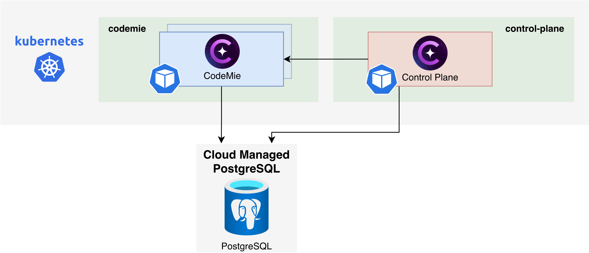

import EnterpriseFeature from '@site/src/components/EnterpriseFeature';

# Control Plane on Kubernetes

<EnterpriseFeature />

This guide provides instructions for installing and configuring the Control Plane, which shows
project leads what AI-assisted delivery produced and what it cost. It combines CodeMie CLI sessions
with tickets from the issue tracker and merge requests from Git, and presents the results per
project, stream and person. The Control Plane is installed with a Helm chart into the Kubernetes
cluster next to AI/Run CodeMie, reads AI usage metrics from the CodeMie backend, and lets users sign
in with the same SSO as CodeMie.

## Prerequisites

### General Requirements

Before you begin, ensure you have:

- **AI/Run CodeMie Deployment**: AI/Run CodeMie deployed in the target cluster
- **Kubernetes Cluster Access**: `kubectl` and `helm` configured to access your target cluster
- **Helm Charts Repository**: Clone access to
  [codemie-helm-charts](https://gitbud.epam.com/epm-cdme/codemie-helm-charts)
- **Container Registry and Helm Charts**: Access to the AI/Run Control Plane container registry and
  Helm chart repository in [ai-run-registry](https://ext.git.epam.com/epm-cdme/ai-run-registry)
- **CodeMie Version**: AI/Run CodeMie v2.65.0 or higher

## Control Plane System Requirements

The diagram below depicts the Control Plane deployed on Kubernetes infrastructure within a cloud
environment.



### Components and Requirements

| Component                       | CPU (Limits/Requests) | Memory (Limits/Requests) | Storage    |
| ------------------------------- | --------------------- | ------------------------ | ---------- |
| Control Plane x 1 Replica       | 2 / 0.1               | 3Gi / 1536Mi             | 20Gi       |
| PostgreSQL (CodeMie, read-only) | -                     | -                        | -          |
| **Total**                       | ~2 / ~0.1 vCPU        | ~3 / ~1.5 GiB RAM        | ~20 Gi PVC |

## PostgreSQL Configuration

The Control Plane reads CodeMie CLI sessions from the `codemie_analytics` schema of the CodeMie
PostgreSQL database. It requires a dedicated read-only user in your PostgreSQL instance. Follow these
steps to configure it.

### Connect to PostgreSQL

Connect to the `codemie` database of your main PostgreSQL instance.

You can connect using one of the following methods:

- Use your cloud provider's built-in query tools.
- Deploy pgAdmin inside the cluster to access your private PostgreSQL instance.

<details>
<summary>Click here for instructions on deploying pgAdmin</summary>

```bash
# Create a dedicated namespace
kubectl create ns pgadmin

# Create credentials for pgadmin
kubectl create secret generic pgadmin4-credentials \
--namespace pgadmin \
--from-literal=password="$(openssl rand -hex 16)" \
--type=Opaque

# Inside cloned codemie-helm-charts
# Deploy pgadmin using Helm
helm upgrade --install pgadmin pgadmin/. -n pgadmin --values pgadmin/values.yaml --wait --timeout 900s --dependency-update

# Forward a local port to the service to access the UI
kubectl -n pgadmin port-forward svc/pgadmin-pgadmin4 8080:80

# You can now access the pgadmin UI at http://localhost:8080
# Default user: "pgadmin4@example.com"
# Retrieve the pgAdmin password from the Kubernetes secret.
kubectl -n pgadmin get secret pgadmin4-credentials -o jsonpath='{.data.password}' | base64 -d; echo
```

</details>

### Create Read-Only User

Execute the following SQL commands to create the read-only user for the Control Plane and grant it
access to the CodeMie analytics tables.

:::warning Important

Replace `'your_strong_password_here'` with a new, secure password for the `control_plane_reader`
user. You can generate one using:

```bash
openssl rand -base64 16 | tr '+/' '-_' | tr -d '= ' | cut -c1-16
```

The command above generates a URL-safe password using only alphanumeric characters, hyphens (`-`),
and underscores (`_`). This is intentional: passwords containing special characters such as `@`,
`#`, `$`, `!`, `%`, `&`, `=`, `\`, spaces, etc., can cause issues when embedded in connection
strings, shell scripts, or Helm values files. Using a password without such characters reduces the
risk of quoting or escaping errors.

:::

```sql
CREATE USER control_plane_reader WITH PASSWORD 'your_strong_password_here';
GRANT CONNECT ON DATABASE codemie TO control_plane_reader;
GRANT USAGE ON SCHEMA codemie_analytics TO control_plane_reader;
GRANT SELECT ON
  codemie_analytics.cli_analytics_alembic_version,
  codemie_analytics.session_dims,
  codemie_analytics.session_usage,
  codemie_analytics.subagent_invocations,
  codemie_analytics.hook_events
TO control_plane_reader;
```

### Build Connection String

Build the connection string from the user, its password and the address of the PostgreSQL
instance:

```text
postgresql://control_plane_reader:<password>@<pg-host>:<pg-port>/codemie
```

The connection string goes into the `CODEMIE_ANALYTICS_PG_URL` variable of the Control Plane,
through the secret in [Step 1](#step-1-create-secrets).

## Deployment Steps

### Step 1: Create Secrets

Create the `control-plane` namespace, the secret to pull the Control Plane image, and the secret
with the connection string to the CodeMie analytics database.

1. Create the namespace:

   ```bash
   kubectl create namespace control-plane
   ```

2. Create the secret to pull the image from the AI/Run registry:

   ```bash
   kubectl create secret docker-registry gitlab-ai-run-registry \
     --namespace control-plane \
     --docker-server=registry.ext.git.epam.com \
     --docker-username='<username>' \
     --docker-password='<access-token>'
   ```

3. Create the secret with the connection string built in
   [Build Connection String](#build-connection-string):

   ```bash
   kubectl create secret generic control-plane-secrets \
     --namespace control-plane \
     --from-literal=codemie-analytics-pg-url='postgresql://control_plane_reader:<password>@<pg-host>:<pg-port>/codemie' \
     --type=Opaque
   ```

4. Verify that the secrets are created:

   ```bash
   kubectl get secret gitlab-ai-run-registry control-plane-secrets -n control-plane
   ```

### Step 2: Configure Values

In the cloned [codemie-helm-charts](https://gitbud.epam.com/epm-cdme/codemie-helm-charts)
repository, open the values file for your cloud (`aws`, `azure` or `gcp`):

```text
codemie-extensions/control-plane/values-<cloud_name>.yaml
```

Update it:

1. Replace `%%DOMAIN%%` with your domain.
2. Set the Control Plane version, replacing `x.y.z` with the release you install:

   ```yaml
   image:
     tag: 'x.y.z-control-plane'
   ```

The other settings, such as the ingress, the storage and the database secret, are already
configured.

To change other Control Plane parameters, add them to the `env` list of the values file:

```yaml
env:
  # ... existing variables
  - name: FEATURE_CHAT
    value: 'false'
```

For all available parameters, see
[Control Plane Configuration Reference](../../../../user-guide/control-plane/configuration.md).

### Step 3: Install Helm Chart

1. Log in to the AI/Run registry with Helm (requires Helm 3.8+):

   ```bash
   helm registry login registry.ext.git.epam.com -u '<username>' -p '<access-token>'
   ```

2. Install the chart from the root of the cloned `codemie-helm-charts` repository:

   ```bash
   helm upgrade --install control-plane \
     oci://registry.ext.git.epam.com/epm-cdme/ai-run-registry/helm-charts/control-plane \
     --version x.y.z \
     --namespace control-plane \
     -f ./codemie-extensions/control-plane/values-<cloud_name>.yaml \
     --wait \
     --timeout 600s
   ```

   Replace `x.y.z` with the chart version from the AI/Run registry.

### Step 4: Verify Deployment

```bash
kubectl get pods -n control-plane
kubectl logs -n control-plane deployment/control-plane --tail=50
```

Expected result: the pod is `Running` and ready, and the logs show no startup errors.

### Step 5: Access the Application

Open the Control Plane at `https://codemie.<domain>/control-plane` and sign in with the CodeMie
account. The first start opens an empty installation: add a client, its projects, streams and
members, and their sources in **Settings → Clients**.

## See Also

- [Control Plane Overview](../../../../user-guide/control-plane/index.mdx)
- [Control Plane Configuration Reference](../../../../user-guide/control-plane/configuration.md)
