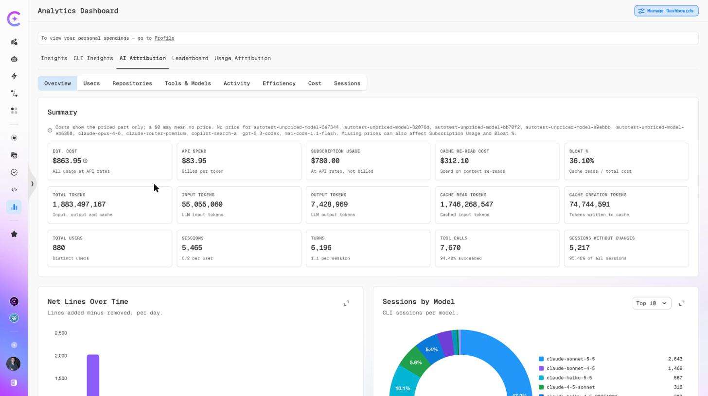
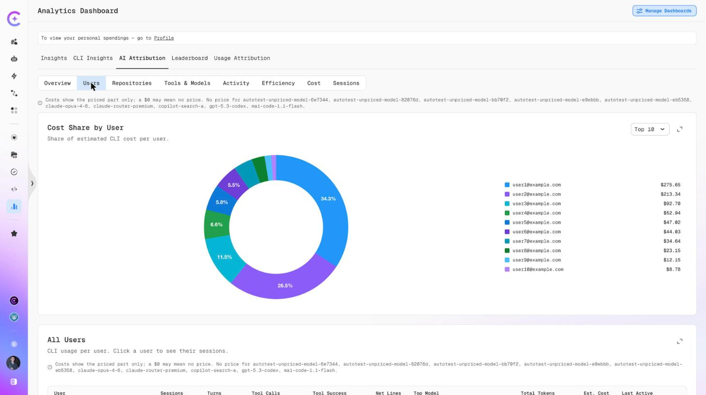
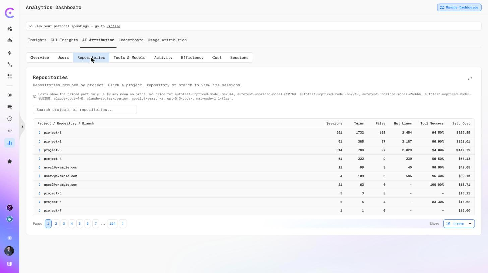
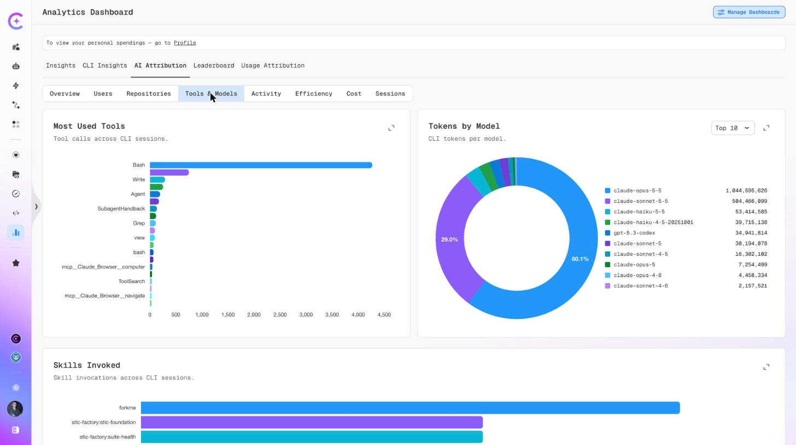
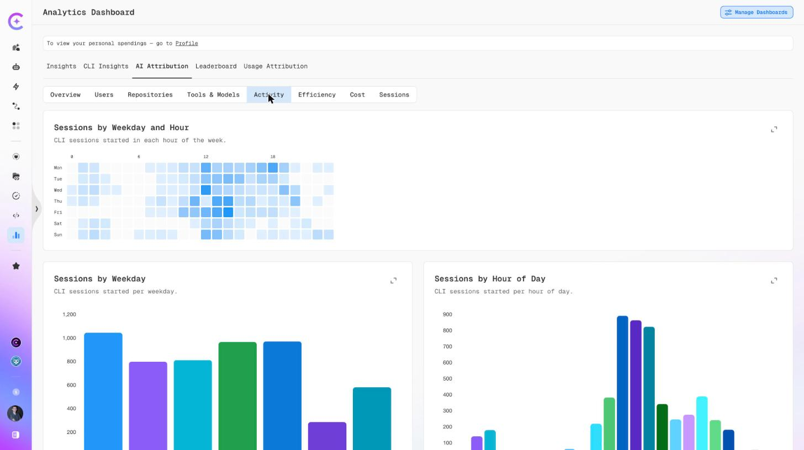
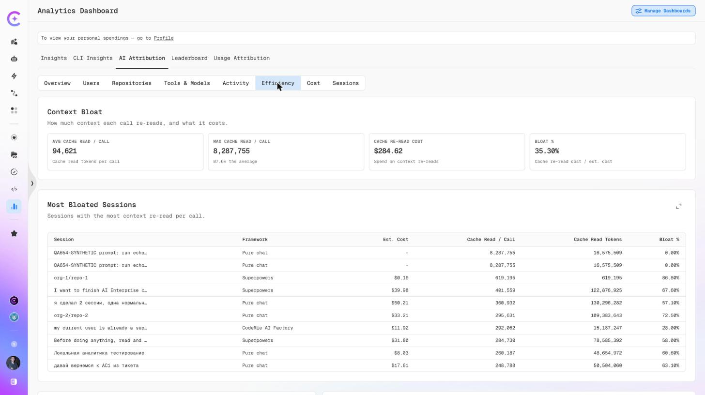
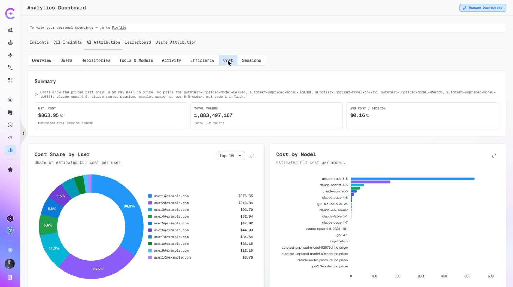
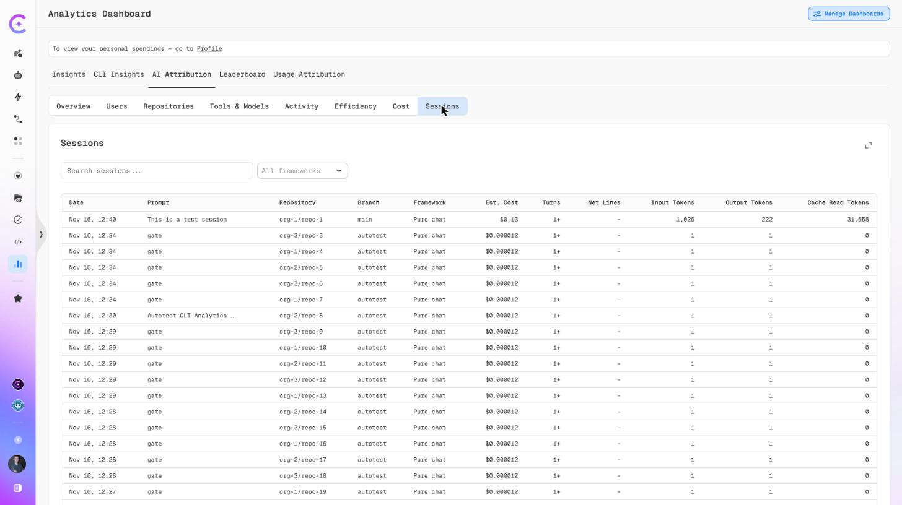

# AI Attribution

AI Attribution makes every AI coding session attributable. For each CLI session it records who
ran it, in which repository and branch, with which model and tools, what it cost, and whether it
changed any code. The data rolls up from a single session to a user, a repository, or a whole
project.

To open it, select **Analytics** in the left navigation, then the **AI Attribution** tab. The
global filters (time period, project, users) apply to every screen. Data visibility follows the
[Analytics Dashboard access rules](./index.md#access-permissions-and-data-visibility).

:::info Estimated costs
Costs are estimated from token counts and model prices, before any invoice. Models without a
configured price count as $0 and are listed in a notice above the figures.
:::

## Overview

**One summary of AI spend, usage, and output.**

- **Cost split**: the estimated cost at API rates, divided into API spend billed per token and
  subscription usage that is not billed per token.
- **Context bloat**: the share of cost spent re-reading cached context. This is the first place
  to look for savings.
- **Sessions without changes**: sessions that produced no file output, worth reviewing with the
  team.

Charts below the summary show net lines changed per day, sessions by model, and the top
repositories.

## Users

**Who uses AI, and what it costs per person.**

- Cost share across the top users.
- A per-user table with sessions, turns, tool success rate, net lines, top model, tokens, cost,
  and last activity. Selecting a user opens that user's sessions.

## Repositories

**AI usage tied to the code it worked on.**

- Projects expand into repositories and branches, each with sessions, files changed, net lines,
  tool success, and cost.
- Selecting a project, repository, or branch opens its sessions.

## Tools & Models

**What the agents actually used.**

- The most used tools and token consumption by model.
- Skills invoked, sub-agent types dispatched, and slash commands run.

## Activity

**When teams work with AI.**

- A weekday-by-hour heatmap of session starts.
- Session counts by weekday and by hour of day.

## Efficiency

**Where spend does not turn into output.**

- **Context bloat**: average and peak cache reads per call, re-read cost, and bloat percentage.
- **Most bloated sessions**: the sessions that re-read the most context per call. These are
  candidates for shorter sessions or smaller tool outputs.
- Sessions without changes, code changes (files written and edited, net lines), and the
  distribution of turns per session.

## Cost

**Where the money goes.**

- Estimated cost, total tokens, and average cost per session.
- Cost share by user, cost by model, and the most expensive sessions.

## Sessions

**Every session, one row each.**

- Date, opening prompt, repository, branch, framework, turns, net lines, token counts, and
  estimated cost.
- Search the sessions and filter them by framework.
