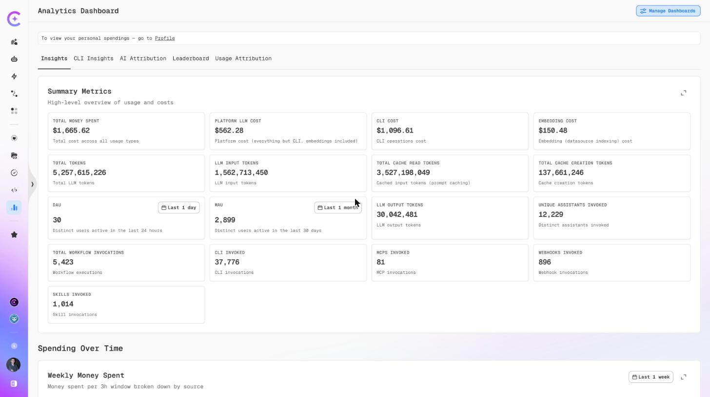
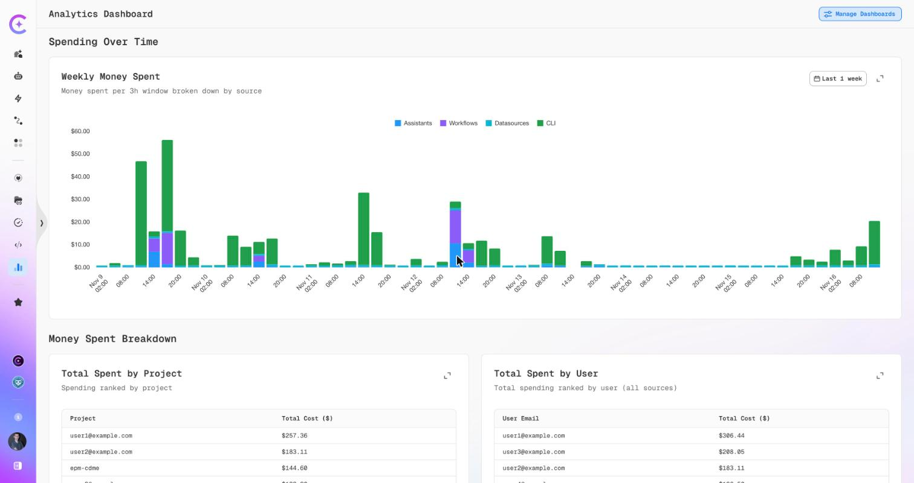
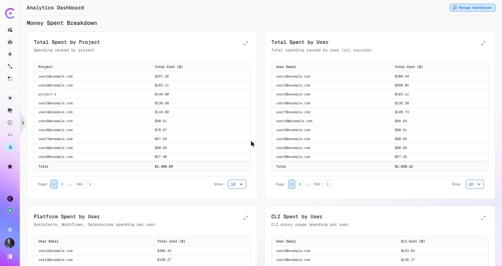
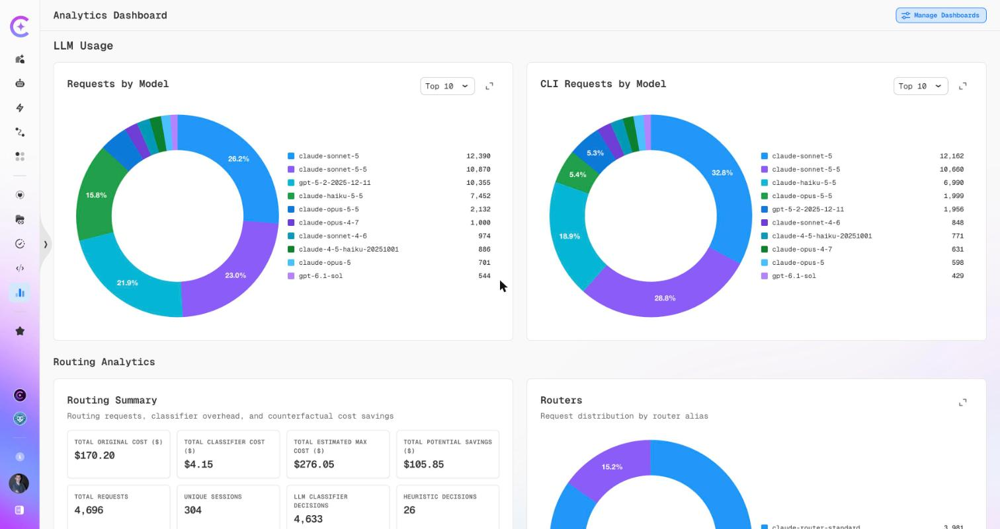
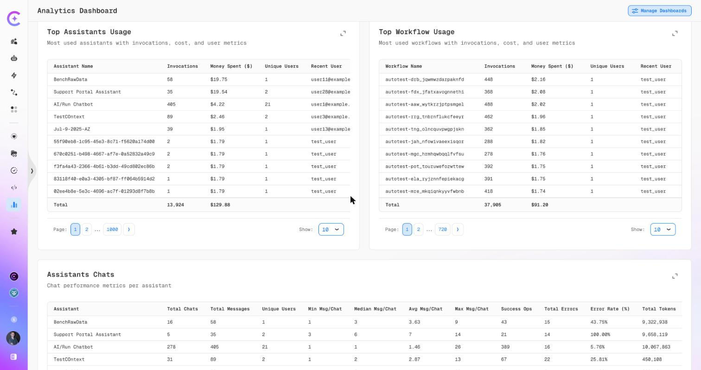

# Spend Inventory

Spend Inventory answers the first FinOps question: what is the organization spending on AI? It
collects LLM spend from every source on the platform (assistants, workflows, data source
indexing, and CLI) into one view, broken down by source, project, user, and model.

To open it, select **Analytics** in the left navigation. The dashboard opens on the **Insights**
tab, which holds the Spend Inventory. The global filters (time period, project, users) apply to
every section. Data visibility follows the
[Analytics Dashboard access rules](./index.md#access-permissions-and-data-visibility).

For a session-level view of CLI usage, see [AI Attribution](./ai-attribution.md).

## Summary Metrics

**Total AI spend and usage on one screen.**

- **Spend by source**: total money spent, split into platform LLM cost, CLI cost, and embedding
  cost for data source indexing.
- **Token volume**: input, output, cache read, and cache creation tokens.
- **Adoption**: daily and monthly active users, plus invocation counts for assistants,
  workflows, CLI, MCP servers, webhooks, and skills.

## Spending Over Time

**When the money is spent, and on what.**

- Spend per 3-hour window, stacked by source: assistants, workflows, data sources, and CLI.
- Spikes point to the source and time to investigate.

## Money Spent Breakdown

**Who spends, ranked.**

- Total spend ranked by project and by user.
- Separate rankings for platform spend (assistants, workflows, data sources) and CLI spend per
  user.

## LLM Usage

**Which models carry the load.**

- Requests by model across the platform, and CLI requests by model.
- When model routing is enabled, the [Routing Analytics](./routing-analytics.md) section follows,
  with routing cost and estimated savings.

## Platform Activity

**What people build and run on the platform.**

- The most used assistants and workflows, with invocations, cost, and unique users.
- Chat and workflow execution metrics, including error rates and cost per operation.
- Power users, marketplace publications, and webhook invocations per user.
