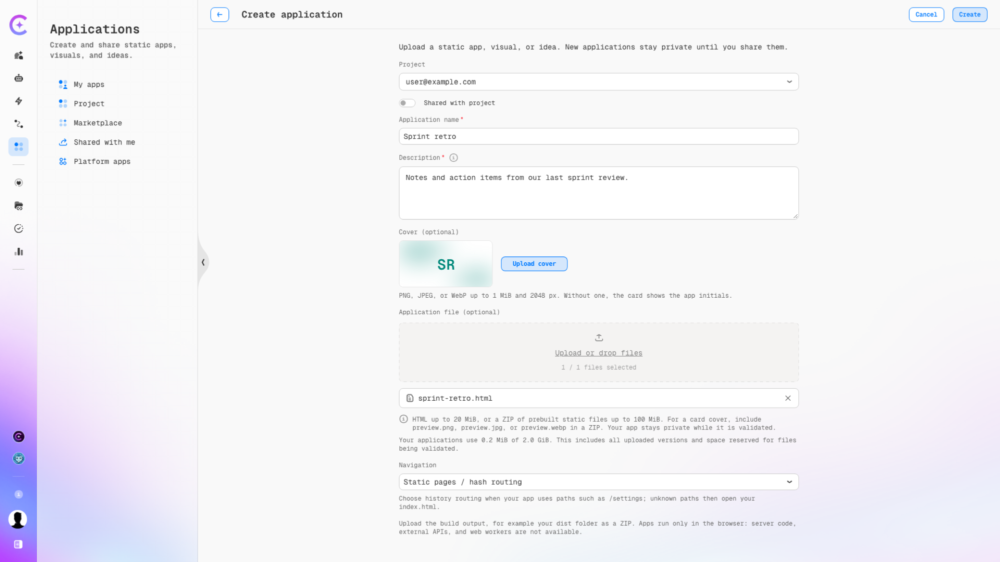
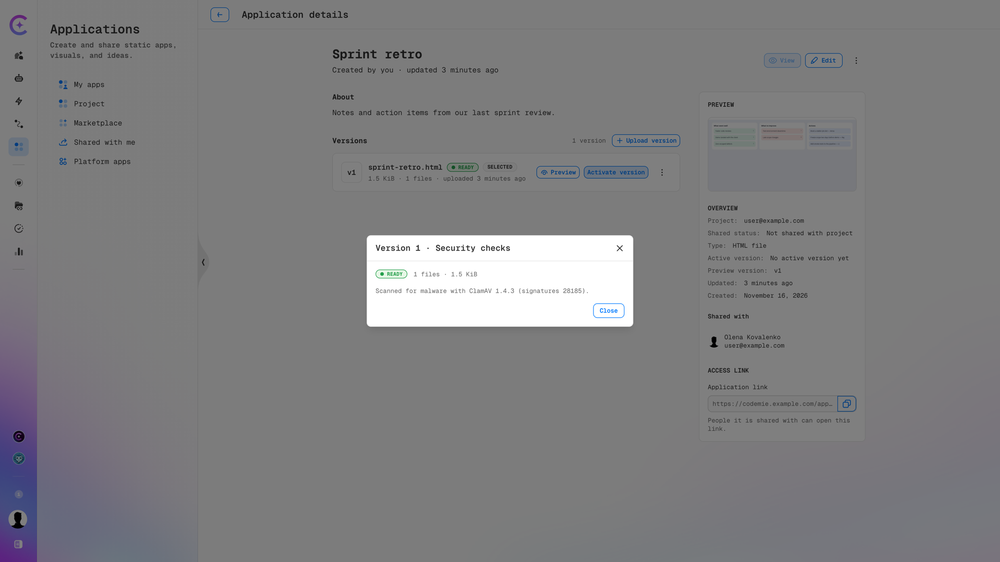
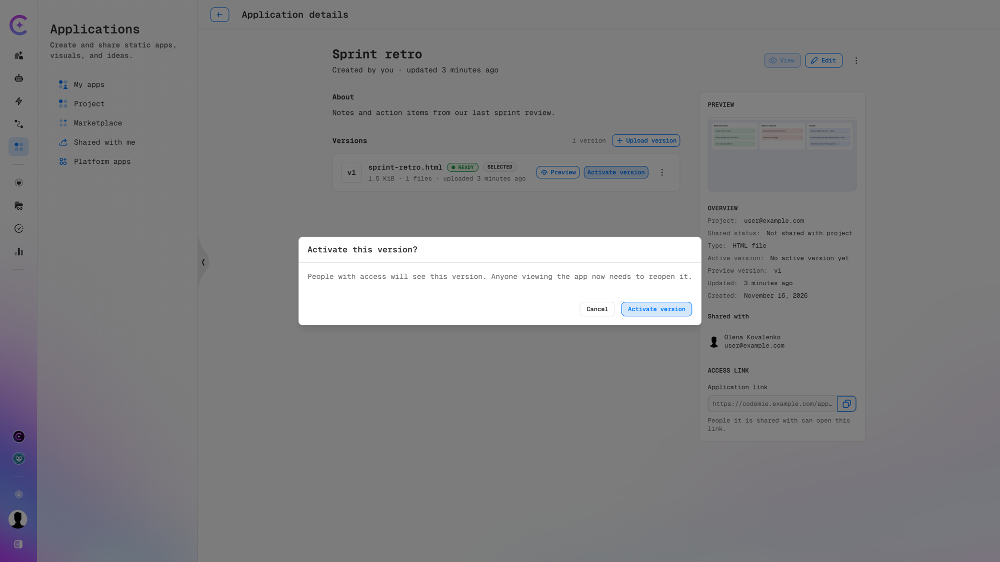
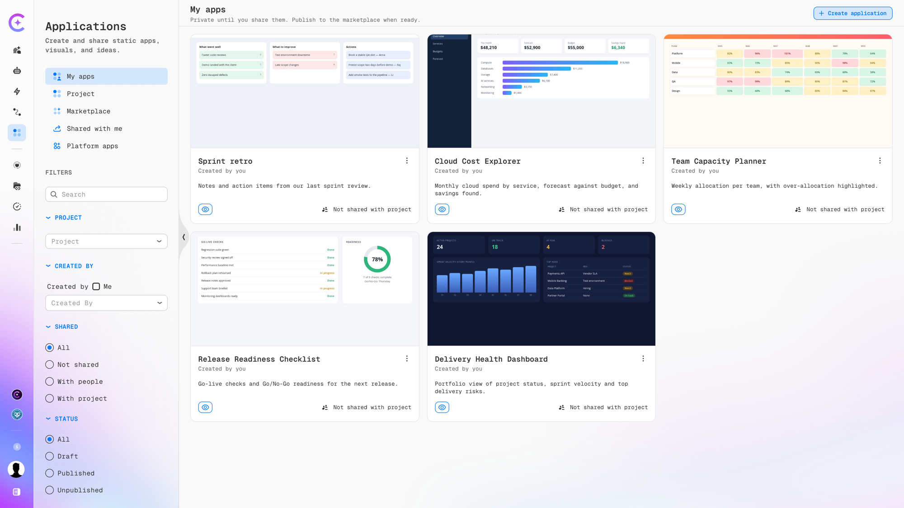
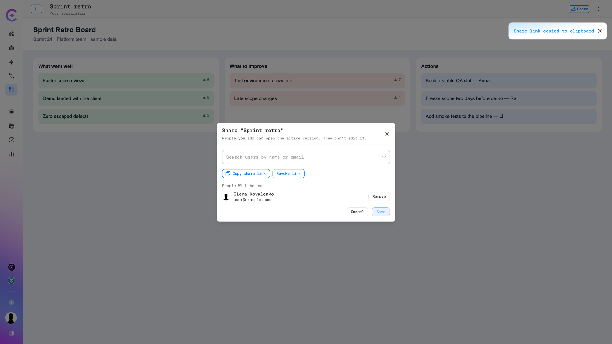

# Hosted Applications

A hosted application is a **small, static web page** that you upload to CodeMie and open from the **Applications** page. It is meant for **presentations**: slides, reports, demos, and visual walkthroughs. It is not an interactive application.

:::info Availability
Your CodeMie administrator turns this feature on. If you see only Platform apps, it is off for your deployment. See [Hosted Applications configuration](../../admin/configuration/codemie/hosted-applications.md).
:::

## What You Can Upload

| Upload type | Limits                                                                                 |
| ----------- | -------------------------------------------------------------------------------------- |
| HTML file   | One `.html` file up to 20 MiB.                                                         |
| ZIP archive | A prebuilt static build up to 100 MiB, 500 MiB unpacked, 5,000 files, 50 MiB per file. |

Use HTML, CSS, JavaScript for display and animation, images, SVG, fonts, audio and video, and bundled JSON or CSV data. CodeMie does not build your project, so run your build locally and upload the output. Bundle every file you need, because nothing is loaded from other sites.

## What It Cannot Do

For security, the page runs in a restricted sandbox:

- no network requests, and no files from CDNs or other sites;
- no forms or data input, because nothing can be submitted;
- no `alert`, `confirm`, or `prompt` dialogs;
- no navigation away from the page, and no downloads;
- no camera, microphone, location, or payments;
- no server-side code. Server files, `node_modules`, source maps, and credentials in files are rejected.

Presentation controls work: a page can switch itself to full screen, and it can open a pop-up window, for example a presenter view. A pop-up window has the same restrictions as the page.

## Create and Open

1. Open **Applications** and select **Create application**.
2. Choose a project, enter a name and a description, and optionally add a cover image (see [Card Cover](#card-cover)). Turn on **Shared with project** if project members should open it. Add the file.

   

3. CodeMie validates the upload and scans it for malware. A version moves through **Uploading**, **Queued**, **Checking**, and then **Ready**. A **Rejected** or **Failed** version shows the reason. Fix the problem and upload a new version. To see the result of the checks, open the version menu (**⋮**) and select **Validation details**.

   

4. A ZIP can stop at **Needs setup**. Confirm the site root, the HTML entry point, and the navigation mode (static pages with hash routing, or a single-page app with history routing), and the version becomes **Ready**.
5. The first ready version is marked **Selected**. The owner can open it with **Preview**, but it is not live yet. Select **Activate version** and confirm. People with access then see this version.

   

6. Select the application card to open it inside CodeMie. If the embedded view does not work in the browser, use **Open in new tab**.

The viewer header names the publisher, because the content is provided by them and not by CodeMie. CodeMie never asks for your password inside an application.

## Card Cover

Each application card on the **Applications** page shows a cover image. CodeMie takes the first cover that is available, in this order:

1. **Uploaded cover.** The image added in the **Cover** field of the application. PNG, JPEG, or WebP, up to 1 MiB and 2048 px per side.
2. **Cover image in the ZIP archive.** A PNG, JPEG, or WebP file in the ZIP archive whose name starts with `preview`, `thumbnail`, `screenshot`, `cover`, or `poster` (for example, `preview.png` or `cover-dark.webp`). The names are used in that order of priority. The file must be up to 1 MiB, up to 2048 px per side, and up to 1 megapixel in area (for example, 1280 × 800). A larger file is skipped.
3. **Automatic preview.** A picture of the start page that CodeMie takes when the version passes validation.
4. **Initials.** If no image is available, the card shows the initials of the application name on a colored background.

The automatic preview opens the start page in a browser window of 1280 × 800 px, without network access, and takes a picture when the page stops changing (after 15 seconds at most). Because of this:

- Content that the page loads from other sites does not appear in the picture. This content does not appear in the application either.
- Pages that draw with WebGL give a blank picture. A picture with one color only is not used.
- Only the top 1280 × 800 px of the page is visible on the card. Put the most important content at the top of the start page.
- The picture does not affect validation. If CodeMie cannot take a picture, the version is still accepted, and the card uses the next cover in the list.

Versions accepted before the automatic preview was available have no picture. Upload a new version to get one. The administrator can also turn the automatic preview off for the deployment.

The owner, project administrators, and platform administrators see the cover of the version they work on (**Selected**). Other people see the cover of the active version. To control the cover, upload one in the **Cover** field or include a cover image in the ZIP archive.

## Share

New applications are private. The owner chooses who can open the active version:

- **Project.** Turn on **Shared with project** to let members of the application's project open it. They find it on the **Project** tab.
- **People.** Add colleagues by name in **Share**. They find it on the **Shared with me** tab.
- **Link.** Select **Copy share link** in **Share** to copy a link to the clipboard. Signed-in colleagues who open it get access until the owner selects **Revoke link**.
- **Marketplace.** **Publish to Marketplace** lets anyone in your organization open it from the **Marketplace** tab.

People you share with can open the application but cannot edit it. Only internal, signed-in users can open hosted applications.

A platform administrator can suspend an application. While it is suspended, only its owner, project administrators, and platform administrators see it, and it cannot be activated, published, or shared. Sharing is kept and applies again after the application is reinstated.

## Versions and Deletion

- Each upload creates a new version. The owner previews a version and chooses which accepted version is live (**Active version**).
- CodeMie keeps the live version, the version you are working on, and the 10 newest accepted versions. Rejected, failed, and canceled versions are removed after 30 days.
- **My apps** can be filtered by sharing (private, people, project) and by status (draft, published, unpublished).
- Deleting an application removes it and its stored files for good. There is no Trash.
- Each person can keep up to 500 applications and has a storage quota (2 GiB by default) for all versions and covers of the applications they created.
