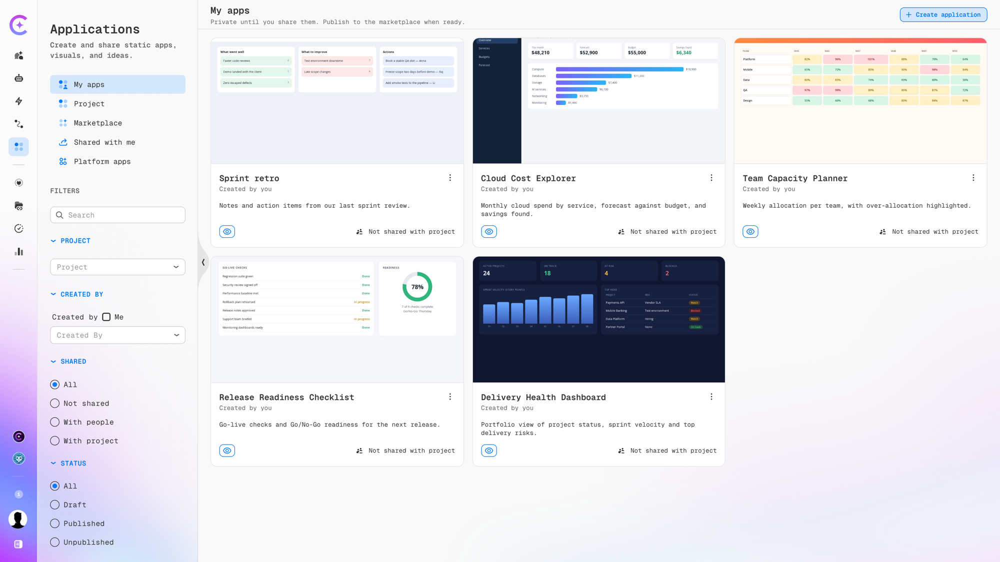

# Card Cover of a Hosted Application

Each application card on the **Applications** page shows a cover image. A good cover helps people find the application in the catalog. This page describes where the cover comes from and how to control it.

## Cover Order

CodeMie takes the first cover that is available, in this order:

1. **Uploaded cover.** The image added in the **Cover** field of the application. PNG, JPEG, or WebP, up to 1 MiB and 2048 px per side.
2. **Cover image in the ZIP archive.** A PNG, JPEG, or WebP file in the ZIP archive whose name starts with `preview`, `thumbnail`, `screenshot`, `cover`, or `poster` (for example, `preview.png` or `cover-dark.webp`). The names are used in that order of priority. The file must be up to 1 MiB, up to 2048 px per side, and up to 1 megapixel in area (for example, 1280 × 800). A larger file is skipped.
3. **Automatic preview.** A picture of the start page that CodeMie takes when the version passes validation.
4. **Initials.** If no image is available, the card shows the initials of the application name on a colored background, with an **HTML** or **Static app** chip.

## Set or Change the Cover

- To add a cover when creating an application, use the **Cover (optional)** field.
- To change it later, open the application, select **Edit**, and use **Upload cover**, **Replace cover**, or **Remove cover**. Select **Save**.

An uploaded cover counts toward the storage quota.

## Automatic Preview

The automatic preview opens the start page in a browser window of 1280 × 800 px, without network access, and takes a picture when the page stops changing (after 15 seconds at most). Because of this:

- Content that the page loads from other sites does not appear in the picture. This content does not appear in the application either.
- Pages that draw with WebGL give a blank picture. A picture with one color only is not used.
- Only the top 1280 × 800 px of the page is visible on the card. Put the most important content at the top of the start page.
- The picture does not affect validation. If CodeMie cannot take a picture, the version is still accepted, and the card uses the next cover in the list.

Versions accepted before the automatic preview was available have no picture. Upload a new version to get one. The administrator can also turn the automatic preview off for the deployment.

## Which Version's Cover Is Shown

Managers see the cover of the version they work on (**Selected**). Other people see the cover of the active version. To control the cover for everybody, upload one in the **Cover** field or include a cover image in the ZIP archive.
