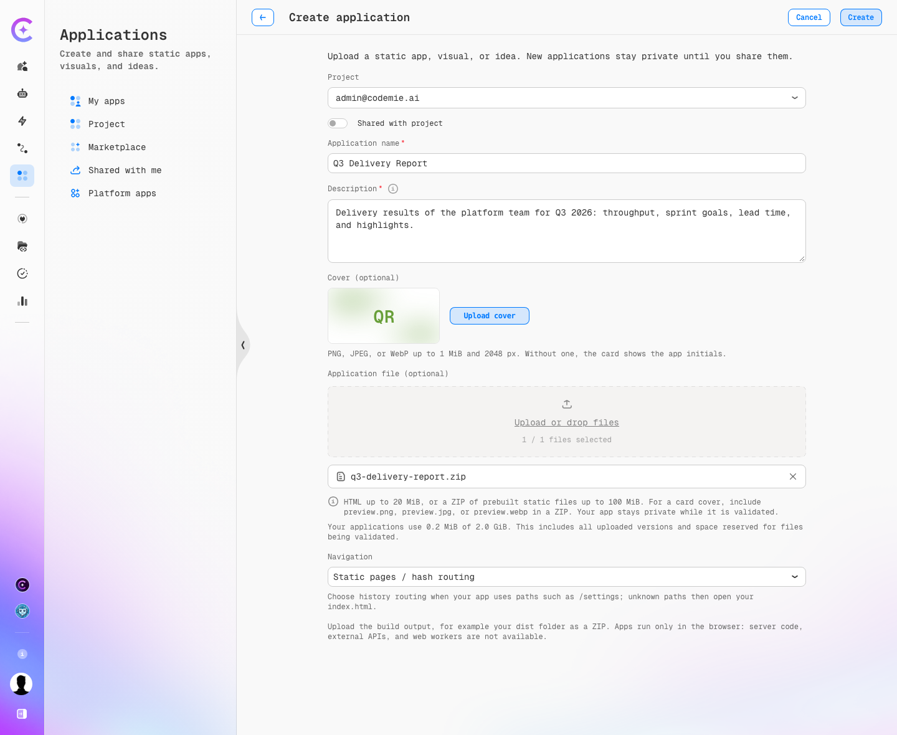

# Create and Upload a Hosted Application

An application is a container with a name, a description, a project, and a list of versions. Each upload of an HTML file or a ZIP archive creates a new version. This page describes how to create an application, upload a version, and prepare the files so that they pass the security checks.

## Create an Application

1. Open **Applications** and select **Create application**.
2. Fill in the form:

   | Field                           | Description                                                                                                                                                                                                           |
   | ------------------------------- | --------------------------------------------------------------------------------------------------------------------------------------------------------------------------------------------------------------------- |
   | **Project**                     | Required. The project that the application belongs to. Its project administrators can also manage the application.                                                                                                    |
   | **Shared with project**         | Optional. Lets all members of the project open the application. See [Share](./share.md).                                                                                                                              |
   | **Application name**            | Required, up to 120 characters.                                                                                                                                                                                       |
   | **Description**                 | Required, up to 2,000 characters. Explain what the application shows.                                                                                                                                                 |
   | **Cover (optional)**            | A PNG, JPEG, or WebP image for the card. See [Card Cover](./card-cover.md).                                                                                                                                           |
   | **Application file (optional)** | An `.html`, `.htm`, or `.zip` file. Below the field, CodeMie shows how much of the storage quota is used.                                                                                                             |
   | **Navigation**                  | Appears after a file is selected. **Static pages / hash routing** for plain HTML and sites with `#` links. **Single-page app with history routing** for React, Vite, or Angular apps that use browser history routes. |

   

3. Select **Create**.

CodeMie creates a private application, uploads the cover and the file, and then starts the security checks. The page shows the progress: **Creating private application…**, **Uploading cover…**, and **Uploading artifact, then checking its security…**. Continue with [Versions and Validation](./versions-and-validation.md).

The file is optional. Without a file, the application is created as a **Draft** with no versions, and a version can be uploaded later.

## Upload a New Version

To update an application, upload a new version. The link to the application does not change.

1. Open the application details (card menu **⋮** > **Details**).
2. Select **Upload version** in the **Versions** section, or **Upload new version** in the menu.
3. In the **Upload a new version** dialog, choose the file and the **Navigation** mode, and confirm.

The new version is checked for security first. People with access keep seeing the active version until a manager activates the new one.

## Interrupted Uploads

An upload can take up to 15 minutes. While it runs, the cancel button reads **Stop and close**. Stopping keeps the private application and its other versions.

If an upload is interrupted, for example by a lost connection, the version shows "The upload was interrupted". It has these actions:

- **Resume upload** opens the **Resume version N** dialog. Select the same file again. The transfer restarts from the beginning of the file.
- **Check file** appears when the file was fully uploaded but the checks did not start. It starts the security checks.
- **Cancel version…** removes the version.

A person can have up to 4 uploads in progress at a time.

## Prepare the Files

### Allowed Files

| Type            | Extensions                                                        |
| --------------- | ----------------------------------------------------------------- |
| Pages and code  | `.html`, `.htm`, `.css`, `.js`, `.mjs`                            |
| Data and text   | `.json`, `.csv`, `.txt`                                           |
| Images          | `.png`, `.jpg`, `.jpeg`, `.gif`, `.webp`, `.avif`, `.ico`, `.svg` |
| Fonts           | `.woff`, `.woff2`, `.ttf`, `.otf`                                 |
| Audio and video | `.mp3`, `.mp4`, `.ogg`, `.webm`                                   |

Text files (HTML, CSS, JavaScript, JSON, CSV, TXT, and SVG) must be UTF-8. Any other file type, for example `.wasm`, `.pdf`, `.xml`, or `.map`, rejects the whole version.

### What Is Rejected

- server files and folders: `server` and `ssr` folders, `server.js`, `server.mjs`, `web.config`, `nginx.conf`;
- package files and folders: `package.json`, `package-lock.json`, `node_modules`, `.git`;
- hidden files and folders (names that start with `.`). The macOS files `__MACOSX` and `.DS_Store` are removed with a warning;
- credentials, such as private keys and access tokens;
- malware;
- SVG files with `DOCTYPE` or entity declarations;
- ZIP archives that are damaged or encrypted, or that contain links, device files, unsafe paths (`../`, absolute paths, backslashes), or two paths that differ only in letter case;
- files over the size limits. See [What Can Be Uploaded](./index.md#what-can-be-uploaded).

A version is not rejected, but the security checks show a warning, when a page refers to external resources, uses `eval` or web workers, or refers to a local file that is missing from the upload. These features do not work at run time.

### Prepare a ZIP of a Build

1. Build the project for production, for example with `npm run build`.
2. Zip the **contents** of the output folder (for example `dist/` or `build/`), with `index.html` at the top level of the archive:

   ```bash
   cd dist
   zip -r ../my-app.zip .
   ```

3. Check that the archive has no source maps (`*.map`). Turn them off in the build settings, or delete them before zipping.

Each version is served from the root of its own address, so absolute asset paths such as `/assets/app.js` and the Angular `<base href="/">` work without changes.

If the ZIP has several possible site folders or several HTML pages and no `index.html`, the version stops at **Needs setup**. See [Needs Setup](./versions-and-validation.md#needs-setup).
