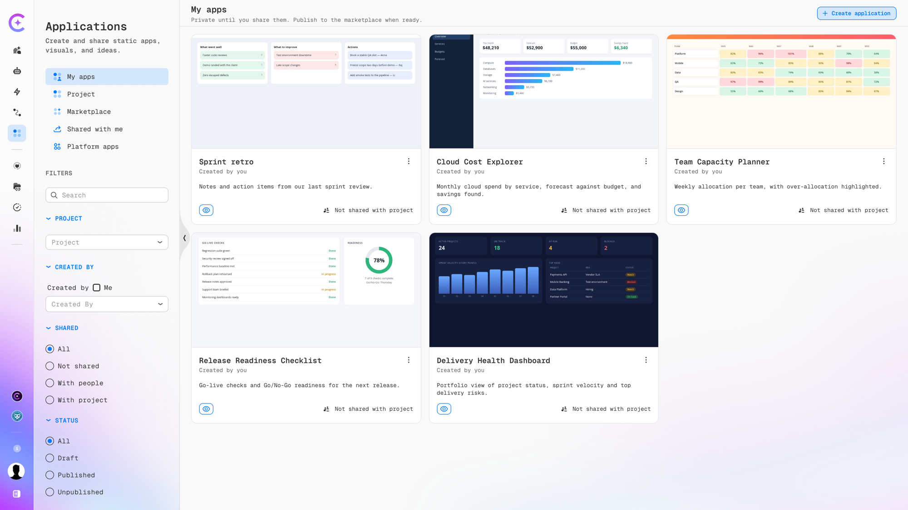

# Hosted Applications

A hosted application is a **small, static web page** that is uploaded to CodeMie and opened from the **Applications** page. It is meant for **presentations**: slides, reports, dashboards, demos, and visual walkthroughs. It is not an interactive application with a server behind it.

Typical uses:

- an HTML report or a dashboard that an AI assistant generated;
- a slide deck built with a JavaScript presentation framework;
- a prebuilt React, Vite, or Angular app that shows bundled data.

:::info Availability
The CodeMie administrator turns this feature on. If the **Applications** page shows only **Platform apps**, the feature is off for the deployment. See [Hosted Applications configuration](../../../admin/configuration/codemie/hosted-applications.md).
:::

Only internal, signed-in users can create and open hosted applications. External accounts see the feature as unavailable.

## What Can Be Uploaded

| Upload type | Limits                                                                                                                                    |
| ----------- | ----------------------------------------------------------------------------------------------------------------------------------------- |
| HTML file   | One `.html` or `.htm` file up to 20 MiB.                                                                                                  |
| ZIP archive | A prebuilt static build up to 100 MiB, 500 MiB unpacked, 5,000 files, and 50 MiB per file. No file can be compressed more than 100 times. |

Use HTML, CSS, JavaScript for display and animation, images, SVG, fonts, audio and video, and bundled JSON or CSV data. CodeMie does not build the project, so run the build locally and upload the output. Bundle every file the page needs, because nothing is loaded from other sites. The full list of file types is in [Create and Upload](./create-and-upload.md#allowed-files).

## What It Cannot Do

For security, each version runs on its own separate address, in a restricted sandbox:

- no requests to other sites: no CDNs, external APIs, or web fonts from the internet. The page can read its own bundled files, for example a JSON data file;
- no embedded frames (`iframe`), web workers, service workers, or `eval`;
- no forms or data input, because nothing can be submitted;
- no `alert`, `confirm`, or `prompt` dialogs;
- no navigation away from the page, and no downloads;
- no camera, microphone, location, USB, or payments;
- no server-side code. Server files, `node_modules`, package files, source maps, and credentials in files are rejected.

Presentation controls work: a page can switch itself to full screen, and it can open a pop-up window after a click, for example a presenter view. A pop-up window opens as a new CodeMie viewer window and has the same restrictions as the page.

The page cannot read the CodeMie page, CodeMie cookies or tokens, or the files of another application.

## The Applications Page

Open **Applications** in the main menu. The page has these tabs:

| Tab                | Content                                                                                                                                 |
| ------------------ | --------------------------------------------------------------------------------------------------------------------------------------- |
| **My apps**        | Applications created by the current user. They are private until they are shared.                                                       |
| **Project**        | Applications shared with the projects of the current user. Project administrators also see the unshared applications of their projects. |
| **Marketplace**    | Applications published for everyone in the organization.                                                                                |
| **Shared with me** | Applications that other people shared with the current user by name or by link.                                                         |
| **Platform apps**  | Applications configured by the platform team. See [Applications](../index.md).                                                          |

### Search and Filters

- **Search** finds applications by name or description.
- The **Project** and **Created by** filters are available on every hosted tab.
- On **My apps**, the **Shared** filter shows **Not shared**, **With people**, or **With project** applications.
- On **My apps**, the **Status** filter shows:
  - **Draft**: no active version, and not in the Marketplace;
  - **Published**: in the Marketplace;
  - **Unpublished**: has an active version, but is not in the Marketplace.

The most recently updated applications come first. The page shows 24 applications at a time. Select **Load more** to see more.

### Application Cards

Each card shows the cover (see [Card Cover](./card-cover.md)), the name, the creator (**Created by you** or **by** the publisher), and the sharing status: **Marketplace**, **Shared with project**, or **Not shared with project**. A card can also show a badge:

- **No active version yet**: nobody can open the application until a manager activates a version.
- **Suspended**: a platform administrator suspended the application.

Managers see a next-step button on the card: **Upload version**, **Activate version**, or **Manage**. The card menu (**⋮**) shows the actions that the current user is allowed to do: **Open**, **Details**, **Edit**, **Upload new version**, **Publish to Marketplace** or **Remove from Marketplace**, **Share**, and **Delete**.

## Who Can Do What

| Role                                                                                                    | Can do                                                                                                                                           |
| ------------------------------------------------------------------------------------------------------- | ------------------------------------------------------------------------------------------------------------------------------------------------ |
| **Managers**: the creator, the administrators of the application's project, and platform administrators | Edit the application, move it to another project, upload and activate versions, preview any version, share, publish, and delete the application. |
| **People with access**                                                                                  | Open the active version. They cannot edit or share the application, and they cannot see other versions.                                          |
| **Platform administrators**                                                                             | In addition to the manager actions, suspend and reinstate any application.                                                                       |

## Limits

| Limit                          | Value                                                                                                                                                   |
| ------------------------------ | ------------------------------------------------------------------------------------------------------------------------------------------------------- |
| Applications per person        | 500                                                                                                                                                     |
| Storage quota per person       | 2 GiB by default. The administrator can change it. It covers all versions, covers, and uploads in progress of the applications that the person created. |
| Uploads in progress per person | 4                                                                                                                                                       |
| Versions per application       | 100                                                                                                                                                     |
| Name and description           | Both are required. The name can have up to 120 characters, the description up to 2,000 characters.                                                      |

## Get Started

1. [Create and upload](./create-and-upload.md) an application.
2. Check the security checks and activate a version: [Versions and Validation](./versions-and-validation.md).
3. Set the [card cover](./card-cover.md).
4. [Share](./share.md) the application.
5. [Open](./open-and-view.md) the application.
6. [Edit, move, or delete](./manage.md) the application later.
