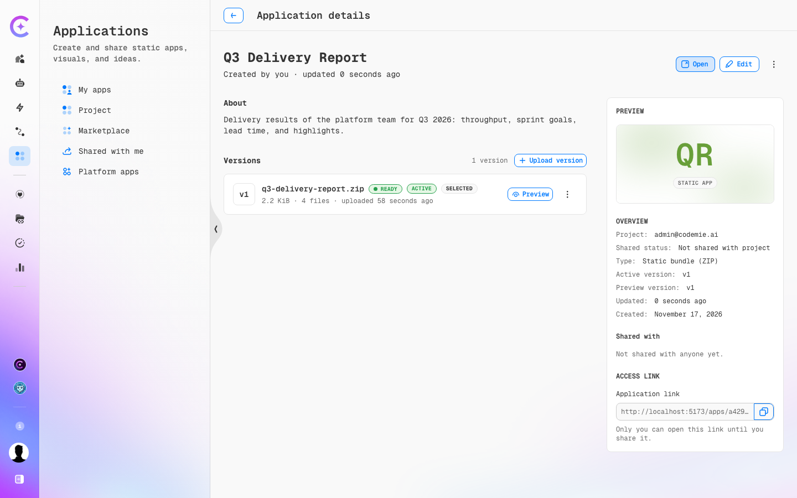

# Manage a Hosted Application

After an application is created, its managers maintain it on the details page: they edit its information, move it to another project, and delete it when it is no longer needed. Platform administrators can also suspend an application. This page describes these tasks.

## Application Details

Select **Details** in the card menu (**⋮**). The **Application details** page has:

- a header with the name, the publisher, the last update, and the **Open** and **Edit** buttons. The menu (**⋮**) has the other actions;
- **About**: the description;
- **Versions**: managers only. See [Versions and Validation](./versions-and-validation.md);
- **Preview**: the card cover;
- **Overview**: **Publisher**, **Project**, **Shared status**, **Type** (HTML file or static bundle), **Active version**, **Preview version**, **Updated**, and **Created**;
- **Shared with**: the people with access;
- **Access link**: the **Application link**, with a copy button and a note on who can open it.

## Edit an Application

1. Select **Edit** on the details page or in the card menu.
2. On the **Edit application** page, change the name, the description, the project, **Shared with project**, or the cover.
3. Select **Save**.

To change the content, upload a new version. See [Upload a New Version](./create-and-upload.md#upload-a-new-version).

Moving an application to another project changes who can manage it and, with **Shared with project** on, who can open it. The application link does not change. The storage stays in the quota of the creator.

## Delete an Application

1. Select **Delete** in the card or details menu.
2. Confirm in the **Delete this application?** dialog.

The application disappears at once, together with all its versions, its cover, and its sharing. CodeMie deletes the stored files in the background, and then frees the storage quota.

:::warning
Deletion is permanent. There is no Trash, and a deleted application cannot be restored.
:::

## Suspension

A platform administrator can suspend an application, for example after a report of harmful content.

1. Select **Suspend** in the card or details menu.
2. Enter a **Reason**, and confirm in the **Suspend this application?** dialog.

While an application is suspended:

- it stops serving visitors, and its card shows **Suspended**;
- only its creator, the administrators of its project, and platform administrators see it;
- it cannot be activated, published, moved to another project, or shared with more people. Managers can still remove access;
- its sharing is kept and applies again after reinstatement.

To clear the suspension, a platform administrator selects **Reinstate**, enters a **Reason**, and confirms. The application becomes available to visitors again. The creator of the application cannot reinstate it, even if the creator is a platform administrator.
