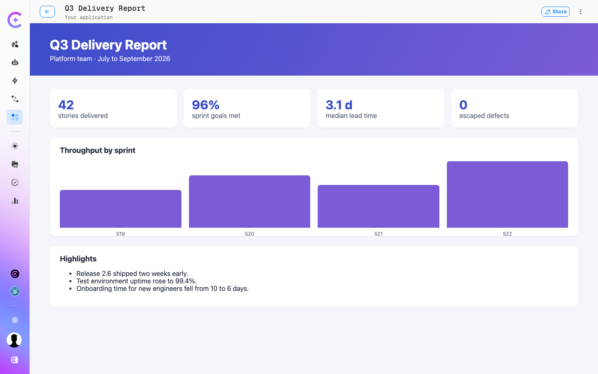

# Open a Hosted Application

Hosted applications open inside CodeMie, in the application viewer. The viewer shows the active version of the application, and it checks access every time the application loads a file. This page describes the viewer and its messages.

## Open an Application

Use one of these ways:

- select the application card on the **Applications** page;
- select **Open** in the card menu (**⋮**) or on the details page;
- open the share link, the application link, or a bookmark of the viewer page.

A share link first shows "Opening application...", grants access, and then opens the viewer.

## The Viewer

The viewer header shows the application name and one of these lines:

- **Published by** the publisher, with the note that the content is provided by its publisher. CodeMie does not create or check the content itself;
- **Your application**, for managers;
- "Previewing a version · people with access see the active version", when a manager previews a version that is not active.

The header has these actions:

- **Share**, for managers;
- the actions menu (**⋮**): **Reload** loads the application again, and **Manage application** or **Application details** opens the details page.

The application can switch itself to full screen. A pop-up window that the application opens after a click, for example a presenter view, opens as a new CodeMie viewer window. It shows the same version.

:::warning
CodeMie never asks for a password inside an application. If an application shows a sign-in form, do not enter credentials, and report the application to the CodeMie administrator.
:::

## Viewer Messages

| Message                                            | Meaning                                                                            | What to do                                                                 |
| -------------------------------------------------- | ---------------------------------------------------------------------------------- | -------------------------------------------------------------------------- |
| **No active version yet**                          | The publisher has not activated a version.                                         | Managers: upload a version and activate it. Others: contact the publisher. |
| **This version is no longer available**            | A newer version was activated after the window opened, or the version was removed. | Select **Open the current version**.                                       |
| **This application is not available**              | The application was deleted, unpublished, or suspended, or access was removed.     | Select **Return to Applications**, or contact the publisher.               |
| **Unable to open application**                     | The application could not load.                                                    | Select **Retry**.                                                          |
| "The application is busy or unavailable right now" | Too many requests at the same time.                                                | Retry in a few seconds.                                                    |
| **Applications are busy right now** (share link)   | The share link could not be opened because the service is busy.                    | Select **Try again**.                                                      |

## Access While Viewing

- Access is checked for every file that the application loads. When a manager removes access, unpublishes, or deletes the application, the next request of an open application is refused.
- Signing out of CodeMie ends the viewing sessions of the user on all devices.
- After a manager activates a new version, an open window can show **This version is no longer available**. Select **Open the current version**.
