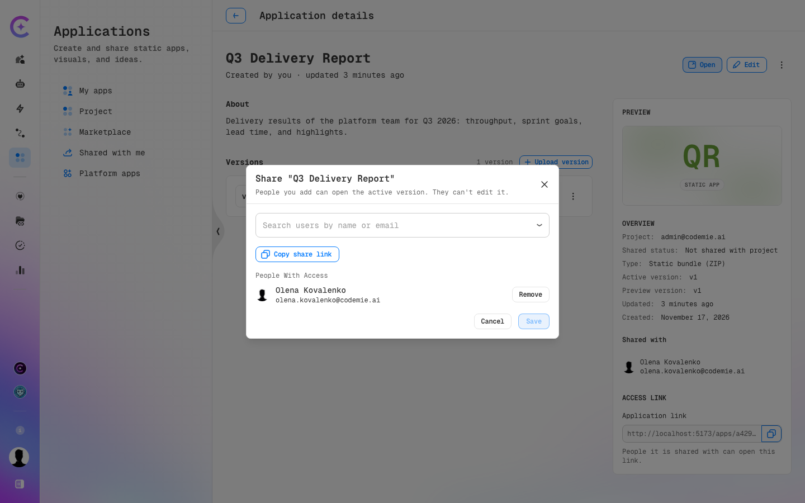

# Share a Hosted Application

New applications are private: only their managers can open them. Managers choose who else can open the **active version**. This page describes the four ways to share and how to remove access.

People with access can open the application, but cannot edit it, share it further, or see other versions. Only internal, signed-in users of the organization can open a hosted application. CodeMie does not notify people about shares, so send them the link.

## Ways to Share

| Way         | Who can open                                       | Where they find it                           |
| ----------- | -------------------------------------------------- | -------------------------------------------- |
| Project     | All members of the application's project           | **Project** tab                              |
| People      | Colleagues added by name                           | **Shared with me** tab                       |
| Link        | Every signed-in colleague who opens the share link | **Shared with me** tab, after the first open |
| Marketplace | Everyone in the organization                       | **Marketplace** tab                          |

The ways can be combined.

### Project

Turn on **Shared with project** when creating the application, or later with **Edit**. Members of the application's project then see it on the **Project** tab.

### People

1. Open the application and select **Share**, or select **Share** in the card menu (**⋮**).
2. In the search field, type at least two characters of a colleague's name or email, and select the person. People who already have access are not listed.
3. Add more people if necessary, and select **Save**.

The **People With Access** list shows everyone who has access by name or by link. People who joined through the share link have a **via link** tag.

### Share Link

Select **Copy share link** in the **Share** dialog. The first copy creates the link and copies it to the clipboard. Send the link to colleagues. A signed-in colleague who opens it gets lasting access, appears in **People With Access** with a **via link** tag, and finds the application on the **Shared with me** tab.

The link has no expiry date. To stop it, select **Revoke link** and confirm in the **Revoke the share link?** dialog:

- people who joined through the link lose access;
- people added by name keep access;
- the next **Copy share link** creates a new link.

:::note
The **Application link** on the details page is a different link. It is the permanent address of the application. Copying it does not give anybody access.
:::

### Marketplace

Select **Publish to Marketplace** in the card or details menu, and confirm with **Publish**. Everyone in the organization can then find the application on the **Marketplace** tab. There is no review step, so check the application before publishing it.

To stop it, select **Remove from Marketplace** and confirm with **Remove**. Project members, people added by name, and people who joined through the link keep their access.

An application can be in the Marketplace before it has an active version. Its card then shows **No active version yet**, and nobody can open it.

## Remove Access

| To remove                           | Do this                                                        |
| ----------------------------------- | -------------------------------------------------------------- |
| One person                          | In the **Share** dialog, select **Remove** next to the person. |
| Everybody who joined through a link | Select **Revoke link**.                                        |
| Project members                     | Turn off **Shared with project** with **Edit**.                |
| The organization                    | Select **Remove from Marketplace**.                            |

A person removed while the share link is still active can come back through the link. Revoke the link to stop this.

Access changes apply at once. An application that is already open stops loading new content for a person who lost access.

While an application is suspended, managers can remove access but cannot add it. See [Suspension](./manage.md#suspension).
