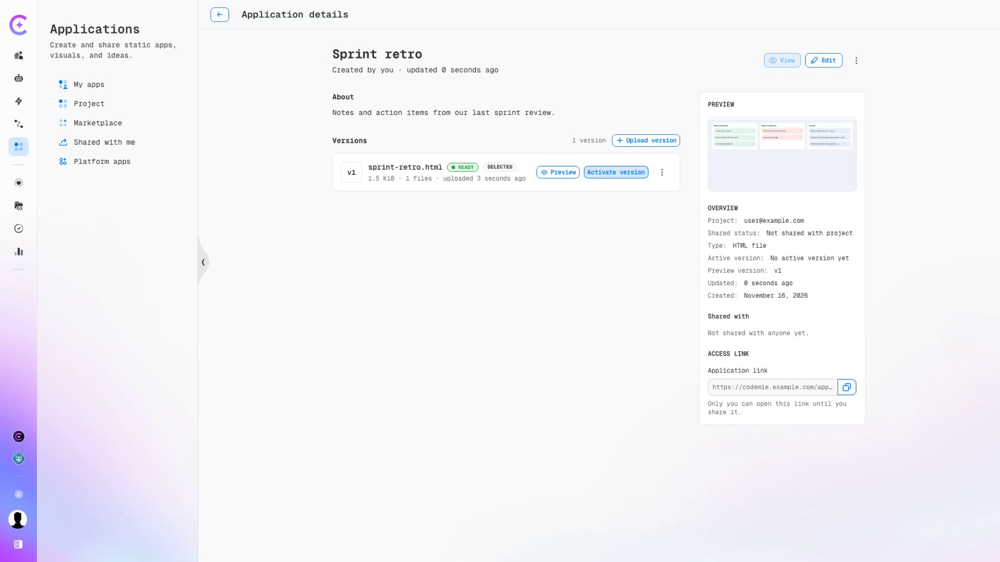
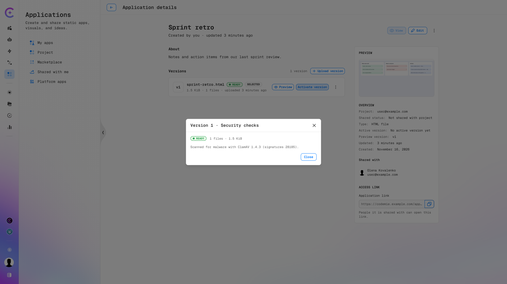
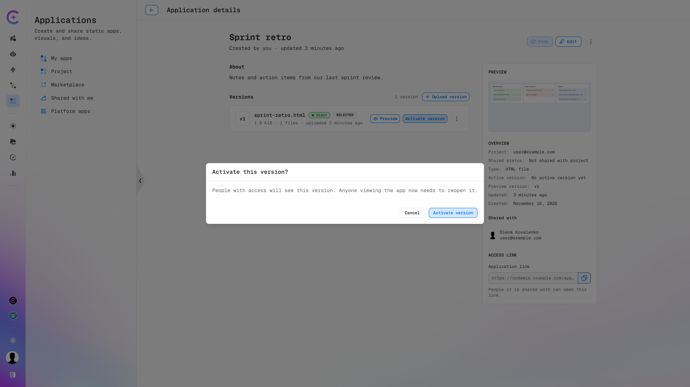

# Versions and Validation

Every upload creates a new version of the application. CodeMie checks each version for security before anybody can open it. Managers then preview the version and decide when it becomes live. This page describes the version statuses, the security checks, and how to activate or roll back a version.

Versions are managed on the application details page. To open it, select **Details** in the card menu (**⋮**), or select a card that has no active version yet. Only managers see the **Versions** section.

## Version Statuses

| Status          | Meaning                                                                                                                   | What to do                                                            |
| --------------- | ------------------------------------------------------------------------------------------------------------------------- | --------------------------------------------------------------------- |
| **Uploading**   | The file is being transferred.                                                                                            | Wait, or select **Stop and close**.                                   |
| **Queued**      | The upload is complete and waits for the security checks. The checks of the whole deployment run a few uploads at a time. | Wait.                                                                 |
| **Checking**    | CodeMie validates the files and scans them for malware and credentials. A large ZIP can take several minutes.             | Wait.                                                                 |
| **Needs setup** | The ZIP has more than one possible site folder or start page.                                                             | Select **Choose configuration**. See [Needs Setup](#needs-setup).     |
| **Ready**       | The version passed the checks.                                                                                            | **Preview** it, and **Activate version** to make it live.             |
| **Rejected**    | The version failed the security checks and can never be published.                                                        | Read **Validation details**, fix the files, and upload a new version. |
| **Failed**      | The checks did not finish because of a temporary platform condition.                                                      | Select **Retry** (up to 3 times), or upload the file again.           |
| **Canceled**    | A manager canceled the version.                                                                                           | None.                                                                 |

Two tags mark special versions:

- **Active**: the live version. All people with access see this version.
- **Selected**: the version that managers work on. The first version that passes the checks becomes **Selected**. Activating a version also makes it **Selected**. Managers see the cover of the **Selected** version on the card.

A **Ready** version can show "This version is unavailable under the current security policy". This happens after the administrator upgrades CodeMie to a stricter policy. Upload the files again to create a new version.

## Security Checks

Open the version menu (**⋮**) and select **Validation details**. The **Version N · Security checks** dialog shows:

- the status, the number of files, and their size;
- the errors that rejected the version, under **This version cannot be published**;
- the warnings, under **Findings**, with the file path and a hint for each. Select **Load more findings** to see all of them;
- the result of the malware scan with ClamAV.

The checks never show the value of a credential that they find.

### Rejection Reasons

| Reason                                       | How to fix it                                                                                                                                                        |
| -------------------------------------------- | -------------------------------------------------------------------------------------------------------------------------------------------------------------------- |
| Malware detected                             | Upload a clean file.                                                                                                                                                 |
| A credential was found                       | Remove the private key or access token, revoke it, and upload again.                                                                                                 |
| Only browser build files are allowed         | Remove server code, source maps, `node_modules`, package files, hidden files, and unsupported file types. See [Allowed Files](./create-and-upload.md#allowed-files). |
| A text file is not valid UTF-8               | Save the file as UTF-8 and upload again.                                                                                                                             |
| Unsafe SVG                                   | Export the SVG again as plain SVG, without `DOCTYPE` or entity declarations.                                                                                         |
| The file is not an HTML document             | Upload an `.html` file or a ZIP of the build.                                                                                                                        |
| No HTML page was found                       | Include an `index.html`.                                                                                                                                             |
| The ZIP is damaged or unsupported            | Create it again with a standard ZIP tool, without links, device files, or encryption.                                                                                |
| Unsafe path in the ZIP                       | Zip the build folder again. Paths cannot contain `../`, start with `/`, or use backslashes.                                                                          |
| Two paths differ only in letter case         | Rename one of the files.                                                                                                                                             |
| Too many files, too large, or too compressed | Remove files that the application does not use. See [What Can Be Uploaded](./index.md#what-can-be-uploaded).                                                         |
| The scanner could not scan the whole upload  | Upload a smaller or simpler bundle. This is a scanner limit, not a malware finding.                                                                                  |

If the malware scanner is unavailable or its signatures are out of date, the version waits or fails. A version is never accepted without a complete scan.

## Needs Setup

A ZIP stops at **Needs setup** when CodeMie cannot decide which folder is the site or which HTML page to open first. Open the version menu (**⋮**), select **Choose configuration**, and set:

- **Site root**: the folder that holds the built site, for example `dist`;
- **HTML entrypoint**: the page to open first, for example `index.html`;
- **Navigation**: **Static pages / hash routing**, or **Single-page app with history routing**.

Select **Validate configuration**. The version becomes **Ready** when the checks pass.

With **Single-page app with history routing**, a link to a route such as `/reports/2026` opens the start page, and the application shows the route. A missing file, such as an image, still gives a "not found" error. With **Static pages / hash routing**, a folder link such as `docs/` opens `docs/index.html`.

## Preview and Activate

1. When a version is **Ready**, select **Preview** to open it. Only managers can preview, and only managers see versions that are not active.
2. Select **Activate version** and confirm in the **Activate this version?** dialog.

   

The version becomes **Active** at once for all people with access. The application link does not change. A version that failed, was canceled, or is still in progress never replaces the active version.

To roll back, activate an earlier **Ready** version.

To stop a version that is not needed, open its menu (**⋮**), select **Cancel version…**, and confirm. A version can be canceled until it passes the checks.

## Version Retention

CodeMie keeps these versions:

- the **Active** version and the **Selected** version;
- the 10 newest versions that passed the checks.

Older accepted versions are removed automatically. Rejected, failed, and canceled versions are removed after 30 days. An application can have up to 100 versions at a time.
