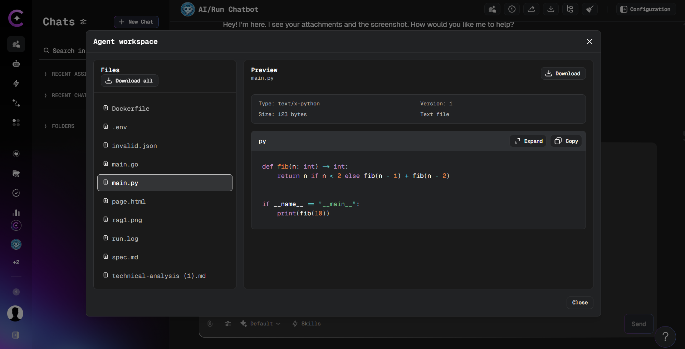
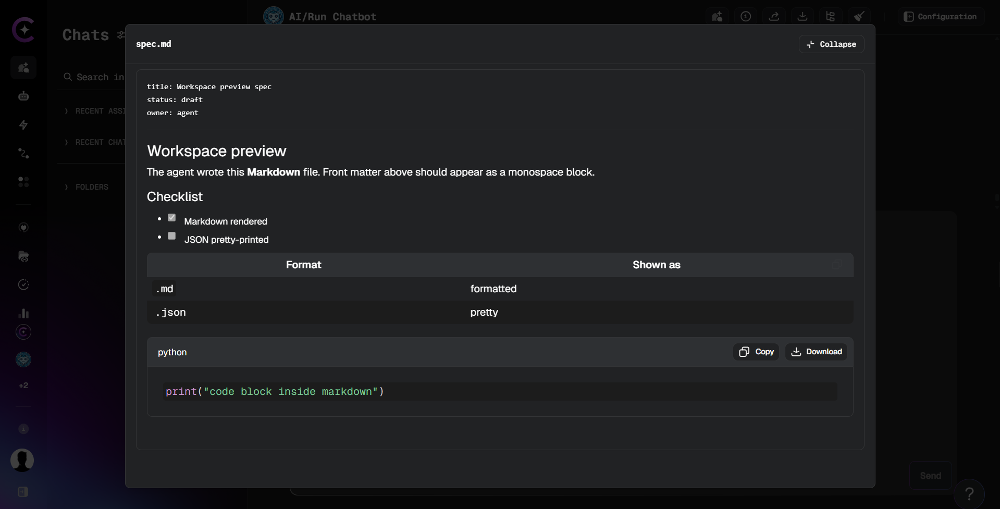

# Previewing Agent Workspace Files

Selecting a file in the **Agent workspace** dialog shows a readable preview of its content, so that agent output such as specifications, plans, reports, configuration files, logs, and diffs can be reviewed in place without downloading each file. See [Agent Workspace](./index.md) for how to open the dialog and select a file.

## What the Preview Shows

The preview type is chosen by the file extension.

| File type                                     | Preview                                                                                                                                                                                             |
| --------------------------------------------- | --------------------------------------------------------------------------------------------------------------------------------------------------------------------------------------------------- |
| Markdown (`.md`, `.markdown`)                 | Rendered as formatted Markdown with headings, lists, tables, code blocks, and diagrams, the same way as assistant replies in chat. A front matter block is shown separately (below).                |
| JSON (`.json`)                                | Pretty-printed with a 2-space indent and syntax highlighting.                                                                                                                                       |
| Text and source code                          | Shown as text with syntax highlighting, the same way as code blocks in chat. Covers logs (`.log`), diffs (`.diff`), plain text (`.txt`), and most programming, markup, and configuration languages. |
| Files without an extension and dotfiles       | Matched by the whole file name: `Dockerfile`, `Makefile`, `.env`, `.gitignore`, and similar files are shown as highlighted text.                                                                    |
| HTML (`.html`)                                | Shown as highlighted source text. The code block offers an optional sandboxed **Preview** (see [HTML Preview](../html-preview.md)).                                                                 |
| Images (`.png`, `.jpg`, `.gif`, `.svg`, etc.) | Shown as an image, fitted to the preview area. Supported image types: `apng`, `avif`, `bmp`, `gif`, `ico`, `jpeg`, `jpg`, `png`, `svg`, `webp`.                                                     |
| Anything else, or binary files                | A hint that no preview is available, listing the supported kinds: Markdown, JSON, text and source code, and common images.                                                                          |

The supported text and source extensions are the same as for code blocks in chat, for example `py`, `js`, `ts`, `tsx`, `jsx`, `java`, `go`, `rs`, `sql`, `sh`, `css`, `html`, `xml`, `yaml`, `yml`, `toml`, `ini`, `conf`, `env`, `log`, `diff`, and `txt`.



### Markdown Front Matter

A Markdown file can start with a front matter block, a section between two `---` lines at the very beginning of the file:

```markdown
---
title: Release plan
status: draft
---

# Release plan
```

In the preview, the front matter appears as a monospace block above the formatted body instead of being rendered as a horizontal rule and a heading. A file that starts with `---` but has no closing `---` line is shown as a regular document.

### JSON Files

Valid JSON is reformatted with a 2-space indent for readability. A file that is not valid JSON is shown exactly as stored, without an error message. JSON containing integers of 16 or more digits is also shown unchanged, so that large identifiers are not altered by reformatting.

The preview formats only what is displayed. The stored file and the downloaded file remain unchanged.

## Copying Content

Text, source code, and JSON previews use the same code block as chat replies, with a **Copy** button that copies the displayed text. The code block's own Download button is hidden in the workspace browser, because it would save the displayed text as a generic code file. The **Download** button of the dialog downloads the actual workspace file. Code blocks inside a rendered Markdown file behave as in chat replies and keep their own **Copy** and **Download** buttons.

## Expanding a Preview

Long documents are easier to read in a larger view. Every previewed file can be expanded:

1. In the **Preview** header, click **Expand**. For text, source code, and JSON, the **Expand** control of the code block is used.
2. The file opens in a large popup titled with the file path.
3. To return to the dialog, click **Collapse**, or press `Esc`.



:::info
Pressing `Esc` in the expanded popup closes only the popup. The **Agent workspace** dialog stays open and the same file stays selected. Pressing `Esc` when nothing is expanded closes the dialog.
:::

For text, source code, and JSON, the expanded popup keeps the **Copy** button and, as in the regular preview, has no code-block Download button. Images are fitted to the popup, and the whole image stays visible.

The expanded popup opens at the top of the file. The scroll position of the regular preview is not preserved.

## Downloading Files

The **Download** button in the **Preview** header downloads the selected file as stored in the workspace. It works for every file, including those without a preview.

## Security

Workspace files are never executed in the application:

- HTML files are displayed as text. Only the optional **Preview** of the code block renders HTML, inside an isolated sandbox, as for HTML in chat.
- HTML embedded in Markdown files is not rendered, as in assistant replies in chat. Tags such as `<script>` or `` appear as literal text, so no script, event handler, or `javascript:` link is ever executed. The output is additionally sanitized before display.

## Limitations

- Files are read-only. Editing is not available in the workspace browser.
- PDF, Office documents, and other binary formats have no preview and can only be downloaded.
- Large files are rendered in full without truncation, so previewing a very large file can take longer.
