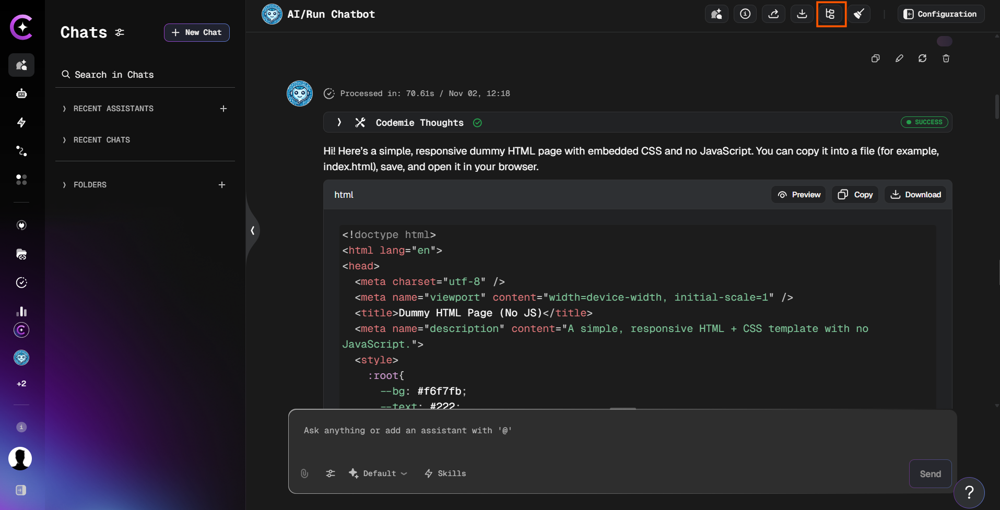
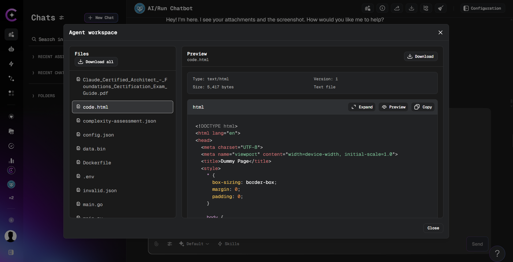

# Agent Workspace

Each chat has an agent workspace: a set of files that the assistant creates or modifies while working on a request, such as specifications, plans, reports, configuration files, logs, and diffs. The **Agent workspace** dialog gives access to these files directly from the chat.

## Opening the Workspace Browser

1. Open a chat with an assistant.
2. In the chat header, click the **Browse files** button. The **Agent workspace** dialog opens.

   

3. Select a file in the list on the left. The **Preview** area on the right shows its content.

   

If the chat has no workspace files, the dialog shows **No files found.** Until a file is selected, the preview area shows **Select a file from the list to see its preview.**

## Dialog Layout

- **Files** (left): the list of workspace files, each shown with its full path.
- **Preview** (right): the header shows the path of the selected file, or the workspace name before a file is selected (**No file selected** if the workspace has no name). The header also holds the **Expand** and **Download** buttons.
- **Details block**: above the preview, information about the selected file:

| Field                       | Description                                        |
| --------------------------- | -------------------------------------------------- |
| **Type**                    | MIME type of the file, for example `text/markdown` |
| **Version**                 | Version of the file in the workspace               |
| **Size**                    | File size in bytes                                 |
| **Text file / Binary file** | Whether the file content is text or binary         |

While a list or preview is loading, a spinner is displayed. If loading fails, an error message appears above the preview. The **Close** button in the dialog footer closes the dialog.

## Capabilities

| Capability                        | Description                                                                                                   |
| --------------------------------- | ------------------------------------------------------------------------------------------------------------- |
| [File preview](./file-preview.md) | Readable preview of Markdown, JSON, logs, source code, and images, with an expanded view for long files.      |
| Download                          | The **Download** button downloads the selected file as stored in the workspace. It works for every file type. |

## Topics

- [Previewing Agent Workspace Files](./file-preview.md) - Supported file types, front matter, JSON formatting, copying, and the expanded view
