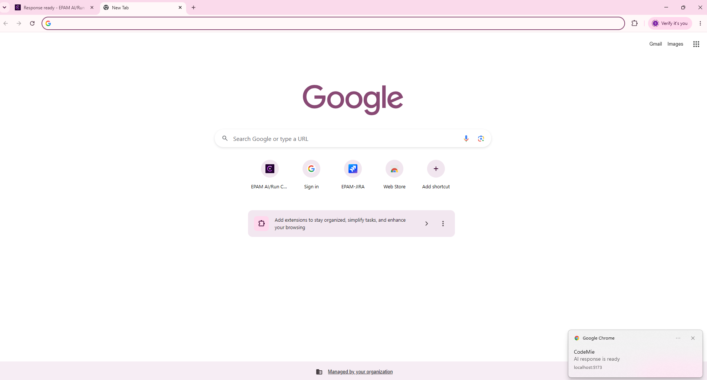
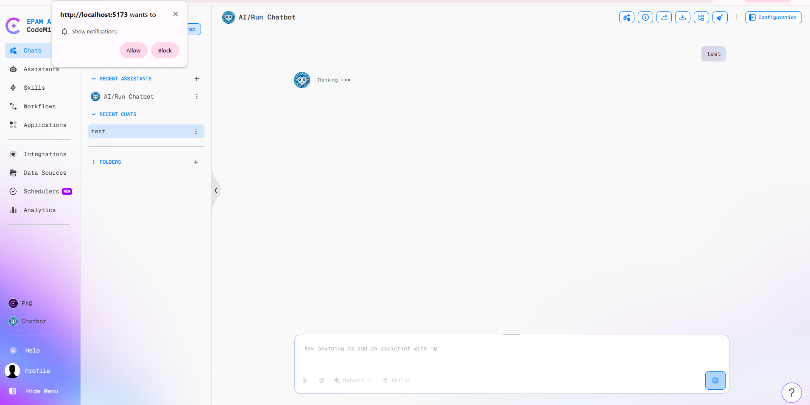

# Response Ready Notifications

When an AI response takes a while to generate, the CodeMie tab does not need to stay in focus. If the response completes while the tab is in the background, CodeMie signals that the response is ready through the **browser tab title** and, when allowed, a **browser notification**.

## How It Works

The signals appear only when all of the following conditions are met:

- A prompt was submitted in a chat and the response was still being generated.
- The CodeMie browser tab became inactive before the response completed (another tab or window was in focus).
- The response completed successfully.

| Signal                   | Behavior                                                                                                                   |
| ------------------------ | -------------------------------------------------------------------------------------------------------------------------- |
| **Tab title**            | The tab title is prefixed with `Response ready -`, for example `Response ready - EPAM AI/Run CodeMie`.                     |
| **Browser notification** | A notification titled **CodeMie** with the text **AI response is ready** is shown, if notification permission was granted. |
| **Screen reader**        | A hidden status message, `AI response ready`, is added to the page for assistive technologies.                             |

Returning to the CodeMie tab clears the indicator and restores the normal tab title.

:::info
The tab title indicator works in every browser and does not require any permission. The browser notification is an optional addition.
:::

### When No Signal Is Shown

CodeMie does not change the tab title and does not show a notification when:

- The CodeMie tab is active at the moment the response completes.
- The response failed with an error.
- Generation was stopped or interrupted by the user.

## Enabling Browser Notifications

Browsers allow a permission prompt only as a result of a user action. CodeMie therefore requests notification permission when a prompt is submitted in the chat, if the permission has not been decided yet.

1. Submit a prompt in a chat.
2. When the browser asks whether to allow notifications from the CodeMie site, select **Allow**.
3. From then on, a notification is shown whenever a response completes while the tab is inactive.

If the permission prompt is dismissed or denied, CodeMie does not ask again until the page is reloaded, and the tab title indicator continues to work.

If no prompt appears within about 10 seconds after submitting a prompt, CodeMie shows an information message: **Notifications are not enabled**. Some browsers suppress the prompt, in which case notifications must be allowed for the site manually in the browser settings.

### Allowing Notifications in Browser Settings

Open the site settings from the lock icon (or site information icon) in the browser address bar and set **Notifications** to **Allow** for the CodeMie site. The exact location differs between browsers.

To stop receiving notifications, set **Notifications** back to **Block** in the same place. The tab title indicator remains active.

## Unsupported Browsers

In browsers that do not support the Notification API, or when the permission is denied, no notification is shown and no error is displayed. The tab title indicator is still applied.

## Related Documentation

- [Chat Input Settings](./chat-input-settings.md)
- [Assistants Overview](./index.md)
