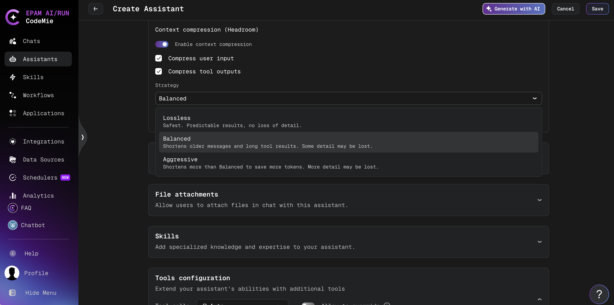
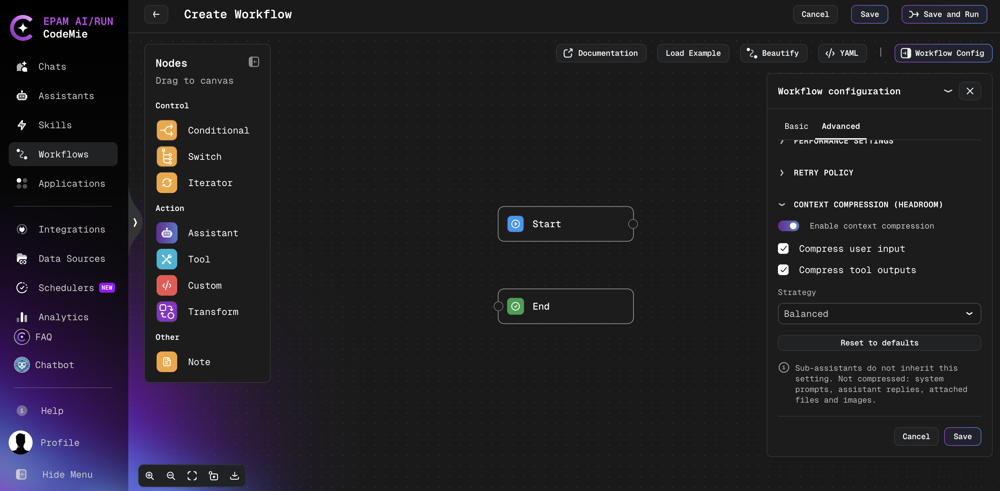
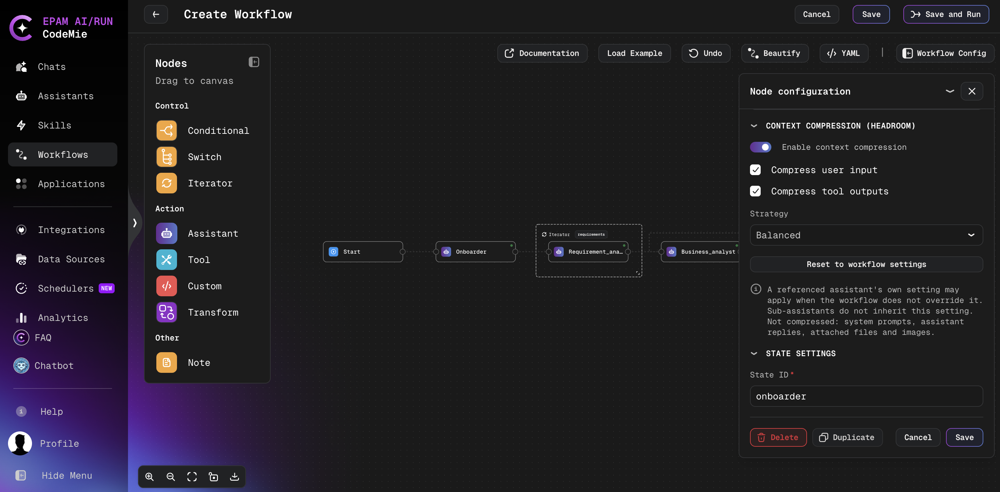
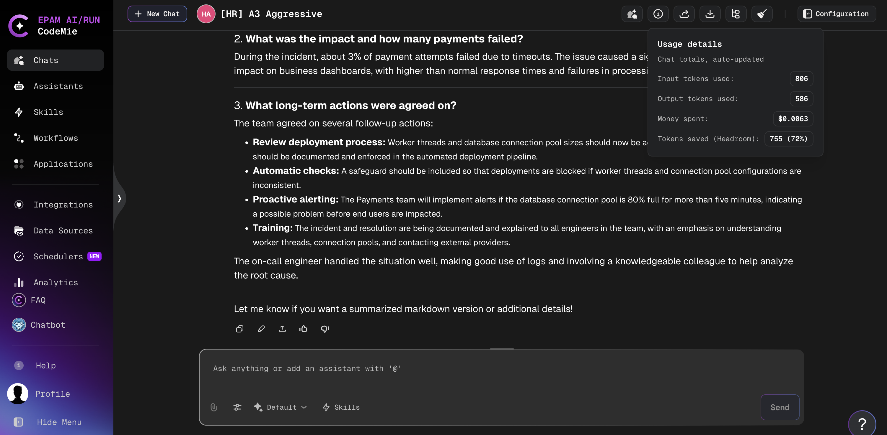
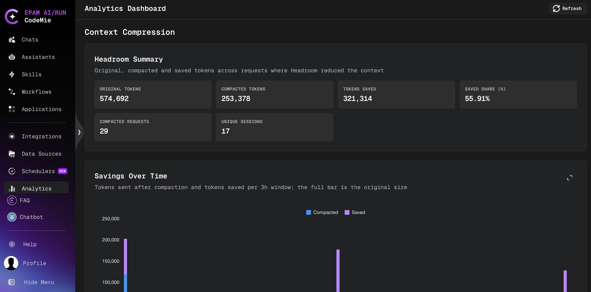

# Context Compression (Headroom)

Long conversations and large tool results, such as file contents, logs or API responses, make every model call bigger. Headroom compresses this context before each model call, so an assistant uses fewer tokens for the same task. Compression is configured per assistant, and a workflow or a single workflow node can override it.

Assistants without a Headroom configuration behave exactly as before.

:::info Availability
Context compression is available only when a platform administrator has enabled it for the instance. When it is not enabled, the settings described on this page are not shown. Administrators can find the setup steps in [Headroom Context Compression Configuration](../../admin/configuration/codemie/headroom-configuration.md).
:::

## What Is Compressed

| Content                            | Compressed                                                                                                                                                    |
| ---------------------------------- | ------------------------------------------------------------------------------------------------------------------------------------------------------------- |
| User messages                      | Yes, when **Compress user input** is selected                                                                                                                 |
| Tool outputs fed back to the model | Yes, when **Compress tool outputs** is selected                                                                                                               |
| Earlier assistant replies          | Never. The assistant's own answers reach the model word for word, so follow-up requests such as "continue with step 4 of the plan" refer to the original text |
| System prompt                      | Never                                                                                                                                                         |
| Attached files and images          | Never                                                                                                                                                         |
| Calls to sub-assistants            | Never. Each sub-assistant uses its own setting                                                                                                                |

Small contexts are not compressed. If compression fails or takes too long, the original messages are sent to the model, so the answer is never blocked.

## Strategies

| Strategy               | Behavior                                                                     | When to use                                                                  |
| ---------------------- | ---------------------------------------------------------------------------- | ---------------------------------------------------------------------------- |
| **Lossless**           | Safest. Predictable results, no loss of detail                               | Precise data matters, or the LLM provider's prompt caching must keep working |
| **Balanced** (default) | Shortens older messages and long tool results. Some detail may be lost       | Most assistants with long conversations or large tool outputs                |
| **Aggressive**         | Shortens more than **Balanced** to save more tokens. More detail may be lost | Maximum savings where approximate context is acceptable                      |

:::warning Prompt caching
**Balanced** and **Aggressive** rewrite older messages. This can reduce the share of the prompt that the LLM provider serves from its prompt cache. Choose **Lossless** when prompt-cache hits matter more than context size.
:::

## Enable Compression for an Assistant

1. Open the assistant for editing, or start creating a new one. See [Create an Assistant](./create-assistant.md).
2. In the **Context** section, find **Context compression (Headroom)**.
3. Turn on **Enable context compression**.
4. Select what to compress:
   - **Compress user input** — compress user messages.
   - **Compress tool outputs** — compress tool results, such as file contents, logs or API responses.
5. Select a **Strategy**.
6. Save the assistant.



The setting applies from the next message in any chat with the assistant. Changing Headroom settings does not create a new assistant version.

## Configure Compression in Workflows

A workflow can set compression for all its assistant nodes and override it for single nodes.

### How Settings Are Combined

Each setting is taken from the first level where it is set:

1. Node
2. Workflow
3. The assistant's own setting
4. Off

The settings are inherited one by one. For example, a node that sets only **Strategy** keeps **Enable context compression** from the workflow. A node with compression turned off is not compressed even when the workflow enables it.

Workflow and node settings apply only to the node's own assistant. Sub-assistants called by the node use their own saved setting.

### Set Compression for the Whole Workflow

1. Open the workflow in the Visual Editor. See [Create a Workflow](../workflows/create-workflow.md).
2. Select **Workflow Config**.
3. Open **Advanced**.
4. Expand **Context compression (Headroom)**.
5. Turn on **Enable context compression**, select what to compress and select a **Strategy**.
6. Save the configuration and the workflow.



The settings apply to every assistant node that does not override them. To remove the workflow-level settings, select **Reset to defaults**.

### Override Compression for a Node

1. In the Visual Editor, select an assistant node to open its configuration.
2. Expand **Context compression (Headroom)**.
3. Change only the settings that must differ from the workflow. Settings left empty show the inherited value as a placeholder and keep inheriting it.
4. Save the node configuration and the workflow.



To remove the node override and use the workflow settings again, select **Reset to workflow settings**.

:::tip Opt a single node out
To exclude one node from compression, turn off **Enable context compression** on that node only. The other nodes keep the workflow setting.
:::

### Configure Compression in YAML

The same settings can be written in the workflow YAML with a `headroom` block. Changes in the YAML and in the Visual Editor stay synchronized.

```yaml
headroom: # workflow level, applies to every assistant node
  enabled: true
  strategy: balanced

assistants:
  - id: analyst
    assistant_id: 00000000-0000-0000-0000-000000000000
    headroom: # node level, overrides the workflow block
      strategy: aggressive

  - id: scribe
    system_prompt: 'Summarize the analysis.'
    headroom:
      enabled: false # this node is not compressed
```

Both blocks accept `enabled`, `compress_user_messages`, `compress_tool_outputs` and `strategy` (`lossless`, `balanced` or `aggressive`). Any other key inside a `headroom` block fails validation. See the [Configuration Reference](../workflows/configuration/configuration-reference.md).

:::note
A block that sets `strategy` without `enabled` anywhere in the chain leaves compression off. Set `enabled: true` at the workflow or node level, or enable compression on the assistant.
:::

## Check the Results

### In a Chat

1. Open a conversation with an assistant that has compression enabled.
2. Send a message that produces a large context, for example a request that reads a long file or calls a tool with a large response.
3. In the chat header, open **Usage details**.

When tokens were saved, the details show **Tokens saved (Headroom)** with the number of tokens and the share of the original context. The row is not shown when nothing was saved, for example when the context was below the minimum size for compression.



### In Analytics

1. Select **Analytics** in the left navigation. The dashboard opens on the **Insights** tab. See [Analytics Dashboard](../analytics/index.md).
2. Set the time, user and project filters as needed.
3. Scroll to the **Context Compression** section.



The section contains:

- **Headroom Summary** — original, compacted and saved tokens across requests where Headroom reduced the context.
- **Savings Over Time** — tokens sent after compaction and tokens saved per time window. The full bar is the original size.
- **Savings by Strategy** — requests and tokens per strategy, with the share of original tokens saved. Requests that combine several strategies, such as workflows with different node settings, are shown as `mixed`.

Savings from workflow executions are included in Analytics together with chat savings.

## Limitations

- Compression is not applied to AWS Bedrock agents, remote A2A assistants or structured-output calls.
- Messages that contain images or attached files keep their original content.
- **Aggressive** can noticeably degrade long text. If answers lose important details, switch to **Balanced** or **Lossless**.
