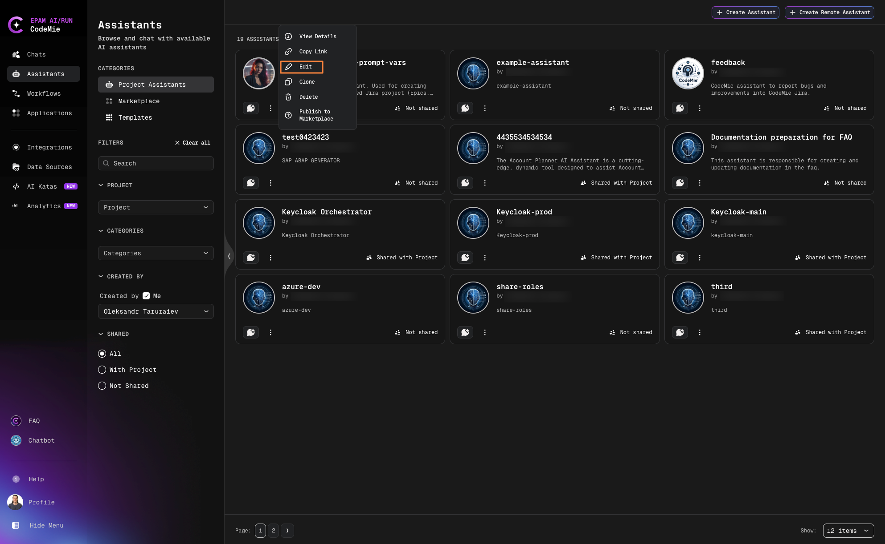
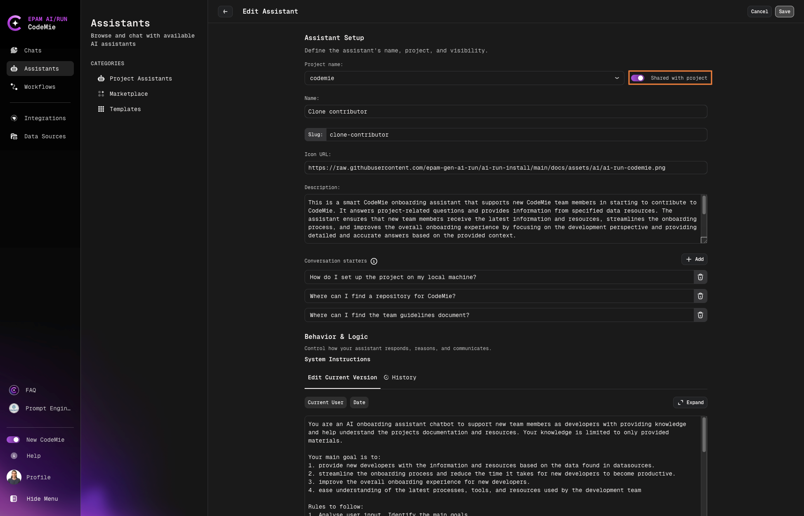

# Share Assistants

Finely tuned assistants are valuable resources that can benefit your entire team. AI/Run CodeMie provides flexible options for sharing assistants within projects and across your organization.

## Share Within Project

Share an assistant with your project team using the built-in toggle:

1. Navigate to **Assistants** → **Project Assistants**.

2. Click the **Actions** button (⋮) next to the assistant and select **Edit**:

   

3. Enable the **Shared with Project** option:

   

4. Scroll down and click **Save**.

:::tip Team Access
When shared with the project team, all team members can view and use the assistant in their chats while the original configuration remains under your control.
:::

### Personalizing Prompt Variables

If the assistant uses prompt variables (e.g. `{{user_name}}`, `{{user_id}}`), each project member can set their own values independently. These are personal overrides — they apply only to your sessions and do not change the assistant's default values or affect other users.

To set your own values:

1. Open the shared assistant and go to its details page.
2. Scroll to the **Prompt Variables** section.
3. Edit the values you want to personalize.
4. Click **Save** next to each variable.

Your values are stored per-user and applied automatically every time you chat with this assistant.

:::tip When to use this
This is useful when the assistant's prompt references personal attributes, for example:

- Your display name for tagging tickets: `{{user_name}}`
- Your user ID for system lookups: `{{user_id}}`
- Your job title or project role: `{{role}}`
  :::

## Share with Specific Users

An assistant can be shared with selected colleagues without exposing it to the whole project. Access is granted per user and can be revoked at any time. This mechanism is independent of the **Shared with Project** option, which remains unchanged.

:::info Prerequisites
Sharing with specific users is available only when the platform runs in [platform-managed mode](../../admin/configuration/access-control/platform-managed-mode-configuration.md) (`ENABLE_USER_MANAGEMENT=True`). The **Share** action is not displayed otherwise.
:::

### What Recipients Can Do

A user who has been granted access can:

- Find the assistant in **Assistants** → **Project Assistants** under their personal project.
- Open the assistant details and view its full configuration, including the system instructions.
- Start and continue conversations with the assistant.

A user who has been granted access cannot:

- Edit or delete the assistant.
- Share the assistant with other users or revoke access of others.
- See the **Share** action or the **SHARED WITH** list.

### Grant Access

Only the assistant owner can grant access, and only to internal CodeMie users. External users are not available in the search results.

1. Navigate to **Assistants** → **Project Assistants**.

2. Click the **Actions** button (⋮) next to the assistant and select **Share**.

3. In the **Share assistant** dialog, type at least two characters of a name or email in the **Search users by name or email** field. Matching users are displayed with their avatar, name and email.

4. Select one or more users. Selected users appear as removable chips in the field.

5. Click **Save**. The selected users receive access immediately.

:::note
The owner cannot be added to the list, and users who already have access are excluded from the search results.
:::

### Review and Revoke Access

The **Share assistant** dialog also lists everyone who currently has access under **People With Access**. For a long list, the area scrolls vertically.

To revoke access:

1. Open the **Share assistant** dialog as described above.
2. Click **Remove** next to the user.

Access is revoked immediately, without clicking **Save**. The user no longer sees the assistant in the assistants list and cannot open or chat with it.

The owner can also review the list of users with access in the **SHARED WITH** section of the assistant details page.

### Combine with Project Sharing

Sharing with specific users and **Shared with Project** can be used together. Project members keep access through the project, and the selected users keep access individually. Turning off **Shared with Project** does not remove per-user access.

On the assistant cards, the status label refers to project-level sharing only:

| Label                       | Meaning                                                |
| --------------------------- | ------------------------------------------------------ |
| **Shared with project**     | The assistant is visible to all members of the project |
| **Not shared with project** | The assistant is not shared project-wide               |

### Limitations

- **Personal integrations**: an assistant that uses personal (user-level) integrations cannot be shared with specific users. Replace them with project integrations first. Personal integrations also cannot be added to an assistant that is already shared with users.
- **Runtime context**: a recipient runs the assistant under their own account, not as the owner. Indexed data source content is available without separate data source access. Integrations selected in the assistant's tools are used as configured, also for recipients who are not members of the project. Tools without a selected integration use the recipient's own integrations. Sub-assistants that are private to the owner are not available to the recipient.
- **Deleting an assistant** removes all granted access automatically.
- **Out of scope**: sharing with external users, edit or collaboration access, and bulk or group sharing.

## Share Beyond Projects

For sharing assistants across projects or with external collaborators, consider using the [Marketplace](./marketplace-overview.md) to publish your assistant configuration.
