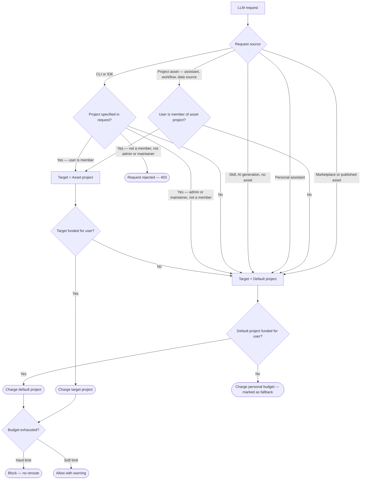

import EnterpriseFeature from '@site/src/components/EnterpriseFeature';

# Budget Attribution

<EnterpriseFeature />

The budget attribution matrix defines which project is charged for every LLM request on
the platform — across assistants, workflows, data sources, CLI sessions, and triggered
runs. Every request follows two steps:

1. **Identify the target project** from the [Attribution Matrix](#attribution-matrix) below,
   based on the asset type and the user's relationship to it.
2. **Walk the fallback chain**: target project → default project → personal budget. The
   first funded step is charged.

---

## Key Terms

| Term                | Definition                                                                                                                                                                                                                                                                          |
| ------------------- | ----------------------------------------------------------------------------------------------------------------------------------------------------------------------------------------------------------------------------------------------------------------------------------- |
| **Asset project**   | The project the assistant, workflow, or data source belongs to.                                                                                                                                                                                                                     |
| **Default project** | The project assigned as the user's default in Users Management. Without an admin assignment: the user's personal project. Without a personal project: the alphabetically first of the user's projects. In IDP-claims mode (Users Management disabled): always the personal project. |
| **Personal budget** | The user's personal or platform-level budget. The final step in every fallback chain.                                                                                                                                                                                               |
| **Funded**          | A project is funded for a user when it has at least one active budget **and** an allocation for that user. A project budget with no allocation for the user counts as not funded for that user.                                                                                     |

---

## Attribution Rule

Pick the target from the [Attribution Matrix](#attribution-matrix) below, then walk the
fallback chain in order:

**target project → Default project → Personal budget**

Charge the first step that is funded. Skip any step that would repeat a previous one.

An **exhausted** budget is not unfunded — it cannot be bypassed. A hard limit blocks the
request; a soft limit allows it with a warning. Neither case triggers a reroute to the next
step in the chain.

---

## Decision Flowchart

---

## Attribution Matrix

The matrix identifies the **target** for each request type. After the target is known, the
fallback chain **target project → Default project → Personal budget** applies automatically.

### Personal Assistants

| Condition                                   | Target                             | Fallback chain                    |
| ------------------------------------------- | ---------------------------------- | --------------------------------- |
| Owner has an admin-assigned default project | Default project                    | Default project → Personal budget |
| Owner has no admin-assigned default         | Default project = personal project | P                                 |

### Project Assistants, Workflows, and Data Sources

| Condition                                                                       | Target          | Fallback chain                    |
| ------------------------------------------------------------------------------- | --------------- | --------------------------------- |
| User is a member of the asset project; asset project is funded for the user     | Asset project   | —                                 |
| User is a member of the asset project; asset project is not funded for the user | Default project | Default project → Personal budget |
| User is not a member of the asset project (shared with user)                    | Default project | Default project → Personal budget |

### Marketplace (Published) Assets

| Condition                                                 | Target          | Fallback chain                    |
| --------------------------------------------------------- | --------------- | --------------------------------- |
| User is a member of the assistant's or workflow's project | Default project | Default project → Personal budget |
| User is not a member                                      | Default project | Default project → Personal budget |
| Asset is owned by the user's personal project             | Default project | Default project → Personal budget |

Marketplace assets always charge the user's default project — regardless of project
membership. This supersedes earlier behavior where a member's spend was charged to the
asset's project.

### Workflows — Nodes and Sub-Assistants

| Condition                                                | Target                                                                     | Fallback chain   |
| -------------------------------------------------------- | -------------------------------------------------------------------------- | ---------------- |
| A workflow node calls a saved assistant from any project | Rows 1–8 applied to that saved assistant, for the user who started the run | Same as rows 1–8 |

Each node is attributed independently. The workflow's own project is not automatically
charged for nodes that delegate to assistants from other projects.

### Skills and AI Generation (No Asset)

| Condition                                                                     | Target          | Fallback chain                    |
| ----------------------------------------------------------------------------- | --------------- | --------------------------------- |
| Skill run, workflow generation, or any AI generation with no associated asset | Default project | Default project → Personal budget |

### Data Source Indexing

| Condition                                                                                 | Target          | Fallback chain                    |
| ----------------------------------------------------------------------------------------- | --------------- | --------------------------------- |
| Indexing started by a member of the data source's project; project is funded for the user | Asset project   | —                                 |
| Indexing started by a member; project is not funded for the user                          | Default project | Default project → Personal budget |
| Indexing started by a user who is not a member of the data source's project               | Default project | Default project → Personal budget |

### CLI and IDE Requests

| Condition                                                       | Target                                      | Fallback chain                                    |
| --------------------------------------------------------------- | ------------------------------------------- | ------------------------------------------------- |
| No project specified in the request                             | Default project                             | Default project → Personal budget                 |
| Explicit project; user is a member                              | That project                                | Default project → Personal budget (if not funded) |
| Explicit project; user is not a member; not admin or maintainer | Request rejected (403)                      | —                                                 |
| Explicit project; user is not a member; admin or Maintainer     | Default project (header ignored and logged) | Default project → Personal budget                 |

When a request falls back to the default or personal budget because the explicit project
was ignored, the named project is not charged and does not appear in analytics for that
request.

Web traffic and CLI traffic must resolve to the same personal budget when both fall back.
Assigning a default project to users ensures consistent attribution across all entry points.

### Scheduled and Webhook Triggers

| Condition         | Target                                                                                                            | Fallback chain |
| ----------------- | ----------------------------------------------------------------------------------------------------------------- | -------------- |
| Any triggered run | Rows from the sections above, applied to the trigger owner using the owner's real memberships and default project | Same           |

Triggered runs are attributed as if the trigger owner had run the asset interactively. If
the trigger owner has no memberships or default project, the request falls through to the
personal budget.

### Special Cases

| Scenario                                     | Behavior                                                    |
| -------------------------------------------- | ----------------------------------------------------------- |
| User with personal credentials (own API key) | Personal key pays — platform attribution rules do not apply |
| Chosen budget is exhausted — hard limit      | Request blocked; not rerouted to the next step in the chain |
| Chosen budget is exhausted — soft limit      | Request allowed with a warning; not rerouted                |

---

## Analytics Attribution

Usage analytics record each charged request with the following fields:

| Field                    | Description                                                                                                                                                                                                                                                                |
| ------------------------ | -------------------------------------------------------------------------------------------------------------------------------------------------------------------------------------------------------------------------------------------------------------------------- |
| `project`                | The project whose budget was actually charged.                                                                                                                                                                                                                             |
| `budget_fallback_from`   | Present only on fallback requests. The name of the project that was targeted but had no funded budget for the user.                                                                                                                                                        |
| `budget_fallback_kind`   | Present only on fallback requests. `default_project` when the charge landed on the user's default project; `personal` when it landed on the personal budget. Use this field to distinguish the two fallback types — `budget_fallback_from` alone does not tell them apart. |
| `budget_funding_unknown` | `true` when the fallback decision was made while the funding check for the target project could not be completed (for example, a transient error). The request proceeded rather than being blocked, and the recorded attribution reflects the fallback that was applied.   |

---

## Edge Cases

### IDP-Claims Mode

When the platform runs in IDP-claims mode (Users Management disabled), no admin-assigned
default project is populated. The personal project is used as the derived default for every
user — the same behavior as a user with no admin-assigned default.

### Budget Cache

Attribution decisions are cached for approximately one minute. After an admin changes a
user's default project or adjusts an allocation, the new attribution applies to subsequent
requests within that delay. Previously recorded spend is not moved to the new project.

---

## See Also

- [Budget Management](./index.md) — budget types, categories, budget priority, and enforcement
- [Project Budgets](./project-budgets.md) — creating and managing per-project budget allocations
- [Default Project](./index.md#default-project) — assigning default projects in Users Management
- [Chargeback and Cost Centers](./chargeback-cost-centers.md) — internal billing attribution
