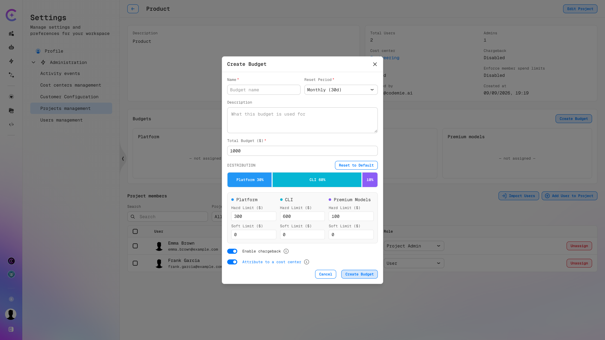
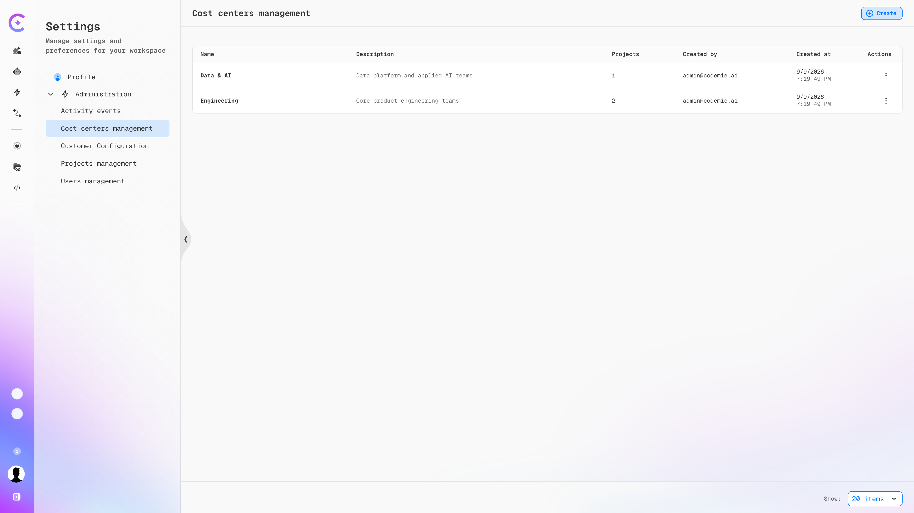
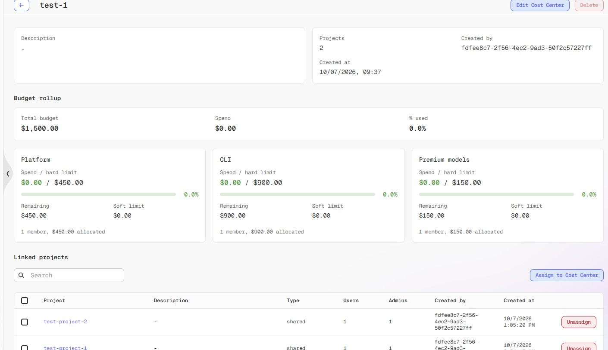
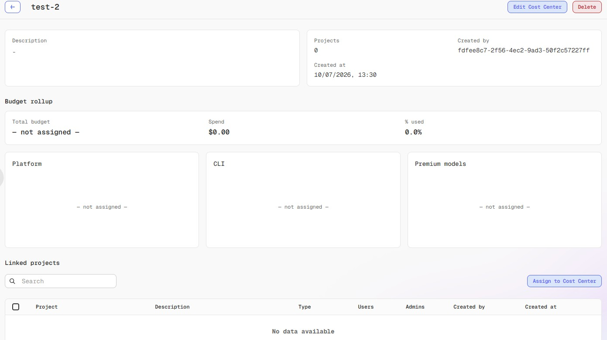

import EnterpriseFeature from '@site/src/components/EnterpriseFeature';

# Chargeback and Cost Centers

<EnterpriseFeature />

A [project budget](./project-budgets.md) decides how much a project may spend. Chargeback and cost
centers decide **who pays for it**.

- **Chargeback** marks a project's spend as billable, so it can be recovered from the team that
  incurred it rather than absorbed centrally.
- A **cost center** groups several projects — a program, a department, or a client engagement — so
  their combined AI spend settles on one bill.

The two are independent of enforcement: neither blocks a request or changes a limit. They determine
where the spend is attributed for internal billing.

## Chargeback

### Enabling Chargeback

Chargeback is configured on the project's budget.

1. Go to **Administration → Projects Management** and select the project.
2. Open the budget dialog — **Create Budget** for a new budget, or **Manage Budget** for an existing
   one.
3. Switch on **Enable chargeback**.
4. Optionally switch on **Attribute to a cost center**, which appears once chargeback is enabled.
5. Save the budget.

### Attribution Targets

| Setting                                                     | Where the spend is billed                                                                   |
| ----------------------------------------------------------- | ------------------------------------------------------------------------------------------- |
| **Enable chargeback** off                                   | Spend is not tracked for internal billing                                                   |
| **Enable chargeback** on                                    | Spend is billed to the project's own billing code                                           |
| **Enable chargeback** on, **Attribute to a cost center** on | Spend rolls up to the cost center assigned to the project instead of the project's own code |

:::note
**Attribute to a cost center** only takes effect when the project has a cost center assigned. Assign
one through **Edit Project → Cost center**. See [Assigning a Project to a Cost Center](#assigning-a-project-to-a-cost-center).
:::

The current state is visible on the project page without opening the budget: the information panel
shows **Chargeback** as `Enabled` or `Disabled`, alongside the **Cost center** the project belongs
to.

## Cost Centers

A cost center is a grouping label that aggregates the spend of every project assigned to it. It
holds **no budget of its own** — limits live on the projects, and the cost center simply adds up
what they spend.

This keeps the two concerns separate: a project budget controls consumption, while a cost center
controls reporting and billing.

### Managing Cost Centers

Path: **Profile → Settings → Administration → Cost centers management**

The list shows every cost center with its description, the number of projects assigned to it, and
creation details.

| Column          | Description                                 |
| --------------- | ------------------------------------------- |
| **Name**        | Cost center identifier                      |
| **Description** | What the cost center covers                 |
| **Projects**    | Number of projects currently assigned to it |
| **Created by**  | User who created the cost center            |
| **Created at**  | Creation timestamp                          |
| **Actions**     | Edit and delete the cost center             |

### Creating a Cost Center

1. Go to **Administration → Cost centers management**.
2. Click **Create**.
3. Enter a **Name** and a **Description**.
4. Save.

:::warning
Cost center names must match the pattern configured by `COST_CENTER_NAME_PATTERN`, which defaults to
two lowercase alphanumeric segments joined by a hyphen (for example, `platform-core`). Names that do
not match are rejected. See [Cost Center configuration](../../admin/configuration/codemie/api-configuration.md#cost-center).
:::

### Assigning a Project to a Cost Center

1. Open the project under **Administration → Projects Management**.
2. Click **Edit Project**.
3. Select the target cost center in the **Cost center** field.
4. Click **Save**.

The project page then shows the cost center in its information panel, and the **Projects** count on
the cost center increases. A project belongs to at most one cost center at a time; clearing the
field removes the association.

:::info
Assigning a cost center does not by itself redirect billing. The project's budget must also have
both **Enable chargeback** and **Attribute to a cost center** switched on for its spend to roll up.
:::

## Budget Rollup

The cost center detail page includes a read-only **Budget rollup** card that combines the budgets of
all linked projects in one place. It removes the need to open each project and total the figures
manually.

The rollup is calculated on demand from the projects currently linked to the cost center. Nothing is
stored: the cost center still has no budget of its own, and the card has no edit controls.

### Viewing the Rollup

Path: **Profile → Settings → Administration → Cost centers management → select a cost center**

The **Budget rollup** section appears between the cost center details and the **Linked projects**
list. It requires the **Maintainer** or **Admin** role, and is shown only when the budget management
UI is enabled. See [Enabling Budget Management UI](../../admin/configuration/codemie/project-budget-management.md#enabling-budget-management-ui).
No additional configuration is required.

### Totals

The top of the card summarizes the whole cost center.

| Field            | Description                                                                                                                                             |
| ---------------- | ------------------------------------------------------------------------------------------------------------------------------------------------------- |
| **Total budget** | Sum of the hard limits of all categories across the linked projects, labeled with the shared reset period (for example, `Monthly · 30d`)                |
| **Spend**        | Combined spend of the linked projects. Includes API key spend, matching the **Spend** figure on the project page; a hint on the label states the amount |
| **% used**       | **Spend** as a percentage of **Total budget**, capped at 100%. Shows `—` when there is no total budget to compare against                               |

### Distribution

Below the totals, three cards show the same figures per budget category: **Platform**, **CLI**, and
**Premium Models**. Each card uses the same layout as the category cards on the project page.

| Field                  | Description                                                                              |
| ---------------------- | ---------------------------------------------------------------------------------------- |
| **Spend / hard limit** | Category spend against the summed hard limit, with a progress bar colored by consumption |
| **Remaining**          | Hard limit minus spend, never below zero                                                 |
| **Soft limit**         | Sum of the soft limits for the category                                                  |
| Footer                 | Number of distinct members with an allocation and the total amount allocated to them     |

A project with no budget in a category contributes zero to that category; the other categories are
still summed. The figures are recalculated each time the page loads, so a changed project budget
shows up after a reload. The card also refreshes after projects are linked to or unlinked from the
cost center.

### Empty and Edge States

A cost center whose linked projects have no budgets assigned shows `— not assigned —` in each category card.

| Situation                                    | What the card shows                                                                                           |
| -------------------------------------------- | ------------------------------------------------------------------------------------------------------------- |
| No projects are linked                       | `No projects linked` in each category card, and `—` for the totals                                            |
| No linked project has a budget in a category | `— not assigned —` in that category card                                                                      |
| Linked projects use different reset periods  | **Total budget** shows `Not summed: different reset periods`, with a hint listing the period of each category |
| Some budget rows were left out of a category | A note under the footer, such as `+1 pending sync` or `+1 excluded (different reset window)`                  |
| The rollup cannot be loaded                  | An error message with a **Retry** button                                                                      |

:::info
Amounts are summed only across budgets that share a reset period. Within a category, the monthly
(`30d`) period is preferred when any linked project uses it. Budgets with a different period are
left out of the sum and reported in the note, rather than added together. Budgets that have not yet
finished syncing with the LLM proxy are likewise left out until the sync completes.
:::

:::note
**Spend** includes API key spend, which is not part of any category, so the category cards may add up
to less than the header figure. The hint next to **Spend** states the difference.
:::

## Putting It Together

A typical rollout across a department:

1. Create a cost center for the department under **Cost centers management**.
2. Give each project in the department a budget with the categories and limits that fit the team.
3. Assign each project to the cost center through **Edit Project**.
4. On each project's budget, switch on **Enable chargeback** and **Attribute to a cost center**.

Every project then carries its own enforced limit, while the department receives a single combined
bill for their AI spend. The combined budget and spend can be reviewed at any time in the
[Budget Rollup](#budget-rollup) on the cost center page.

## See Also

- [Project Budgets](./project-budgets.md) — creating budgets, tracking spend, and member allocations
- [Budget Management](./index.md) — budget types, categories, and priority
- [API Configuration Reference](../../admin/configuration/codemie/api-configuration.md#cost-center) — the `COST_CENTER_NAME_PATTERN` setting
