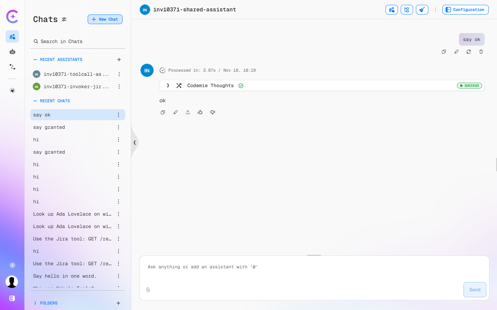
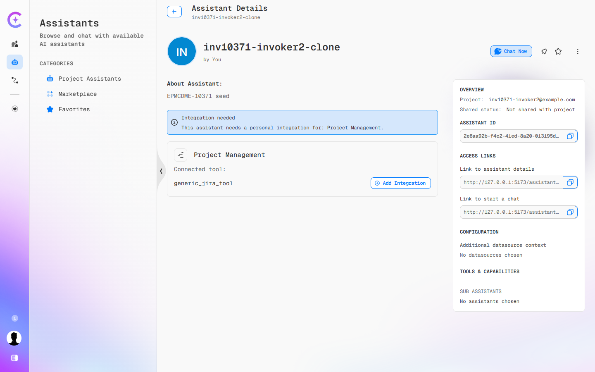

# Invoker Role

The **Invoker** is a restricted platform role for people who only need to _use_ AI/Run CodeMie, not build in it. An Invoker chats with assistants and runs workflows that other people have shared. An Invoker cannot see or change how those assistants and workflows are configured.

The interface for an Invoker is chat-first. The navigation rail contains four items plus help: **Chats**, **Assistants**, **Workflows**, and **Integrations**.

:::info Who assigns the role
The role is assigned by a Platform Maintainer or Admin. See [Invoker Role Administration](../../admin/configuration/access-control/invoker-role.md).
:::

## What an Invoker Can Do

- **Chat** with assistants that are shared with them, including assistants shared with them by name (see [below](#assistants-shared-by-name)). The chat input has an attach button and **Send**, and no model picker, tool toggles, or skills controls.
- **Manage their own conversations**: list, rename, and delete them, give or remove feedback (like or dislike), and stop a response that is still streaming.
- **Approve or deny tool calls** when an assistant is set to ask for approval before it uses a tool (**Allow** or **Deny**).
- **Run shared workflows**, and for their own executions: abort, continue (resume) an interrupted execution, edit the output of a step, request changes, and delete the execution.
- **Upload and download files** for their own chats and workflow runs. A file uploaded by someone else cannot be used.
- **Create, test, edit, and delete their own personal integrations** (see [Integrations](#integrations)).
- **Clone an assistant from the Marketplace** (see [Cloning from the Marketplace](#cloning-from-the-marketplace)).

### Assistants shared by name

When an assistant owner shares an assistant with specific users, an Invoker who is on that list can find the assistant in their assistants list, open its details page, and chat with it. The Invoker cannot edit the assistant and cannot share it with anyone else.

### Cloning from the Marketplace

An Invoker can clone an assistant that is published in the **Marketplace**. The clone:

- is created in the Invoker's personal project;
- can be run, but **not edited or deleted**, like every other assistant for an Invoker.

Cloning an assistant that is not in the Marketplace, or that belongs to another user's project, is refused.

## What an Invoker Cannot Do

An Invoker cannot:

- **View or edit** the configuration of an assistant or a workflow. The assistant details page shows the description, the integrations it needs, and similar general information, but not the system prompt, toolkits, model, or the workflow YAML. The workflow page shows run history and **Run workflow** only.
- **Create** assistants, workflows, or skills, or **change the model** of a chat or an assistant. A request that tries to set a model or a system prompt is rejected.
- Open or use **Projects**, **Data Sources**, **Skills**, **Schedulers**, **Analytics**, **Applications**, **Katas**, or any **administration page**.
- Open an assistant, workflow, or integration that has not been shared with them, or edit another user's or a project integration.
- See or touch another Invoker's conversations and executions.

A hidden page opened by its URL shows **403 Access Denied** in the interface. The matching API calls are refused (see [Denied requests](../../admin/configuration/access-control/invoker-role.md#denied-requests)).

## Integrations

Assistants often need credentials, for example a Jira account. An Invoker uses only their **own personal (user) integrations**: tools run with the Invoker's own credential, never with credentials of the assistant author, other users, or the project, except as described in [Credentials](../../admin/configuration/access-control/invoker-role.md#credentials).

On the **Integrations** page an Invoker can create, test, edit, and delete personal integrations. The **Credential Type** dropdown offers only the types that the assistants available to the Invoker actually need (in the tested setup this was **Jira**). Creating any other type is refused. Project integrations and integrations of other users cannot be created, edited, deleted, or tested.

### The "Integration needed" banner

If an assistant needs a personal integration that the Invoker does not have yet, the **assistant details page** shows a banner:

> **Integration needed** — This assistant needs a personal integration for: _Project Management_.

Click **Add Integration**, create the integration, and the banner changes to **Integrations configured** with a selector for the integration to use. Until then the assistant's tool does not run: the assistant answers that it has no access to the tool.

:::note
The banner is shown on the assistant details page, not in the **Configuration** panel of a chat.
:::

## Tool Output Visibility

An Invoker sees the same tool results as any other user of a shared assistant, including tool output and error text in the **Thoughts** of a response. Assistant owners can hide tool outputs with the **Hide tool outputs** setting of their assistant.
