# Projects Management

Projects are isolated workspaces that group your assistants, workflows, data sources, and
integrations. Every user can create their own projects and manage team membership within them.
Platform Admins can view and manage all projects across the platform. **Auditors** have
read-only visibility of all platform projects and their spending data; create, edit, delete,
and member management controls are not available to them.

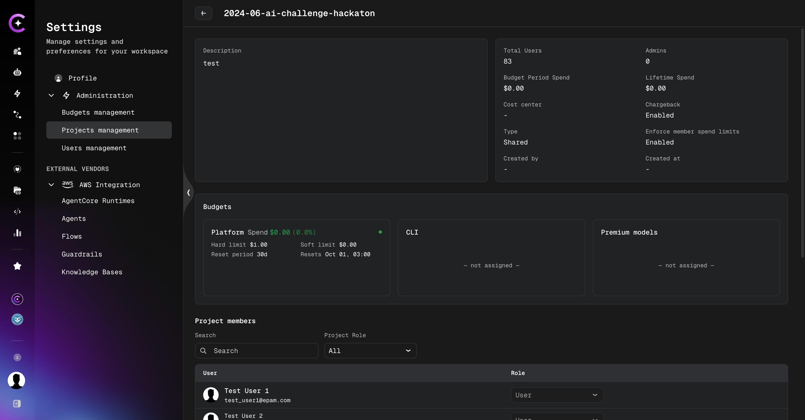

To access Projects Management, click the **Profile** icon in the bottom-left corner → **Settings → Administration → Projects management**.

:::info Admin configuration required
Projects Management is only available when **Platform-managed mode** is enabled. If the
**Projects management** tab is not visible, ask your administrator to follow the
[Platform-managed Mode Configuration](../../admin/configuration/access-control/platform-managed-mode-configuration.md)
guide.
:::

## Projects List

The projects list displays all projects you have access to. For each project, the table shows:

- **Name** — the project name (always lowercase)
- **Last update** — date and time of the most recent change
- **Created** — date the project was created
- **Assignments** — entity counts for linked items (users, assistants, workflows, data sources,
  and other resources), shown as icons with numbers
- **Users** — total number of members in the project
- **Actions** — row-level actions: **View**, **Edit**, **Delete**, and **Change ownership**
  (available to Platform Admins and Project Admins; not shown for personal projects)

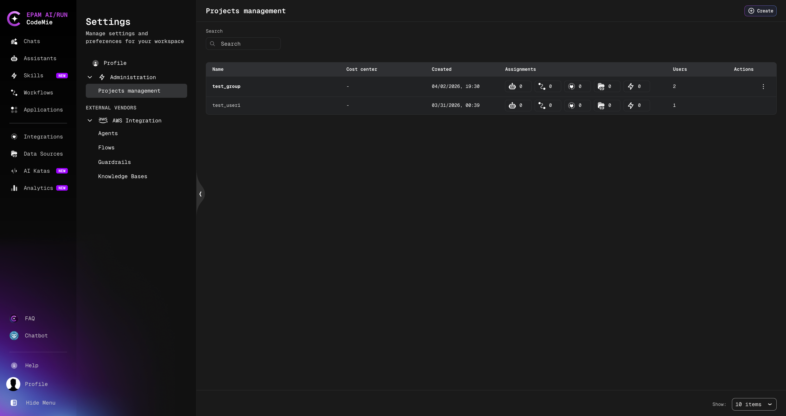

## Create a Project

1. Click the **Create** button in the top-right corner of the Projects Management page.
2. In the **Create Project** dialog, fill in:
   - **Name** (required) — a unique project name. Must be **lowercase only**.
   - **Description** (required) — a plain-text description of the project.
3. Click **Create**.

The new project appears in the list immediately without a page reload.

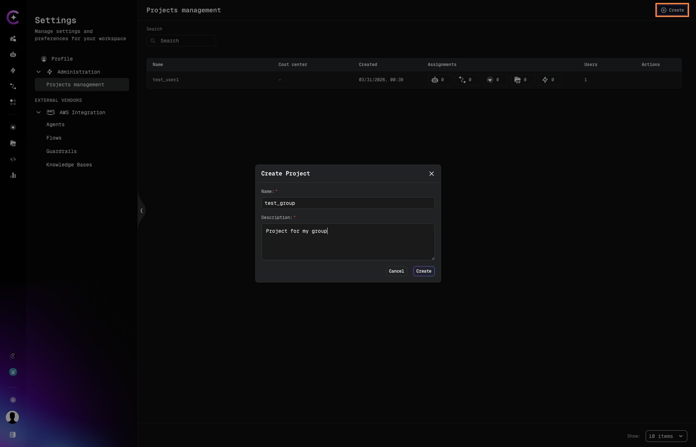

:::note
Project names must be **lowercase**. Uppercase characters are not accepted.
:::

## Open a Project

Click the **⋮ (Actions)** menu on any project row and select **View**, or click directly on
the project name. This opens the **project detail page**.

The project detail page is organized into tabs. The tabs available depend on the user's role
and the features enabled for the deployment:

| Tab              | Visible to                             | Requires                                     |
| ---------------- | -------------------------------------- | -------------------------------------------- |
| **Overview**     | All project members                    | —                                            |
| **Members**      | All members (not on personal projects) | —                                            |
| **Models**       | Project Admins and Platform Admins     | `features:projectModelOverride` flag enabled |
| **Budgets**      | Members with budget view access        | `features:budgetManagement` flag enabled     |
| **Integrations** | Project Admins and Platform Admins     | —                                            |

The **Overview** tab shows:

- Project **description**, **type**, **created by**, and timestamps
- **Total users** count and **last access** date
- Quick-action links to other project tabs

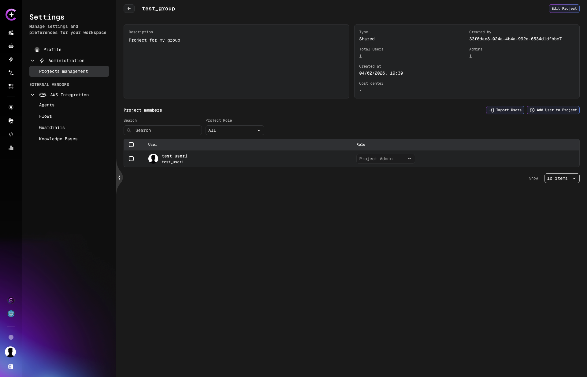

## Edit a Project

1. Click the **⋮ (Actions)** menu on a project row and select **Edit**.

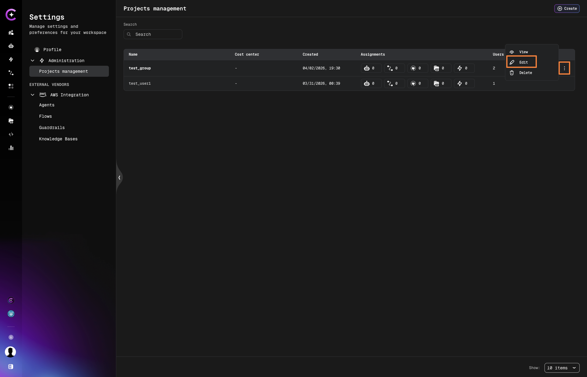

2. In the **Edit Project** dialog, update the **Description**.
3. Click **Save**.

:::note
The project **name cannot be changed** after creation. If you need a different name, delete
the project and create a new one with the desired name.
:::

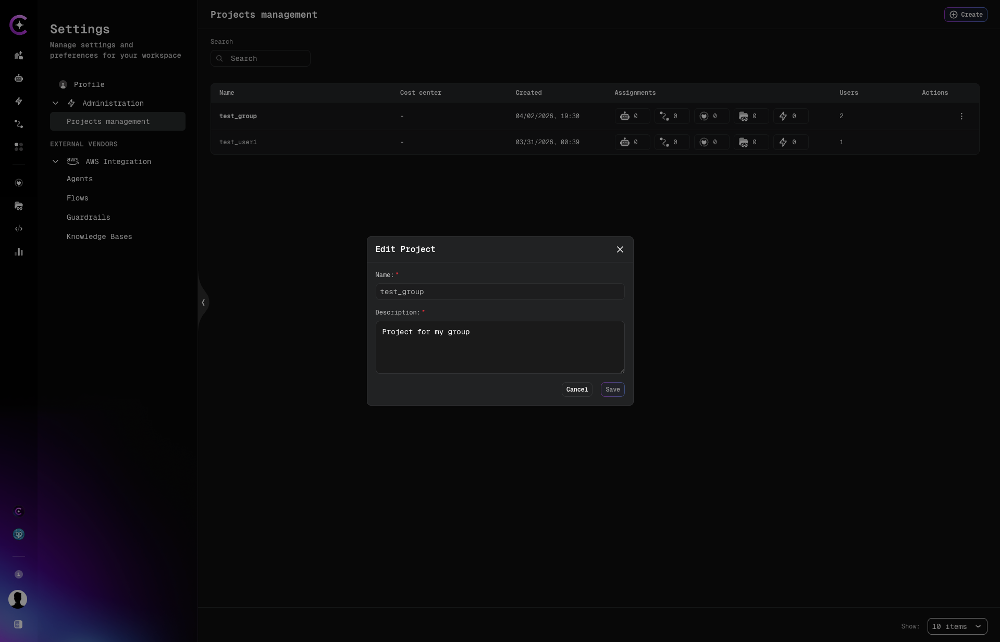

## Delete a Project

:::warning
A project can only be deleted if it contains **no associated entities** (no users, assistants,
workflows, data sources, or other items). If the project is not empty, deletion will be blocked
and an error will list the blocking entities.
:::

1. Click the **⋮ (Actions)** menu on the project row and select **Delete**.
2. Confirm the deletion.

The project is removed from the list immediately.

## Change Project Ownership

Platform Admins and Project Admins can transfer ownership of any project to another registered
user. Personal projects cannot have their ownership changed.

1. Click the **⋮ (Actions)** menu on the project row and select **Change ownership**.

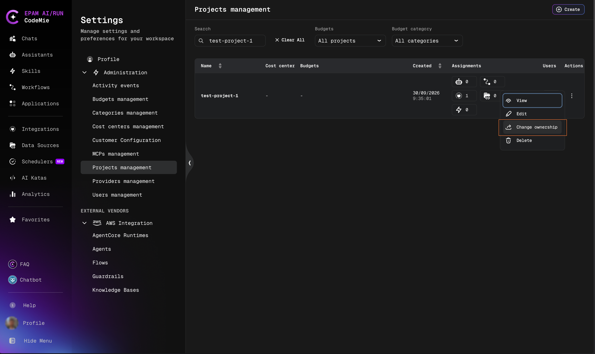

2. In the **Change Ownership** dialog, the current owner is displayed.
3. In the **New owner** field, type to search by name or email, then select the target user
   from the results.

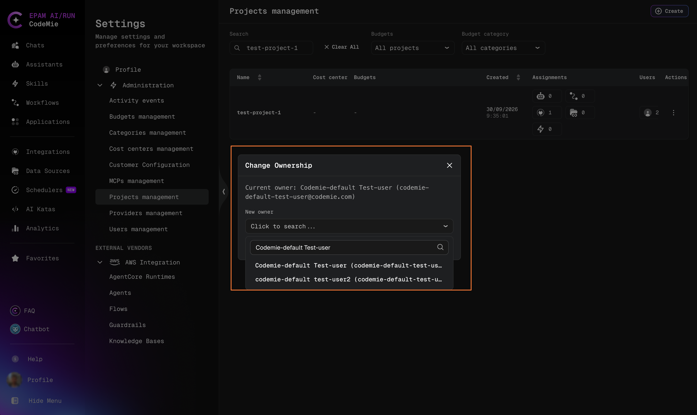

4. Click **Confirm**.

A confirmation message appears and the projects list refreshes automatically to reflect the
updated owner.

:::note
The **Change ownership** option does not appear in the actions menu for personal projects.
:::

## Managing Project Members

From the **project detail page**, you can add, import, change roles for, and remove members.

### Add a User

1. Click **Add User to Project** on the project detail page.
2. In the **Select user** field, search for a user by name or email.
3. Select the user from the dropdown.

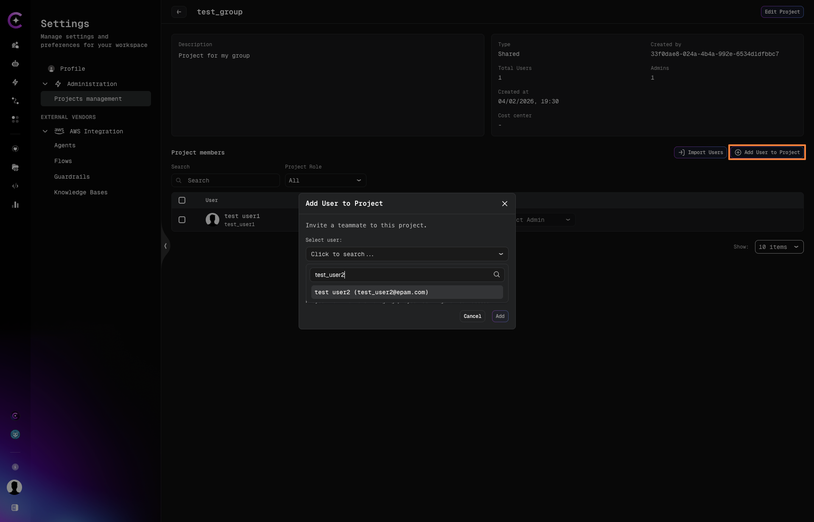

4. In the **Role** dropdown, choose the role to assign:
   - **User** — standard project access
   - **Project Admin** — can manage project members and settings

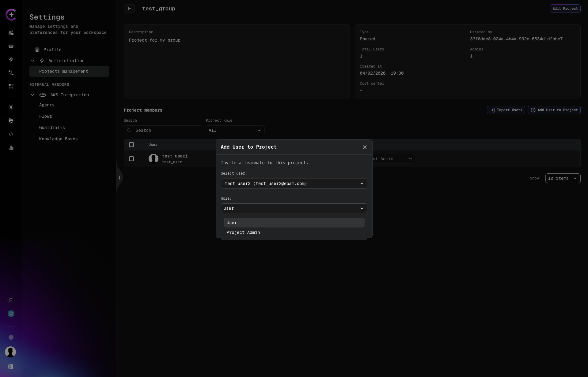

5. Click **Add**.

The user appears in the Project Members table immediately.

:::info User not found in search?
If a user does not appear in the search results, they have not logged in to CodeMie yet.
Ask them to sign in first — their account will be available in the search after their first login.
:::

### Import Users via CSV

To add multiple users at once:

1. Click **Import Users** on the project detail page.
2. In the **Import Users to project** dialog, upload a CSV file by clicking
   **Upload or drop file**, or drag and drop a file onto the upload area.

   Use the **Download template** link to get a correctly formatted file.

3. Click **Import**.

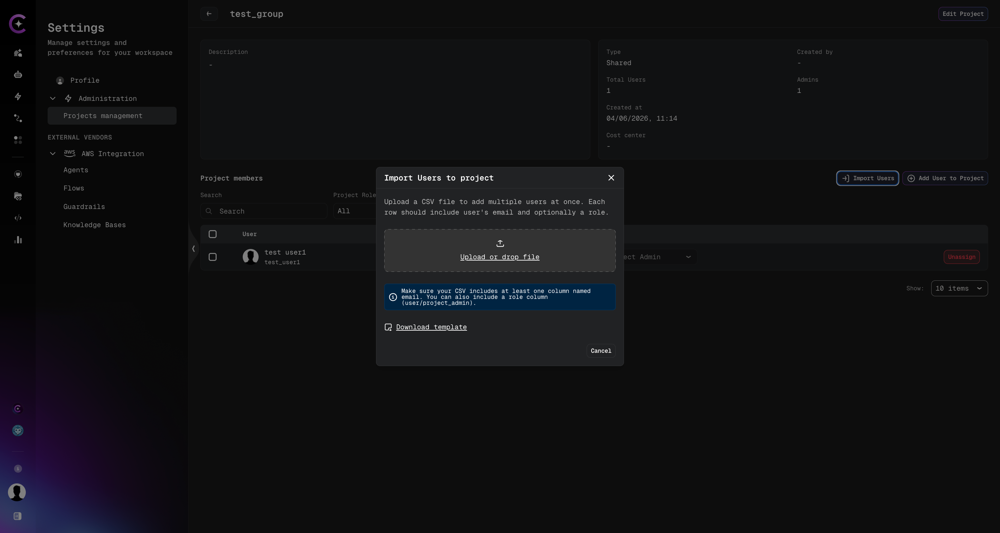

:::info CSV format
The file must have two columns:

| Column  | Required | Values                    |
| ------- | -------- | ------------------------- |
| `email` | Yes      | User's email address      |
| `role`  | Yes      | `project_admin` or `user` |

Example:

```csv
email,role
example@domain.com,project_admin
example2@domain.com,user
```

Each row represents one user to be added to the project.
:::

### Change a Member's Role

In the **Project Members** table, use the **Role** dropdown next to a user's name to switch
their role between **User** and **Project Admin**. The change takes effect immediately.

### Remove a Member

1. In the **Project Members** table, click the **Unassign** button (or the action icon) next
   to the member you want to remove.
2. Confirm the action in the **Unassign User?** dialog by clicking **Unassign**.

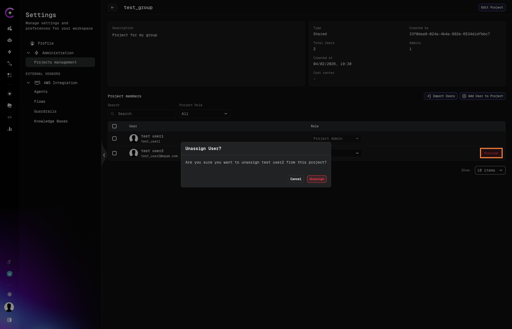

The user is removed from the project immediately. Their account is not deleted — they simply
lose access to this project.

If this project was the user's default project, it stops being charged for the user's usage and
a new default is determined automatically. See
[Default Project](./users.md#default-project).

## Model Configuration

:::info Requires admin enablement
The **Models** tab is only visible when the `features:projectModelOverride` flag is enabled in
`customer-config.yaml`. See [Customer Feature Configuration](../../admin/configuration/codemie/customer-feature-configuration.md#project-model-override) for
how to enable it. The **Models** tab is not shown on personal projects.
:::

The **Models** tab on the project detail page lets Project Admins and Platform Admins control
which LLM models are available within a project and set a project-level default model. The
configuration applies to all chats, assistants, and workflows that belong to the project —
including shared assistants, marketplace assistants, and workflows shared across projects.

**How model availability works:**

- By default, every project has access to the full platform model catalog. Narrowing is
  opt-in — no existing project loses access when the feature is enabled.
- Model configuration works as an **exclusion set**: models are deselected to rule them out.
  Any model newly added to the platform catalog becomes available to all projects automatically,
  without re-opening project settings.
- Once a project has a custom model configuration, that configuration **replaces** the global
  defaults entirely — it does not merge with them.
- A mandatory **Project default model** must be selected from the allowed models when saving
  a custom configuration.
- When an assistant or workflow in the project is configured to use a model that has since been
  ruled out, it silently falls back to the project's default model at runtime, without error.
- When starting a chat from the sidebar without a project-specific context, the model selector
  shows the global model list rather than a single project's restricted list.

:::info LiteLLM enforcement
When [LiteLLM Proxy](../../admin/deployment/extensions/litellm-proxy/index.md) is deployed,
model restrictions are enforced at the API level: the project's per-category virtual keys are
regenerated with the updated allow-list on each save, so narrowing takes effect on the next
request without any restart or redeploy.
:::

### Access

Path: **Profile → Settings → Administration → Projects Management → select a project → Models**

The **Models** tab is accessible to users with the **Project Admin** role within the project,
and to **Platform Admins** across all projects.

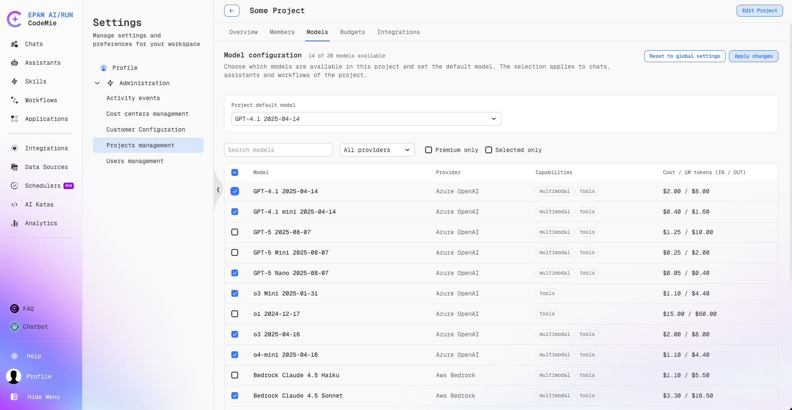

### Project Default Model

At the top of the **Models** tab, the **Project default model** selector sets the model
pre-selected when members open a new chat or create an assistant in the project. Only models
currently enabled in the project's configuration appear in this dropdown.

Selecting a default model is required when saving a custom model configuration. If a **Premium**
model is selected as the default, a note appears indicating the model incurs additional usage
charges with a link to the models catalog.

### Model Configuration Table

Below the default model selector, the model configuration table lists all platform models
available for selection, including **routing models** (auto-routing profiles such as "Claude
Router Standard v1"). The routing Premium option is filtered out automatically when no premium
models are enabled for the project.

| Column                          | Description                                          |
| ------------------------------- | ---------------------------------------------------- |
| **Checkbox**                    | Enables or disables the model for the project        |
| **Model**                       | Model name; a **Premium** badge marks premium models |
| **Provider**                    | Cloud provider (e.g., Azure OpenAI, Anthropic)       |
| **Capabilities**                | Supported capabilities (`multimodal`, `tools`)       |
| **Cost / 1M tokens (IN / OUT)** | Per-million-token cost for input and output          |

Use the **Search models** field, the **Provider** dropdown, and the **Premium only** or
**Selected only** checkboxes to filter the list. The header checkbox toggles all currently
visible rows on or off.

:::note At least one chat model required
At least one chat model must remain enabled. Attempting to save with all chat models disabled
is rejected with a validation message.
:::

Models that have been removed from the platform catalog appear as **no longer available** in
the configuration table. They remain in the list for visibility but cannot be re-enabled, and
are not offered in the model selector for members.

### Applying and Resetting Changes

After making changes, click **Apply changes** to save the configuration. If navigation away from
the **Models** tab is attempted with unsaved changes, a dialog prompts to apply the changes,
discard them, or stay on the page.

To restore the project to the platform-wide defaults, click **Reset to global settings**. This
stages the global defaults in the form without saving immediately — click **Apply changes** to
confirm the reset. This button is disabled when no project-specific configuration is active.

The counter next to **Model configuration** shows how many models are currently enabled out of
the total available (for example, `12 of 18 models available`).

### Overview Tab — Models and Usage

When the feature is enabled, the project **Overview** tab gains a **Models and usage** section
showing a real-time summary of the project's model configuration:

| Indicator              | Description                                                                  |
| ---------------------- | ---------------------------------------------------------------------------- |
| **Model availability** | Number of enabled models out of the full catalog (e.g., "12 of 18 models")   |
| **Automatic routing**  | Whether routing models (auto-routing profiles) are on or off for the project |
| **Premium models**     | "Visible" if at least one premium model is enabled; "Not visible" otherwise  |

A **Configure** link on the **Model availability** card navigates directly to the **Models** tab.

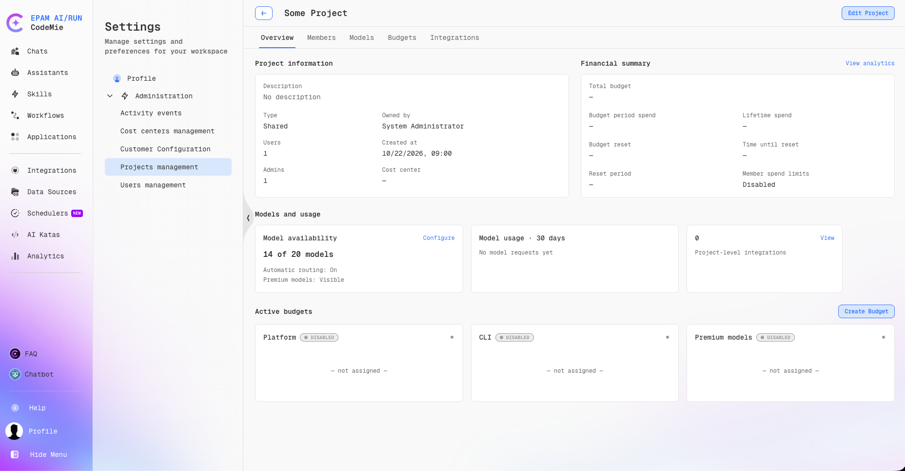
