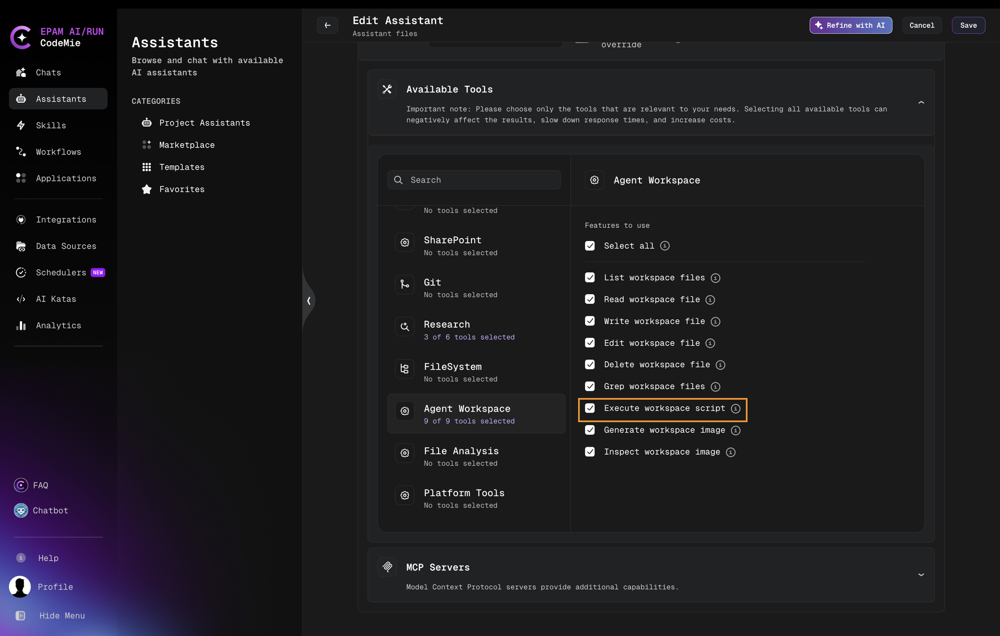
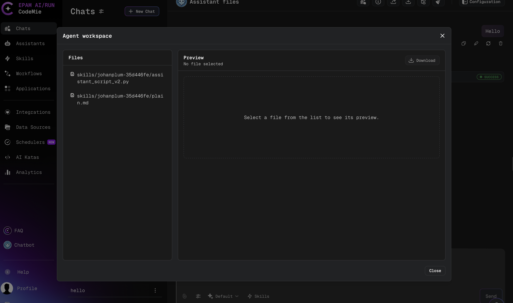
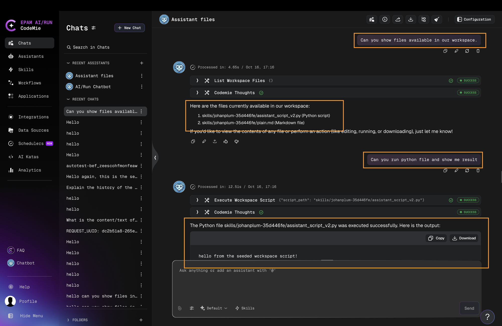
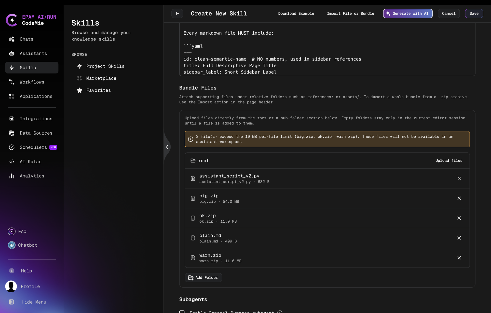

# Skill Bundles and Workspace Scripts

A skill can ship with supporting files, such as scripts, templates, and reference data. When an assistant uses such a skill, the files are made available in the conversation workspace, and the assistant can run the bundled scripts with the **Execute workspace script** tool. No manual file upload is required.

## What Is a Skill Bundle

A skill bundle consists of:

- The main instructions of the skill (`SKILL.md`), stored with the skill itself and given to the assistant when it is built.
- Supporting files (companion files), uploaded together with the skill as an archive (`.zip`) and stored with the skill.

Before this capability, the assistant could only read companion files one at a time through the skill tool. Now the files are also present in the workspace, so scripts can be executed and can read the data and templates stored next to them.

:::info
The main instructions (`SKILL.md`) are not copied to the workspace. They are always taken from the skill itself.
:::

## Requirements

Companion files are placed in the workspace only when all of the following conditions are met:

- The assistant has the **Execute workspace script** tool selected (**Agent Workspace** tools in the assistant configuration).



- The Code Executor runs in `sandbox-jobs` mode. See [Code Executor](../../admin/configuration/codemie/code-executor-configuration.md).
- The environment-wide workspace script bridge is switched on (customer configuration component `features:workspaceScriptBridge`). See [Customer Feature Configuration](../../admin/configuration/codemie/customer-feature-configuration.md).
- The request belongs to a conversation or a workflow run.

If any condition is missing, no skill files are placed in the workspace and no notice is shown. The files remain readable through the skill tool.

## How Files Appear in the Workspace

When the assistant handles its first request in a conversation (or a workflow run), the files of every attached skill that has companion files are made available under a dedicated folder:

```text
skills/<skill-folder>/
```

The folder name is built from the skill name and ends with a short identifier, for example `skills/report-skill-35d446fe/`. The assistant learns the exact folder from the hint added by the skill tool. Each skill gets its own folder, so files with the same relative path in two different skills never overwrite each other.

The files can be inspected in the **Agent workspace** dialog of the chat.



Key behaviors:

- Files are not duplicated per conversation. The workspace points at the stored files of the skill, so there is no waiting and no extra storage per conversation.
- Existing workspace files are never overwritten.
- When the skill tool loads a skill, it adds a hint with the folder, so the assistant knows where the files are.
- If the assistant has no skills, or the skills have no companion files, nothing changes for the conversation.
- The workspace has no skill files before the first request. Opening it in the UI or through the workspace API before the assistant handled a request shows no skill files.
- A skill attached after the conversation has started is made available on the next request. Skills that are already available are not added again.

## Running a Bundled Script

A script from a skill folder runs exactly like any other workspace script, through the **Execute workspace script** tool. The skill instructions tell the assistant which script to run and when.

Scripts should locate their own files relative to the script location rather than relying on a fixed absolute path. This works wherever the script is placed.

**Example bundle:**

```text
report-skill.zip
├── SKILL.md
├── scripts/
│   └── build_report.py
└── templates/
    └── report.txt
```

**`scripts/build_report.py`:**

```python
from pathlib import Path

# Resolve the skill folder from the script location
skill_dir = Path(__file__).resolve().parent.parent
template = (skill_dir / 'templates' / 'report.txt').read_text()

print(template.format(title='Weekly report'))
```

**Relevant part of `SKILL.md`:**

```markdown
To build a report, run the script `scripts/build_report.py` from this skill
and return its output to the user.
```

In the conversation, the files are located at `skills/<skill-folder>/scripts/build_report.py` and `skills/<skill-folder>/templates/report.txt`, where `<skill-folder>` is the folder of the skill.

In a chat, the assistant lists the workspace files and runs the script with the **Execute workspace script** tool:



## Editing Files in the Workspace

Skill files in the workspace are ordinary files. The assistant, a script, or a user can change, create, or delete them.

- A change stays in that conversation only. The stored file of the skill, the skill itself, and other conversations are not affected.
- A file deleted in the workspace is not restored on later requests.

## Snapshot Behavior and Limitations

Each conversation works on a snapshot of the skill taken when the files were first made available.

- When a skill is updated later, the conversation keeps the files and content it had at its start. New conversations get the updated content.
- Files added to a skill after the first preparation do not appear in conversations that are already open. A new conversation is required.
- If the same file content is saved again, no new version is created. Changed content is stored as a new version, and earlier versions are never overwritten.
- Stored versions that workspaces still point to are not removed when a skill is updated or deleted.

## Limits

Each skill bundle is subject to three limits:

| Limit                 | Default   | Dynamic config key                          |
| --------------------- | --------- | ------------------------------------------- |
| Files per skill       | 100 files | `SKILL_WORKSPACE_SEED_MAX_FILE_COUNT`       |
| Size of a single file | 10 MB     | `SKILL_WORKSPACE_SEED_MAX_FILE_SIZE_BYTES`  |
| Total size per skill  | 50 MB     | `SKILL_WORKSPACE_SEED_MAX_TOTAL_SIZE_BYTES` |

These are dynamic config keys, not environment variables. A missing value, a non-integer value, or a value below 1 falls back to the default.

Files are taken in path order until a limit is reached. The remaining files are skipped without failing the request. They stay readable through the skill tool, and the assistant is told which files are missing.

A bundle over the limits is still accepted when it is uploaded, and the skill can be saved.

### Upload Warning

A whole bundle is imported from a `.zip` archive with **Import File or Bundle** in the skill editor header. Supporting files can also be attached one by one in the **Bundle Files** section, under relative folders such as `references/` or `assets/`. After files are added, a warning is shown if some files will not be available in the workspace. No warning is shown for an archive within the limits. Each reason is reported as one sentence listing up to five file names, followed by `... and N more`. The skill can still be saved.



Message templates (sizes are shown in a readable unit such as `10 MB`):

| Reason                                   | Message                                                                                       |
| ---------------------------------------- | --------------------------------------------------------------------------------------------- |
| Older skill with files stored inline     | `{n} companion file(s) are not available in the workspace; read them through the skill tool.` |
| Paths that cannot be used in a workspace | `{n} file(s) have paths that cannot be used in an assistant workspace.`                       |
| Single file over the size limit          | `{n} file(s) exceed the {bytes}-byte per-file limit.`                                         |
| More files than the file-count limit     | `{n} file(s) exceed the {count}-file limit.`                                                  |
| Total size over the limit                | `{n} file(s) exceed the {bytes}-byte total size limit.`                                       |

The warning ends with: `These files will not be available in an assistant workspace.`

## Notices to the Assistant

When some files cannot be placed in the workspace, the assistant receives a notice that starts with `Skill '<name>':`, so it can fall back to reading the files through the skill tool. The notices are the same sentences as in the upload warning, plus:

- `Skill '<name>' could not be set up in the workspace due to an unexpected error. Its companion files may be unavailable.`
- `Skill '<name>' was not set up in the workspace because another skill already owns the folder <folder>/. Rename one of the skills to make its companion files available.`

When the skill tool loads a skill, it appends this hint:

```text
Files of this skill are in the workspace at {folder}/. Files over the size or count limits, and files stored inline in older skills, are not there; read them with the skill tool.
```

## Skill Name Conflicts

If two attached skills have the same name, the first skill keeps the folder, and the second one is reported as a name conflict in the log and to the assistant. The order is the same as the one used by the skill tool, including after a re-attach. Renaming one of the skills resolves the conflict.

## Older Skills

Some older skills keep their files inside the skill record instead of as separate stored files. Their files are not placed in the workspace. A warning is logged, and the assistant is told to read the files through the skill tool. These skills are not converted automatically.

## Workflows

Assistants in workflows receive skill files in the run workspace in the same way as in a chat. When several assistants of one run attach the same skill, its files are added once. The assistant receives the same notices when files cannot be placed in the workspace. See [Skills in Workflow](./skills-in-workflow.md).

## Reserved Paths

The script bridge folder and the runtime helper file at the workspace root are reserved by the platform.

- Writing or deleting a reserved path is refused with an error. In a batch write, the reserved file is skipped with a warning, and the rest of the batch succeeds.
- Spellings that differ only in letter case or Unicode form are treated as the same name.
- A folder with the same name deeper in the workspace, for example inside a skill folder, is an ordinary folder.
- Reading and listing reserved paths are not restricted.

## Export, Clone, and Marketplace

When a skill is exported, cloned, or published to the marketplace, each file is taken from its stored version, so the correct content is always used. See [Manage Skills](./manage-skills.md) and [Marketplace Skills](./marketplace-skills.md).
