# Integrations

Every integration has a **Scope** that defines who can use it. All integrations, regardless of scope, are managed from a single **Integrations** list and created with a single **New Integration** form. If an integration is not explicitly selected, CodeMie picks one automatically — see [How the Default Integration Is Selected](#how-the-default-integration-is-selected) below.

There are two scopes, and the **Global** toggle extends a User integration to all projects, which gives three kinds of integrations:

- **User Integration** (Scope: **User**): Personal configuration scoped to the current project. Available only to its owner.
- **User Global Integration** (Scope: **User**, **Global** toggle enabled): Personal integration available to its owner across all projects where the owner is onboarded.
- **Project Integration** (Scope: **Project**): Shared configuration available to all members of the selected project. Can be created by project admins only.

:::note
Only project admins (`applications_admin` role in the project) and platform admins (`isAdmin`) can create **Project Integrations** and see the Project scope in the list and in the form. Members without these rights work with User integrations only. To request `applications_admin` access, submit a Support ticket. See [Project & User Management](../../project-user-management/index.mdx) for details on managing roles.
:::

## How the Default Integration Is Selected

When a tool requires an integration and no specific one has been chosen, CodeMie picks it automatically. **User Integration always takes priority over Project Integration.**

| Priority | Type                        | Created with                                                 | Visible to                                                   |
| -------- | --------------------------- | ------------------------------------------------------------ | ------------------------------------------------------------ |
| 1        | **User Integration**        | **Scope: User**, current project                             | The owner only, in this project                              |
| 2        | **User Global Integration** | **Scope: User**, **Global Integration** toggle enabled       | The owner only, in all projects where the owner is onboarded |
| 3        | **Project Integration**     | **Scope: Project** (project admins and platform admins only) | All project members                                          |

If no matching integration is found at any level, the action requiring it will fail.

### When does this matter?

**One integration of a type** — it is always used automatically. Nothing to configure.

**Multiple integrations of the same type** — the priority above applies unless a specific one is selected manually in the assistant form.

### Tips

- Use **User Global Integration** for the same credentials across multiple projects — configure once, use everywhere.
- **Project Integration** acts as a shared fallback for team members who have not set up their own.
- If a tool is using unexpected credentials, open **Integrations**, set the **Scope** filter to **User** (or, for members, simply review the list), and check whether a User Integration is overriding the project-level one.

## Automatic Credentials Lookup

When adding a tool to an assistant, each tool that has at least one configured integration displays an **Automatic Credentials Lookup** toggle. The toggle and the integration dropdown together record the assistant author's decision for that **integration slot** — a slot being any place where a tool, a toolkit, or an MCP server takes an integration.

The decision is stored per slot and has three distinct states:

| Author's decision                    | How the slot resolves at run time                                                                          | Offered for personal selection |
| ------------------------------------ | ---------------------------------------------------------------------------------------------------------- | ------------------------------ |
| **Lookup on** (default)              | Resolved per user, using the priority order above — everyone runs under their own integration of that type | Yes                            |
| **Lookup off, integration selected** | The author's integration is pinned and applied on behalf of everyone using the assistant                   | No                             |
| **Lookup off, no integration**       | Nothing is resolved automatically — the slot has **No integration**                                        | Yes                            |

When the toggle is **On**, the integration dropdown is hidden — no manual selection is needed:

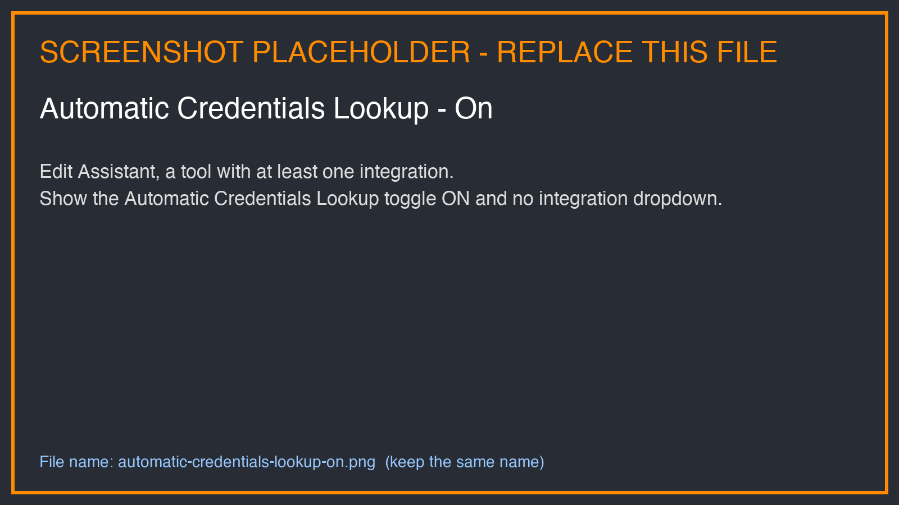

When the toggle is **Off**, the dropdown becomes visible and a specific integration can be pinned:

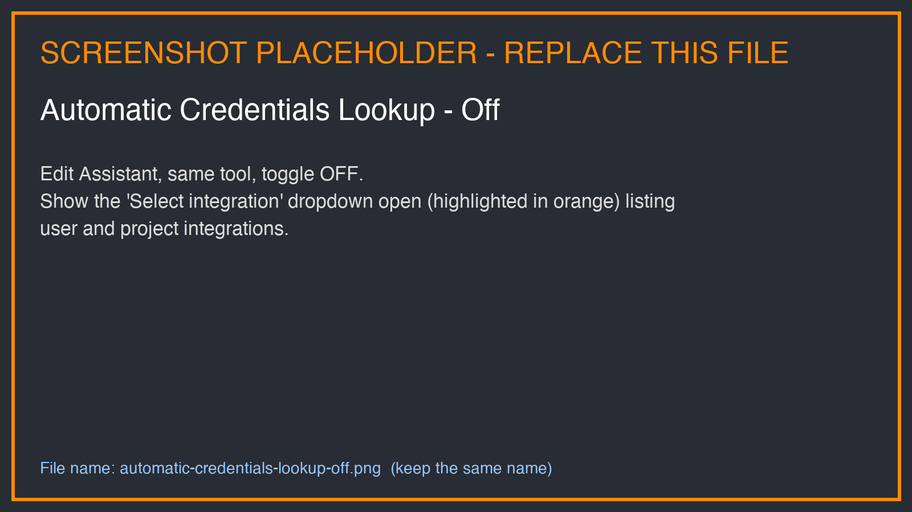

### Lookup off with nothing pinned

Turning the toggle off and leaving the dropdown empty is a deliberate state, not an unfinished one: it means the slot carries no credentials at all. Nothing is looked up automatically, the assistant shows **No integration** for the slot, and the tool reports the missing integration when it is called — the tool is not silently dropped from the assistant. A user of the assistant can still pick an integration for such a slot themselves.

### Personal selection by users of the assistant

Every slot the author did not pin is offered to each user of a shared assistant in its **Your Integration Settings** section — on the assistant page, and in the [assistant panel on the workflow executions page](../../workflows/assistant-panel-in-executions.md). Personal selection is available on any shared assistant, not only on assistants published to the marketplace.

A user's own decision always wins over automatic lookup, including an explicit **No integration**: the choice is remembered and is not replaced by an automatically resolved integration the next time the assistant is opened or run.

How widely the choice is remembered depends on where it is made:

| Saved from                        | Applies to                                                                                                    |
| --------------------------------- | ------------------------------------------------------------------------------------------------------------- |
| The assistant page                | The assistant everywhere for that user — chat, the assistant page, and every workflow using the assistant     |
| The assistant panel of a workflow | That workflow only, unless **Apply to the whole assistant, not just this workflow** is selected before saving |

A workflow-scoped selection takes precedence over the assistant-scoped one when that workflow runs, and leaves the same assistant untouched in chat and in other workflows. Both scopes are personal and never affect other users. See [Assistant Panel on the Executions Page](../../workflows/assistant-panel-in-executions.md#where-the-selection-applies) for the full behavior.

:::tip
Leave **Automatic Credentials Lookup** on for shared assistants. This ensures each team member uses their own credentials automatically, without requiring the assistant owner to share their personal integration.
:::

:::warning
Pinning a specific integration applies the author's credentials to every user of the assistant. The secret values are not exposed to other users, but everyone works through the same account, and no one can substitute their own. Pin a slot only when a single shared account is intended.
:::

## Setting Up Integrations

### The Integrations List

In the AI/Run CodeMie main menu, click **Integrations**:

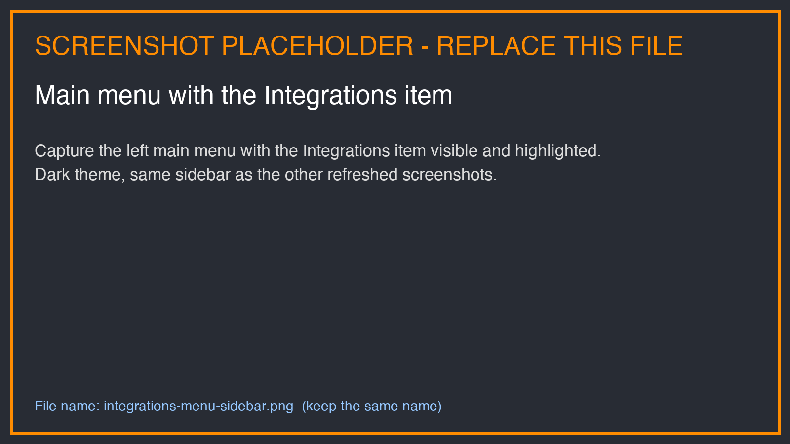

The page shows one combined list of all integrations the current user can see. There are no separate **User** and **Project** tabs or switches. The list contains the following columns:

| Column      | Description                                                                                                         |
| ----------- | ------------------------------------------------------------------------------------------------------------------- |
| **Project** | Project the integration belongs to                                                                                  |
| **Alias**   | Name of the integration                                                                                             |
| **Scope**   | **User** or **Project**. User integrations with the **Global** toggle enabled additionally carry a **Global** badge |
| **Type**    | Credential type, for example Git or Jira                                                                            |
| **URL**     | Integration URL, where the credential type has one                                                                  |
| **State**   | Enabled or disabled state, shown for credential types that support it (for example, Scheduler)                      |

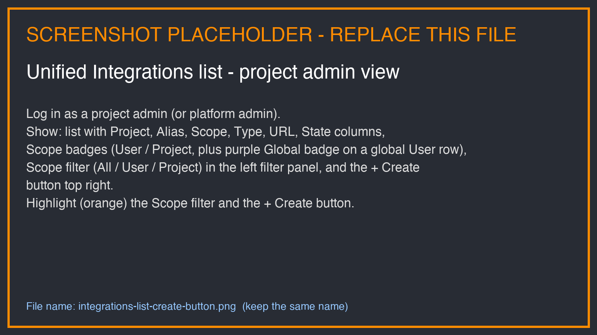

What the list shows depends on the role:

- **Project admins and platform admins** see User and Project integrations together. A **Scope** filter with the options **All** (default), **User**, and **Project** narrows the list to one scope.
- **Members without project-admin rights** see only their own User integrations. The **Scope** filter is not displayed, and the list behaves as if **Scope: User** is always selected.

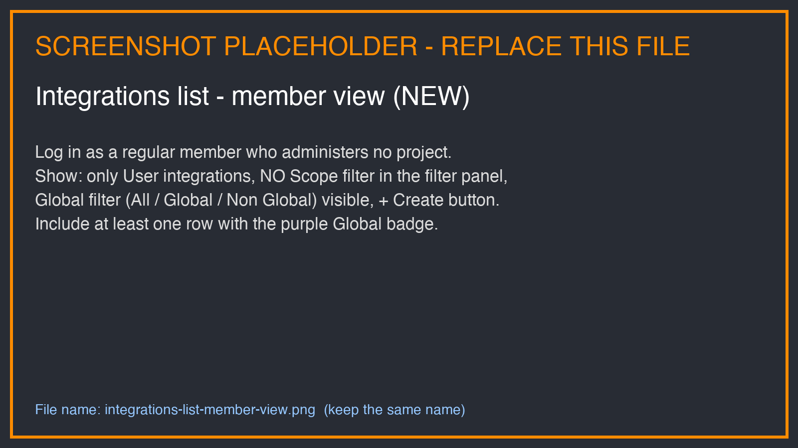

Each project's Project integrations are listed to the admins of that project only. Platform admins see Project integrations of all projects.

### Creating an Integration

All integrations are created with the same **New Integration** form, regardless of scope.

1. On the **Integrations** page, click **+ Create**. The form opens with the **Scope** already selected to match the list: **Scope: Project** is preselected when the list is filtered to **Project**, otherwise **User**.

2. Select the **Scope**. This is the first field of the form and defines who can use the integration:
   - **User**: only the creator can use the integration. Turn on **Global Integration** to use it in every project the creator is onboarded to.
   - **Project**: every member of the selected project can use the integration. Only project admins and platform admins can select this scope. For other members, the form explains that Project integrations can be created by project admins only. Project admins see only the projects they administer in the **Project** field.

3. Select the **Project** the integration belongs to. The project cannot be changed after saving.

4. Select the desired tool from the **Credential Type** dropdown, specify the **Alias** and the credentials, then click **Save**:

   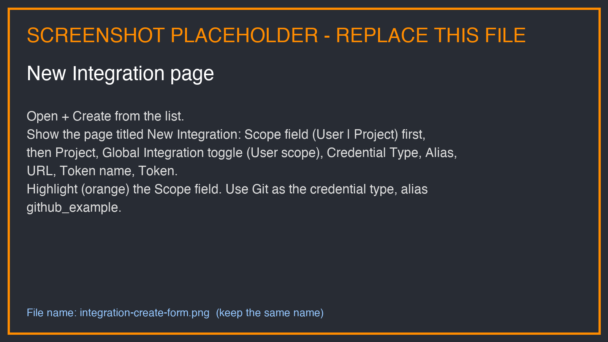

After saving, the list opens again, the saved row is highlighted, and a confirmation message is displayed. If the active filters hide the new row (for example, a User integration is saved while **Scope: Project** is selected), the message says so and offers **Show all scopes and types** to reset the filters.

:::note
Most of the tools require specifying the URL, token, and alias. Alias is the name of the setting that is displayed in the integrations list.
:::

:::tip
The **Credential Type** dropdown is sorted alphabetically and includes a scrollbar, making it easy to locate the required credential type even when many options are available.
:::

:::info
Changing the **Scope** while filling in the form clears the **Credential Type** if the new scope does not offer it. Switching to **Project** also turns off the **Global Integration** toggle, because Global applies to User integrations only. Moving an existing integration from one scope to the other is not supported; the **Scope** field is locked when an integration is edited.
:::

### Scope-Bound Credential Types

Most credential types are available at both scopes. Some types exist at one scope only:

| Credential type  | Available at |
| ---------------- | ------------ |
| **DIAL**         | Project only |
| **Google OAuth** | User only    |

:::note
**Google OAuth** is displayed only when the Google OAuth feature is enabled in the customer configuration. Types limited to specific roles (Webhook, LiteLLM, MS Teams Bot) are shown to the same people as before.
:::

Scope-bound types are marked with a **User only** or **Project only** badge in the **Credential Type** dropdown of the form and in the **Type** filter of the list. They affect the form as follows:

- **Selecting a type bound to the other scope switches the Scope automatically** while the Scope is still changeable. For example, selecting **DIAL** while **Scope: User** is selected switches the Scope to **Project**.
- **After a scope-bound type is selected, the Scope field is locked.** The form explains why, for example: "DIAL is available only at Project scope, so User is unavailable. Pick another type to change it." To change the scope, select a different credential type first.
- **Members without project-admin rights** see Project-only types such as DIAL as disabled, with the hint "Project only · needs project admin rights".
- When the Scope is locked (for example, when the form is opened from a project page), types bound to the other scope are listed as disabled with the hint "Not available at … scope".

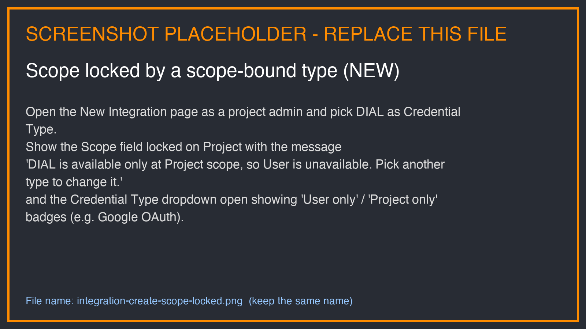

## Integration Validation During Assistant Save

When you save or publish an assistant, the platform automatically checks whether all
selected tools have the required integrations configured. If any are missing, a
**Missing Integrations** modal appears before saving.

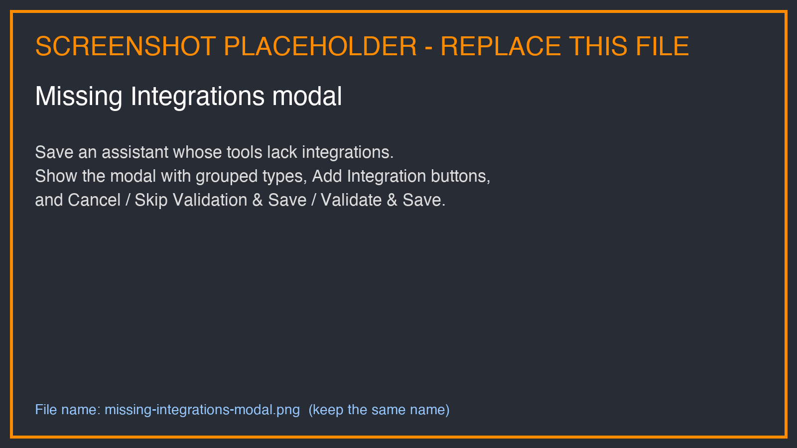

The modal lists every integration type that needs to be set up, grouped by type, and shows
which tools depend on each one. For each missing integration you have two options:

- Click **Add Integration** — opens the quick Create User Integration form for that type. This shortcut always creates a **User** integration. A Project integration is created from the **Integrations** page. After
  saving the integration, return to the assistant and save again.
- Leave it as-is and click **Skip Validation & Save** — saves the assistant without the
  missing integrations. Tools without integrations will not work until you set them up.

**Modal action buttons:**

| Button                     | Behavior                                                                 |
| -------------------------- | ------------------------------------------------------------------------ |
| **Validate & Save**        | Re-checks integrations and saves if all required ones are now configured |
| **Skip Validation & Save** | Saves immediately, bypassing the validation check                        |
| **Cancel**                 | Closes the modal and returns to the assistant form without saving        |

:::warning
An assistant saved with missing integrations will fail at runtime for any tool that
requires those integrations. Configure all required integrations before publishing.
:::

## Alternative Ways to Create Integrations

As an alternative way of getting to the Integrations page, you can click the **Add User Integration** button in front of the desired tool when creating/editing your assistant:

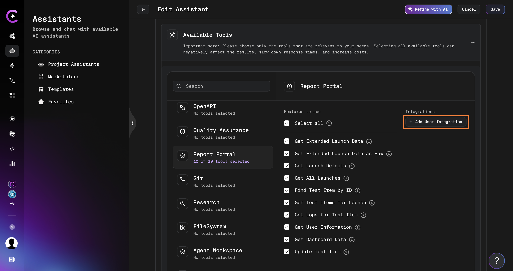

This link opens the quick Create User Integration form, which creates **User** integrations only and has no **Scope** field. Note that this link appears only if no such tools are configured by the users.

If you have two or more integrations related to one tool, you can specify the needed one when adding/editing assistants.

## Creating Integration from Data Source Page

For Datasource you can create user integration from data source page:

1. Navigate or create a new datasource.

2. Click **Select integration** for.

3. Click the **Add User Integration** button.

   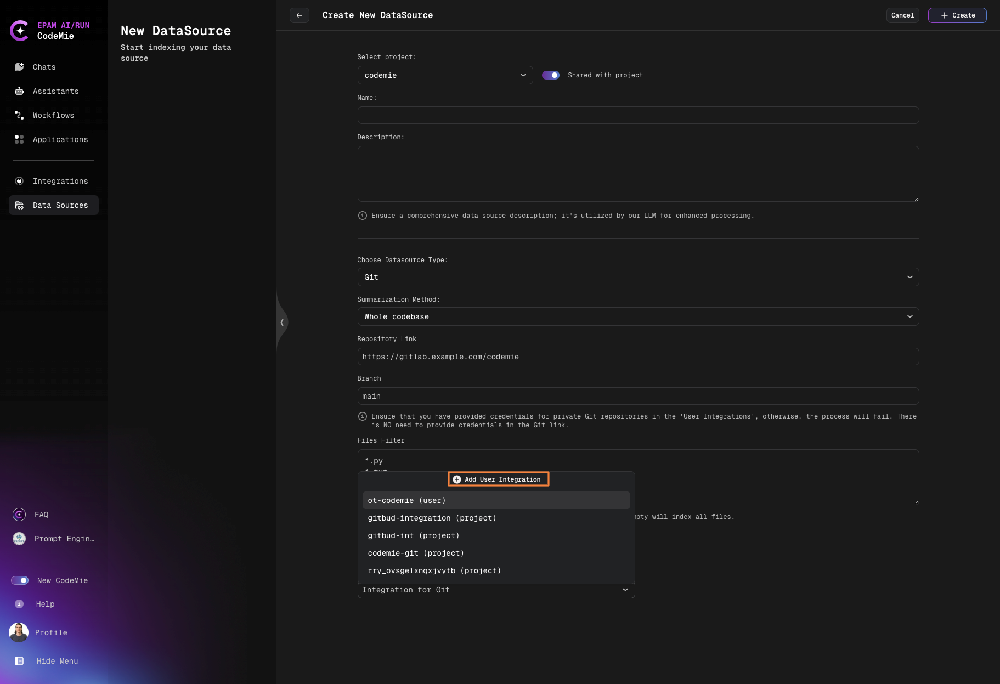
   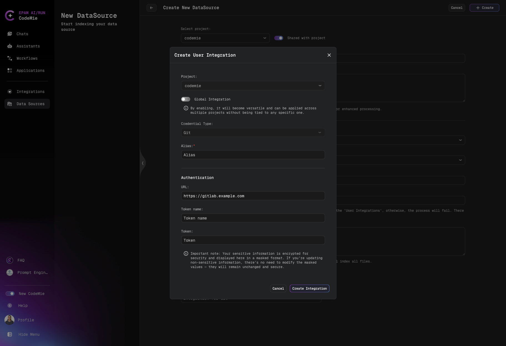

4. After saving, the new integration appears in the existing list without requiring a page reload or navigation away.

## Scheduler State in the Integrations List

For integrations with **Credential Type: Scheduler**, the enabled/disabled state is shown directly in the integration list — no need to open individual records to check whether a scheduler is active.

Each scheduler entry in the list displays a visible state indicator (enabled or disabled). This makes it possible to scan all scheduled integrations at a glance and identify which ones are currently running without navigating into the record.

:::tip
To see all scheduler integrations in one view, use the **TYPE** filter and select **Scheduler**. The state of each scheduler is immediately visible in the filtered list.
:::

To change the state of a scheduler, open the record and toggle the **Is Enabled** field.

## Filter Integrations

As the number of integrations grows, the filter panel on the **Integrations** page narrows the list. Some filters are shown only for a specific scope.

| Filter         | Shown for                                                 | Description                                                                                            |
| -------------- | --------------------------------------------------------- | ------------------------------------------------------------------------------------------------------ |
| **Search**     | Everyone                                                  | Free-text search                                                                                       |
| **Scope**      | Project admins and platform admins                        | **All** (default), **User**, or **Project**                                                            |
| **Project**    | Everyone                                                  | One or more projects                                                                                   |
| **Type**       | Everyone                                                  | One or more credential types. Types bound to one scope carry a **User only** or **Project only** badge |
| **Global**     | **Scope: User**, and members without project-admin rights | **All**, **Global**, or **Non Global** User integrations                                               |
| **Created by** | **Scope: Project**                                        | Filters Project integrations by the user who created them                                              |

At **Scope: All**, the **Global** and **Created by** filters are not offered, and the panel shows the hint "Pick a scope to filter by Global or Created by."

When the **Scope** changes, **Global** and **Created by** are cleared. Selected **Type** values bound to the other scope are removed from the filter, and a note names what was removed, for example: "DIAL was removed from Type: it exists only at Project scope." In the **Type** filter, types bound to the other scope are disabled with the hint "Not available at … scope" while a single scope is selected.

:::tip
To see all scheduler integrations in one view, set **Type** to **Scheduler**. See [Scheduler State in the Integrations List](#scheduler-state-in-the-integrations-list).
:::
