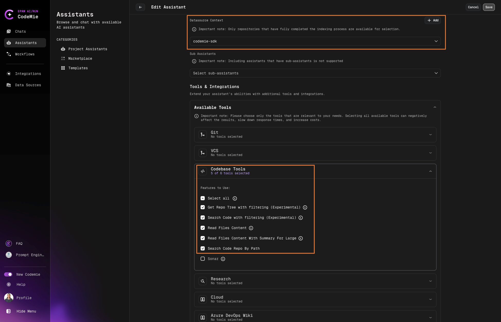
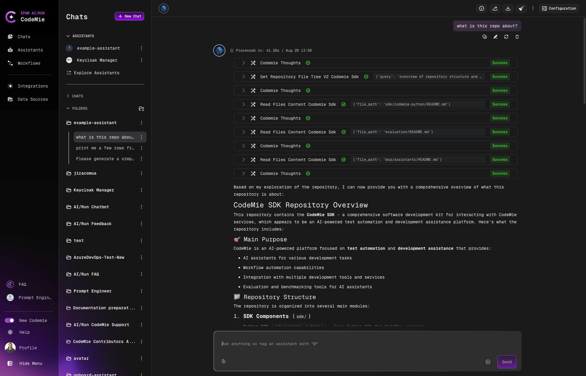

# Codebase Tools

Codebase Tools were designed to help users navigate and search data within data sources. These things work as a "tree" tool in Linux or as an AI-powered search engine. Codebase Tools include the following components:

## Available Tools

### Get Repository File Tree

This tool builds the complete file tree of a Git data source. It is one of the [default datasource tools](#default-datasource-tools) and is selected automatically when a code data source is attached to an assistant.

:::tip
On very large repositories, such as monorepos, the full file tree can consume a significant share of the model's context window. In such cases, deselect this tool or use **Get Repo Tree with filtering (Experimental)** instead.
:::

### Search Code Repo

This tool searches the content of a code data source by meaning and keywords. It is one of the [default datasource tools](#default-datasource-tools) and is selected automatically when a code data source is attached to an assistant.

### Get Repo Tree with filtering (Experimental)

This tool allows assistants to build a file tree for a data source. As a result, users will get a sorted file diagram of a data source. These tools work solely with Git data source type.

### Search Code with filtering (Experimental)

This tool works as a powerful search. Not only can it search files or text but also allows it to identify logical patterns, keywords, queries, etc. For example, a user can ask an assistant to show a file with code that imports a library that stores mathematical functions or contains more than five classes declared.

### Read Files Content

Tool allows you to directly access and read the content of a specific file within the code repository. Provided you know the file path or name. This tool is particularly useful when you need detailed information about a particular file without the need for broader search across the repository. To use this tool, simply provide the file path of the file you wish to read. The tool will return the content of the specified file or files.

:::note
This tool is efficient for pinpointing and retrieving the contents of individual files, making it a valuable resource when precise file content is required.
:::

### Read Files Content With Summary

Tool allows you to directly access and read the content of a specific file within the code repository, provided you know the file path or name. This enhanced version of the file reader automatically handles large files by providing intelligent summaries when the content exceeds token limits.

**Key features:**

- Reads full content for files within token limits
- Automatically summarizes larger files while preserving key information
- Focuses summaries on main functionality, purpose, and key components
- Maintains original file source information

To use this tool, simply provide the file path of the file you wish to read.

The tool will return either the complete content or a summarized version, depending on the file size.

:::info
This tool is particularly useful when dealing with large codebases or files, as it ensures you get the most relevant information while staying within system limits. If you receive a summary, it will be clearly marked as such.
:::

## Default Datasource Tools

Attaching a data source to an assistant adds a set of tools that let the assistant work with that data source. These are the default datasource tools:

| Data source type | Default tools                                      | Tools group    |
| ---------------- | -------------------------------------------------- | -------------- |
| Code             | **Get Repository File Tree**, **Search Code Repo** | Codebase Tools |
| Knowledge Base   | **Search Knowledge Base**                          | Codebase Tools |

Default datasource tools are listed in the **Available Tools** section of the assistant form together with all other tools, and they are managed the same way.

### Automatic Selection

When a data source is attached to an assistant, the matching default tools become selected automatically:

- Attaching a code data source selects **Get Repository File Tree** and **Search Code Repo**.
- Attaching a knowledge base data source selects **Search Knowledge Base**.

Assistants created before this behavior was introduced show their default tools as selected, and they work exactly as before.

### Deselecting a Default Tool

A default tool can be deselected by clearing its checkbox in the **Available Tools** section, and the change is applied after the assistant is saved.

- A deselected tool is not available to the assistant for any of its data sources of that type.
- The other default tools remain available.
- A tool that was deselected stays deselected when another data source of the same type is attached later, as well as when the last data source of that type is removed and a new one is attached.
- The choice is kept when the assistant is saved as a new version, restored from a previous version, exported and imported, or used in a workflow.
- When **Get Repository File Tree** is deselected, no remaining code tool instructs the model to call the repository tree first.

:::info
Deselecting a default tool has the same effect as deselecting any other tool. No warning is shown.
:::

### Standard and Filtering Variants

Each default code tool has a "with filtering" variant. A tool and its variant cannot both be selected through the form:

| Standard tool            | Variant                                     |
| ------------------------ | ------------------------------------------- |
| Get Repository File Tree | Get Repo Tree with filtering (Experimental) |
| Search Code Repo         | Search Code with filtering (Experimental)   |

- Selecting a variant deselects the standard tool, and the other way around.
- Both can be deselected if neither is needed.

:::note
If a stored assistant already has both a tool and its variant selected, the form shows both as selected. Choosing either one then deselects the other.
:::

### Assistants in Workflows

A workflow can use a predefined assistant or a virtual assistant, which is defined only inside the workflow. Both use the same mechanism for default datasource tools: the same tools listing, automatic selection, deselection and exclusivity rules apply when either kind of assistant is edited. The workflow configuration setting `exclude_extra_context_tools` is independent and is described in the [workflow configuration reference](../../workflows/configuration/configuration-reference.md).

### Save Errors

If the platform rejects a save, an error message is displayed and the form keeps all changes, so the problem can be corrected without re-entering data.

## Setup

These tools don't require any integration to set up. Instead, they need a Data Source to work with. To use these tools, you need to enable them on the available tools list:

## Usage Example

The **Get Repo Tree with filtering (Experimental)** tool is activated when asking a question related to a repository structure:

