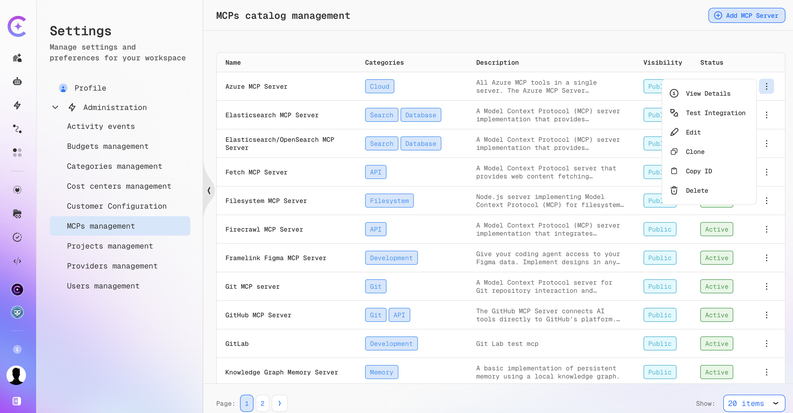
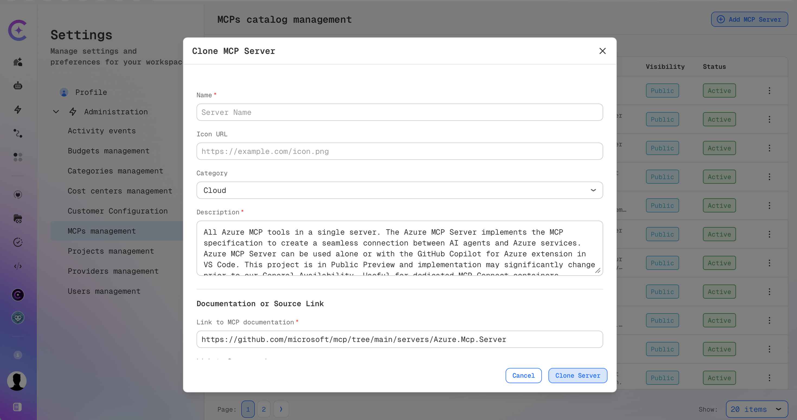
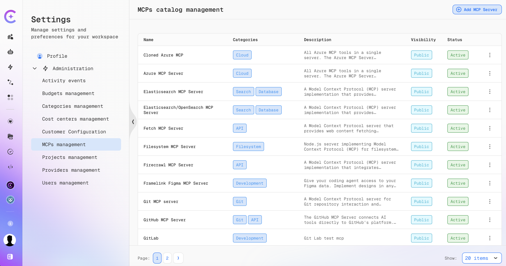

# Clone an MCP Server Configuration

Cloning lets you start a new entry in the MCP server catalog from an existing one, instead of
re-entering every field by hand. The clone opens as an editable, pre-filled form so you can
review and adjust values before saving — not a one-click copy.

:::warning Access Required
Cloning an MCP server configuration is available only to users whose account has `is_admin` set
to `true`. This includes **Maintainers**, who always have `is_admin` enabled. For everyone else,
the **Clone** item is hidden from the row actions menu, and the clone request is rejected by the
API. See [Roles and Access Control](../../../../admin/security/roles-rbac.md) for details on these
roles.

The **MCPs management** page is also available only when both of these feature flags are enabled:

- `mcpConnect`, set in the customer configuration. See
  [Customer Feature Configuration](../../../../admin/configuration/codemie/customer-feature-configuration.md).
- `features:enterpriseEdition`, which the platform enables automatically when it runs as
  Enterprise Edition.

If either flag is disabled, the page is not available.
:::

This manages the same admin-controlled catalog referenced in
[Adding an MCP Server](./adding-an-mcp-server.md) (the servers available under **Browse Catalog**,
and the only servers selectable when `mcpCustomServersDisabled` restricts users to catalog-only
configuration).

## Open MCP Catalog Management

1. Click the **Profile** icon in the bottom-left corner → **Settings** → **Administration** →
   **MCPs management**.
2. The **MCPs catalog management** page lists every server in the catalog, with its name,
   categories, description, visibility, and status.

## Clone an Existing Server

1. Open the actions menu (**⋮**) for the server you want to copy and select **Clone**.
2. The **Clone MCP Server** dialog opens immediately, pre-filled from the source server —
   **except Name, which opens empty.** Type a name before you can save; it is not pre-filled or
   suggested from the source name.

   

3. Review and edit any of the pre-filled values:
   - The top fields: **Name** (required, starts empty), **Icon URL**, **Category** (choose up to
     three from the predefined list), **Description** (required).
   - **Documentation or Source Link**: **Link to MCP documentation** (required). **Link to Source
     code** isn't marked required in the dialog, but the form currently blocks saving if it's left
     empty — fill in a URL here even though it has no required indicator.
   - **Server Configuration**: the server's **Configuration JSON** (command/arguments or
     connection URL, depending on server type), with **Prettify** and copy helpers.
   - **Environment Variables**: the source's required environment variable definitions (name,
     description, required flag), editable and extendable with **Add Variable**.
4. Click **Clone Server** to save the new catalog entry, or **Cancel** to discard the draft.

:::info Secret values
If the source server's auth settings include a confidential OAuth2 client secret, the
Configuration JSON never shows the real value — the secret field is replaced with a
`has_client_secret` flag instead. Leave that part of the configuration as-is to carry the
original secret over to the clone unchanged, or add a `client_secret` value to set a different
secret for the clone.

This masking applies only to OAuth2 client secrets in `auth_config`. Any other credentials in the
Configuration JSON — such as headers, tokens, environment variable values, or credentials embedded
in URLs — are shown in plain text to the person cloning and are copied to the clone as-is unless
you change them.

If the source server uses an OAuth2 login flow, the clone always gets a new internal auth
configuration ID. Existing OAuth sign-ins for the source server do not carry over to the clone —
anyone using the clone, including you, needs to complete the OAuth login again for it, even though
the rest of the Configuration JSON is unchanged.
:::

## After Cloning

- The clone is saved as a **new, independent** catalog entry. Subsequent edits to the clone do not
  change the original, and edits to the original do not affect the clone.
- You become the owner of the clone, regardless of who created the original.
- Visibility and system-provided status are always copied from the source and cannot be changed in
  the clone form.
- Assistants and workflows that use the original server are not switched to the clone. Update them
  manually if they should use the new entry.
- The clone starts with its own usage count of zero and is active immediately. It appears at the
  top of the list right after saving; after a page refresh, it takes its place in the regular sort
  order (most-used first, then by name).

## Validation and Errors

- **Name**, **Description**, **Link to MCP documentation**, **Link to Source code**, and the
  **Configuration JSON** are required.
- **Link to MCP documentation**, **Link to Source code**, and **Icon URL** must be valid URLs.
- You can select at most three categories.
- Each environment variable must have a name.
- Configuration JSON must be valid JSON; an invalid server configuration is rejected on save.
- The name must be unique among the configurations you created — reusing a name you already used
  for another of your catalog entries is rejected with "Name already exists". A name used by a
  different admin or maintainer's entry does not conflict.
- If the source server is deleted before you finish cloning it, saving fails with
  "MCP configuration not found" — verify the configuration still exists and retry.
- On the rare case of an internal ID conflict, saving fails and can be retried — a new identifier
  is generated on every clone attempt.
