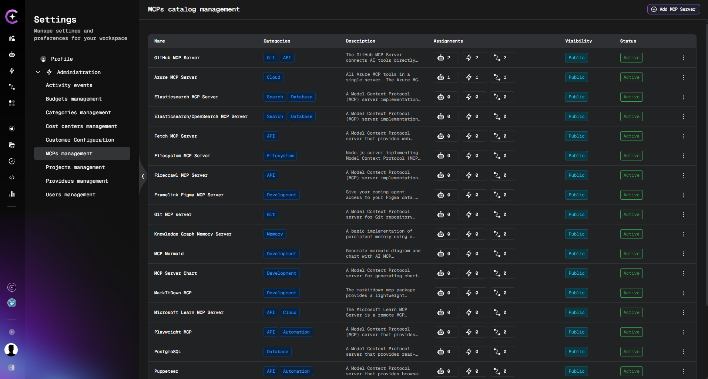

import EnterpriseFeature from '@site/src/components/EnterpriseFeature';

# MCP Management

<EnterpriseFeature />

The **MCPs management** page in **Settings** → **Administration** is the catalog of MCP servers available on the platform. The **Assignments** column shows how many Assistants, Skills, and Workflows use each MCP server, and each count opens the matching asset list already filtered to that server.

This makes the impact of a change visible before it is made. Before an MCP server is edited, disabled, or removed, the Assignments column shows which assets depend on it and the drill-down links list them.

## Prerequisites

- Access to **Settings** → **Administration** (administrator role).
- The MCP feature enabled on the deployment. See [Customer Feature Configuration](../../../../admin/configuration/codemie/customer-feature-configuration.md) (`adminActions`, `mcpConnect`).
- At least one MCP server in the catalog. See [Adding an MCP Server](./adding-an-mcp-server.md).

## What the Assignments Column Shows

Each row of the MCP catalog contains three badges, one per asset type:

| Badge      | Counts                                                                     |
| ---------- | -------------------------------------------------------------------------- |
| Assistants | Assistants that reference the MCP server, including marketplace assistants |
| Skills     | Skills that reference the MCP server                                       |
| Workflows  | Workflows whose configuration references the MCP server                    |

Hovering over a badge shows the asset type in a tooltip.

### How Counts Are Calculated

- **Enabled references only.** An MCP server attached to an asset but switched off in that asset is not counted.
- **Visibility-aware.** Only assets visible to the current user are counted. A different user can see a different number for the same MCP server.
- **Workflows.** A workflow is counted when the MCP server is attached to an assistant node or a tool node in the workflow configuration. An MCP server that is attached only to a separate Assistant record that the workflow uses is not counted for the workflow.
- **No references.** When no asset uses the MCP server, all three badges show `0`.
- **Refresh.** Counts are recalculated whenever the list is loaded. After the MCP configuration of an asset is changed, reload the list to see the updated numbers.

## Open the Assets That Use an MCP Server

1. Open **Settings** → **Administration** → **MCPs management**.
2. Locate the MCP server in the list. Use the search field if the catalog is long.
3. In the **Assignments** column, click the badge for the asset type to review:
   - **Assistants** — opens **Assistants** → **Project Assistants** with the selected MCP server in the **MCP servers** filter.
   - **Skills** — opens **Skills** → **Project Skills** with the selected MCP server in the **MCP Servers** filter.
   - **Workflows** — opens **Workflows** → **All Workflows** with the selected MCP server in the **MCP Servers** filter.
4. Review the filtered list. Every row is an asset that references the selected MCP server and is visible to the current user.

### Assistants Filtered by MCP Server

The **Assistants** badge opens **Project Assistants** with the **MCP servers** filter pre-selected. An assistant is listed when the selected MCP server is attached to it and enabled. The same rule is used for the **Assistants** count. See [Filtering Assistants](../../../assistants/index.md#filtering-assistants).

### Skills Filtered by MCP Server

The **Skills** badge opens **Project Skills** with the **MCP Servers** filter pre-selected. A skill is listed when the selected MCP server is attached to it and enabled. The same rule is used for the **Skills** count. See [Managing Skills](../../../skills/manage-skills.md#viewing-skills).

### Workflows Filtered by MCP Server

The **Workflows** badge opens the **All Workflows** list with the **MCP Servers** filter pre-selected. A workflow is listed when the selected MCP server is attached and enabled on an assistant node or on a tool node in the workflow configuration. The same rule is used for the **Workflows** count, so the badge and the list stay consistent.

The **MCP Servers** filter is also available directly in the filter panel of **All Workflows** and **My Workflows**. See [Workflows Overview](../../../workflows/workflows-overview.md#filtering-workflows).

:::info
The number in the badge and the number of rows in the opened list are expected to match. A difference can appear when assets were changed in the meantime or when the list is limited by other filters, for example **PROJECT** or **VISIBILITY**.
:::

## Work With the Filtered List

Once the list is open from the MCP page, it behaves like any other list of the same asset type:

- **Search.** Entering text in the search field narrows the results within the MCP-filtered set only. The MCP filter stays applied.
- **Change or add servers.** In **Assistants**, **Skills**, and **Workflows**, the **MCP Servers** filter is a multi-select. Additional servers can be selected, and an asset is shown when it references any of the selected servers. See [Assistants](../../../assistants/index.md#filtering-assistants), [Managing Skills](../../../skills/manage-skills.md#viewing-skills), and [Workflows Overview](../../../workflows/workflows-overview.md#filtering-workflows).
- **Clear the filter.** Remove the MCP server from the filter, or click **Clear all**, to return to the default list. The MCP server is also removed from the page address.
- **Share the view.** The filter is part of the page address, so the filtered list can be bookmarked or shared with another user. The other user sees only the assets visible to them.

## Unknown or Inaccessible MCP Server

When the page address contains an MCP server that was deleted or that the current user cannot access, the **Assistants**, **Skills**, and **Workflows** lists do not silently fall back to all assets. An empty state with the message below is shown instead:

> This MCP server could not be found or you no longer have access to it.

Clear the MCP filter to return to the default list.

## Typical Scenarios

### Check the Impact Before Removing an MCP Server

1. Open **MCPs management** and find the MCP server to be removed.
2. Check the three badges. If all are `0`, no visible asset depends on the server.
3. If a count is greater than zero, click the badge and review the listed assets.
4. Update the affected assets to use another MCP server, or notify their owners, and then remove or disable the server.

### Find Every Skill That Uses a Specific Server

1. Click the **Skills** badge of the MCP server.
2. Open each skill from the list to review or update its MCP configuration. See [Managing Skills](../../../skills/manage-skills.md).

### Find Every Workflow That Uses a Specific Server

1. Click the **Workflows** badge of the MCP server.
2. Open each workflow from the list and review the MCP server on its assistant and tool nodes. See [Workflows Overview](../../../workflows/workflows-overview.md).

## Related Documentation

- [Adding an MCP Server](./adding-an-mcp-server.md)
- [MCP Integration Credentials](./mcp-integration-credentials.md)
- [Assistants](../../../assistants/index.md#filtering-assistants)
- [Managing Skills](../../../skills/manage-skills.md)
- [Enterprise Features](../../../getting-started/enterprise-features.md)
