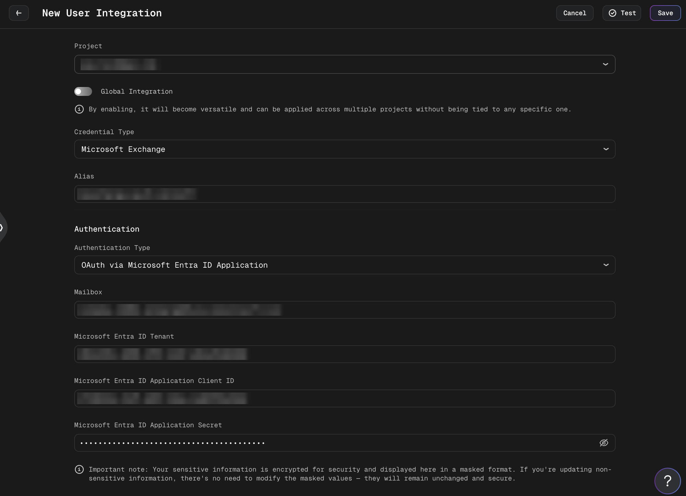
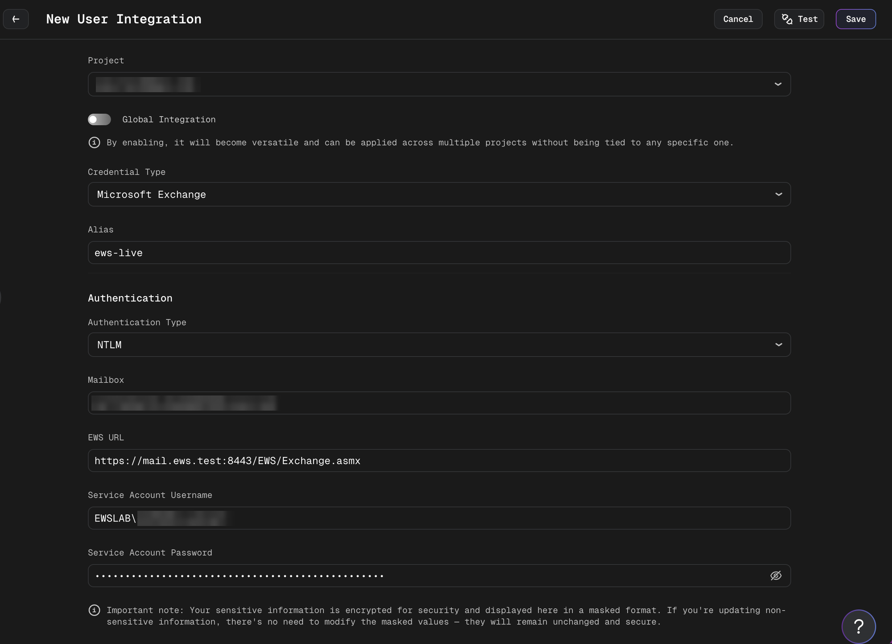
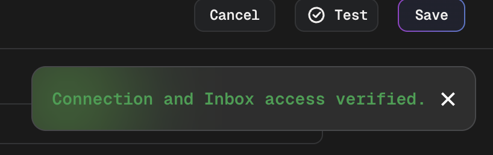
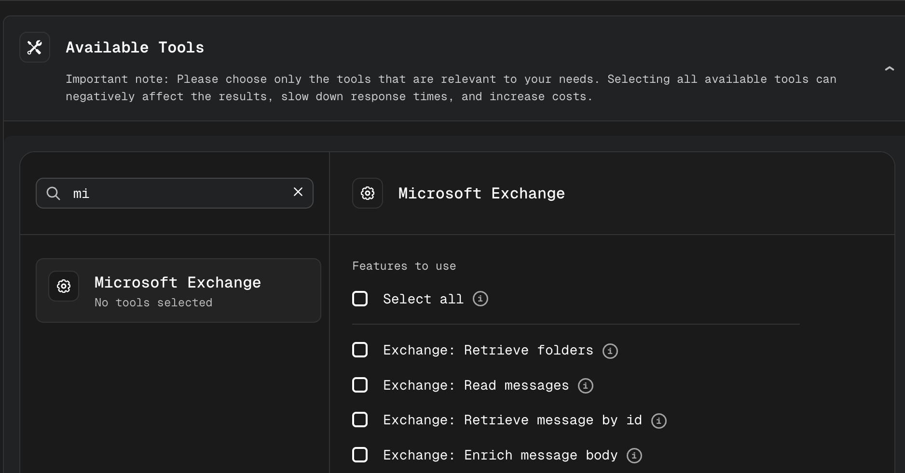
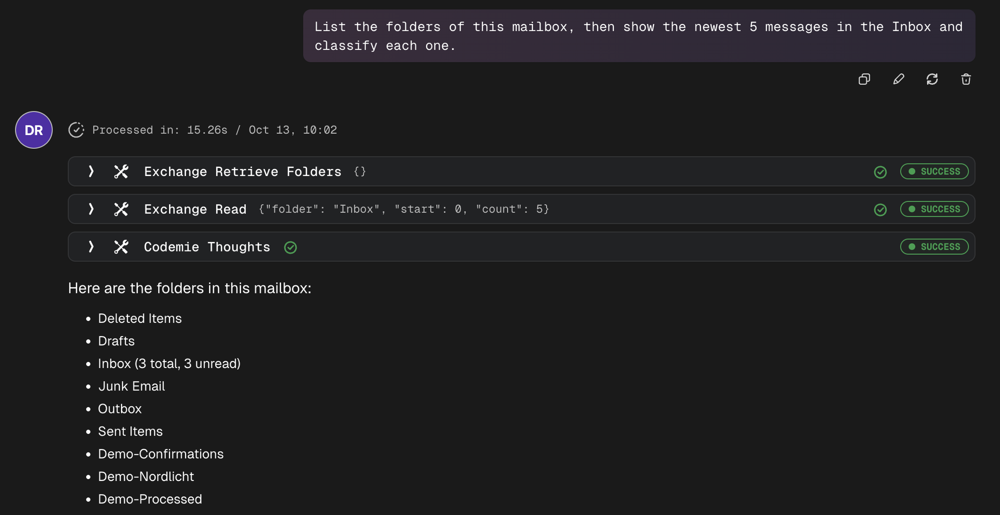

# Microsoft Exchange

## Overview

The Microsoft Exchange toolkit gives AI/Run CodeMie assistants and workflows access to a mailbox. The toolkit has two groups of tools:

- **Read tools** list folders, read messages, open a single message and extract text from its attachments. They never change the mailbox.
- **Write tools** send, forward, move, tag and delete messages. They change the mailbox. See [Write Operations](#write-operations).

The toolkit connects to Exchange in one of two ways. The mode is chosen explicitly when the integration is created:

| Authentication type                          | Transport                   | Use it for                                                                                   |
| -------------------------------------------- | --------------------------- | -------------------------------------------------------------------------------------------- |
| **OAuth via Microsoft Entra ID Application** | Microsoft Graph             | Exchange Online                                                                              |
| **NTLM**                                     | Exchange Web Services (EWS) | On-premises Exchange, air-gapped environments, or tenants where Entra ID apps are restricted |

In both modes, an identity (an Entra ID application or a service account) authenticates, and the toolkit opens the separate target mailbox that you set in the integration.

## Prerequisites

:::note Required Integration
This tool requires you to have at least one Microsoft Exchange integration configured in AI/Run CodeMie. For more details, please refer to the [Integrations Overview](../integrations/index.md) guidelines.
:::

### OAuth via Microsoft Entra ID Application (Microsoft Graph)

- An app registration in Microsoft Entra ID with a client secret.
- The **application** permissions on Microsoft Graph that match the tools in use, with admin consent granted:

  | Permission       | Needed for                                                                             |
  | ---------------- | -------------------------------------------------------------------------------------- |
  | `Mail.Read`      | The read tools                                                                         |
  | `Mail.ReadWrite` | **Exchange: Move message**, **Exchange: Tag message** and **Exchange: Delete message** |
  | `Mail.Send`      | **Exchange: Send message** and **Exchange: Forward message**                           |

  `Mail.ReadWrite` includes read access. An integration that only reads mail needs `Mail.Read` alone.

:::warning Mailbox scope
An application-level mail permission grants access to **every mailbox in the tenant**. This is more serious for `Mail.ReadWrite` and `Mail.Send`, because the application can then change mail and send mail as any mailbox. To restrict the application to specific mailboxes, the Exchange administrator must configure an Exchange **Application Access Policy**.
:::

### NTLM (Exchange Web Services)

- A service account that has the **Full Access** mailbox permission on the target mailbox. The toolkit lists folders from the mailbox root, so Full Access is what it needs. Folder-level delegate rights in Outlook have not been verified to be enough. Full Access also covers moving, tagging and deleting messages.
- For **Exchange: Send message** and **Exchange: Forward message**, the **Send As** permission for the service account on the target mailbox. Full Access does not include Send As.
- EWS enabled for the service account and for the target mailbox.
- NTLM (Windows authentication) enabled on the EWS virtual directory of the Exchange server.
- Network access from the CodeMie cluster to the Exchange server. See [On-premises Notes (EWS)](#on-premises-notes-ews).

Your Exchange administrator can set up the server side in the Exchange Management Shell:

```powershell
# Full Access for the service account on the target mailbox
Add-MailboxPermission -Identity <mailbox> -User <service-account> -AccessRights FullAccess -InheritanceType All

# Send As for the service account on the target mailbox (only for the send and forward tools)
Add-ADPermission -Identity <mailbox> -User <service-account> -ExtendedRights "Send As"

# EWS enabled for the mailbox
Set-CASMailbox -Identity <mailbox> -EWSEnabled $true

# NTLM (Windows authentication) enabled on the EWS virtual directory
Set-WebServicesVirtualDirectory -Identity "<server>\EWS (Default Web Site)" -WindowsAuthentication $true
```

If EWS or NTLM is turned off, the toolkit reports rejected credentials or denied access. See [Troubleshooting](#troubleshooting).

:::note
If your Exchange server is on an internal network, ask the platform administrator to add its host name or subnet to `EXCHANGE_EWS_ALLOWED_HOSTS`. See [Microsoft Exchange (EWS)](../../../admin/configuration/codemie/api-configuration.md#microsoft-exchange-ews) in the API configuration guide. Until then, the EWS URL is rejected.
:::

## Setting Up Integration

### 1. Navigate to Integrations

- Go to **Integrations**
- Select **User Integrations** or **Project Integrations** based on your needs:
  - **User Integrations**: Available only to you across all projects
  - **Project Integrations**: Shared with all members of the selected project
- Click **+ Create**

### 2. Configure Integration Settings

- **Credential Type**: Select **Microsoft Exchange**
- **Alias**: Provide a descriptive name (e.g., "Support Inbox")
- **Authentication Type**: Select **OAuth via Microsoft Entra ID Application** or **NTLM**
- **Mailbox**: The address of the target mailbox (e.g., `user@example.com`). Required in both modes.

### 3. Set Up Authentication

The form shows only the fields of the selected authentication type, and only those fields are required.

**OAuth via Microsoft Entra ID Application:**

| Field                                        | Description                                         |
| -------------------------------------------- | --------------------------------------------------- |
| **Microsoft Entra ID Tenant**                | The tenant ID of your Microsoft Entra ID directory  |
| **Microsoft Entra ID Application Client ID** | The application (client) ID of the app registration |
| **Microsoft Entra ID Application Secret**    | A client secret of the app registration             |



**NTLM:**

| Field                        | Description                                                                                                  |
| ---------------------------- | ------------------------------------------------------------------------------------------------------------ |
| **EWS URL**                  | The direct EWS endpoint, for example `https://mail.contoso.local/EWS/Exchange.asmx`. See [EWS URL](#ews-url) |
| **Service Account Username** | The service account with Full Access to the mailbox, as `DOMAIN\username`, for example `DOMAIN\svc-codemie`  |
| **Service Account Password** | The password of the service account                                                                          |



:::info Authentication Details
Your sensitive information (the application secret and the service account password) is encrypted for security and displayed in a masked format. When updating non-sensitive information, masked values remain unchanged and secure.
:::

### 4. Save Integration

- Click **+ Save** to store the integration

## Testing the Connection

Use the **Test** button on the integration to check the settings. The test signs in and checks that the Inbox of the target mailbox can be read. An empty Inbox passes the test.

- On success, the message is "Connection and Inbox access verified."

  

- If required fields for the selected authentication type are missing or invalid, the message is "The Exchange connection settings are invalid. Check the required fields for the selected authentication type."
- For any other failure, the test shows one of the fixed messages listed in [Troubleshooting](#troubleshooting).

:::note
The test only checks read access. It does not check the `Mail.ReadWrite` or `Mail.Send` permissions (OAuth) or the Send As permission (NTLM). Missing write permissions show up when a write tool is first used. See [Write Operation Errors](#write-operation-errors).
:::

## Using in Assistants

### 1. Add the Toolkit

When creating or editing an assistant:

- Navigate to **Assistants** section
- Click **+ Create Assistant** or edit an existing one
- In **Available tools**, add **Microsoft Exchange**
- Select your Microsoft Exchange integration from the dropdown

The integration is selected once for the whole toolkit. All tools use it.



### 2. Available Tools

The toolkit has four read tools and five write tools. The write tools are described in [Write Operations](#write-operations).

**Read tools** never change the mailbox:

| Tool                                 | What it does                                                                                                                                                            |
| ------------------------------------ | ----------------------------------------------------------------------------------------------------------------------------------------------------------------------- |
| **Exchange: Retrieve folders**       | Lists the mailbox folders with their ID, name, total item count and unread count.                                                                                       |
| **Exchange: Read messages**          | Lists messages in a folder, newest first. Returns ID, subject, sender, received time, read state and whether the message has attachments. Never marks messages as read. |
| **Exchange: Retrieve message by id** | Returns one message by its ID: the summary fields plus To, Cc and the body as plain text.                                                                               |
| **Exchange: Enrich message body**    | Returns the message body plus text extracted from its attachments.                                                                                                      |

**Exchange: Read messages** parameters:

- **folder**: defaults to **Inbox**. Both modes accept:
  - a well-known folder name: `inbox`, `drafts`, `sentitems`, `deleteditems`, `junkemail`, `outbox`, `msgfolderroot` and a few system folders. `archive` (also `clutter` and `scheduled`) works in OAuth mode only;
  - a folder ID, as returned by **Exchange: Retrieve folders**;
  - a folder name, matched case-insensitively.

  The folder list includes subfolders. It is flattened and carries no path, so two folders with the same name are ambiguous: the first match wins. Use the folder ID to pick a specific one.

- **start**: the offset to start from, default `0`.
- **count**: the number of messages to return, default `10`, maximum `50`.

**Exchange: Enrich message body** details:

- Images are processed with OCR. Text is extracted from PDF and DOCX files.
- Only PDF files with a text layer are extracted. A scanned PDF is not OCR-ed, so it returns little or no text and is listed as "text extraction failed".
- Other attachment types, such as XLSX, TXT or EML, are skipped as "unsupported attachment type".
- Limits: at most 10 attachments per message, 10 MB per attachment and 25 MB in total.
- An optional OCR model can be set with `ocr_model`. If it is not set, an assistant uses a multimodal model from the platform's model list. The assistant's own model is used only when the platform has no multimodal model configured, and then it must be multimodal, otherwise images are skipped with "text extraction failed". A workflow tool node has no assistant model, so it needs `ocr_model`. See [Using in Workflows](#using-in-workflows).
- Attachments that are not extracted are listed with a short note that explains why they were skipped.

Each read request times out after 60 seconds. Temporary failures are retried automatically up to 3 times, and all retries of one call share a 90-second budget. In a workflow tool node, the node retries a failed read on top of this (up to 10 attempts by default). Writes follow a stricter policy, described in [Retries and Time Limit](#retries-and-time-limit).

| Mode  | What is retried                                                                                                                                                         |
| ----- | ----------------------------------------------------------------------------------------------------------------------------------------------------------------------- |
| OAuth | Rate limiting (HTTP 429) and server errors (HTTP 5xx). A request that times out after 60 seconds is not retried.                                                        |
| NTLM  | Server-busy and temporary server errors, and timeouts or dropped connections. After a 60-second timeout, the 90-second budget leaves room for at most one more attempt. |

### 3. Example Prompts

```text
List the folders in the mailbox and show how many unread messages each one has.
```

```text
Open the latest message from billing@example.com and extract the text of its PDF attachments.
```

```text
Tag every message from billing@example.com in the Inbox with the category "Invoice", then move it to the folder "Invoices".
```

```text
Forward the latest message in the Inbox to support@example.com.
```

For a request such as "List the folders of this mailbox, then show the newest 5 messages in the Inbox and classify each one.", the assistant calls **Exchange: Retrieve folders** and then **Exchange: Read messages**:



## Write Operations

The write tools change the mailbox. They work the same way in both authentication modes, and the result has the same shape on Microsoft Graph and on EWS.

:::warning Write tools change real mail
Sent messages cannot be recalled, and a permanent delete cannot be undone. Add the write tools to an assistant only when it is meant to change mail, and describe in the assistant instructions when each tool may be used.
:::

:::warning Use the Guarded or Manual tool-call policy
The write tools are never approved automatically. With the **Guarded** tool-call policy the assistant asks for confirmation before each write, while the read tools run without asking. The **Manual** policy asks before every tool call. With the **Auto** policy, sends and deletes run without any confirmation. Set **Guarded** or **Manual** for an assistant that has write tools. If tool-call permissions are turned off for the whole installation, all tool calls are approved automatically. See [Tool Call Permissions](../../../admin/configuration/codemie/customer-feature-configuration.md#tool-call-permissions).
:::

### Tools

| Tool                          | What it does                                                                                                                 |
| ----------------------------- | ---------------------------------------------------------------------------------------------------------------------------- |
| **Exchange: Send message**    | Sends a new message.                                                                                                         |
| **Exchange: Forward message** | Forwards an existing message to new recipients, without a comment. The subject is prefixed by Exchange, for example `FW: …`. |
| **Exchange: Move message**    | Moves a message to another folder.                                                                                           |
| **Exchange: Tag message**     | Adds one category to a message and keeps the existing categories.                                                            |
| **Exchange: Delete message**  | Moves a message to Deleted Items (default) or deletes it permanently.                                                        |

**Exchange: Send message** parameters:

- **to**: a list of recipient email addresses. Cc, Bcc and attachments are not supported.
- **subject**: the subject of the message.
- **body**: the body of the message.
- **body_type**: `text` (default) or `html`. HTML is sent exactly as given, without sanitization.

**Exchange: Forward message** parameters: **message_id** and **to** (a list of recipient email addresses).

:::info Sending is not delivery
The result `submitted` means that Exchange accepted the message. It does not mean that the message reached the recipient. The toolkit does not check delivery.
:::

**Exchange: Move message** parameters:

- **message_id**: the ID of the message.
- **target_folder**: a well-known folder name, a folder name (matched case-insensitively) or a folder ID. The same lookup rules as for **folder** in **Exchange: Read messages** apply. Well-known names are not limited to mail folders: names such as `recoverableitemsdeletions` and `msgfolderroot` are accepted on Microsoft Graph and on EWS. A message moved to `recoverableitemsdeletions` disappears from normal view like a deleted one but skips Deleted Items. Use such a target only on purpose.

A message can get a new ID when it moves. The result contains the new ID, and later steps must use it. The ID can be `null` when it is not known.

**Exchange: Tag message** parameters: **message_id** and **category** (one category name, up to 255 characters, without control characters).

- Categories are handled as a set. Tagging a message that has the category `Finance` with `Processed` results in `Finance` and `Processed`.
- The comparison ignores letter case. A category that is already present is not written again, and the result contains `already_done`.
- Removing or replacing categories and creating master categories are not supported.
- Concurrent changes: on EWS, a conflicting concurrent change to the categories is detected. The message is read again and the tag is applied once more. A second conflict is reported as "Not applied". On Microsoft Graph, protection against a concurrent change is **not guaranteed**: if another process changes the categories of the same message at the same moment, one of the changes can be lost.

**Exchange: Delete message** parameters:

- **message_id**: the ID of the message.
- **soft**: `true` (default) moves the message to Deleted Items, where it can be recovered. `false` deletes the message permanently.

:::danger Permanent delete
`soft=false` removes the message from normal access and cannot be undone through the toolkit. A retention policy or a litigation hold can still keep a copy, but immediate physical erasure is not guaranteed. Use it only when permanent deletion is explicitly required.
:::

A soft delete of a message that is already in Deleted Items does nothing and returns `already_done`. A repeated or retried default delete never turns into a permanent delete.

### Results

Each write tool returns a JSON result.

| Tool                          | Result                                                                  |
| ----------------------------- | ----------------------------------------------------------------------- |
| **Exchange: Send message**    | `status` (`submitted`), `to`, `subject`                                 |
| **Exchange: Forward message** | `status` (`submitted`), `message_id`, `to`                              |
| **Exchange: Move message**    | `status` (`moved`), `message_id` (new ID), `target_folder`              |
| **Exchange: Tag message**     | `status` (`tagged`), `message_id`, `categories` (the resulting set)     |
| **Exchange: Delete message**  | `status` (`deleted`), `soft`, `message_id` (new ID after a soft delete) |

`already_done` is added to the result of move, tag and soft delete when the mailbox was already in the requested state and nothing was written.

### Not Applied and Unknown

A write that fails always ends in one of two outcomes. The error message contains the outcome:

| Message contains | Meaning                                                                                                         |
| ---------------- | --------------------------------------------------------------------------------------------------------------- |
| `Not applied.`   | The mailbox is unchanged. The request never reached Exchange, or Exchange rejected it before changing anything. |
| `Unknown.`       | The change may or may not have been made. A timeout, a lost connection or a server error after the submission.  |

Each individual write on the server either completes fully or changes nothing. A lost response is not a partial change.

After `Not applied.`, fix the cause that the message names and repeat the request. After `Unknown.`, check the mailbox before repeating:

- **Send and forward** are never repeated automatically. Check the Sent Items folder first, because repeating the request can send a second message. The toolkit keeps no history of earlier calls, so the caller must handle duplicate sending.
- **Move and delete** are never submitted a second time. The toolkit makes one read to check whether the message is now in the target folder. If that is confirmed, the call succeeds. If not, for example because the message ID changed during the move, the result stays `Unknown.`. A message that cannot be found when move or delete is sent is `Unknown.` and not `Not applied.`, because the message may already have been moved or deleted.
- **Permanent delete** is never confirmed automatically, because a missing message does not prove that this call deleted it.

Where the message appears depends on where the tool runs:

- **In chat**, the text is wrapped: `Error calling tool: exchange_move with: Arguments: {...}. The root cause is: 'Not applied. …'`. The outcome is inside the message, not at its start, and the input values of the call are shown in the `Arguments` part.
- **In a workflow tool node**, the message is shown as it is, with the outcome at its start.
- An argument of the wrong type is rejected before the toolkit runs and has no outcome. In chat the message begins with "Error parsing tool input", and in a workflow with "Tool method arguments are not correct".

### Retries and Time Limit

The whole call has one 90-second limit. It includes the sign-in, the reads that precede a change, the request and the waiting between attempts. The limit does not cancel or roll back a change that Exchange has already accepted.

A write is submitted at most 3 times: the first attempt and up to two retries. A retry happens only when the previous attempt provably changed nothing and the cause is temporary:

- OAuth: the request was rejected with rate limiting (HTTP 429).
- NTLM: Exchange answered that the server is busy and gave a back-off time.

When Exchange gives a wait time, the toolkit waits at least that long. If the wait does not fit into the remaining time, the call stops with "Not applied" and a rate-limit message. Without a wait time, the wait is random, between 0 and 1 second before the first retry and between 0 and 2 seconds before the second. This applies only to a Microsoft Graph rate-limit response without a `Retry-After` header. NTLM never retries without a wait time from Exchange, and the single repeat after a tag conflict does not wait.

Authentication, permission and input errors are not retried. A timeout or a server error after the submission is not retried either. It ends as `Unknown.`.

A workflow tool node does not run a failed write again by itself, so a retry never sends a second message or repeats a delete. The failed node stops the workflow. Checking the mailbox after `Unknown.` and repeating the step is up to the workflow author.

### Input Checks

Before anything is submitted, the toolkit checks the input. An invalid value ends as "Not applied" with a message that asks to check the input values. The message text does not contain the value itself. In chat, the call arguments are shown next to the message, as described in [Not Applied and Unknown](#not-applied-and-unknown).

- Recipient addresses must be a non-empty list of valid email addresses.
- `body_type` must be exactly `text` or `html`.
- Message IDs, folder names and categories must not be blank and must not start or end with whitespace. A recipient address is at most 254 characters long.

### Sender

Messages are sent as the target mailbox, not as the identity that signs in, and appear in the Sent Items of the target mailbox. **Exchange: Send message** is a second way of sending mail, next to the SMTP-based [Email Sender](./email-sender-tool.md) tool. **Exchange: Send message** sends through the Exchange mailbox, while **Email Sender** sends through an SMTP server. The assistant instructions should say which of the two tools to use.

## Using in Workflows

A workflow refers to the tools by their technical names, not by the labels shown in the assistant form. Set `integration_alias` to the alias of the Microsoft Exchange integration.

| Technical name              | Arguments                                                                                      |
| --------------------------- | ---------------------------------------------------------------------------------------------- |
| `exchange_retrieve_folders` | None                                                                                           |
| `exchange_read`             | `folder` (default `Inbox`), `start` (default `0`), `count` (default `10`, maximum `50`)        |
| `exchange_retrieve_by_id`   | `message_id` (required)                                                                        |
| `exchange_enrich_body`      | `message_id` (required), `ocr_model` (optional name of a multimodal model used for images)     |
| `exchange_send`             | `to` (required, list), `subject` (required), `body` (required), `body_type` (`text` or `html`) |
| `exchange_forward`          | `message_id` (required), `to` (required, list)                                                 |
| `exchange_move`             | `message_id` (required), `target_folder` (required)                                            |
| `exchange_tag`              | `message_id` (required), `category` (required)                                                 |
| `exchange_delete`           | `message_id` (required), `soft` (default `true`)                                               |

:::note OCR in workflow tool nodes
When `exchange_enrich_body` runs as a tool node, no assistant model is available. Set `ocr_model` in `tool_args` to the name of a multimodal model. Otherwise every image attachment is skipped and listed as "no OCR model provided". An assistant in a workflow, as in the second example below, uses a multimodal model from the platform's model list.
:::

Example of a tool that reads the newest messages of a folder:

```yaml
tools:
  - id: read-inbox
    tool: exchange_read
    tool_args:
      folder: Inbox
      count: 20
    integration_alias: support-inbox

states:
  - id: fetch-messages
    tool_id: read-inbox
    next:
      state_id: summarize
```

An assistant in a workflow lists the tools under `tools` with `name` and `integration_alias`:

```yaml
assistants:
  - id: mail-assistant
    model: gpt-4.1-mini
    system_prompt: |
      You summarize the mailbox.
    tools:
      - name: exchange_read
        integration_alias: support-inbox
      - name: exchange_enrich_body
        integration_alias: support-inbox
```

Example of tools that mark a processed message and move it to another folder. The `message_id` is taken from the workflow context:

```yaml
tools:
  - id: tag-processed
    tool: exchange_tag
    tool_args:
      message_id: '{{message_id}}'
      category: Processed
    integration_alias: support-inbox

  - id: move-processed
    tool: exchange_move
    tool_args:
      message_id: '{{message_id}}'
      target_folder: Processed
    integration_alias: support-inbox
```

:::tip Assistants in workflows
An assistant node, like an assistant in chat, can call a write tool again after an error, including a send after `Unknown.`. Add an instruction to the assistant, for example: "After an Unknown result from an Exchange write tool, do not repeat the call. Check the mailbox with the read tools, or report the result to the user."
:::

Move and tag are well suited as progress markers in a workflow that processes a mailbox: a message that is moved to a "Processed" folder or tagged with a category is easy to skip in the next run. The toolkit does not prevent two overlapping runs from handling the same message and does not keep a history of earlier calls.

For the full workflow syntax, see the [Workflow Configuration Reference](../../workflows/configuration/configuration-reference.md).

## On-premises Notes (EWS)

### EWS URL

- Only `https` is supported. If you enter a bare host name, the connection is made over https.
- URLs that contain embedded credentials are rejected.
- Example: `https://mail.contoso.local/EWS/Exchange.asmx`.
- Autodiscover is not used. Enter the direct EWS endpoint. If the endpoint redirects the request, the toolkit stops with the message "The Exchange endpoint redirected the request. Configure the direct EWS endpoint URL."
- The default placeholder in the form shows the Exchange Online EWS URL. For on-premises Exchange, replace it with your own server's endpoint.

**Address rules.** Before connecting, the toolkit checks where the EWS URL points:

- A host name is resolved (A and AAAA records), and **every** address it resolves to must pass the rules below.
- Loopback, link-local (including `169.254.169.254`), unspecified and multicast addresses are always rejected, and so is `localhost`. The allowlist does not override this.
- Private and other non-public addresses (RFC 1918 ranges, IPv6 ULA, CGNAT and reserved ranges) are rejected unless the platform administrator lists the host name or a matching CIDR in `EXCHANGE_EWS_ALLOWED_HOSTS`. This applies to host names and to IP addresses, so an on-premises server entered by IP address works once its address is covered by a listed CIDR.
- Public addresses are always allowed.
- A rejected address returns "The configured Exchange EWS endpoint is not usable. Check the endpoint URL."
- A host name that does not resolve, or a lookup that takes longer than 5 seconds, returns "The Exchange service is unreachable. Try again later."

Platform administrators must make sure that:

- the EWS host name resolves from the CodeMie cluster;
- egress and firewall rules allow HTTPS from the CodeMie backend pods to the Exchange host, on the port in the EWS URL (443 by default; for example `https://mail.contoso.local:8443/EWS/Exchange.asmx` uses port 8443);
- an Exchange server on a private address is listed in `EXCHANGE_EWS_ALLOWED_HOSTS`. See [Microsoft Exchange (EWS)](../../../admin/configuration/codemie/api-configuration.md#microsoft-exchange-ews).

### TLS / CA Certificate

The certificate of the Exchange server must chain to a CA that the CodeMie backend trusts. There is no field in the integration to upload a certificate or to turn off certificate verification. If the certificate cannot be verified, the toolkit shows "The TLS certificate of the Exchange service could not be verified. Check the endpoint certificate configuration."

For a self-signed certificate or one from an internal CA, the platform administrator adds the CA to the `codemie-api` chart. See [CA Certificate for the Exchange Server](../../../admin/configuration/codemie/api-configuration.md#ca-certificate-for-the-exchange-server).

## Troubleshooting

The toolkit and the **Test** button show fixed messages. Error text from Microsoft is never shown. Search this table for the exact text of the message. In chat, parts of a message can be masked: the NTLM credentials message can appear as "Check the configured username \*\*\* password.".

| Message                                                                                                                                                                                                     | Likely cause                                                                                                                                                              | Fix                                                                                                                                                                                                               |
| ----------------------------------------------------------------------------------------------------------------------------------------------------------------------------------------------------------- | ------------------------------------------------------------------------------------------------------------------------------------------------------------------------- | ----------------------------------------------------------------------------------------------------------------------------------------------------------------------------------------------------------------- |
| "The Exchange service account credentials were rejected. Check the configured username and password." (NTLM)                                                                                                | Wrong service account username or password, a username that is not in the `DOMAIN\username` format, or NTLM (Windows authentication) is off on the EWS virtual directory  | Check **Service Account Username** and **Service Account Password**. Ask your Exchange administrator to enable NTLM on the EWS virtual directory. See [NTLM (Exchange Web Services)](#ntlm-exchange-web-services) |
| "Delegate access to the mailbox is denied or the mailbox does not exist." (NTLM)                                                                                                                            | The service account has no Full Access permission on the mailbox, EWS is disabled for the mailbox, or the mailbox is wrong                                                | Grant the **Full Access** mailbox permission to the service account, enable EWS for the mailbox, or correct **Mailbox**. See [NTLM (Exchange Web Services)](#ntlm-exchange-web-services)                          |
| "The configured Exchange EWS endpoint is not usable. Check the endpoint URL."                                                                                                                               | The **EWS URL** is not https or contains credentials, points to `localhost` or a loopback or link-local address, or resolves to a private address that is not allowlisted | Enter the https EWS endpoint. For a private address, ask the platform administrator to add the host name or subnet to `EXCHANGE_EWS_ALLOWED_HOSTS`. See [EWS URL](#ews-url)                                       |
| "The Exchange endpoint redirected the request. Configure the direct EWS endpoint URL."                                                                                                                      | The URL points to a page that redirects, not to the EWS endpoint                                                                                                          | Enter the direct EWS endpoint, for example `https://mail.contoso.local/EWS/Exchange.asmx`                                                                                                                         |
| "The TLS certificate of the Exchange service could not be verified. Check the endpoint certificate configuration."                                                                                          | The server certificate does not chain to a CA the backend trusts                                                                                                          | Ask a platform administrator to add the CA. See [CA Certificate for the Exchange Server](../../../admin/configuration/codemie/api-configuration.md#ca-certificate-for-the-exchange-server)                        |
| "Administrator consent is missing or was revoked for the required Microsoft Graph permissions." (OAuth)                                                                                                     | Admin consent was not granted for `Mail.Read`, or it was revoked                                                                                                          | Grant admin consent for the application permission in Microsoft Entra ID                                                                                                                                          |
| "The Microsoft Graph client secret has expired. Ask an administrator to issue a new secret." (OAuth)                                                                                                        | The value in **Microsoft Entra ID Application Secret** has expired                                                                                                        | Create a new client secret and update the integration                                                                                                                                                             |
| "The Microsoft Graph client secret is invalid. Check the configured client secret." (OAuth)                                                                                                                 | The value in **Microsoft Entra ID Application Secret** is wrong                                                                                                           | Check that you copied the secret **value**, not the secret ID, and update the integration                                                                                                                         |
| "Access to this mailbox was denied. Check that the app registration has the Mail.Read application permission with administrator consent, and that no Application Access Policy blocks the mailbox." (OAuth) | Microsoft Graph returns the same error when administrator consent for `Mail.Read` is missing and when an Exchange Application Access Policy does not include the mailbox  | Grant admin consent for the `Mail.Read` application permission, and ask your Exchange administrator to add the mailbox to the Application Access Policy                                                           |
| "Microsoft Graph rejected the access token. Retry the request or check the app registration." (OAuth)                                                                                                       | The access token was rejected, for example because of a temporary problem or a misconfigured app registration                                                             | Retry the request. If it keeps failing, check the app registration                                                                                                                                                |
| "The requested OCR model is not available. Omit ocr_model to use the assistant's default model."                                                                                                            | The `ocr_model` argument of **Exchange: Enrich message body** names a model that does not exist or that the project cannot use                                            | Omit `ocr_model`, or use the name of a multimodal model that is available in the project                                                                                                                          |
| "The Exchange service is unreachable. Try again later."                                                                                                                                                     | The host name does not resolve from the cluster, the lookup takes longer than 5 seconds, or DNS, firewall or egress rules block the connection                            | Check that the host resolves from the cluster and that HTTPS egress is allowed on the port of the EWS URL (443 by default)                                                                                        |

Other fixed messages cover an unknown tenant or application, a mailbox that is not found or not enabled for REST, rate limiting, a server that does not respond in time, temporary server errors, and folders or messages that do not exist.

### Write Operation Errors

Every write error message contains `Not applied.` or `Unknown.`. See [Not Applied and Unknown](#not-applied-and-unknown). Sign-in and connection problems have the same causes as in the table above, but the write messages are worded differently: they say that nothing was changed and end with what to do. Use the table above to find the cause and the fix. With NTLM, a mailbox that does not exist is reported as "Not applied. The mailbox was not found…", not as the "Delegate access…" message of the read tools.

Permission errors have their own fixes:

| Message contains                                                                            | Likely cause                                                                                                                                                | Fix                                                                                                                           |
| ------------------------------------------------------------------------------------------- | ----------------------------------------------------------------------------------------------------------------------------------------------------------- | ----------------------------------------------------------------------------------------------------------------------------- |
| "Not applied. Access to send mail from this mailbox was denied…" (OAuth)                    | `Mail.Send` is missing or has no administrator consent, or an Application Access Policy blocks the mailbox. The message does not say which of these applies | Grant the `Mail.Send` application permission with administrator consent, and check the Application Access Policy              |
| "Not applied. Access to change this mailbox was denied…" (OAuth)                            | `Mail.ReadWrite` is missing or has no administrator consent, or an Application Access Policy blocks the mailbox. The message does not say which applies     | Grant the `Mail.ReadWrite` application permission with administrator consent, and check the Application Access Policy         |
| "Not applied. The Exchange service account was not allowed to send as this mailbox…" (NTLM) | The service account has no **Send As** permission or no access to the Sent Items folder of the mailbox, or mailbox access is restricted                     | Grant **Send As** and **Full Access** to the service account. See [NTLM (Exchange Web Services)](#ntlm-exchange-web-services) |
| "Not applied. The Exchange service account was not allowed to change this mailbox…" (NTLM)  | The service account has no write rights on the mailbox, or mailbox access is restricted                                                                     | Grant **Full Access** to the service account. See [NTLM (Exchange Web Services)](#ntlm-exchange-web-services)                 |

Other write errors:

- **"Not applied. The mail folder was not found…"** or **"Not applied. The message was not found…"**: the folder or message ID is wrong, or the message was moved or deleted and its ID changed. Use the folder ID from **Exchange: Retrieve folders** and read the message list again for the current message ID. With NTLM, a missing folder can also mean that the service account has no delegate rights on the mailbox.
- **"Not applied. Exchange rejected the request as invalid…"**: an input value is invalid. See [Input Checks](#input-checks).
- **Other "Not applied." messages**, such as rate limiting, a used-up time limit, a mailbox read that failed before the change, a rejected request or a concurrent category change: nothing was changed. Repeat the operation, after a while for rate limiting. See [Retries and Time Limit](#retries-and-time-limit).
- **"Unknown."** messages: the change may have been made. Follow the checks in [Not Applied and Unknown](#not-applied-and-unknown). With NTLM, a permanent delete by an account without delete rights currently ends as "Unknown. An unexpected error occurred while changing the mailbox…", not as an access error.

## Limitations

- Replying to a message is not supported.
- IMAP and POP3 are not supported.
- Certificate-based authentication for the Entra ID application is not supported. Use a client secret.
