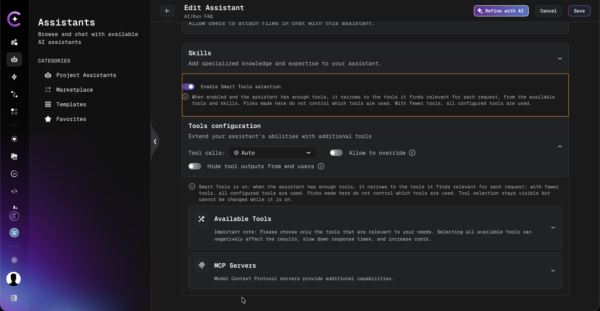

# Assistant's Tools Overview

Assistant's tools are powerful enhancements that bring completely new capabilities to AI/Run CodeMie. This page provides a comprehensive overview of all available tools.

---

## Available Tools

| Tool                                                                         | Description                                                                                                       |
| ---------------------------------------------------------------------------- | ----------------------------------------------------------------------------------------------------------------- |
| **[A2A Protocol](./a2a.mdx)**                                                | Agent-to-Agent protocol integration for connecting external AI agents and enabling cross-framework collaboration  |
| **[Keycloak](./keycloak.md)**                                                | Access management and authentication tool that allows users to leverage AI/Run CodeMie for project access control |
| **[SonarQube](./sonarqube.mdx)**                                             | Code quality analysis and static code review tool for comprehensive codebase analysis                             |
| **[SQL](./sql.md)**                                                          | Database operations tool for querying and managing SQL databases                                                  |
| **[Telegram](./telegram.md)**                                                | Send notifications to Telegram channels and bots                                                                  |
| **[Azure](./azure.md)**                                                      | Microsoft Azure cloud platform integration for cloud resource management                                          |
| **[GCP](./gcp.md)**                                                          | Google Cloud Platform integration for GCP resource operations                                                     |
| **[AWS](./aws.md)**                                                          | Amazon Web Services integration for AWS cloud operations                                                          |
| **[Kubernetes](./kubernetes.md)**                                            | Kubernetes cluster management tool for container orchestration                                                    |
| **[Webhook](./webhook.md)**                                                  | HTTP webhook integrations for event-driven automatization                                                         |
| **[Elasticsearch](./elastic.md)**                                            | Search and data analysis platform for analytical queries and data access                                          |
| **[Codebase Tools](./codebase-tools.md)**                                    | Comprehensive code analysis and management with repo browsing, code search, and file operations                   |
| **[Email Sender](./email-sender-tool.md)**                                   | Send email notifications from assistants                                                                          |
| **[OpenAPI](./openapi-tool.md)**                                             | Integrate with any third-party tools supporting the OpenAPI standard                                              |
| **[Jira](./jira.mdx)**                                                       | Issue tracking and project management integration for Jira Cloud and Jira Old UI                                  |
| **[LiteLLM](./litellm.md)**                                                  | LLM proxy integration for connecting to various AI model providers through a unified API                          |
| **[Confluence](./confluence.mdx)**                                           | Atlassian Confluence integration for retrieving and interacting with spaces, pages, and articles                  |
| **[ReportPortal](./reportportal.md)**                                        | AI-powered test execution analysis, launch data retrieval, and failure recommendations                            |
| **[Quality Assurance](./quality-assurance-with-jira-zephyr-scale-addon.md)** | Test management with Zephyr Scale (formerly TM4J) and Zephyr Squad for Jira environments                          |
| **[Xray](./xray.md)**                                                        | Test management with Xray for Jira - retrieve and interact with test cases using JQL-like syntax                  |
| **[ServiceNow](./servicenow.md)**                                            | ITSM operations including incident management, change requests, and CMDB operations                               |
| **[Scheduler](./scheduler.md)**                                              | Task scheduling and automation (Admin role only)                                                                  |
| **[Plugin](./plugin.md)**                                                    | Custom plugin integrations for extending assistant capabilities (e.g., file system)                               |
| **[FileSystem](./filesystem.md)**                                            | Code execution and file processing tools including Code Interpreter, Code Executor, and Generate Image            |
| **[Git](./git-overview.md)**                                                 | Version control system integration for GitHub, GitLab, Bitbucket, and Azure DevOps repositories                   |
| **[Azure DevOps](./azure-devops/index.md)**                                  | Work Items, Wiki, and Test Plans management via Azure DevOps integration                                          |
| **[MS Teams Bot](./ms-teams-bot.md)**                                        | Chat with CodeMie assistants directly from Microsoft Teams personal chats, group chats, and channels              |

| **[MCP](./mcp/index.md)** | Model Context Protocol: add servers, configure credentials, and use MCP tools in assistants |

---

## Smart Tool Selection

**Smart Tool Selection** lets the assistant choose the tools to use for each request, instead of relying only on tools picked manually in the assistant configuration. Relevant tools are found based on the meaning of the current request and the recent conversation.

### How to Enable

1. Open the assistant's **Create** or **Edit** page.
2. Switch on **Enable Smart Tools selection**, located above the **Tools configuration** section.
3. Click **Save**.

:::info Platform Setting Required
The toggle and the **Smart Tools** row in the assistant details are shown only when Smart Tool Selection is enabled on the platform level. If they are missing, contact the platform administrator. See [Smart Tool Selection](../../../admin/configuration/codemie/api-configuration.md#smart-tool-selection) in the configuration guide.
:::

### Behavior

#### When Smart Tools Is On

- The assistant chooses tools for each request from all tools available on the platform. Tools are not limited to those picked manually.
- Tool relevance is based on the request and the recent conversation, so different requests can use different tools.
- The tools used are the ones found relevant to the request. Narrowing to the most relevant ones applies only when enough tools are found; the threshold is a platform setting. With fewer tools, all found tools are used.
- The tools picked in **Tools configuration** are used only when no relevant tool is found, or when the request has no text.
- Tools required by the skills attached to the assistant are always added next to the matched tools.
- The tools of the assistant's data sources (knowledge base, repository) and MCP servers, and the skill tool, are always available. They are not part of the relevance search and do not depend on the manual selection.
- The tools picked manually in **Tools configuration** do not decide which tools run. They stay visible but cannot be changed: tool checkboxes, **Select all**, MCP server toggles, and plugin selections are disabled, and an information message explains why. Integration (credential) dropdowns remain editable and are applied to the selected tools when they are used.
- Web search, code interpreter, and image generation are added only when the matching feature is available and switched on for the request in the chat. Git tools are added whenever the assistant has a code data source, without adding the **Git** toolkit. A Git integration pinned to a Git tool picked in the assistant applies to that tool; other Git tools use the integration settings of the user and the project.
- A technical maximum of 128 tools sent to the model still applies.
- Smart Tool Selection does not guarantee a tool call; the model may still answer directly.
- When enabled on the platform, the **Assistant details** sidebar shows **Smart Tools: ON** under **Tools & Capabilities**.

#### When Smart Tools Is Off

- The assistant uses only the tools selected manually in **Tools configuration**, as before.
- Switching Smart Tools on and then off again restores the previous manual selection, because manual picks are never removed.

### Important Considerations

:::warning Workflow Operations

- Workflows always use the legacy/traditional approach
- The Smart Tool Selection toggle **does not affect workflow behavior**
- This ensures workflow consistency and predictable execution
  :::

:::info Skills
While Smart Tools is on, the tools required by a skill attached to the assistant are always added next to the matched tools, so a skill keeps the tools it needs.
:::

### When to Use Smart Tool Selection

**Enable Smart Tool Selection when:**

- Automatic, intelligent tool discovery is preferred over manual configuration
- The assistant needs different tools depending on the conversation
- The assistant handles a wide range of tasks and tool needs are hard to predict

**Keep it Disabled when:**

- Precise control over tool availability is required
- The assistant works with sensitive tools that must be selected explicitly
- A fixed, predictable tool set is preferred

---

## Tool Integration Requirements

The table below shows which tools require integration setup and the integration name to use:

| Tool Name                                             | Integration Required | Integration Name | Requires Project Admin |
| ----------------------------------------------------- | :------------------: | :--------------: | :--------------------: |
| **Project Management => Jira**                        |        ✅ Yes        |       Jira       |         ❌ No          |
| **Git**                                               |        ✅ Yes        |       Git        |         ❌ No          |
| **VCS => GitHub / GitLab / AzureDevOps**              |        ✅ Yes        |       Git        |         ❌ No          |
| **Project Management => Confluence**                  |        ✅ Yes        |    Confluence    |         ❌ No          |
| **Cloud => Kubernetes**                               |        ✅ Yes        |    Kubernetes    |         ❌ No          |
| **Cloud => AWS**                                      |        ✅ Yes        |       AWS        |         ❌ No          |
| **Cloud => GCP**                                      |        ✅ Yes        |       GCP        |         ❌ No          |
| **Cloud => Azure**                                    |        ✅ Yes        |      Azure       |         ❌ No          |
| **Access Management => Keycloak**                     |        ✅ Yes        |     Keycloak     |         ❌ No          |
| **Cloud => AzureDevOps**                              |        ✅ Yes        |   AzureDevOps    |         ❌ No          |
| **Azure DevOps Wiki**                                 |        ✅ Yes        |   AzureDevOps    |         ❌ No          |
| **Azure DevOps Work Item**                            |        ✅ Yes        |   AzureDevOps    |         ❌ No          |
| **Azure DevOps Test Plan**                            |        ✅ Yes        |   AzureDevOps    |         ❌ No          |
| **Data Management => Elasticsearch**                  |        ✅ Yes        |     Elastic      |         ❌ No          |
| **OpenAPI**                                           |        ✅ Yes        |     OpenAPI      |         ❌ No          |
| **Plugin**                                            |        ✅ Yes        |      Plugin      |         ❌ No          |
| **FileSystem => Code Interpreter**                    |        ❌ No         |       ---        |         ❌ No          |
| **FileSystem => Code Executor**                       |        ❌ No         |       ---        |         ❌ No          |
| **FileSystem => Generate Image**                      |        ❌ No         |       ---        |         ❌ No          |
| **Notification => Email**                             |        ✅ Yes        |      Email       |         ❌ No          |
| **LiteLLM**                                           |        ✅ Yes        |     LiteLLM      |         ❌ No          |
| **Report Portal**                                     |        ✅ Yes        |   ReportPortal   |         ❌ No          |
| **Codebase Tools => Sonar**                           |        ✅ Yes        |      Sonar       |         ❌ No          |
| **Codebase Tools => Get Repo Tree** (Experimental)    |        ❌ No         |      --- \*      |         ❌ No          |
| **Codebase Tools => Search Code** (Experimental)      |        ❌ No         |      --- \*      |         ❌ No          |
| **Codebase Tools => Read Files Content**              |        ❌ No         |      --- \*      |         ❌ No          |
| **Codebase Tools => Read Files Content with Summary** |        ❌ No         |      --- \*      |         ❌ No          |
| **Data Management => SQL**                            |        ✅ Yes        |       SQL        |         ❌ No          |
| **Notification => Telegram**                          |        ✅ Yes        |     Telegram     |         ❌ No          |
| **Webhook**                                           |        ✅ Yes        |     Webhook      |         ✅ Yes         |
| **Quality Assurance => ZephyrCloud**                  |        ✅ Yes        |   ZephyrCloud    |         ❌ No          |
| **Quality Assurance => ZephyrSquad**                  |        ✅ Yes        |   ZephyrSquad    |         ❌ No          |
| **Quality Assurance => Xray**                         |        ✅ Yes        |       Xray       |         ❌ No          |
| **Research => Google Search**                         |        ❌ No         |       ---        |         ❌ No          |
| **Research => Google Places**                         |        ❌ No         |       ---        |         ❌ No          |
| **Research => Wikipedia**                             |        ❌ No         |       ---        |         ❌ No          |
| **Research => Tavily Search**                         |        ❌ No         |       ---        |         ❌ No          |
| **Research => Web Scraper**                           |        ❌ No         |       ---        |         ❌ No          |
| **Scheduler**                                         |        ✅ Yes        |    Scheduler     |         ✅ Yes         |

::: note \* For these Codebase tools, Git data source should be added as additional context.
:::

:::info OAuth 2.0 authentication
The **Jira**, **Confluence**, and **Git** (GitLab) integrations support an optional
**OAuth 2.0 per-user sign-in** in addition to Personal Access Tokens. When OAuth is
enabled by an administrator, members authorize under their own account — no shared token.
See the individual tool guides for setup instructions and the
[OAuth Integration Setup](../../../admin/configuration/codemie/api-configuration.md#gitlab-oauth) admin guide
for platform configuration.
:::

:::info Git vs VCS
**By choosing Git tool only:** The operations listed above are available. Git data source must be added as additional context.

**By choosing VCS tool:** All operations are available without needing additional Git data source context.
:::

---

## MCP (Model Context Protocol)

AI/Run CodeMie supports MCP servers for extending assistant capabilities.

| Topic                                                                   | Description                                                  |
| ----------------------------------------------------------------------- | ------------------------------------------------------------ |
| **[Adding an MCP Server](./mcp/adding-an-mcp-server.md)**               | Learn how to add and configure MCP servers                   |
| **[MCP Integration Credentials](./mcp/mcp-integration-credentials.md)** | Choose whose credentials each user runs the MCP server under |

---

## Need Help?

For detailed instructions on configuring specific tools, click on the tool name links in the tables above to view the dedicated guide for each tool.
