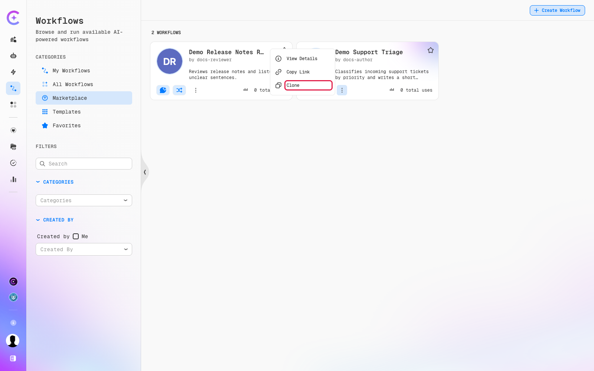
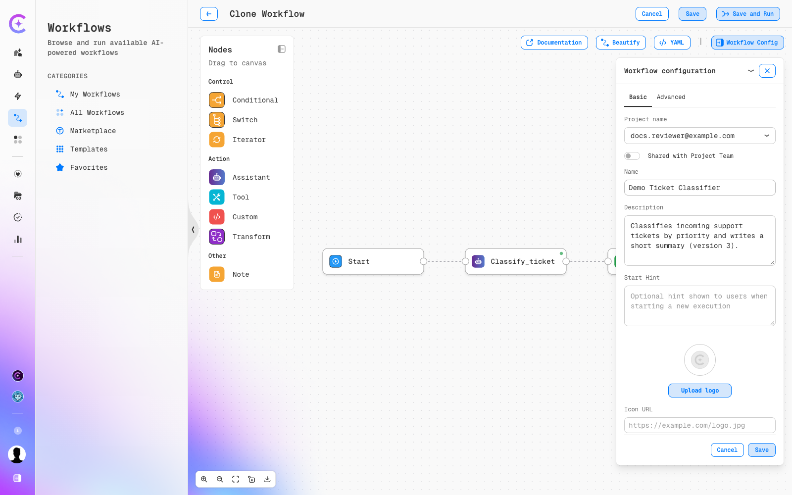

# Clone Workflow from Marketplace

Clone a marketplace workflow to a personal project to customize it or adapt it for a specific use case. All authenticated users can clone any marketplace workflow. The clone is a fully independent copy — changes to it do not affect the original.

## Clone a Workflow

### 1. Navigate to Marketplace

1. Go to **Workflows** and select **Marketplace**.
2. Browse the catalog or use search and filters to find the workflow to clone.

### 2. Select a Workflow

1. Optionally click the workflow card (or select **View Details** in its actions menu) to review the workflow. The **Clone** action is not on that page; it is in the card actions menu.
2. On the workflow card in the **Marketplace**, open the actions menu (⋮) and select **Clone**:

   

The **Clone Workflow** editor opens with the original workflow's graph and configuration.

### 3. Configure Clone Settings

1. Click **Workflow Config** in the editor toolbar. The **Workflow configuration** panel opens on the **Basic** tab.
2. In **Project name**, set the project to your own project by selecting it from the dropdown.
3. Enter a **Name** for the cloned workflow. The field is empty, so a name is required:

   

4. Optionally adjust **Shared with Project Team**, **Description**, **Start Hint** and **Icon URL**, then click **Save** in the panel.

### 4. Complete Cloning

1. Click **Save** in the top-right corner of the **Clone Workflow** page. **Save and Run** saves the copy and starts it; **Cancel** discards it.
2. The system creates a copy with all configuration preserved.
3. The message "Workflow has been created successfully!" is displayed and the **Marketplace** page opens.

## After Cloning

The cloned workflow appears under **My Workflows** for the target project, where it can be:

- Edited and reconfigured freely
- Connected to different datasources or assistants
- Published to the Marketplace as a new entry

:::tip Fully independent copy
The cloned workflow is independent from the original. Modifications do not affect the marketplace version, and updates to the original are not reflected in the clone.
:::
