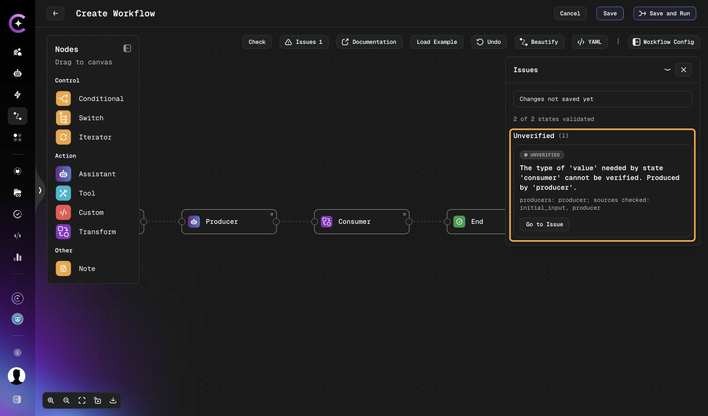
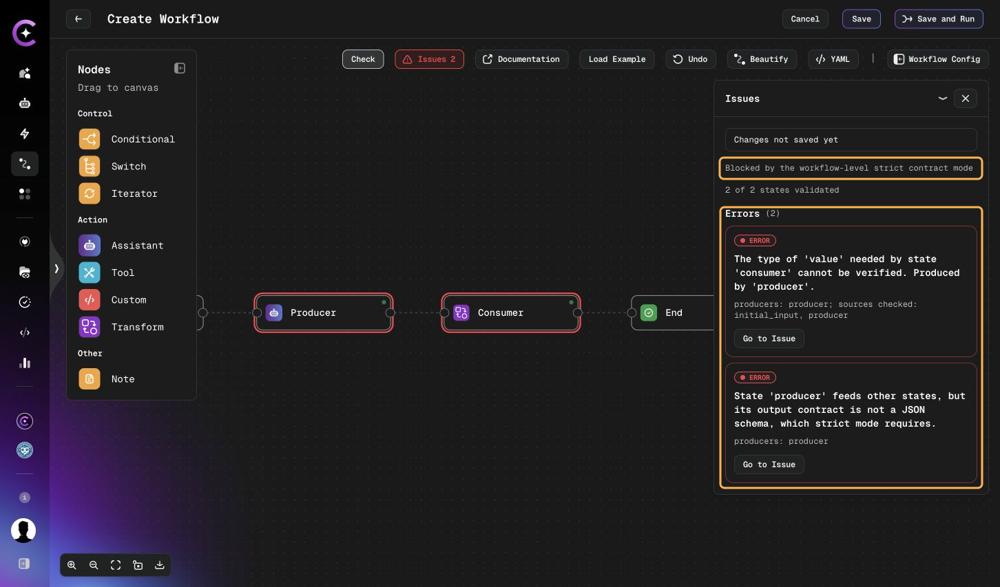
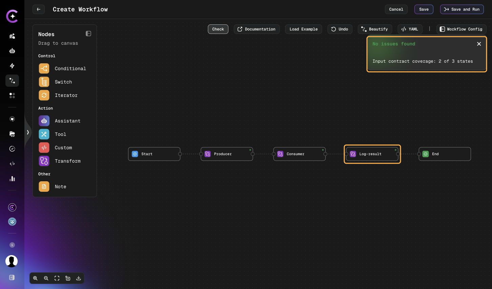

# Workflow States

## 4. Workflow States

### 4.1 State Types

- **Agent States**: Execute AI assistant with specific task
- **Tool States**: Execute tool directly without LLM
- **Custom Node States**: Specialized processing nodes

### 4.2 Agent State Configuration

```yaml
states:
  - id: state-1
    assistant_id: assistant-1
    task: |
      Detailed task description and instructions with {{dynamic_placeholders}}.
    next:
      state_id: state-2
    resolve_dynamic_values_in_prompt: true
```

#### Agent State Properties:

- **id**: Unique state identifier
- **assistant_id**: Reference to assistant configuration
- **task**: Instructions for the assistant
- **next**: State transition configuration
- **resolve_dynamic_values_in_prompt**: Enable template variable resolution
- **output_schema**: Structured output definition (optional) — see [Two Modes of `output_schema`](#two-modes-of-output_schema) and [Save-time output contract forms](#save-time-output-contract-forms)
- **input_schema**: Declared input contract as JSON text (optional) — see [Input contracts](#input-contracts-input_schema)
- **validation**: State-level save-time validation mode, `warn` or `strict` (optional) — see [Validation modes and required coverage](#validation-modes-and-required-coverage)
- **interrupt_before**: Pause workflow for user confirmation
- **retry_policy**: Custom retry configuration
- **finish_iteration**: Marks the last step of a per-item chain — see [Iteration Properties](./state-transitions.md#iteration-properties)
- **result_as_human_message**: Add this state's output to the message history as a user message instead of an assistant message (default `false`)

:::note
`interrupt_before` was previously named `wait_for_user_confirmation`. If you encounter this legacy term in older workflow configurations or documentation, it refers to the same feature.
:::

#### Two Modes of `output_schema`

`output_schema` accepts a YAML block scalar containing JSON, and its contents decide how strongly
the output is enforced. These are the two ways an agent uses the value; they give different guarantees.
Save-time validation classifies the same text more finely — see
[Save-time output contract forms](#save-time-output-contract-forms).

**Mode 1 — a real JSON Schema: enforced.** When the value parses as a valid JSON Schema, the
assistant is switched into structured-output mode and the model provider constrains the response
to match. Fields and types are guaranteed.

```yaml
output_schema: |
  {
    "type": "object",
    "properties": {
      "severity": { "type": "string", "enum": ["low", "medium", "high"] },
      "findings": { "type": "array", "items": { "type": "string" } }
    },
    "required": ["severity"]
  }
```

**Mode 2 — a shape example: a suggestion only.** When the value is JSON but not a valid schema —
typically an object whose values describe the fields in prose — it is appended to the system
prompt as guidance. The model usually follows it, but nothing enforces it, and a downstream
condition reading a missing field will silently take the `otherwise` branch.

```yaml
output_schema: |
  {
    "severity": "One of: low, medium, high",
    "findings": "List of issue descriptions"
  }
```

:::tip
Use Mode 2 for readability while drafting, and switch to Mode 1 before any state's output is
consumed by a condition, a `switch`, or an `iter_key`. Those three read fields positionally and
have no way to recover when a field is absent.
:::

#### Save-time output contract forms

When you save a workflow, the platform classifies each state's `output_schema` to learn which
fields the state can provide to later states. This classification is separate from the agent's
structured-output behavior described above. The table shows what each form supplies.

| Form                  | What it is                                                                                                                                                             | What it supplies at save time                                                                                              |
| --------------------- | ---------------------------------------------------------------------------------------------------------------------------------------------------------------------- | -------------------------------------------------------------------------------------------------------------------------- |
| `schema`              | A valid JSON Schema object                                                                                                                                             | Top-level property names, plus types and required flags where the schema declares them                                     |
| `example`             | A plain JSON object that is not a schema                                                                                                                               | Field names only. Example values do not establish field types                                                              |
| `list` (plain)        | A JSON list of objects                                                                                                                                                 | Field names taken from the object items. No types or required flags                                                        |
| `list` (array schema) | A schema whose root is an array                                                                                                                                        | Field names from `items.properties`, with types and required flags taken from `items`                                      |
| `invalid`             | A value that is not usable as an output contract: malformed JSON text, or valid JSON that fails the checks, such as a scalar or an object that fails the schema checks | Quoted keys that can be recovered from some malformed text, as names only. If none can be recovered, the source is unknown |
| `none`                | No `output_schema`, or a blank one                                                                                                                                     | Nothing. The state declares no output information                                                                          |

Keep these points in mind:

- A value that parses as JSON but fails the schema checks is not automatically an `example`.
  Classification depends on the text.
- A list with no usable names remains an unknown source.
- Key recovery applies to some malformed text, not to every `invalid` value. A valid JSON scalar
  has no keys to recover, so its source is unknown.
- Recovery from malformed text never establishes types or required status.
- A root array schema is classified as a `list`, not as a `schema`.
- Save-time classification does not mean every node enforces its output contract at runtime.
  Only the agent structured-output behavior described above constrains a model response.

#### Input contracts (`input_schema`)

`input_schema` is a state-level declaration of the data the state expects to read. It is JSON
text in a YAML block scalar, not a YAML mapping, and it has no example form.

```yaml
states:
  - id: summarize-ticket
    assistant_id: summarizer
    task: |
      Summarize the ticket {{ticket_title}}: {{ticket_body}}
    input_schema: |
      {
        "type": "object",
        "properties": {
          "ticket_title": { "type": "string" },
          "ticket_body": { "type": "string" },
          "labels": { "type": ["array", "null"] }
        },
        "required": ["ticket_title", "ticket_body"]
      }
    next:
      state_id: end
```

Structure rules:

| Rule           | Accepted form                                                                              |
| -------------- | ------------------------------------------------------------------------------------------ |
| Root           | A JSON object with `"type": "object"`                                                      |
| `properties`   | An object. An empty object is accepted                                                     |
| Property entry | An object with a supported `type`                                                          |
| Single type    | `string`, `number`, `integer`, `boolean`, `object`, or `array`                             |
| Type list      | A non-empty list of supported types. `null` is allowed only with a supported non-null type |
| `required`     | Optional list of names. Every name must also appear in `properties`                        |
| Size           | At most 64 KiB in UTF-8                                                                    |
| Depth          | At most 32 nesting levels                                                                  |

This is a limited structural check. Other JSON Schema keywords are accepted but ignored, and
`$ref` is not resolved.

A malformed declared `input_schema` fails structure validation in both `warn` and `strict` mode,
and even when contract linking is disabled. The check also applies to unreachable and orphaned
states.

**What an input contract describes.** The contract describes the data the state can read, not
the data the state produces. It does not create context values and does not define mandatory
tool parameters; tool requirements come from the tool's own argument schema. The main source of
input is the shared context (see [Context Management](./context-management.md)). For the first
state of an iteration, item fields can also supply tool input or agent placeholders where the
state reads them. A transform node does not read the iteration item directly. See
[Iteration Properties](./state-transitions.md#iteration-properties).

**Iteration items.** A required field that can only be supplied by an unknown iteration item
cannot be verified at save time and is reported as `UNVERIFIED`. This applies to required
fields only: optional declared fields give `OK`. Static analysis can carry the uncertainty about
item data along an iteration branch.

#### Validation modes and required coverage

Two settings control how strictly save-time validation treats findings. Both are described in
the [Configuration Reference](./configuration-reference.md#32-workflow-level-settings).

- **`validation`** — `warn` or `strict`. Set at workflow level (default `warn`) and optionally on
  a state. An explicit state value overrides the workflow value for that state's checks.
- **`require_input_contracts`** — boolean, workflow level only, default `false`.

```yaml
validation: warn
require_input_contracts: true

states:
  - id: publish
    assistant_id: publisher
    validation: strict   # this state's checks use strict
    task: Publish {{report}}
    next:
      state_id: end
```

**Required coverage.** A state has input-contract coverage when it has a usable declared
`input_schema` or a contract that can be derived: from agent placeholders (only when the state
sets `resolve_dynamic_values_in_prompt: true`; otherwise its task placeholders contribute no
requirements), from the extraction
roots of a transform node, or from the argument schema of a tool (even one with no mandatory
parameters). With `require_input_contracts: true`, an uncovered reachable state blocks saving in
both modes. A state-level `warn` does not disable this rule, and the setting does not require an
explicit `input_schema` on every state. Transition checks alone give no coverage.

**Strict output-form rule.** Under `strict`, a reachable producer that writes to context and
declares a non-schema output contract (`example`, `list`, or `invalid`) can be rejected. A strict
consumer can also be rejected because an upstream producer has a non-schema contract. Lists
count as non-schema for this rule, even when written as a root array schema. Strict mode does
not require an output contract on every state: a state with no `output_schema` does not trigger
this rule.

#### Requirement outcomes

Analysis produces one of four raw outcomes for each requirement. The effective mode decides what
each does to saving.

| Raw outcome                       | Meaning                                                       | In `warn`      | In `strict`    |
| --------------------------------- | ------------------------------------------------------------- | -------------- | -------------- |
| `OK`                              | The requirement is satisfied or needs no check                | Does not block | Does not block |
| `ERROR` on a declared requirement | A declared requirement is not satisfied                       | Blocks         | Blocks         |
| `ERROR` on a derived requirement  | A problem in a requirement derived from the configuration     | Warning        | Blocks         |
| `WARNING`                         | Availability, type, or another property is uncertain or risky | Warning        | Blocks         |
| `UNVERIFIED`                      | Analysis cannot establish the result                          | Informational  | Blocks         |

Two exceptions to keep in mind: the advisory to convert an `example` into a schema stays
informational in both modes, although a separate strict output-form finding can still block;
and the required-coverage rule blocks in both modes. `warn` mode therefore does not mean that
all findings are warnings.

##### Compare warn and strict

In this small example, the producer declares
`{"value":"description"}` as its output contract. The consumer requires `value` as a string.
The example form supplies the field name but cannot establish its type.

Under the default `warn` mode, Check reports one informational **Unverified** finding.



Change the workflow mode to `strict` and Check again. The type finding becomes an error, and a
second error reports the producer's non-schema output contract. The panel states which mode
caused the rejection.



#### Check and Save results

Contract findings use the `contract_validation` identifier. Raw outcomes are converted into
three public issue values:

| Policy result                | Public issue value           |
| ---------------------------- | ---------------------------- |
| Blocking                     | `ERROR`                      |
| Warning                      | `WARNING`                    |
| Informational, non-OK result | `UNVERIFIED`                 |
| `OK`                         | Omitted from the issue lists |

Because the conversion depends on the mode, a raw `UNVERIFIED` result appears as a public `ERROR`
under `strict`, and a raw derived `ERROR` appears as a public `WARNING` under `warn`.

- **Accepted response.** A successful save or Check returns the contract warnings and, when
  contract linking ran, the [coverage](#contract-coverage) object.
- **Rejected response.** A rejection carries `error.details` with `error_type`, `message`,
  `errors`, `warnings`, and `coverage`.
- **Issue entries** identify the state and the relevant data field or configuration location.
  Location details can be absent.
- **Warning limit.** At most 100 contract warnings are returned. When more exist,
  `warnings_truncated` gives the number omitted. A response without `warnings_truncated` does not
  mean the response contains no warnings.

#### Contract coverage

When contract linking runs, the response includes a coverage object with five fields.

| Field                 | Meaning                                                                                                                  |
| --------------------- | ------------------------------------------------------------------------------------------------------------------------ |
| `validated_states`    | Reachable states with declared or derived input-contract coverage. Not the states that passed all checks                 |
| `total_states`        | Number of reachable states                                                                                               |
| `uncovered_state_ids` | Reachable states without input-contract coverage                                                                         |
| `analysed`            | Whether a usable analysis result was produced. `false` separates a failed or missing analysis from a clean, empty result |
| `cap_reached`         | Whether the analysis reached its work limit                                                                              |

Read `analysed` and `cap_reached` together with the counts. `analysed: true` does not prove an
exhaustive check when `cap_reached` is `true`. For example, `validated_states: 3` with
`total_states: 4` and one entry in `uncovered_state_ids` means one reachable state has no input
contract coverage.

Remember:

- Full coverage does not prove that every requirement passed or that runtime values will be valid.
- A result with no issues can still show incomplete coverage when `require_input_contracts` is off.
- Transition checks alone give no input coverage, and an output contract alone gives no input
  coverage for its own state.
- Coverage is omitted when contract linking does not run. Absent coverage is not zero coverage and
  not a successful analysis.

##### Check with incomplete coverage

The workflow below has three reachable states.
The first two have input contracts. The final **Log-result** state has a constant output and no
declared or derived input contract. With `require_input_contracts: false`, Check returns
**No issues found** and **Input contract coverage: 2 of 3 states**.



This result does not establish input coverage for **Log-result**. Enable `require_input_contracts`
if a missing input contract must block saving.

#### Using Check in the editor

In the workflow editor, workflow-level settings are under **Contracts** in the advanced
configuration. Action states have input and output contract fields and a validation-mode
override. **Check** evaluates the current form without saving it.

See [Checking Workflow Contracts](../create-workflow.md#checking-workflow-contracts) for screenshots
of the Issues panel, field navigation, and the local **Resolved** state. The
[workflow contract settings](../create-workflow.md#workflow-contract-settings) and
[node contract fields](../create-workflow.md#node-contract-fields) are also shown in that guide.

**Procedure:**

1. Configure the contracts: the workflow-level settings under **Contracts**, then the input and
   output contract fields and the validation-mode override on each state.
2. Click **Check**.
3. Read the **Issues** list. Each entry names the state and, where available, the field.
4. Select **Go to Issue** to jump to the field.
5. Change the field.
6. Click **Check** again.
7. Click **Save** when the remaining issues are acceptable for the effective mode.

**Resolved.** After a local edit the editor can mark an issue **Resolved**. That only means the
field changed on your screen. It does not prove that backend validation passed, so always
**Check** again before saving.

A successful Check does not guarantee that a later save succeeds, because access, dependencies,
and input can change.

**Troubleshooting**

| Question                                  | Answer                                                                                                                                                                                                                     |
| ----------------------------------------- | -------------------------------------------------------------------------------------------------------------------------------------------------------------------------------------------------------------------------- |
| Why does `warn` mode block Save?          | Some findings block in both modes: a declared requirement that fails, a missing required coverage under `require_input_contracts: true`, and a malformed `input_schema`. See [Requirement outcomes](#requirement-outcomes) |
| Why is coverage absent?                   | Contract linking did not run, for example because `WORKFLOW_CONTRACT_LINKING_ENABLED` is off. Absent coverage is not zero coverage and not a successful analysis                                                           |
| Why does full coverage still show issues? | Coverage counts states that have an input contract, not requirements that passed. See [Contract coverage](#contract-coverage)                                                                                              |
| Why did Check pass but Save fail?         | Check does not save. Access, dependencies, or input can change between the two, and the editor's **Resolved** mark is local only                                                                                           |

#### Platform prerequisite

Save-time contract linking is controlled by the platform setting
`WORKFLOW_CONTRACT_LINKING_ENABLED`, which defaults to `false`. When it is disabled, new contract
warnings and coverage are not returned, but the `input_schema` structure checks still apply. No
per-workflow `validation` value turns linking off when the platform enables it. A successful save
does not prove that runtime values are correct.

For a complete workflow with both contracts, expected coverage, and a warn versus strict
comparison, see
[Example: Workflow with Input and Output Contracts](./examples.md#116-example-workflow-with-input-and-output-contracts).

#### Agent State Advanced Examples:

**Example 1: Using `output_schema` for Structured Output**

```yaml
assistants:
  - id: data-extractor
    model: gpt-4.1
    system_prompt: Extract structured information from text

states:
  - id: extract-user-info
    assistant_id: data-extractor
    task: |
      Extract user information from this text: {{user_text}}

      Return data in the specified JSON format.
    output_schema: |
      {
        "type": "object",
        "properties": {
          "name": {"type": "string"},
          "email": {"type": "string", "format": "email"},
          "age": {"type": "number", "minimum": 0},
          "interests": {
            "type": "array",
            "items": {"type": "string"}
          }
        },
        "required": ["name", "email"]
      }
    # A valid JSON Schema puts the assistant into structured-output mode,
    # so the model provider constrains the response to match it
    next:
      state_id: process-user-data

# Example successful output:
# {
#   "name": "Alice Johnson",
#   "email": "alice@example.com",
#   "age": 28,
#   "interests": ["reading", "hiking", "photography"]
# }
```

**Example 2: Using `interrupt_before` for Human-in-the-Loop**

```yaml
assistants:
  - id: approver
    model: gpt-4.1
    system_prompt: Review and summarize proposed changes

states:
  - id: analyze-changes
    assistant_id: approver
    task: |
      Analyze the proposed changes and provide a summary:
      {{changes_description}}
    next:
      state_id: await-approval

  - id: await-approval
    assistant_id: approver
    interrupt_before: true  # Pause before executing this state
    task: |
      Apply the approved changes.

      Previous analysis: {{task}}
    # Workflow pauses here and waits for user to:
    # 1. Review the analysis from previous state
    # 2. Click "Continue" to proceed or "Cancel" to stop
    # User sees all previous conversation history
    next:
      state_id: apply-changes

  - id: apply-changes
    assistant_id: approver
    task: "Execute the approved changes"
    next:
      state_id: end
```

**Example 3: Using `retry_policy` at State Level**

```yaml
assistants:
  - id: api-caller
    model: gpt-4.1-mini
    system_prompt: Make API calls and handle responses
    tools:
      - name: http_request

states:
  - id: call-external-api
    assistant_id: api-caller
    task: |
      Call the external API at {{api_endpoint}} and retrieve data.
      Handle any rate limiting or temporary errors gracefully.
    retry_policy:
      max_attempts: 5         # Retry up to 5 times
      initial_interval: 2.0   # Wait 2 seconds before first retry
      backoff_factor: 2.0     # Double wait time each retry (2s, 4s, 8s, 16s)
      max_interval: 30.0      # Cap wait time at 30 seconds
    # Automatically retries on:
    # - Network errors (5xx status codes)
    # - Timeout errors
    # - Rate limiting errors (429)
    # Does NOT retry on: 401, 403, 404 errors
    next:
      state_id: process-api-response

# Retry timing example:
# Attempt 1: Immediate
# Attempt 2: After 2 seconds
# Attempt 3: After 4 seconds
# Attempt 4: After 8 seconds
# Attempt 5: After 16 seconds
# Total max time: 30 seconds of delays + execution time
```

**Example 4: Combining Multiple Advanced Properties**

```yaml
assistants:
  - id: critical-processor
    model: gpt-4.1
    system_prompt: Process critical business data
    tools:
      - name: database_query
        integration_alias: prod-db

states:
  - id: critical-data-processing
    assistant_id: critical-processor
    interrupt_before: true  # Require approval before running
    task: |
      Process critical financial data for quarter {{quarter}}.

      Extract:
      - Total revenue
      - Operating expenses
      - Net profit margin
      - Growth percentage
    output_schema: |
      {
        "type": "object",
        "properties": {
          "total_revenue": {"type": "number"},
          "operating_expenses": {"type": "number"},
          "net_profit_margin": {"type": "number"},
          "growth_percentage": {"type": "number"}
        },
        "required": ["total_revenue", "net_profit_margin"]
      }
    retry_policy:
      max_attempts: 3
      initial_interval: 1.0
      backoff_factor: 2.0
    resolve_dynamic_values_in_prompt: true
    # This state demonstrates:
    # 1. Requires user approval before execution
    # 2. Enforces structured output schema
    # 3. Has custom retry policy for reliability
    # 4. Uses dynamic value resolution for quarter variable
    next:
      state_id: generate-report
```

**Example 5: Using `resolve_dynamic_values_in_prompt`**

```yaml
states:
  - id: personalized-analysis
    assistant_id: analyzer
    resolve_dynamic_values_in_prompt: true  # Enable template resolution
    task: |
      Analyze data for user {{user_name}} (ID: {{user_id}}).

      Focus areas:
      - Department: {{department}}
      - Project: {{project_name}}
      - Time period: {{start_date}} to {{end_date}}

      Previous results: {{previous_results}}
    # All {{variables}} are replaced with values from context store
    # before sending task to the LLM
    next:
      state_id: next-step

# With context:
# {
#   "user_name": "Alice",
#   "user_id": "12345",
#   "department": "Engineering",
#   "project_name": "Platform Redesign",
#   "start_date": "2025-01-01",
#   "end_date": "2025-03-31",
#   "previous_results": "92% completion rate"
# }
#
# LLM receives:
# "Analyze data for user Alice (ID: 12345).
#  Focus areas:
#  - Department: Engineering
#  - Project: Platform Redesign
#  - Time period: 2025-01-01 to 2025-03-31
#  Previous results: 92% completion rate"
```

### 4.3 Tool State Configuration

```yaml
states:
  - id: state-1
    tool_id: tool-1
    tool_args:
      param1: value1
      param2: "{{context_value}}"
    next:
      state_id: state-2
```

#### Tool State Properties:

- **id**: Unique state identifier
- **tool_id**: Reference to tool configuration
- **tool_args**: Override tool arguments (optional)
- **next**: State transition configuration

### 4.4 Custom Node State Configuration

```yaml
states:
  - id: state-1
    custom_node_id: node-1
    task: Processing instructions
    next:
      state_id: state-2
```

#### Custom Node State Properties:

- **id**: Unique state identifier
- **custom_node_id**: Reference to custom node configuration
- **task**: Instructions for the node
- **next**: State transition configuration

---
