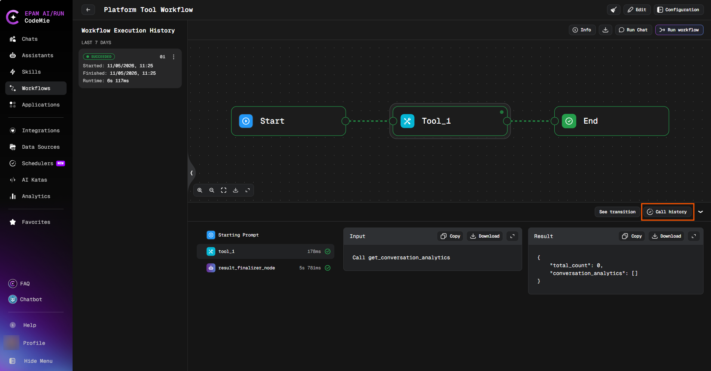
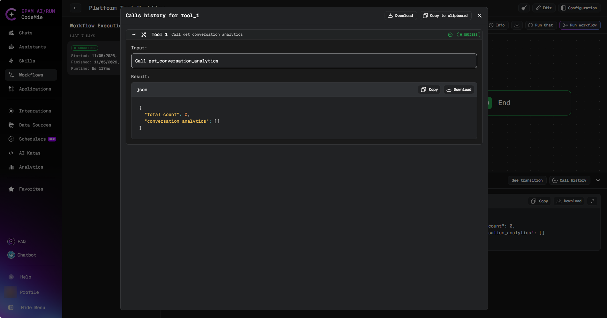
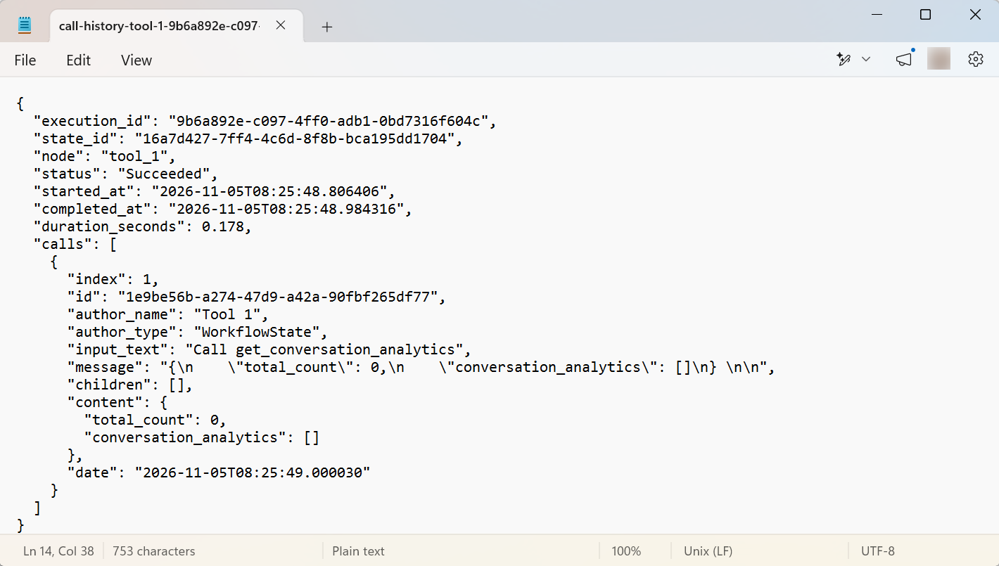

# Exporting Node Call History

Each node in a workflow execution records the individual LLM and tool calls it made. You can review these calls in the **Call history** popup and export them as JSON to share in a ticket, chat, or log, or to analyze them outside the platform.

This differs from [Exporting Workflow Execution](./exporting-workflow-execution.md), which saves the results of every step as a zip archive of Markdown or HTML files. Call history export saves the calls made inside a single node.

## Open the Call History

1. Open a workflow and select an execution in **Workflow Execution History**.

2. In the node list at the bottom of the execution page, below the workflow graph, select the node whose calls you want to review.

3. Click **Call history**.

   

The popup opens with the title `Calls history for` followed by the node name. It lists every call with its status, input, and result. Expand a call to see its input, result, and any sub-calls (thoughts) it made.



:::note
The **Call history** button is not available for the **Starting Prompt** item. Clicking a node in the workflow graph does not open the popup.
:::

## Export Call History

The popup header provides two actions for saving or sharing a node's call history:

| Action                | Description                                                                                            |
| --------------------- | ------------------------------------------------------------------------------------------------------ |
| **Download**          | Saves the call history as a `.json` file. The filename is derived from the node name and execution ID. |
| **Copy to clipboard** | Copies the full call history JSON to the clipboard.                                                    |

To export a node's call history:

1. Open the **Call history** popup for the node, as described above.

2. Click **Download** to save a file, or **Copy to clipboard** to paste the JSON elsewhere. A confirmation message appears when the export succeeds.

:::info
The two buttons appear once the node's calls are loaded and are hidden for a node without calls.
:::

## Exported JSON

Both actions produce the same indented JSON, built from the call data already loaded for the popup. No additional data is fetched from the server. It contains a node summary followed by the calls.

### Node Summary

| Field              | Description                                                                |
| ------------------ | -------------------------------------------------------------------------- |
| `execution_id`     | Identifier of the workflow execution                                       |
| `state_id`         | Identifier of the node's state within the execution                        |
| `node`             | Node name                                                                  |
| `status`           | Node status, for example `Succeeded` or `Failed`                           |
| `started_at`       | Time the node started                                                      |
| `completed_at`     | Time the node completed                                                    |
| `duration_seconds` | Time between start and completion, in seconds. `null` if either is missing |

### Calls

The `calls` array lists every call shown in the popup, in order, including sub-calls:

| Field                      | Description                                                                       |
| -------------------------- | --------------------------------------------------------------------------------- |
| `index`                    | Position of the call, starting at 1                                               |
| `id`                       | Identifier of the call                                                            |
| `author_name`, `tool_name` | Name of the assistant or tool that made the call                                  |
| `author_type`              | Type of the call's author, for example `WorkflowState`                            |
| `input_text`               | Input passed to the call                                                          |
| `message`                  | Raw output of the call                                                            |
| `content`                  | Output parsed as JSON when it is valid JSON, otherwise the same text as `message` |
| `error`                    | Error value, when the call failed                                                 |
| `children`                 | Sub-calls (thoughts) made during the call                                         |
| `date`                     | Date and time of the call                                                         |

### Example

The downloaded file opened in a text editor:



The same content as text:

```json
{
  "execution_id": "9b6a892e-c097-4ff0-adb1-0bd7316f604c",
  "state_id": "16a7d427-7ff4-4c6d-8f8b-bca195dd1704",
  "node": "tool_1",
  "status": "Succeeded",
  "started_at": "2026-11-05T08:25:48.806406",
  "completed_at": "2026-11-05T08:25:48.984316",
  "duration_seconds": 0.178,
  "calls": [
    {
      "index": 1,
      "id": "1e9be56b-a274-47d9-a42a-90fbf265df77",
      "author_name": "Tool 1",
      "author_type": "WorkflowState",
      "input_text": "Call get_conversation_analytics",
      "message": "{\n    \"total_count\": 0,\n    \"conversation_analytics\": []\n} \n\n",
      "children": [],
      "content": {
        "total_count": 0,
        "conversation_analytics": []
      },
      "date": "2026-11-05T08:25:49.000030"
    }
  ]
}
```

:::tip
Use **Copy to clipboard** to paste a node's call history straight into a ticket or chat, and **Download** when you need to keep the file or attach it.
:::
