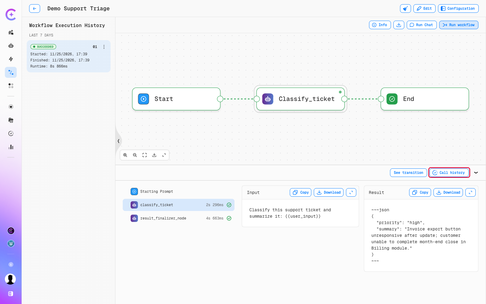
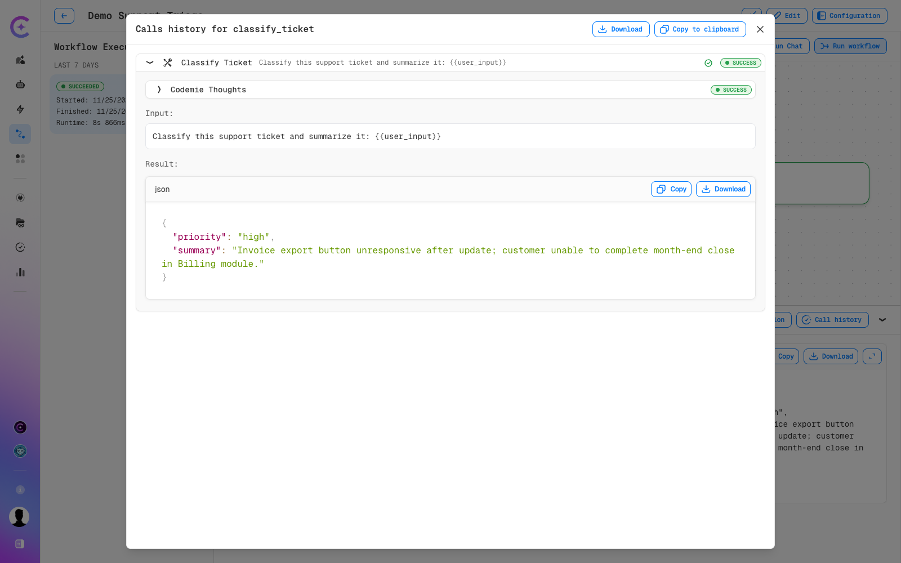

# Exporting Node Call History

Each node in a workflow execution records the individual LLM and tool calls it made. You can review these calls in the **Call history** popup and export them as JSON to share in a ticket, chat, or log, or to analyze them outside the platform.

This differs from [Exporting Workflow Execution](./exporting-workflow-execution.md), which saves the results of every step as a zip archive of Markdown or HTML files. Call history export saves the calls made inside a single node.

## Open the Call History

1. Open a workflow (**More options** (⋮) → **View Details** on the workflow card) and select an execution in **Workflow Execution History**.

2. In the node list at the bottom of the execution page, below the workflow graph, select the node whose calls you want to review.

3. Click **Call history** above the node list, next to **See transition**.

   

The popup opens with the title `Calls history for` followed by the node name. It lists every call with a **SUCCESS** or failure status badge, its input, and its result. Expand a call to see its input, its result (with **Copy** and **Download** buttons for the result block), and any sub-calls it made, such as **Codemie Thoughts**.



:::note
The **Call history** button is not available for the **Starting Prompt** item. Clicking a node in the workflow graph does not open the popup.
:::

## Export Call History

The popup header provides two actions for saving or sharing a node's call history:

| Action                | Description                                                                                                         |
| --------------------- | ------------------------------------------------------------------------------------------------------------------- |
| **Download**          | Saves the call history as a `.json` file. The filename has the form `call-history-<node-name>-<execution-id>.json`. |
| **Copy to clipboard** | Copies the full call history JSON to the clipboard.                                                                 |

To export a node's call history:

1. Open the **Call history** popup for the node, as described above.

2. Click **Download** to save a file, or **Copy to clipboard** to paste the JSON elsewhere. A confirmation message ("downloaded" or "copied to clipboard") appears when the export succeeds.

:::info
The two buttons appear once the node's calls are loaded and are hidden for a node without calls.
:::

## Exported JSON

Both actions produce the same indented JSON, built from the call data already loaded for the popup. No additional data is fetched from the server. It contains a node summary followed by the calls.

### Node Summary

| Field              | Description                                                                |
| ------------------ | -------------------------------------------------------------------------- |
| `execution_id`     | Identifier of the workflow execution                                       |
| `state_id`         | Identifier of the node's state within the execution                        |
| `node`             | Node name                                                                  |
| `status`           | Node status, for example `Succeeded` or `Failed`                           |
| `started_at`       | Time the node started                                                      |
| `completed_at`     | Time the node completed                                                    |
| `duration_seconds` | Time between start and completion, in seconds. `null` if either is missing |

### Calls

The `calls` array lists every call shown in the popup, in order, with sub-calls nested in `children`:

| Field         | Description                                                                                 |
| ------------- | ------------------------------------------------------------------------------------------- |
| `index`       | Position of the call, starting at 1                                                         |
| `id`          | Identifier of the call                                                                      |
| `author_name` | Name of the assistant or tool that made the call (`tool_name` when the call is a tool call) |
| `author_type` | Type of the call's author, for example `WorkflowState`                                      |
| `input_text`  | Input passed to the call                                                                    |
| `message`     | Raw output of the call                                                                      |
| `content`     | Output parsed as JSON when it is valid JSON, otherwise the same text as `message`           |
| `error`       | Error value, when the call failed                                                           |
| `children`    | Sub-calls (thoughts) made during the call, for example `Codemie Thoughts`                   |
| `date`        | Date and time of the call                                                                   |

### Example

The downloaded file for the `classify_ticket` node of a run of the demo workflow, with identifiers replaced by placeholders:

```json
{
  "execution_id": "<execution-id>",
  "state_id": "<state-id>",
  "node": "classify_ticket",
  "status": "Succeeded",
  "started_at": "2026-11-25T17:39:31.187911",
  "completed_at": "2026-11-25T17:39:33.483088",
  "duration_seconds": 2.296,
  "calls": [
    {
      "index": 1,
      "id": "<call-id>",
      "author_name": "Classify Ticket",
      "author_type": "WorkflowState",
      "input_text": "Classify this support ticket and summarize it: {{user_input}}\n",
      "message": "~~~json\n{\n  \"priority\": \"high\",\n  \"summary\": \"Invoice export button unresponsive after update; customer unable to complete month-end close in Billing module.\"\n}\n~~~ \n\n",
      "children": [
        {
          "id": "<thought-id>",
          "execution_state_id": "<state-id>",
          "parent_id": "<call-id>",
          "author_name": "Codemie Thoughts",
          "author_type": "Tool",
          "input_text": "",
          "content": "~~~json\n{\n  \"priority\": \"high\",\n  \"summary\": \"Invoice export button unresponsive after update; customer unable to complete month-end close in Billing module.\"\n}\n~~~",
          "date": "2026-11-25T17:39:33.435631",
          "children": []
        }
      ],
      "content": "~~~json\n{\n  \"priority\": \"high\",\n  \"summary\": \"Invoice export button unresponsive after update; customer unable to complete month-end close in Billing module.\"\n}\n~~~ \n\n",
      "date": "2026-11-25T17:39:33.490882"
    }
  ]
}
```

A sub-call in `children` has `id`, `execution_state_id`, `parent_id` (the `id` of the call it belongs to), `author_name`, `author_type`, `input_text`, `content`, `date` and its own `children`.

:::tip
Use **Copy to clipboard** to paste a node's call history straight into a ticket or chat, and **Download** when you need to keep the file or attach it.
:::
