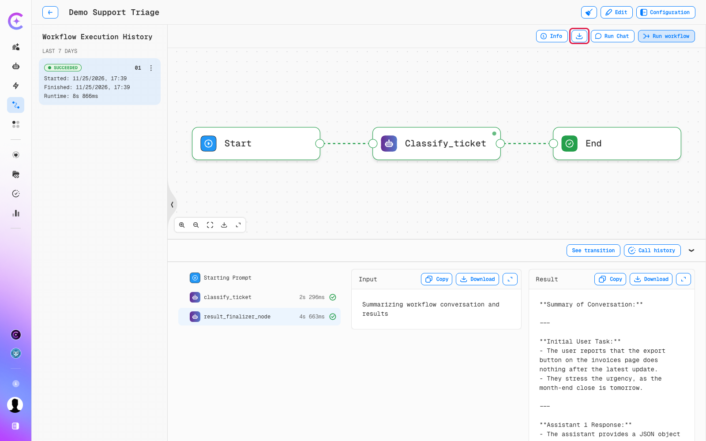
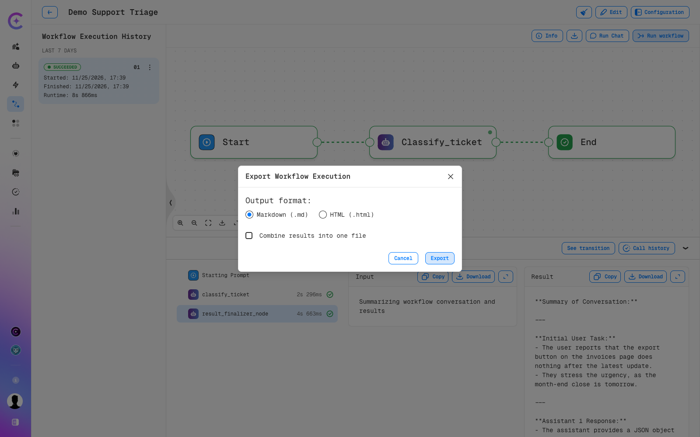

# Exporting Workflow Execution

This functionality allows you to export information about the execution steps of a workflow as a zip archive containing Markdown or HTML files. Each file includes details about a specific step and its status.

## Export Current Execution

After a workflow has finished running:

1. Open the execution page (**More options** (⋮) → **View Details** on the workflow card, then select the execution in **Workflow Execution History**).

2. Click the download icon in the upper-right toolbar. Its tooltip reads **Export as .md or .html**.

   

3. In the **Export Workflow Execution** dialog, choose the **Output format**: **Markdown (.md)** or **HTML (.html)**.

4. Optionally, select **Combine results into one file** to merge all steps into one file instead of separate files.

5. Click **Export**. The browser downloads the zip archive. **Cancel** closes the dialog.

   

:::tip
When you combine results into a single file, the zip archive contains one consolidated file instead of one file per step.
:::

## Export Previous Executions

To export a previous workflow execution:

1. Open the workflow (**More options** (⋮) → **View Details** on its card).

2. Select the execution you want to export in **Workflow Execution History**. The ⋮ menu of a history entry only offers **Remove**; there is no per-entry download.

3. Click the export icon in the toolbar and choose the format in the same dialog, then click **Export**.

## Archive Structure

The system generates a zip archive containing the exported data. The archive is available for download immediately.

### Archive Naming

The browser saves the archive under this name:

```text
<workflow name>_<YYYY-MM-DD_HH_mm_ss>.zip
```

Where `<workflow name>` is the name of the workflow and the date and time are the start time of the execution, for example `Demo Support Triage_2026-11-25_17_39_29.zip`.

### File Structure

Inside the archive, each execution step is represented by a separate file:

```text
<YYYY-MM-DD_HH-mm-ss.mmm>_<step>_<status>.md
```

Where:

- `<YYYY-MM-DD_HH-mm-ss.mmm>` - the date and time of the step, with milliseconds
- `<step>` - the name of the step, for example `classify_ticket`. The last step is always `result_finalizer_node`
- `<status>` - the step status in lowercase, for example `succeeded`

The extension is `.html` when you choose the HTML format.

With **Combine results into one file**, the archive holds one file named `<workflow name>_<execution id>.md` (or `.html`) that contains all steps.

### Example

Listing of the archive exported from an execution of the **Demo Support Triage** workflow (`unzip -l`):

```text
Archive:  Demo Support Triage_2026-11-25_17_39_29.zip
  Length      Date    Time    Name
---------  ---------- -----   ----
      164  11-25-2026 22:21   2026-11-25_17-39-33.483_classify_ticket_succeeded.md
     1703  11-25-2026 22:21   2026-11-25_17-39-38.167_result_finalizer_node_succeeded.md
---------                     -------
     1867                     2 files
```

:::note

- Ensure that the workflow execution has been completed before exporting.

- The archive is available for download immediately after it is generated.

- File and archive names follow the naming conventions above, which simplifies analysis and archiving.
  :::
