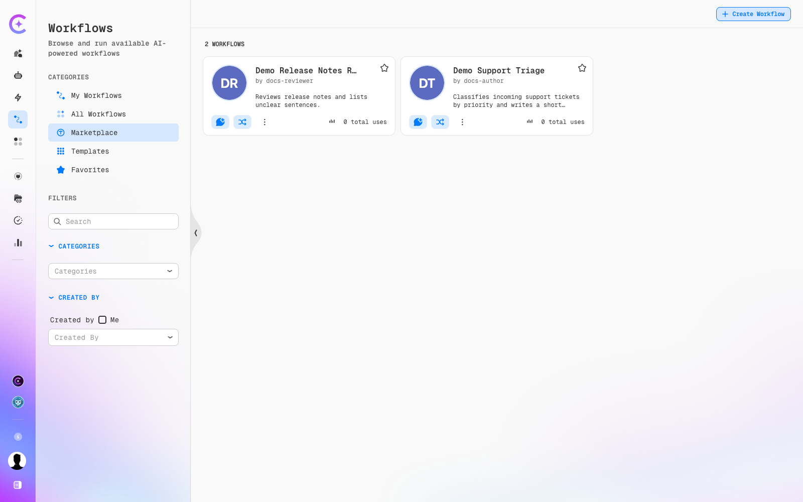

# Workflow Marketplace Overview

The Workflow Marketplace is a centralized hub where authenticated users can discover and execute workflows published by the community. Each marketplace workflow runs using the publisher's project resources — datasources and assistants — so no additional configuration is required to get started.

## Accessing the Marketplace

Navigate to **Workflows** and select **Marketplace** in the **Categories** list on the left, below **My Workflows** and **All Workflows**.

Each card shows the workflow name, its author (`by <author>`), a short description, the number of total uses, and the **Start Chat** and **Start Execution** buttons, plus an actions menu (⋮).

## Key Features

### Community Catalog

Browse a catalog of globally published workflows, each designed for specific use cases and built using the publisher's configured datasources and assistants.

### Usage Metrics

Each workflow card displays its total number of uses (for example, `0 total uses`), which helps identify widely used solutions.

### Filtering and Search

- Use the **Categories** filter to narrow results to a specific domain
- Use **Search** to find a workflow by name
- Use **Created By** (or select the **Me** checkbox) to show workflows from a specific author

## Executing a Marketplace Workflow

Any authenticated user can execute a marketplace workflow without additional permissions or configuration:

1. Navigate to **Workflows** and select **Marketplace**.
2. Browse the catalog or use search and filters to find a workflow.
3. Click the workflow card (or open its actions menu and select **View Details**) to open the workflow page.
4. Click **Run workflow** to start an execution, or **Run Chat** to run it from a chat. The card offers the same two actions as the **Start Execution** and **Start Chat** buttons, so you can skip the details page.

The workflow runs using the **publisher's project context** — their configured datasources and the assistants defined inside the workflow are used automatically. A workflow that uses external (non-virtual) assistants or skills cannot be published. No personal integrations are required unless the workflow explicitly relies on user-level credentials.

:::info Execution context
Because marketplace workflows use the publisher's resources, the results and data access reflect the publisher's project configuration, not the executing user's project.
:::

## Cloning a Marketplace Workflow

To customize a marketplace workflow or adapt it for a specific project, clone it to a personal workspace. Cloning creates a fully independent copy that can be modified without affecting the original.

See [Clone Workflow from Marketplace](./clone-workflow-from-marketplace.md) for step-by-step instructions.

:::tip Publishing a Workflow
To share a workflow with the community, see [Publish to Marketplace](./marketplace-publishing.md) for publishing requirements and the credential review process.
:::
