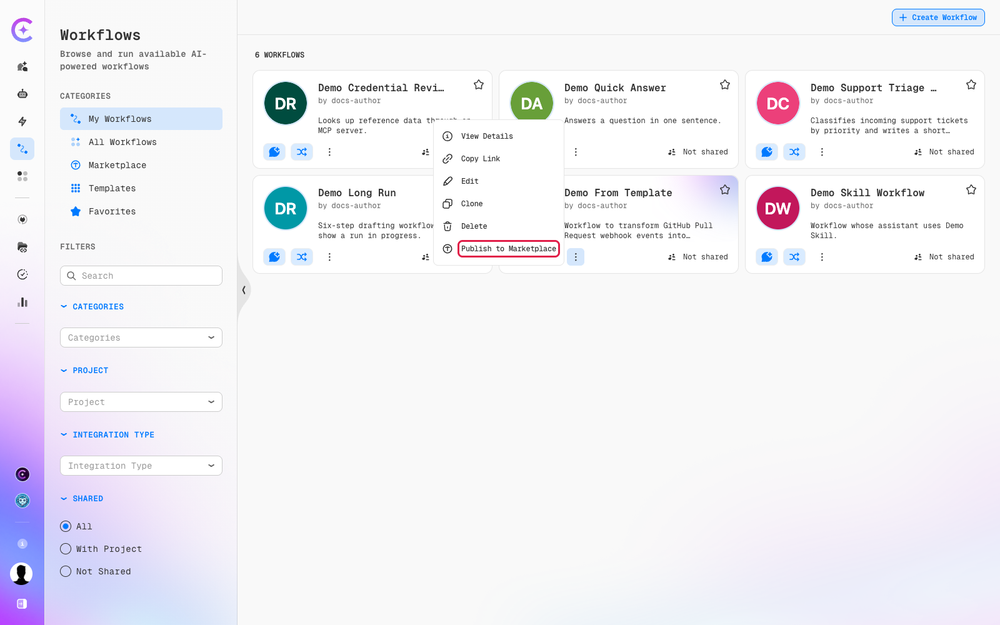
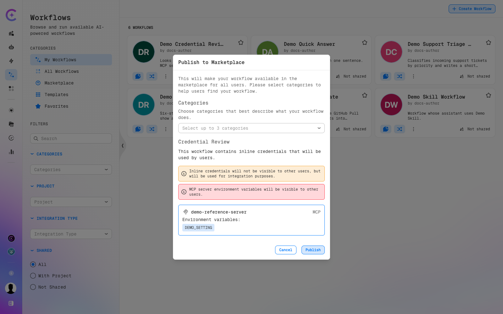
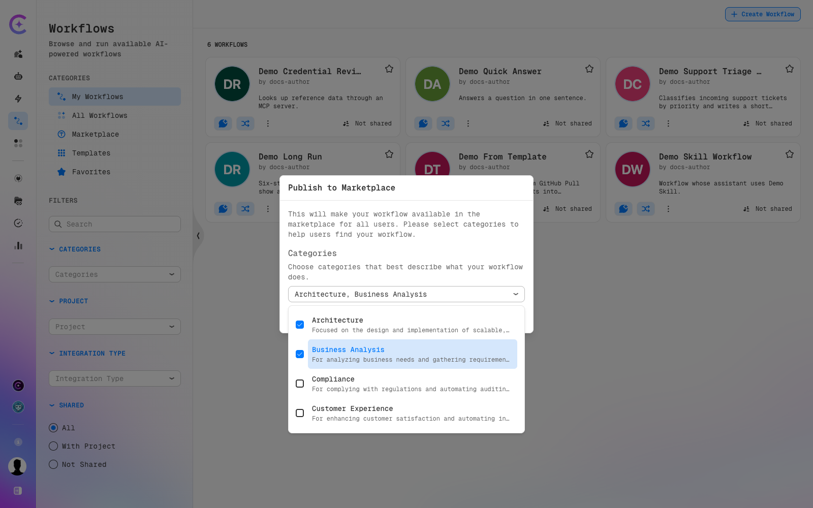
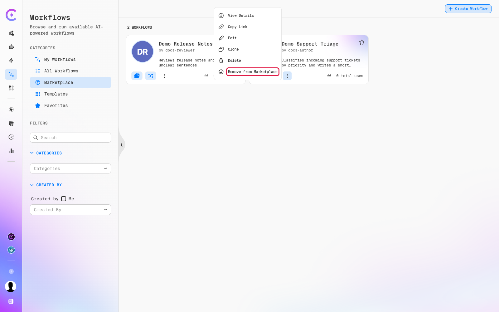

# Publish Workflow to Marketplace

Share a workflow with all authenticated users by publishing it to the Workflow Marketplace. Published workflows are globally discoverable and executable by anyone, using the publisher's project resources.

## Prerequisites

Before publishing, ensure the following:

- Edit rights on the workflow are available.
- The workflow is fully configured and tested.
- The workflow references only datasources — **no external assistants or skills**.

## Publishing Process

1. Go to **Workflows** → **My Workflows** and find the workflow to publish.

2. Open the actions menu (⋮) on the workflow card and select **Publish to Marketplace**:

   

3. The **Publish to Marketplace** dialog opens and the system validates the workflow ("Validating your workflow configuration..."):
   - If the workflow references any external assistants or skills, publishing is **blocked** and the message "Marketplace workflows cannot use external (non-virtual) assistants or skills" is displayed. Remove those references before proceeding.
   - If the workflow contains inline credentials (MCP environment variables or integration aliases), a **Credential Review** section is added to the dialog.

4. Review the credential warning if present (see [Credential Review](#credential-review) below).

5. Select **1 to 3 categories** to help users discover the workflow.

6. Click **Publish**. A confirmation message is displayed and the workflow appears in the **Marketplace**.

## Credential Review

If the workflow contains inline credentials — such as MCP environment variable values or integration aliases — a **Credential Review** section appears in the **Publish to Marketplace** dialog, below the category selector.

:::warning Inline Credentials
Inline credentials embedded in the workflow configuration will be accessible to all users who execute the marketplace workflow. Review carefully before clicking **Publish**.
:::

The section lists each detected credential: the MCP server or tool name, and the environment variable names or integration alias. MCP server environment variables are visible to other users, while integration credentials are not visible but are used for integration purposes. There is no separate confirmation step: the workflow is published when **Publish** is clicked, so review the list first and click **Cancel** to stop.

If no inline credentials are detected, the **Credential Review** section is not shown.

## Selecting Categories

Choose 1 to 3 categories that best describe the workflow's purpose. Categories help users filter and discover relevant workflows in the Marketplace.

:::info
At least one category is required. Clicking **Publish** without a category selection shows the validation error "Please select at least one category".
:::

:::note
These are the same categories as the [Categories field in the workflow configuration](./create-workflow.md#workflow-categories). The dialog starts with the workflow's current categories, and publishing saves the chosen categories to the workflow, replacing the previous selection (which also changes the **Categories** filter results on **My Workflows**).
:::

## After Publishing

Once published, the workflow becomes globally visible in **Marketplace** in the Workflows section. Any authenticated user can view and execute it.

:::note Known limitation
In the current release, a published workflow appears in the **Marketplace** only and is not listed in **My Workflows**. This is a known issue and is expected to change. To find your published workflow, open **Marketplace**.
:::

The workflow remains editable by the owner and admins. The following management actions are available from the workflow card actions menu in the **Marketplace**, together with **View Details**, **Copy Link** and **Clone**:

| Action                      | Description                                           |
| --------------------------- | ----------------------------------------------------- |
| **Edit**                    | Update the workflow configuration and settings        |
| **Delete**                  | Permanently remove the workflow (also unpublishes it) |
| **Remove from Marketplace** | Unpublish the workflow without deleting it            |

:::note External assistant and skill restriction on edit
After a workflow is published to the Marketplace, saving changes that introduce references to external assistants or skills is blocked by validation.
:::

## Unpublishing

To remove a workflow from the Marketplace without deleting it:

1. Go to **Workflows** → **Marketplace** and locate the workflow.
2. Open the card actions menu (⋮) and select **Remove from Marketplace**:

   

3. In the **Remove from Marketplace?** dialog, click **Unpublish** to confirm.

The workflow is removed from the Marketplace immediately and returns to the project-scoped state. Existing executions are not affected.

:::info Deletion and unpublishing
Deleting a workflow automatically unpublishes it from the Marketplace.
:::
