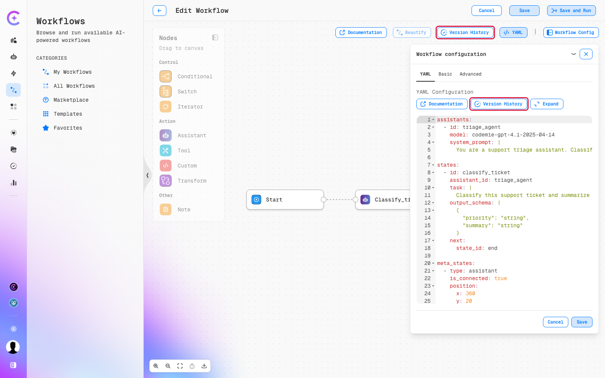
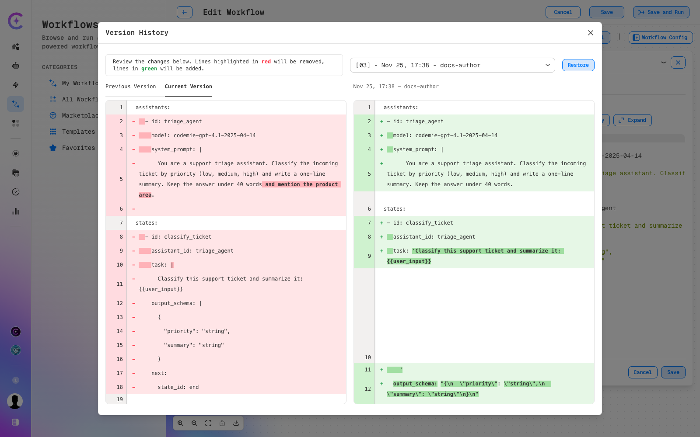
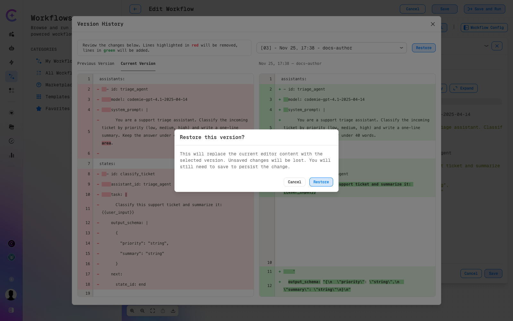

# Workflow Version History

Workflow YAML configuration changes are tracked automatically. When editing an existing workflow, you can browse prior YAML versions, compare them against the current editor content, and restore a previous configuration when an experiment does not work out.

Version history applies to **workflow YAML configuration** only. Workflow metadata (name, description, project assignment) and execution history are managed separately.

## Prerequisites

- An existing workflow with at least one saved YAML change (history is empty until the configuration is modified and saved at least once)
- Access to edit the workflow (see [Permissions](#permissions) below)

## Open Version History

Version history is available when **editing** an existing workflow. It is not shown during workflow creation.

1. Navigate to **Workflows** and open a workflow for editing (click **More options** (⋮) → **Edit** on the workflow card, or **Edit** on the Workflow Details page). The **Edit Workflow** page opens.

2. Click **YAML** in the editor toolbar. The **Workflow configuration** panel opens on the **YAML** tab.

3. In the **YAML Configuration** section, click **Version History** (next to **Documentation** and **Expand**):

   

:::info Toolbar Button
The **Edit Workflow** toolbar also has a **Version History** button (next to **Beautify** and **YAML**). It opens the same popup with a visual comparison of the workflow graph, where each node is marked **Added**, **Modified** or **Removed**. The YAML comparison described below is opened from the **YAML** tab.
:::

## Browse and Compare Versions

The **Version History** popup lists every saved version of the workflow YAML in a dropdown. Each entry is labeled in this format:

`[NN] - <date> - <author>`

Where `NN` is a sequential version number (newer versions have higher numbers), for example `[03] - Nov 25, 17:38 - docs-author`.

1. Select a version from the dropdown to load it into the diff view.

2. Compare the selected version against a baseline using the tabs above the diff:

   | Baseline             | Description                                                                                    |
   | -------------------- | ---------------------------------------------------------------------------------------------- |
   | **Current Version**  | The YAML currently in the editor, including any unsaved changes captured when the popup opened |
   | **Previous Version** | The next older historical version relative to the selected entry (disabled when none exists)   |

3. Review the side-by-side diff. The text above it reads: "Review the changes below. Lines highlighted in red will be removed, lines in green will be added." The right pane is headed with the date and author of the selected version.

   

If no historical versions exist, the popup displays **No version history available** and the **Restore** button is unavailable.

## Restore a Previous Version

Restoring a version replaces the YAML in the editor with the content from the selected historical version. The change is **not** saved automatically.

1. Select the version to restore from the dropdown.

2. Click **Restore** next to the dropdown.

3. In the **Restore this version?** dialog, read the message ("This will replace the current editor content with the selected version. Unsaved changes will be lost. You will still need to save to persist the change.") and click **Restore**. **Cancel** closes the dialog without changes.

   

4. Click **Save** on the **Edit Workflow** page to persist the restored configuration.

:::warning Unsaved Changes
Restoring a version replaces the current editor content. All unsaved workflow edits—including changes made in the visual editor or YAML panel—are discarded when restore is confirmed.
:::

:::info Distinction from AI Revert
**Revert to Previous** discards an unsaved AI refinement and returns to the YAML captured before refinement. **Version History** restores any previously saved YAML version from the workflow's change history. See [Create Workflow](./create-workflow.md) for AI refinement details.
:::

## Permissions

| Access level | Browse history | Compare versions | Restore |
| ------------ | -------------- | ---------------- | ------- |
| Read         | Yes            | Yes              | No      |
| Write        | Yes            | Yes              | Yes     |

Users with read-only access can open version history and review diffs but cannot restore versions. Saving a restored configuration requires write access to the workflow.

## When History Is Recorded

A new history entry is created when the workflow YAML configuration is saved with content that differs from the previous saved version. Metadata-only changes (such as renaming the workflow) do not add YAML history entries.

## Related Documentation

- [Create Workflow](./create-workflow.md) — Build and edit workflows with the visual editor and YAML panel
- [Workflow YAML Configuration Guide](./configuration/introduction.md) — YAML syntax and configuration reference
