<!-- cspell:words XLSB -->

# Workflows Overview

AI/Run CodeMie allows you to design complex logic for interactions between assistants, enabling the creation of fully functional workflows. By executing a series of actions, users can create their own low-code pipelines to handle a wide variety of tasks.

## Accessing Workflows

Select **Workflows** in the left navigation (click **Show Menu** to display item labels):

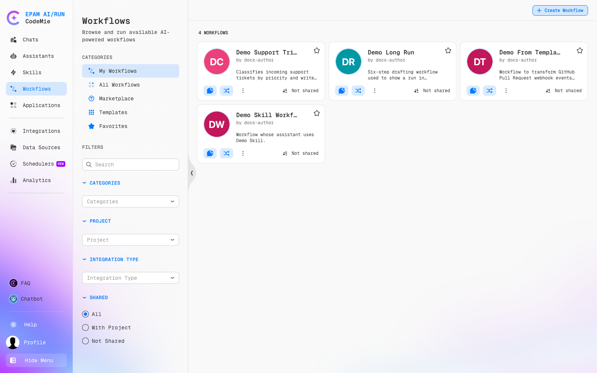

## Workflow Categories

Workflows are organized into the following categories:

| Category          | Description                                                                                                        |
| ----------------- | ------------------------------------------------------------------------------------------------------------------ |
| **My Workflows**  | Workflows created by the user                                                                                      |
| **All Workflows** | Workflows available to the user, except those published to the Marketplace                                         |
| **Templates**     | Ready-made templates for quickly creating and customizing workflows                                                |
| **Marketplace**   | Published workflows, listed here instead of in My Workflows and All Workflows. Any authenticated user can run them |
| **Favorites**     | Workflows marked with a star                                                                                       |

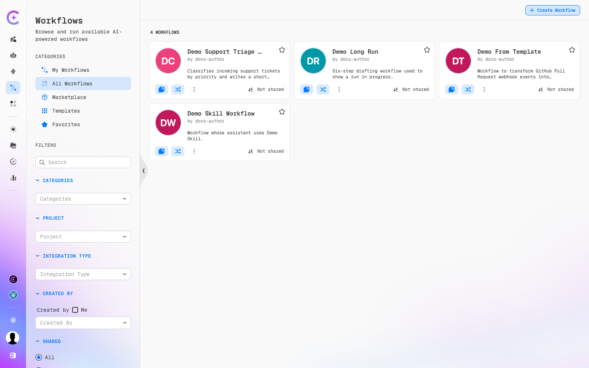

## Managing Workflows

### Workflow Actions

Each workflow card has the **Start Chat** and **Start Execution** buttons, a star for [favorites](#marking-workflows-as-favorites) and a **More options** (three dots) menu. Click **More options** to:

- View workflow details
- Copy the workflow link
- Edit the workflow configuration
- Clone the workflow
- Delete the workflow
- Publish the workflow to the Marketplace

**Edit**, **Delete** and **Publish** appear only for users with the rights to manage the workflow.


To open the Workflow Details page, select **View Details** from the **More options** menu.

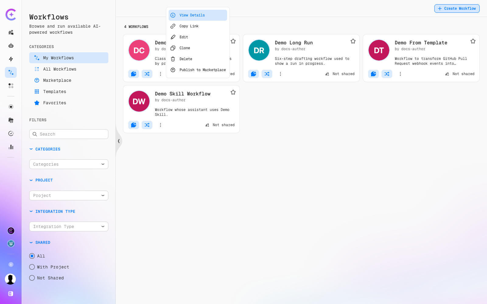

## Filtering Workflows by Category

The **My Workflows**, **All Workflows** and **Marketplace** pages include a **Categories** filter in the left sidebar. It uses the same categories as assistants and works with categories assigned in the workflow's [configuration](./create-workflow.md#workflow-categories).

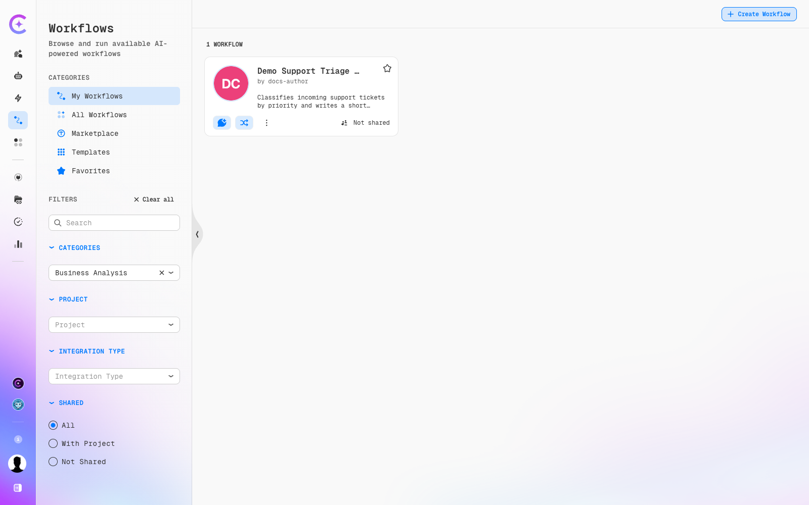

1. Open **My Workflows**, **All Workflows** or **Marketplace**.
2. In the left sidebar, open the **Categories** dropdown.
3. Select one or more categories. The list updates to show only workflows that have a selected category assigned.
4. To restore the full list, clear the selected categories or click **Clear all** next to **Filters**.

Workflows without categories are hidden while a category filter is applied and are shown again when the filter is cleared.

## Workflow Details Page

The Workflow Details page is the central hub for viewing, running, and managing a specific workflow. It combines the execution history, the workflow graph, the execution output and the workflow configuration on one screen. If the workflow has executions, **View Details** opens the page with the latest execution selected.

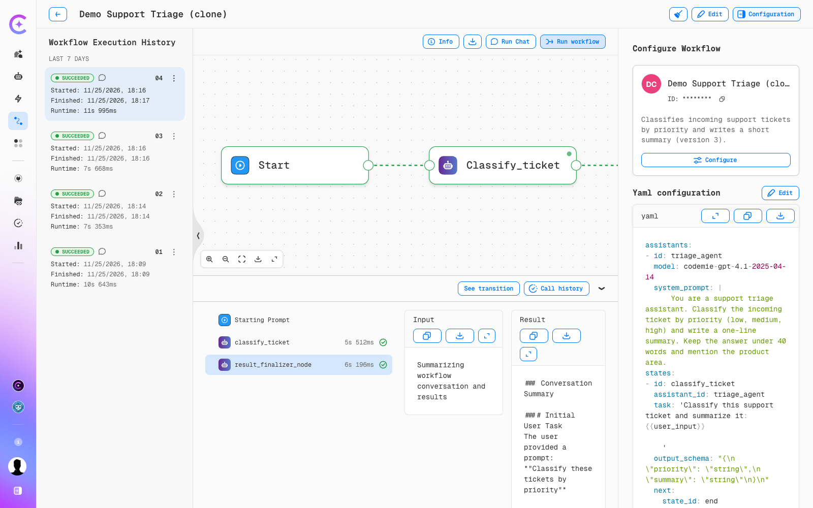

### Header Actions

The following buttons are available in the page header and above the graph:

| Button                     | Description                                                                                                                    |
| -------------------------- | ------------------------------------------------------------------------------------------------------------------------------ |
| **Back** (arrow)           | Returns to the previous page.                                                                                                  |
| **Clear all executions**   | The broom icon in the header removes all executions of this workflow from the history.                                         |
| **Edit**                   | Opens the workflow editor to modify the workflow configuration. Only visible with edit permissions for this workflow.          |
| **Configuration**          | Opens the **Configure Workflow** side panel with the workflow metadata and YAML.                                               |
| **Info**                   | Shows the **Execution Info** dialog for the selected execution: status, who triggered it, times, runtime and spending metrics. |
| **Export as .md or .html** | Downloads the selected execution. See [Exporting a Workflow Execution](./exporting-workflow-execution.md).                     |
| **Run Chat**               | Creates a new chat session with this workflow as the active agent. The Chat page opens.                                        |
| **Run workflow**           | Opens the **New Workflow Execution** dialog to start a workflow execution with a prompt.                                       |
| **Abort**                  | Visible while the selected execution is in progress. Stops the execution.                                                      |

### Browsing Executions

The page has no separate tabs. The left panel, **Workflow Execution History**, lists the executions of the workflow. Select an execution to see its graph and its nodes in the node list below the graph. Select **Starting Prompt** or a node to see its **Input** and **Result**. Selecting an assistant node opens the [assistant panel](./assistant-panel-in-executions.md). When a workflow has no executions yet, the page shows the graph and the **You don't have any executions yet** message with the **Run Chat** and **Run workflow** buttons.

### Workflow Graph

The visual graph displays all states (nodes) and their transitions (edges) in the workflow.

The graph toolbar at the bottom of the graph panel provides the following controls:

| Control          | Description                                                                                                                                     |
| ---------------- | ----------------------------------------------------------------------------------------------------------------------------------------------- |
| **+** (Zoom in)  | Increases the zoom level of the graph.                                                                                                          |
| **−** (Zoom out) | Decreases the zoom level of the graph.                                                                                                          |
| **Fit view**     | Automatically scales and repositions the graph so all nodes are visible within the current panel.                                               |
| **Download**     | Saves the current graph view as an image file.                                                                                                  |
| **Expand**       | Expands the graph panel to fill the entire viewport, hiding other page elements for a focused view. To exit, click **Collapse** or press `Esc`. |

:::tip Fullscreen graph view
Use the **Expand** button to view complex workflows in fullscreen mode — especially useful during demos or knowledge-sharing sessions.
:::

### Configuration Panel

Click **Configuration** in the page header to open the **Configure Workflow** panel on the right.

#### YAML Configuration

The **Yaml configuration** section of the panel shows the full YAML configuration of the workflow in a read-only code block. Use the buttons in the top-right corner of the code block to expand it, copy the YAML to the clipboard, or download it. **Edit** next to the section title opens the workflow editor.

#### Workflow Information

The top of the panel displays workflow metadata:

| Field           | Description                                                                              |
| --------------- | ---------------------------------------------------------------------------------------- |
| **Name**        | The workflow name and its avatar.                                                        |
| **ID**          | The unique identifier of this workflow. Click the copy icon to copy it to the clipboard. |
| **Description** | The workflow description.                                                                |
| **Configure**   | Opens the workflow configuration form.                                                   |

## Starting Workflow in Chat Mode

Launch workflows within a chat interface, preserving conversational context and minimizing context switching. Your chat prompt serves as the initial input for the workflow.

1. Click the **Start Chat** button on the workflow card

   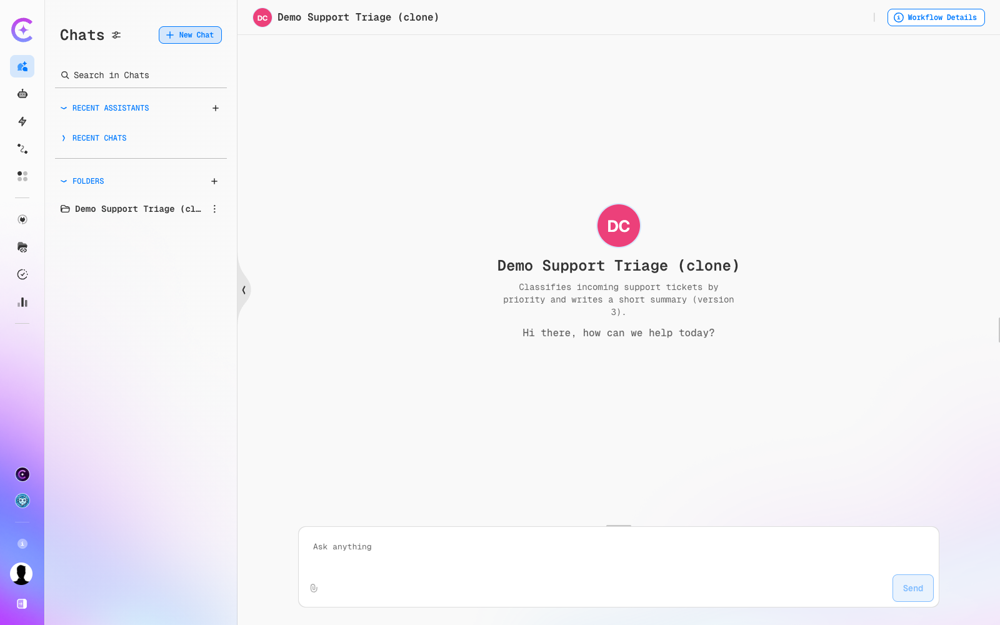

2. Enter the prompt in the chat interface and send it

3. The workflow executes with your message as the initial input

4. Monitor progress and view results in the chat. The response shows the executed states and the workflow result. The highlighted **Open execution page** icon in the message action bar below the response opens the execution page (see the next section).

   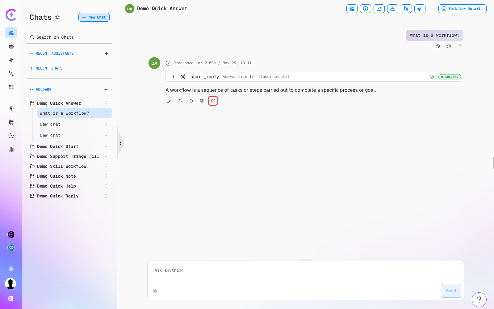

### Opening the Execution Page from Chat

Each workflow response message in chat mode includes an **Open execution page** icon in the message action bar. Click it to open the full workflow execution page for that specific message in a new tab — where you can review execution steps, states, and detailed output.

### Attaching a File in Chat Mode

A file can be attached to a message in chat mode. When the message starts an execution, only the first attached file is passed to the workflow. To pass several files to one execution, attach them in the **New Workflow Execution** window (see [Starting Workflow in Execution Mode](#starting-workflow-in-execution-mode)).

**To attach a file:**

1. In the chat input area, attach a file using either method:
   - Click the **paperclip** icon in the input toolbar to open a file picker
   - Drag and drop the file into the chat window
2. The uploaded file appears as a chip with the file name and type and the options to download or remove it.
3. Send your message to start the workflow execution.

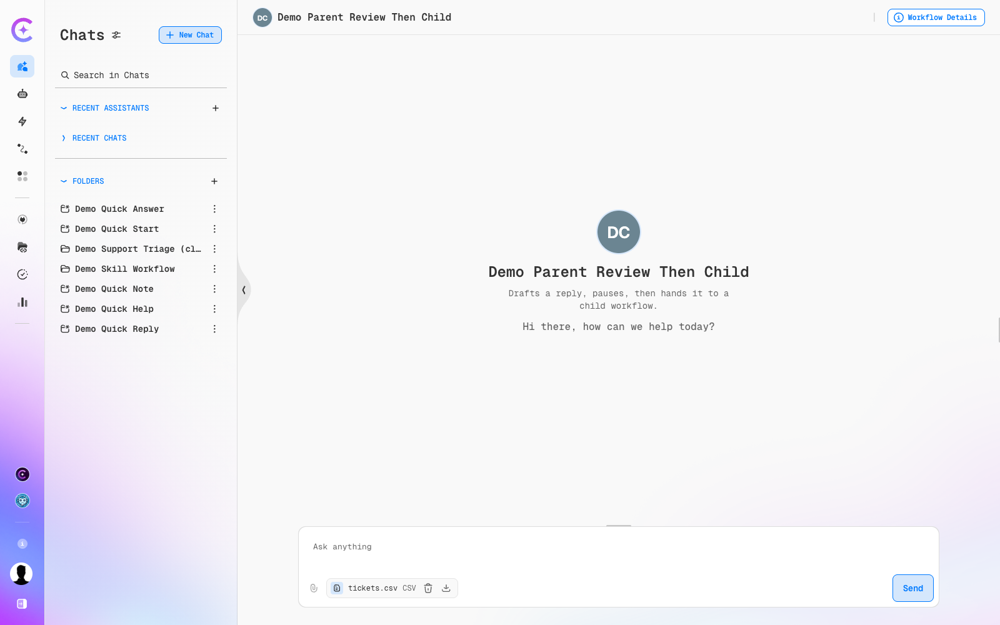

### Chat History

Workflow chat history works the same way as with regular assistants. Workflow conversations are reviewed in **Chats**. The sidebar lists **Recent Assistants**, **Recent Chats** and **Folders**.

## Starting Workflow in Execution Mode

The standard way to launch a workflow with a dedicated execution interface.

1. Click the **Start Execution** button on the workflow card (or **Run workflow** on the Workflow Details page):

   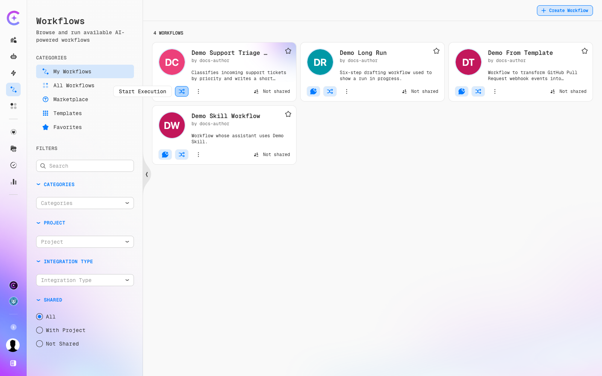

2. Enter the prompt in the **New Workflow Execution** window. The paperclip icon in the prompt field attaches files:

   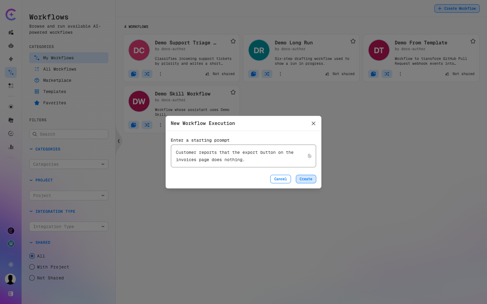

   The prompt input field may display a hint set by the workflow creator to guide what input is expected.

3. Click **Create** to initiate the execution. **Cancel** closes the window without starting a run.

### Attaching Files

In the **New Workflow Execution** window, several files can be attached to one execution. After the execution completes, open it in **Workflow Execution History**. The input of a state contains one `File attached:` line per file that was passed to the execution. The screenshot shows a run started with two files:

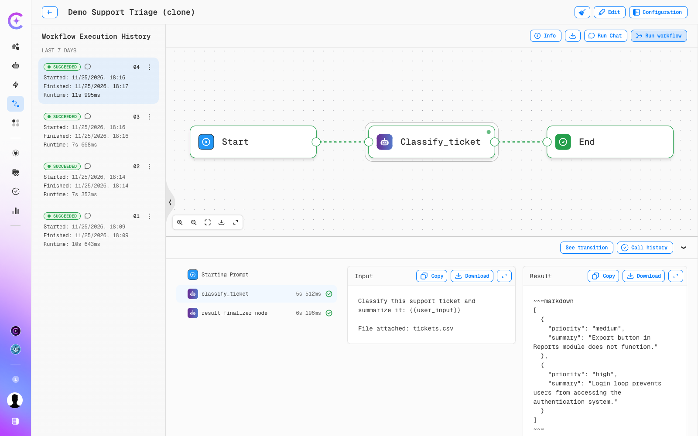

**Supported file types and limits:**

| Parameter     | Value                                                                        |
| ------------- | ---------------------------------------------------------------------------- |
| Max files     | 20 per execution                                                             |
| Max file size | 100 MB per file                                                              |
| File formats  | PPTX, DOCX, XLSX, XLSB, PDF, CSV, JPEG, PNG, JPG, GIF (others as plain text) |

**How files are available in workflow steps:**

Each file passed to the execution is appended to the task description of assistant states:

```text
File attached: filename.ext
```

The full list of file names is also accessible via the `{{file_names}}` context variable in YAML task templates or tool arguments.

### Monitoring Execution

After an execution starts, the Workflow Details page opens with the new execution selected:

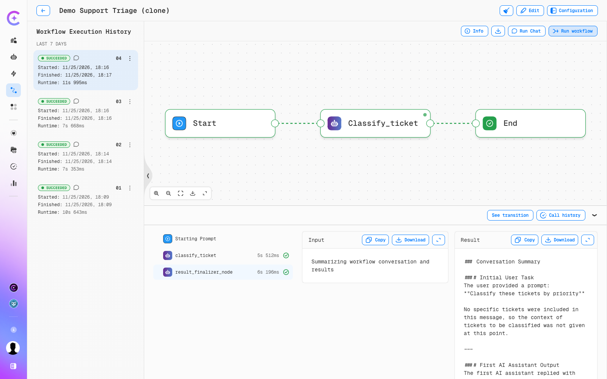

### Execution Controls

During execution, you can:

- **View Progress**: Monitor the execution status in the **Workflow Execution History** panel and the status of each node in the node list under the graph
- **Run workflow**: Start a new execution of the workflow
- **Abort**: Stop a running execution

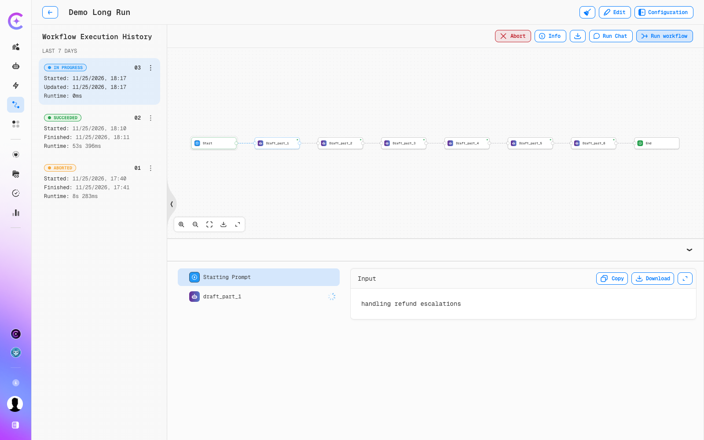

:::info
The header **Abort** button is only available while the workflow is actively executing. An aborted execution gets the **Aborted** status.

When an execution is **Interrupted**, select the interrupted node: its header shows **Abort**, **Edit** and **Continue**. Use them to stop the execution, edit the node output, or continue the run.
:::

### Execution History

All workflow executions are saved in the execution history. Switch between past executions by clicking on them in the **Workflow Execution History** panel. Each entry shows the execution number, status, start and finish time and runtime:

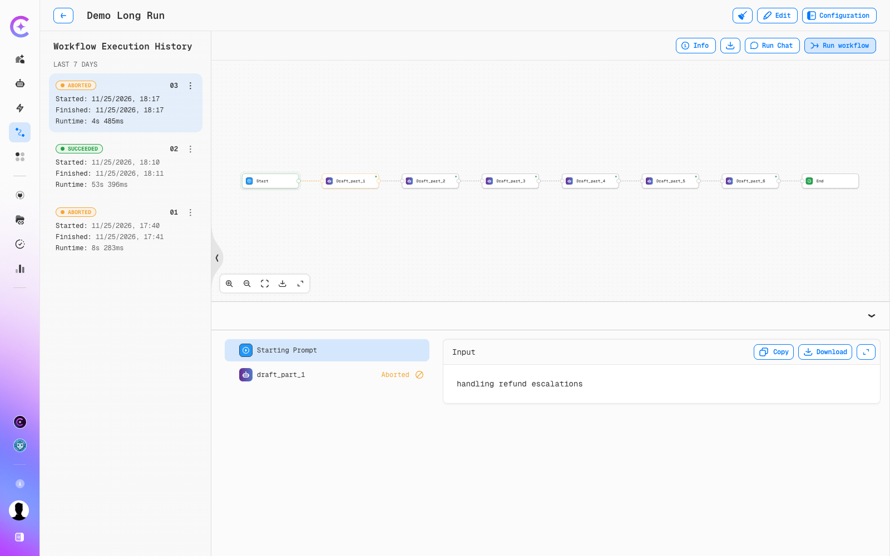

## Marking Workflows as Favorites

Any workflow can be marked as a favorite for quick access. Click the star icon (**Add to favorites**) on a workflow card to save it. All favorite workflows are listed under **Favorites** in the workflow categories on the left. To remove a workflow from favorites, click the filled star and confirm with **Remove**.

See [Favorites](../assistants/favorites.md) for full details.

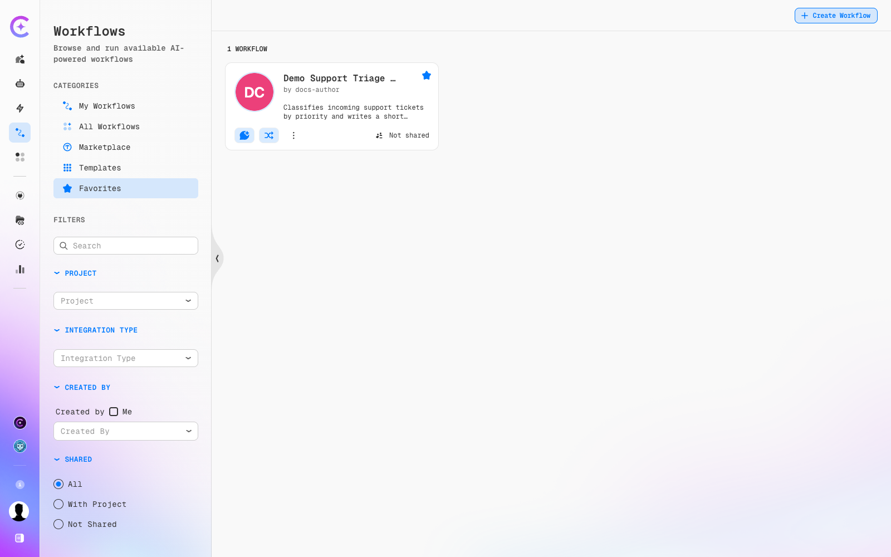

## Node Call History

Each node in a workflow execution records the individual LLM and tool calls it made. To view them, open an execution, select the node in the node list at the bottom of the execution page, below the workflow graph, and click **Call history**. The popup lists every call with its status, input, and result, and provides **Download** and **Copy to clipboard** actions to export the calls as JSON.

See [Exporting Node Call History](./exporting-node-call-history.md) for the full steps and the exported JSON structure.
